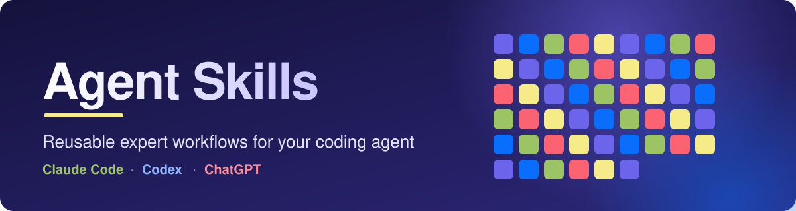

<p align="center">
  
</p>

<p align="center">
  
  
  
  
</p>

Step-by-step expert workflows your coding agent can follow, packaged as
[Agent Skills](https://agentskills.io/specification). Write them once, use them in Claude Code
and Codex. System Design also ships zips for ChatGPT.

## Collections

| Collection | What it covers | Skills |
|---|---|---|
| [**System Design Skills**](system-design-skills/) | Design, scale, secure, operate and review software systems: capacity, databases, consistency, caching, messaging, storage, reliability, observability, payments, geospatial, architecture review | 17 |
| [**Egyptology Skills**](egyptology-skills/) | Read and check Middle Egyptian hieroglyphic text: sign lookup by Gardiner code, transliteration, annotated layouts, tool building, accuracy review. Output is a draft for specialists | 5 |

More collections can sit beside it. Each one is a self-contained folder.

## Which one is for my tool?

| I use | System Design Skills | Egyptology Skills |
|---|---|---|
| **Claude Code** | [guide](system-design-skills/claude/README.md) | [guide](egyptology-skills/claude/README.md) |
| **OpenAI Codex** | [guide](system-design-skills/openai/README.md#codex) | [guide](egyptology-skills/openai/README.md#codex) |
| **ChatGPT** | [17 zips](system-design-skills/openai/chatgpt/) | Not built yet |

Claude Code and Codex read the same `skills/` folder in each collection. ChatGPT takes zips, so it
has its own folder where one exists. Each collection has the same layout: `skills/`, `claude/`,
`openai/` and `prompts/`.

## Install

Clone once, then run the installer from the collection you want.

```bash
git clone https://github.com/allamiro/tamir-agent-skills.git
cd tamir-agent-skills/system-design-skills        # or: cd tamir-agent-skills/egyptology-skills
bash scripts/install.sh --claude --project /path/to/your/project   # Claude Code
bash scripts/install.sh --codex --project /path/to/your/project    # OpenAI Codex
```

For ChatGPT, upload a ready-made zip from
[`system-design-skills/openai/chatgpt/`](system-design-skills/openai/chatgpt/). Start with
`system-design.zip`.

Then ask in plain language:

> Design the backend for a marketplace with flash sales and card payments.
>
> Review this architecture and give me findings with evidence and severity.

Every skill has ready-to-paste prompts:
[System Design](system-design-skills/prompts/README.md) and
[Egyptology](egyptology-skills/prompts/README.md), where each skill has its own file.

## What you get

- **Workflows.** Each skill says when to use it, what it needs, the steps, how to choose between
  options, what can fail, and what to hand back.
- **Honest sources.** Every skill ends with a sources block that separates what was verified,
  what was fetched from official docs (dated), and what still needs checking.
- **Checked.** Validators cover the spec, structure, size, links, templates, scripts and
  description routing. The collection README lists what has and has not been run.

## Contribute

New skills, new collections and fixes are welcome. Start with [CONTRIBUTING.md](CONTRIBUTING.md).

## License

[Apache-2.0](LICENSE)
