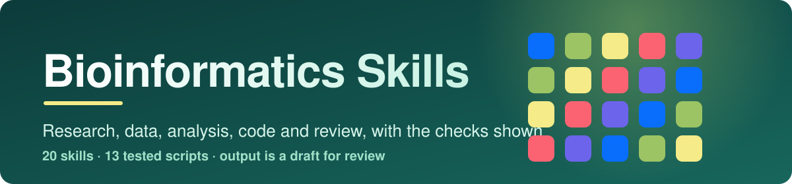

<p align="center">
  
</p>

<p align="center">
  
  
  
  
</p>

Twenty-three skills for the whole of a bioinformatics project, not only the code: planning and study
design, literature search and appraisal, benchmarking methods, research proposals, finding and citing data, privacy and ethics, file formats, sequencing pipelines, alignment,
genes and proteins, trees, variants, omics tables, statistics, machine learning, programming,
reproducibility, writing up, review, and learning the field. They treat bioinformatics as information
science applied to biology, so every skill asks what chance would give before it reports a pattern.
Every output is a draft for someone who knows the data; the skills show where the doubt is instead of
hiding it.

## Which one is for my tool?

| I use | Read | Install | Status |
|---|---|---|---|
| **Claude Code** | [`claude/`](claude/README.md) | `bash scripts/install.sh --claude --project DIR` | Works |
| **OpenAI Codex** | [`openai/`](openai/README.md#codex) | `bash scripts/install.sh --codex --project DIR` | Works |
| **ChatGPT desktop app** | [`openai/`](openai/README.md#chatgpt) | [23 zips](openai/chatgpt/) | Zips built; how the app takes them is not confirmed |
| **OpenAI Skills API** | [`openai/`](openai/README.md#openai-skills-api) | [23 zips](openai/chatgpt/) | Zips built to the documented format and limits |

Claude Code and Codex read the same files from [`skills/`](skills/). Nothing is copied per platform,
so there is one place to fix a skill. The zips are built from `skills/` and checked for being current.

## What is in this folder

```text
bioinformatics-skills/
├── skills/     the 23 skills (SKILL.md plus references, scripts and templates)
├── claude/     Claude Code: install and use
├── openai/     OpenAI: Codex, ChatGPT and the Skills API, with chatgpt/ holding one zip per skill
├── prompts/    ready-to-paste prompts, one file per skill
├── scripts/    install.sh, build_chatgpt.py, validate_collection.py, check_routing.py, check_answers.py
├── evals/      test cases and measured results
├── examples/   a real answer per skill, with token counts
└── assets/     banner
```

## Skills

### Plan and research context

| Skill | Use it for | Prompts |
|---|---|---|
| [`bioinformatics-workflow`](skills/bioinformatics-workflow/) | The coordinator: a claim the data could refute, the null model, data provenance, controls, and which skill does each step | [5](prompts/bioinformatics-workflow.md) |
| [`experimental-design`](skills/experimental-design/) | Replicates, controls, batch layout, sample size and power before data are collected | [6](prompts/experimental-design.md) |
| [`biological-databases`](skills/biological-databases/) | Identifiers, versions and builds, ID mapping, annotation reliability, citing and depositing data | [6](prompts/biological-databases.md) |
| [`data-governance-ethics`](skills/data-governance-ethics/) | Consent, privacy, controlled access, sharing, and care with online tools (guidance, not legal advice) | [6](prompts/data-governance-ethics.md) |
| [`research-writing-reporting`](skills/research-writing-reporting/) | Methods sections, claim wording, figures, availability statements, reviewer replies | [6](prompts/research-writing-reporting.md) |
| [`bioinformatics-learning-path`](skills/bioinformatics-learning-path/) | A study plan for your background, exercises with checkable answers, projects | [5](prompts/bioinformatics-learning-path.md) |

### Academic and research skills

| Skill | Use it for | Prompts |
|---|---|---|
| [`literature-search-appraisal`](skills/literature-search-appraisal/) | A documented search, citation chasing, appraising a method paper, retraction checks, and a citation checker for invented references | [6](prompts/literature-search-appraisal.md) |
| [`method-benchmarking`](skills/method-benchmarking/) | Designing and auditing tool comparisons: fair tuning, leakage, failures, detectable differences, chance gaps, paired tests across datasets | [6](prompts/method-benchmarking.md) |
| [`research-proposal-planning`](skills/research-proposal-planning/) | Question to aims, data management plan check, schedule with critical path, risks, roles and credit | [6](prompts/research-proposal-planning.md) |

### Sequences and genomes

| Skill | Use it for | Prompts |
|---|---|---|
| [`sequence-formats`](skills/sequence-formats/) | FASTA, FASTQ, GFF3, BED and SAM, Phred qualities, and 0-based versus 1-based coordinates | [6](prompts/sequence-formats.md) |
| [`ngs-pipelines`](skills/ngs-pipelines/) | Reads to alignments, variants or counts; SAM flags, CIGAR strings, coverage and depth | [6](prompts/ngs-pipelines.md) |
| [`sequence-alignment`](skills/sequence-alignment/) | Global and local alignment, scoring choices, a shuffle test for the score | [6](prompts/sequence-alignment.md) |
| [`gene-finding-translation`](skills/gene-finding-translation/) | Reverse complement, GC, k-mers, translation, open reading frames and their chance level | [6](prompts/gene-finding-translation.md) |
| [`protein-analysis`](skills/protein-analysis/) | Protein mass, composition, hydropathy, structure and function evidence | [6](prompts/protein-analysis.md) |
| [`phylogenetics`](skills/phylogenetics/) | Distances, UPGMA and neighbour-joining trees, Newick, rooting and support | [6](prompts/phylogenetics.md) |
| [`variants-population-genetics`](skills/variants-population-genetics/) | VCF files, allele frequencies, Hardy-Weinberg, linkage, association caveats | [6](prompts/variants-population-genetics.md) |

### Omics, statistics and models

| Skill | Use it for | Prompts |
|---|---|---|
| [`omics-data-analysis`](skills/omics-data-analysis/) | Design checks, batch effects, clustering, PCA, enrichment and networks for omics tables | [6](prompts/omics-data-analysis.md) |
| [`information-theory-sequences`](skills/information-theory-sequences/) | Entropy, diversity numbers, motif information, mutual information, compression distance | [6](prompts/information-theory-sequences.md) |
| [`sequence-statistics`](skills/sequence-statistics/) | Counting, binomial and hypergeometric tails, expected word counts, Markov chains, multiple testing | [6](prompts/sequence-statistics.md) |
| [`machine-learning-biology`](skills/machine-learning-biology/) | Leakage-safe splits, metrics for imbalanced data, near-duplicate checks, model cards | [6](prompts/machine-learning-biology.md) |

### Code, reproducibility and review

| Skill | Use it for | Prompts |
|---|---|---|
| [`bioinformatics-programming`](skills/bioinformatics-programming/) | Large files, packed sequences, log-space arithmetic, linear windows, common bugs | [6](prompts/bioinformatics-programming.md) |
| [`reproducible-research-code`](skills/reproducible-research-code/) | Data records, pinned environments, seeds, tests that can fail, sensitive data | [6](prompts/reproducible-research-code.md) |
| [`bioinformatics-review`](skills/bioinformatics-review/) | Audit of an analysis or claim: sources, null models, leakage, batch, ranked findings | [6](prompts/bioinformatics-review.md) |

## How researchers would use them

- Turn a loose question into a plan with a null model, controls and a sample size before running anything.
- Identify and pin the exact records, builds and releases an analysis used, and cite them.
- Check a list of p-values, a motif count or an alignment score against what chance gives.
- Read a FASTQ, GFF3, BED or VCF file without the off-by-one error that quietly shifts every feature.
- Translate and find open reading frames, and see how often chance alone gives one that long.
- Decode a SAM flag or a CIGAR string, and work out how much sequencing is enough.
- Evaluate a classifier without leakage, and write up the result at the strength the evidence supports.
- Learn the field from your own starting point, with exercises you can check by running something.

## Install

Run from this folder. Install all 23 skills together: the coordinator hands work to the others.

```bash
bash scripts/install.sh --claude --project /path/to/your/repo   # Claude Code
bash scripts/install.sh --codex --project /path/to/your/repo    # OpenAI Codex
```

Add `--user` to install for every project on the machine, `--symlink` to link instead of copy,
`--force` to replace, or `--dry-run` to preview. Details: [`claude/`](claude/README.md) and
[`openai/`](openai/README.md).

## Scripts you can run

Each needs only Python 3.9 or later and has a `--selftest` with hand-computed values.

| Script | Skill | What it does |
|---|---|---|
| `seqinfo.py` | `information-theory-sequences` | Entropy, diversity numbers, mutual information, compression distance |
| `seqstats.py` | `sequence-statistics` | Sampling counts, binomial and hypergeometric tails, expected counts, p-value adjustment |
| `align.py` | `sequence-alignment` | Global and local alignment, shuffle significance |
| `seqformats.py` | `sequence-formats` | FASTA, FASTQ and GFF3 checks, coordinate conversion |
| `genecode.py` | `gene-finding-translation` | Reverse complement, translation, ORFs, chance level of open frames |
| `tree.py` | `phylogenetics` | Distances, UPGMA, neighbour-joining, Newick |
| `design.py` | `experimental-design` | Sample size, power, batch layout, confounding check |
| `accessions.py` | `biological-databases` | Identifier formats, versions, ambiguity |
| `ngs.py` | `ngs-pipelines` | SAM flags, CIGAR arithmetic, coverage |
| `popgen.py` | `variants-population-genetics` | Hardy-Weinberg, linkage, VCF summary |
| `protein.py` | `protein-analysis` | Composition, mass, hydropathy |
| `mlmetrics.py` | `machine-learning-biology` | Metrics, group folds, near-duplicates |
| `bioprog.py` | `bioinformatics-programming` | Two-bit packing, canonical k-mers, log-sum-exp, streaming |

## Try it

Pick a skill's prompt file from [`prompts/`](prompts/README.md). Or run a script directly:

```bash
python3 skills/gene-finding-translation/scripts/genecode.py orfs CATGAAATAGCCCC --min-aa 2
python3 skills/sequence-alignment/scripts/align.py global GCATGCG GATTACA
python3 skills/experimental-design/scripts/design.py n --d 0.5
python3 skills/ngs-pipelines/scripts/ngs.py flags 99
python3 skills/protein-analysis/scripts/protein.py mass DRVYIHPF --mono
python3 skills/machine-learning-biology/scripts/mlmetrics.py auc 0,0,1,1 0.1,0.4,0.35,0.8
```

<!-- samples:start -->

## Sample outputs and token cost

Every skill has one real answer in [`examples/`](examples/), with the prompt that produced it. The table has the numbers behind those answers: means over 3 runs with the skills installed and 3 without (Claude Code 2.1.296, model claude-opus-5-5). **Output tokens** is what the model wrote, including its reasoning. **Extra input tokens** is how many more tokens the model read across all turns when the skills were installed (the skill text it loaded, reference files, script output and extra turns); the large base context is the same in both arms and is left out. **Skill size** is Claude Code's own projected cost from `claude plugin details`: the first figure is in every session for every installed skill (its name and description), the second only when the skill is used. When the skill was not invoked in a run, the extra is only the descriptions of the installed skills, so the smallest figure in the table is the cost of having the collection installed. More tokens is not a defect by itself; what the tokens buy is in [`evals/`](evals/).

| Skill | Output tokens, no skill to skill | Extra input tokens | Cost, no skill to skill (US dollars) | Skill size, always / when used | Sample |
|---|---|---|---|---|---|
| `bioinformatics-learning-path` | 3,493 to 3,931 | +69,973 | 0.13 to 0.22 | ~210 / ~1,800 | [answer](examples/bioinformatics-learning-path.md) |
| `bioinformatics-programming` | 1,440 to 2,445 | +94,792 | 0.09 to 0.19 | ~230 / ~2,000 | [answer](examples/bioinformatics-programming.md) |
| `bioinformatics-review` | 3,399 to 3,624 | +25,740 | 0.14 to 0.21 | ~250 / ~1,800 | [answer](examples/bioinformatics-review.md) |
| `bioinformatics-workflow` | 2,572 to 3,669 | +83,073 | 0.11 to 0.22 | ~270 / ~2,400 | [answer](examples/bioinformatics-workflow.md) |
| `biological-databases` | 1,056 to 1,469 | +81,378 | 0.08 to 0.17 | ~240 / ~1,900 | [answer](examples/biological-databases.md) |
| `data-governance-ethics` | 1,653 to 1,210 | +43,055 | 0.09 to 0.15 | ~270 / ~2,000 | [answer](examples/data-governance-ethics.md) |
| `experimental-design` | 2,113 to 2,149 | +78,818 | 0.12 to 0.19 | ~190 / ~2,000 | [answer](examples/experimental-design.md) |
| `gene-finding-translation` | 196 to 401 | +5,288 | 0.06 to 0.11 | ~230 / ~2,200 | [answer](examples/gene-finding-translation.md) |
| `information-theory-sequences` | 2,299 to 1,744 | +56,518 | 0.11 to 0.16 | ~230 / ~2,000 | [answer](examples/information-theory-sequences.md) |
| `literature-search-appraisal` | 1,581 to 2,553 | +74,506 | 0.11 to 0.22 | ~290 / ~2,500 | [answer](examples/literature-search-appraisal.md) |
| `machine-learning-biology` | 891 to 1,032 | +5,287 | 0.08 to 0.12 | ~230 / ~1,900 | [answer](examples/machine-learning-biology.md) |
| `method-benchmarking` | 2,109 to 2,326 | +84,408 | 0.10 to 0.19 | ~270 / ~2,600 | [answer](examples/method-benchmarking.md) |
| `ngs-pipelines` | 817 to 1,009 | +5,287 | 0.08 to 0.12 | ~240 / ~2,000 | [answer](examples/ngs-pipelines.md) |
| `omics-data-analysis` | 5,930 to 6,241 | -10,360 | 0.25 to 0.32 | ~260 / ~2,200 | [answer](examples/omics-data-analysis.md) |
| `phylogenetics` | 917 to 1,094 | +5,290 | 0.08 to 0.12 | ~210 / ~1,900 | [answer](examples/phylogenetics.md) |
| `protein-analysis` | 817 to 1,057 | +5,290 | 0.08 to 0.12 | ~220 / ~2,000 | [answer](examples/protein-analysis.md) |
| `reproducible-research-code` | 10,376 to 12,519 | +242,295 | 0.40 to 0.58 | ~230 / ~1,900 | [answer](examples/reproducible-research-code.md) |
| `research-proposal-planning` | 708 to 921 | +5,288 | 0.07 to 0.12 | ~290 / ~2,300 | [answer](examples/research-proposal-planning.md) |
| `research-writing-reporting` | 1,059 to 2,030 | +69,194 | 0.08 to 0.18 | ~250 / ~1,900 | [answer](examples/research-writing-reporting.md) |
| `sequence-alignment` | 1,747 to 1,667 | +24,046 | 0.11 to 0.16 | ~210 / ~1,900 | [answer](examples/sequence-alignment.md) |
| `sequence-formats` | 1,480 to 1,500 | +5,291 | 0.09 to 0.13 | ~210 / ~2,100 | [answer](examples/sequence-formats.md) |
| `sequence-statistics` | 366 to 466 | +5,284 | 0.07 to 0.11 | ~240 / ~2,000 | [answer](examples/sequence-statistics.md) |
| `variants-population-genetics` | 968 to 1,467 | +18,062 | 0.08 to 0.14 | ~230 / ~2,000 | [answer](examples/variants-population-genetics.md) |

### One answer in full: `method-benchmarking`

Prompt:

> A new variant caller scores 0.83 accuracy against 0.81 for the established one on my 200-item test set. Is that a real improvement? Tell me what the test could detect at all and what I would need.

Answer with the skill (excerpt of a single run; the same prompt without the skill is on the [sample page](examples/method-benchmarking.md)):

````text
**No. This test can't show it.** On 200 items, 0.83 vs 0.81 means the new caller got 4 more items right (166 vs 162). That gap is well within what chance produces.

## What a 200-item test can detect

- **Smallest detectable difference:** about **11 points** (0.81 vs about 0.92), at 80% power and α = 0.05. Your gap is 2 points, about a fifth of that.
- **Paired test (McNemar):** both callers ran on the same items, so the right test uses only the items where they disagree. Even in the best case, where the new caller wins all 4 disagreements and loses none, p = 0.125. More realistic splits are much weaker: 10 wins vs 6 losses gives p = 0.45, and 20 vs 16 gives p = 0.62. Count your actual disagreements and run `benchstats.py mcnemar --b <old right, new wrong> --c <old wrong, new right>`.
- **Chance alone:** if two equally good callers are scored on 200 items, the better-looking one is ahead by about 1.6 points on average. Your 2-point lead is about that size.

## Test size needed to detect a 2-point gain

| Test items | Smallest detectable gap (unpaired) |
|---|---|
| 200 | 0.110 |
| 1,000 | 0.049 |
| 2,000 | 0.035 |
| ~6,000 | 0.020 |

A paired design needs fewer items. How many depends on how often the callers disagree: if they disagree on about 10% of items, roughly 2,000 items would detect a 2-point gain. Two cheap ways to get that many: score every truth-set variant site, not a 200-item sample, and use the GIAB benchmark regions.

## Beyond test size

1. **Use better metrics than accuracy.** For variant calling, report precision, recall and F1 separately for SNVs and indels (e.g. hap.py/vcfeval against GIAB truth sets). A caller can gain accuracy by trading recall for precision, and that trade may not suit your use.
2. **Test on several samples, not one.** Use more than one sample (e.g. several GIAB genomes), and if possible more than one sequencing platform or coverage depth. Treat each sample as one unit and report the paired difference with a confidence interval across samples. Many sites from one genome are not independent evidence.
3. **Break results down by region type.** Look at easy regions, homopolymers, segmental duplications and low-mappability regions separately. A real gain is often concentrated in one of these, or one caller collapses in one.
4. **Tune both callers the same way.** Give them the same filtering effort and thresholds, set on data kept apart from the test set. Pin versions and use the same compute limits.
5. **Count failures.** Sites the caller crashed on or didn't call count as errors, not as missing values.

[... excerpt ends; the full answer is longer]
````

<!-- samples:end -->

## Check it

```bash
python3 scripts/validate_collection.py          # structure, links, prompts, script self-tests, bundles current, evaluation cases
python3 scripts/check_answers.py                # exercises and good-answer lines against the scripts
python3 scripts/check_routing.py                # description routing for the starter prompts
python3 scripts/build_chatgpt.py --fresh        # zips are valid and match the skills
skills-ref validate skills/<name>               # official Agent Skills validator
claude plugin validate skills                   # Claude Code's own check of the skill files
python3 ../tools/run_evals.py plan .            # evaluation cases; live runs spend API credit, see TESTING.md
```

Last run, 2026-10-14: the collection validator reports 0 errors on Python 3.9 and 3.14 (23 skills, 17
scripts), including the navigation, prompt, bundle and evaluation-case checks; the script self-tests pass; a
mutation run that breaks the scripts in 125 places (89 in the original 13 scripts, 36 in `benchstats.py`,
`dmpcheck.py`, `schedule.py` and `citecheck.py`) is caught every time, and `benchstats.py` also agrees with SciPy on 901
random comparisons (one McNemar mutant is equivalent to the original by symmetry and was left out); `skills-ref`
accepts all 23 skills and all 23 zips; `claude plugin validate` accepts the skills; markdownlint reports 0
issues; 79 answer checks pass; and all 23 starter prompts route to their own skill. Routing is a word-match
check, not a model of how an agent picks a skill.

### Measured results

How an agent actually behaves with these skills, measured by [`tools/run_evals.py`](../tools/run_evals.py). Method,
limits and the commands are in [TESTING.md](../TESTING.md); the full tables are in [`evals/results/`](evals/results/).

<!-- results:start -->

#### Outcome runs: starter prompts with and without the skills

Share of runs passing each check, with Wilson 95% intervals; the last column is the difference in percentage points with a Newcombe interval. Rubric and limits are judged by a model.

| Collection | Skills | Runs per arm | Facts: skills / none | Rubric: skills / none | Rubric difference | Limits: skills / none | Expected skill invoked |
|---|---|---|---|---|---|---|---|
| bioinformatics-skills | 23 | 69 / 69 | 97% (90-99) / 90% (81-95) | 97% (90-99) / 86% (75-92) | +12 (+2 to +22) | 28% (18-39) / 22% (14-33) | 57% (45-68) |

Leaving out the starter prompts that ask for the skill's own table, checker or template:

| Collection | Skills kept | Facts: skills / none | Rubric: skills / none | Rubric difference |
|---|---|---|---|---|
| bioinformatics-skills | 22 | 97% (90-99) / 92% (83-97) | 97% (90-99) / 89% (80-95) | +8 (-2 to +18) |

#### Tokens and cost per run (means)

| Collection | Output tokens: skills / none | Input tokens read: skills / none | Cost, US dollars: skills / none | Runs with a denied tool call: skills / none |
|---|---|---|---|---|
| bioinformatics-skills | 2,458 / 2,086 | 101,518 / 54,658 | 0.185 / 0.113 | 0 / 0 |

#### Trigger runs: does the agent pick the right skill

| Collection | Should-trigger runs hit (recall) | Near-miss runs correctly left alone (specificity) | Precision | Unrelated prompts that triggered a skill |
|---|---|---|---|---|
| bioinformatics-skills | 80% (69-88) | 100% (95-100) | 100% (93-100) | 0 of 6 |

#### Model-judged pairwise comparison (both orders)

| Collection | Skill preferred | Baseline preferred | Tie | Inconsistent across orders | Share preferring the skill, decisive pairs only |
|---|---|---|---|---|---|
| bioinformatics-skills | 15 | 3 | 3 | 2 | 83% (61-94) |

#### Codex smoke test (one run per prompt and arm, facts only)

| Collection | Every expected fact: skills / none | Expected skill used | Any skill used |
|---|---|---|---|
| bioinformatics-skills | 21 of 23 / 21 of 23 | 23 of 23 | 23 of 23 |

Judge self-agreement with a single vote, bioinformatics-skills: Rubric, 23 of 24, 0.00; States its limits, 23 of 24, 0.90. Verdicts in the tables are the majority of 3 judge votes; the second and third votes changed 5 of 276 verdicts.

Human grading: the blind kit is built (`run_evals.py sheet`) but no person has graded any answers yet, so none of the judged results above has been checked against human preference.

<!-- results:end -->

Read these with care. Each starter prompt was run three times with the skills and three times without, on one model on one
day, and the prompts were written alongside the skills. On most of these prompts a strong model already knows the key facts,
so the facts check barely separates the two arms; the skills are picked up far less often on self-contained calculations
(translation, alignment, protein mass), where the model works the answer out itself, than on planning and judgement prompts.
The rubric and limits checks are a model's judgement (see `evals/results/judge-check.md`). No bioinformatician has graded
any answer. The blind kit for that is built (`python3 ../tools/run_evals.py sheet .`), and until people use it, the judged
results here are not checked against human preference.

## Contribute

See [CONTRIBUTING.md](../CONTRIBUTING.md). Add a script only with a self-test that uses hand-computed
values or an independent cross-check, and check that the test can fail.

## License

Apache-2.0

## Citation

Ramsden, Jeremy J. 2009. *Bioinformatics: An Introduction*. 2nd ed. Computational Biology Series.
London: Springer. DOI 10.1007/978-1-84800-257-9.
