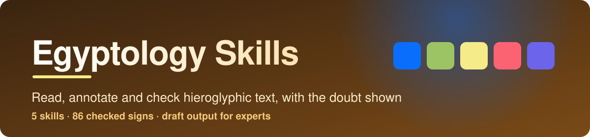

<p align="center">
  
</p>

<p align="center">
  
  
  
  
</p>

Eight skills that help a coding agent work with Middle Egyptian hieroglyphs: look up signs,
transliterate, lay out annotated texts, build tools, and audit the result, plus three for academic
and research work: finding and citing scholarship, editorial conventions, and provenance and ethics.
They are made for researchers, students and digital-humanities teams. Every output is a draft for someone who
reads the language; the skills show where the doubt is instead of hiding it.

## Which one is for my tool?

| I use | Read | Install | Status |
|---|---|---|---|
| **Claude Code** | [`claude/`](claude/README.md) | `bash scripts/install.sh --claude --project DIR` | Works |
| **OpenAI Codex** | [`openai/`](openai/README.md#codex) | `bash scripts/install.sh --codex --project DIR` | Works |
| **ChatGPT desktop app** | [`openai/`](openai/README.md#chatgpt) | [8 zips](openai/chatgpt/) | Zips built; how the app takes them is not confirmed |
| **OpenAI Skills API** | [`openai/`](openai/README.md#openai-skills-api) | [8 zips](openai/chatgpt/) | Zips built to the documented format and limits |

Claude Code and Codex read the same files from [`skills/`](skills/). Nothing is copied per
platform, so there is one place to fix a skill.

## What is in this folder

```text
egyptology-skills/
├── skills/     the 8 skills (SKILL.md plus references, scripts and templates)
├── claude/     Claude Code: install and use
├── openai/     OpenAI: Codex, ChatGPT and the Skills API, with chatgpt/ holding one zip per skill
├── prompts/    ready-to-paste prompts, one file per skill
├── scripts/    install.sh, build_chatgpt.py, validate_collection.py and check_answers.py
├── evals/      test cases and measured results
├── examples/   a real answer per skill, with token counts
└── assets/     banner
```

## Skills

| Skill | Use it for | Prompts |
|---|---|---|
| [`gardiner-sign-lookup`](skills/gardiner-sign-lookup/) | A sign by Gardiner code, Unicode character, MdC string or sound: section, code point, role, sourced reading | [6](prompts/gardiner-sign-lookup.md) |
| [`transliteration`](skills/transliteration/) | Reading a sign sequence: uniliteral, biliteral and triliteral signs, complements, determinatives, every ambiguity flagged | [6](prompts/transliteration.md) |
| [`text-annotation`](skills/text-annotation/) | Line-by-line layout: signs, transliteration, gloss, translation, a confidence grade per word | [5](prompts/text-annotation.md) |
| [`hieroglyph-app-builder`](skills/hieroglyph-app-builder/) | Data model, Unicode and fonts, joiners, direction, search by code or sound, MdC import and export | [5](prompts/hieroglyph-app-builder.md) |
| [`accuracy-review`](skills/accuracy-review/) | Audit of a reading or a sign table: sources, consistency, smoothing, calibration | [6](prompts/accuracy-review.md) |
| [`egyptology-literature`](skills/egyptology-literature/) | Finding, reading and citing scholarship: reference tools, editions against translations, and a citation checker for invented references | [6](prompts/egyptology-literature.md) |
| [`edition-conventions`](skills/edition-conventions/) | Editorial marks for lacunae, restorations and emendations with a declared key, notes, witnesses, dating, and the 2023 Leiden transliteration standard | [6](prompts/edition-conventions.md) |
| [`provenance-research-ethics`](skills/provenance-research-ethics/) | Object histories as evidence-backed records, gaps for a specialist, permissions, images and disclosure of AI help | [6](prompts/provenance-research-ethics.md) |

## How researchers would use them

- Look up a sign, its Unicode character and its readings in one step.
- Get a first-pass transliteration with the doubtful signs marked and the alternatives listed.
- Produce an annotated text, then correct it instead of typing it all.
- Check a published or draft transliteration against sign values and find the claims with no source.
- Prepare a consistent corpus, or build a small search tool over signs and sounds.
- Find where a monument is published, check a reference list for invented citations, and mark restorations with a declared key.
- Record an object's history, see the gaps, and say only what the record supports.

## Install

Run from this folder. Install all eight skills together: they refer to each other.

```bash
bash scripts/install.sh --claude --project /path/to/your/repo   # Claude Code
bash scripts/install.sh --codex --project /path/to/your/repo    # OpenAI Codex
```

Add `--user` to install for every project on the machine, `--symlink` to link instead of copy,
`--force` to replace, or `--dry-run` to preview. Details: [`claude/`](claude/README.md) and
[`openai/`](openai/README.md).

## Try it

Pick a skill's prompt file from [`prompts/`](prompts/README.md). Or run the lookup script directly:

```bash
python3 skills/gardiner-sign-lookup/scripts/signs.py D21
python3 skills/gardiner-sign-lookup/scripts/signs.py --value nfr
python3 skills/gardiner-sign-lookup/scripts/signs.py --mdc "G17-D21:N35"
```

<!-- samples:start -->

## Sample outputs and token cost

Every skill has one real answer in [`examples/`](examples/), with the prompt that produced it. The table has the numbers behind those answers: means over 3 runs with the skills installed and 3 without (Claude Code 2.1.296, model claude-opus-5-5). **Output tokens** is what the model wrote, including its reasoning. **Extra input tokens** is how many more tokens the model read across all turns when the skills were installed (the skill text it loaded, reference files, script output and extra turns); the large base context is the same in both arms and is left out. **Skill size** is Claude Code's own projected cost from `claude plugin details`: the first figure is in every session for every installed skill (its name and description), the second only when the skill is used. When the skill was not invoked in a run, the extra is only the descriptions of the installed skills, so the smallest figure in the table is the cost of having the collection installed. More tokens is not a defect by itself; what the tokens buy is in [`evals/`](evals/).

| Skill | Output tokens, no skill to skill | Extra input tokens | Cost, no skill to skill (US dollars) | Skill size, always / when used | Sample |
|---|---|---|---|---|---|
| `accuracy-review` | 2,562 to 3,548 | +121,305 | 0.11 to 0.21 | ~180 / ~1,400 | [answer](examples/accuracy-review.md) |
| `edition-conventions` | 1,835 to 3,018 | +145,443 | 0.10 to 0.20 | ~270 / ~2,300 | [answer](examples/edition-conventions.md) |
| `egyptology-literature` | 1,333 to 2,056 | +27,937 | 0.12 to 0.18 | ~280 / ~2,300 | [answer](examples/egyptology-literature.md) |
| `gardiner-sign-lookup` | 944 to 684 | +9,454 | 0.09 to 0.12 | ~190 / ~1,700 | [answer](examples/gardiner-sign-lookup.md) |
| `hieroglyph-app-builder` | 7,176 to 5,995 | +90,362 | 0.21 to 0.26 | ~220 / ~1,700 | [answer](examples/hieroglyph-app-builder.md) |
| `provenance-research-ethics` | 3,521 to 3,408 | +51,815 | 0.18 to 0.25 | ~300 / ~2,400 | [answer](examples/provenance-research-ethics.md) |
| `text-annotation` | 998 to 2,094 | +118,312 | 0.08 to 0.17 | ~190 / ~1,500 | [answer](examples/text-annotation.md) |
| `transliteration` | 1,320 to 1,756 | +109,472 | 0.09 to 0.17 | ~210 / ~2,000 | [answer](examples/transliteration.md) |

### One answer in full: `provenance-research-ethics`

Prompt:

> An object was excavated in 1895 with a field register entry, sold in 1921 with a catalogue lot number, and given to a museum in 1982 by the collector's heirs, with only an oral account for that last step. Build the record, run the checker and tell me what can and cannot be said.

Answer with the skill (excerpt of a single run; the same prompt without the skill is on the [sample page](examples/provenance-research-ethics.md)):

````text
I built the record and ran the checker. The checker's own self-test passes (27 checks). The record has **4 flags**, and nothing contradicts itself: there are no out-of-order dates and no undated events.

Record file: `scratchpad/record.json` (excavation 1895 → sale 1921 → gift 1982). You didn't give me names, the site, the museum, the object number or the citations, so those are labelled placeholders. I also had to **assume the excavator was the 1921 seller**, because you didn't say who sold it. Please confirm that.

## Checker flags and what each one means

| Flag | Response |
|---|---|
| **undocumented-event**: the 1982 gift rests on an oral account | It's the weakest step. Ask the museum for its accession register entry, deed of gift or donor correspondence for 1982. Any of these would turn it into a documented step. Until then, write down who gave the oral account and when. |
| **broken-chain**: the collector → the heirs | Nothing records how the object passed from the collector to the heirs: no date of death, will or estate inventory. Probate records or the deed of gift could close this. |
| **gap, 1895–1921 (26 years)** | It's unclear where the object was between excavation and sale. Did it go through a division of finds, an export permit, or stay with the excavator? **No export from Egypt is recorded at all.** |
| **gap, 1921–1982 (61 years)** | The object was with the collector and then the heirs for 61 years, and nothing documents it. Look for exhibitions, publications, insurance lists or letters. |

The checker also noted that the object was documented in 1895, before both 1970 (UNESCO) and 1973 (the Archaeological Institute of America's publication rule). An earlier date only shows when the object was first documented. **It does not show that the object left Egypt lawfully.**

## What can be said

- **Excavated in 1895, recorded in the field register (entry no. __).** You can call this "documented" once someone has seen the entry. If you only know of it from another source, call it **"reported"**.
- **Sold in 1921 as lot __ of [sale catalogue].** The same rule applies: "documented" if the catalogue has been checked, otherwise "reported".
- **The object was documented before 1970 and 1973.** That's relevant to a journal rule that accepts earlier documentation, such as the Archaeological Institute of America's. Confirm the exact policy of your journal.

## What can only be said with qualification

[... excerpt ends; the full answer is longer]
````

<!-- samples:end -->

## Check it

```bash
python3 scripts/validate_collection.py          # structure, links, prompts, sign table, script self-tests, bundles, evaluation cases
python3 scripts/check_answers.py                # the prompts' computable good-answer lines against the scripts
python3 scripts/build_chatgpt.py --fresh        # zips are valid and match the skills
skills-ref validate skills/<name>               # official validator
claude plugin validate skills                   # Claude Code's own check of the skill files
python3 ../tools/run_evals.py plan .            # evaluation cases; live runs spend API credit, see TESTING.md
```

Last run, 2026-10-14: the collection validator reports 0 errors on Python 3.9 and 3.14 (8 skills, 4 scripts, 86
sign-table rows), including the navigation, prompt, bundle and evaluation-case checks; the four scripts pass their
self-tests (`signs.py` 16 checks, `citecheck.py` 26, `sigla.py` 30, `provrecord.py` 27); `skills-ref` accepts all
eight skills; `claude plugin validate` accepts the skills; markdownlint reports 0 issues; and 18 answer checks pass
against the scripts. The bracket checker also agrees with an independent parser on 30,000 random strings, apart
from the one input class where they intentionally differ (`[[ ]]` is read as an erasure mark).

### Measured results

How an agent actually behaves with these skills, measured by [`tools/run_evals.py`](../tools/run_evals.py). Method,
limits and the commands are in [TESTING.md](../TESTING.md); the full tables are in [`evals/results/`](evals/results/).

<!-- results:start -->

#### Outcome runs: starter prompts with and without the skills

Share of runs passing each check, with Wilson 95% intervals; the last column is the difference in percentage points with a Newcombe interval. Rubric and limits are judged by a model.

| Collection | Skills | Runs per arm | Facts: skills / none | Rubric: skills / none | Rubric difference | Limits: skills / none | Expected skill invoked |
|---|---|---|---|---|---|---|---|
| egyptology-skills | 8 | 24 / 24 | 100% (86-100) / 96% (80-99) | 100% (86-100) / 33% (18-53) | +67 (+42 to +82) | 96% (80-99) / 62% (43-79) | 100% (86-100) |

Leaving out the starter prompts that ask for the skill's own table, checker or template:

| Collection | Skills kept | Facts: skills / none | Rubric: skills / none | Rubric difference |
|---|---|---|---|---|
| egyptology-skills | 6 | 100% (82-100) / 100% (82-100) | 100% (82-100) / 39% (20-61) | +61 (+33 to +80) |

#### Tokens and cost per run (means)

| Collection | Output tokens: skills / none | Input tokens read: skills / none | Cost, US dollars: skills / none | Runs with a denied tool call: skills / none |
|---|---|---|---|---|
| egyptology-skills | 2,820 / 2,461 | 152,795 / 68,533 | 0.196 / 0.122 | 0 / 0 |

#### Trigger runs: does the agent pick the right skill

| Collection | Should-trigger runs hit (recall) | Near-miss runs correctly left alone (specificity) | Precision | Unrelated prompts that triggered a skill |
|---|---|---|---|---|
| egyptology-skills | 100% (86-100) | 100% (86-100) | 100% (86-100) | 0 of 6 |

#### Replication with a second agent model (Claude Sonnet 5.5, 2 runs per case, cases frozen)

The same final cases, run again with a different, cheaper agent model and no changes to any test after the first runs. Same judge as before (three votes).

| Collection | Rubric: skills / none | Rubric difference | Facts: skills / none | Limits: skills / none | Expected skill invoked | Trigger recall | Near-miss specificity |
|---|---|---|---|---|---|---|---|
| egyptology-skills | 88% (64-97) / 31% (14-56) | +56 (+22 to +76) | 94% (72-99) / 75% (51-90) | 100% (81-100) / 81% (57-93) | 100% (81-100) | 88% (64-97) | 100% (81-100) |

#### Second judge (claude-opus-5-5) on the same saved answers

| Collection | Rubric: same verdict as the first judge | Rubric difference under the second judge | Limits: same verdict | Limits difference under the second judge |
|---|---|---|---|---|
| egyptology-skills | 37 of 48 (kappa 0.44) | +21 (-3 to +42) | 42 of 48 (kappa 0.51) | +17 (-0 to +36) |

#### Model-judged pairwise comparison (both orders)

| Collection | Skill preferred | Baseline preferred | Tie | Inconsistent across orders | Share preferring the skill, decisive pairs only |
|---|---|---|---|---|---|
| egyptology-skills | 4 | 2 | 0 | 2 | 67% (30-90) |

#### Codex smoke test (one run per prompt and arm, facts only)

| Collection | Every expected fact: skills / none | Expected skill used | Any skill used |
|---|---|---|---|
| egyptology-skills | 7 of 8 / 5 of 8 | 8 of 8 | 8 of 8 |

Judge self-agreement with a single vote, egyptology-skills: Rubric, 18 of 24, 0.48; States its limits, 21 of 24, 0.65. Verdicts in the tables are the majority of 3 judge votes; the second and third votes changed 2 of 96 verdicts.

Human grading: the blind kit is built (`run_evals.py sheet`) but no person has graded any answers yet, so none of the judged results above has been checked against human preference.

<!-- results:end -->

Read these with care. Each starter prompt was run three times with the skills and three times without with Opus 5.5 as the agent,
then twice each with Sonnet 5.5 as a check, on frozen cases, and the prompts were written alongside the skills. The facts check is a regular expression and a strong model often
passes it without help. A second judge model passes more of the no-skill answers than the first, so the size of the rubric gain depends on the judge (see the second-judge table above). The rubric and limits checks are a model's judgement, with moderate agreement with itself (see
`evals/results/judge-check.md`). No Egyptologist has graded any answer. The blind kit for that is built
(`python3 ../tools/run_evals.py sheet .`), and until specialists use it, the judged results here are not checked against
expert preference.

## Contribute

See [CONTRIBUTING.md](../CONTRIBUTING.md). Add a sign to the table only with a source and a status.

## License

Apache-2.0

## Citation

Gardiner, Alan H. 1957. *Egyptian Grammar: Being an Introduction to the Study of Hieroglyphs*.
3rd ed. Oxford: Griffith Institute. Sign-list, pp. 438-548.
