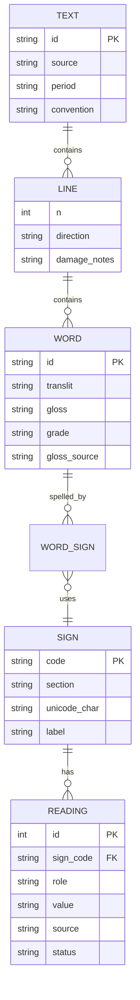

# Data model

A minimal relational model. Every table with a reading carries a source and a status.

Notes:

- `READING.role` is one of uniliteral, biliteral, triliteral, ideogram, determinative, marker.
- `READING.status` says how it was checked (verified against which edition and page, or
  `VERIFY`). A reading without a status cannot be saved.
- `WORD_SIGN` keeps order, orientation and any damage flag; it is the link that lets a reader
  re-check the reading.
- `WORD.grade` uses the scale in `text-annotation`.
- One word can map to several candidate spellings during editing; keep the chosen one and the
  rejected ones with reasons.
