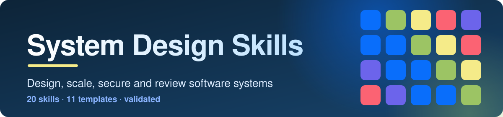

<p align="center">
  
</p>

<p align="center">
  
  
  
  
</p>

Twenty skills that help a coding agent make sound architecture decisions: estimate load,
pick components, find failure modes, and review existing designs. A coordinator skill runs the
workflow and calls only the specialists a problem needs. Three more help with academic and research
work: reading the literature, measuring performance honestly, and writing papers and reviews.

## Which one is for my tool?

| I use | Read | Install | Status |
|---|---|---|---|
| **Claude Code** | [`claude/`](claude/README.md) | `bash scripts/install.sh --claude --project DIR` | Works |
| **OpenAI Codex** | [`openai/`](openai/README.md#codex) | `bash scripts/install.sh --codex --project DIR` | Works |
| **ChatGPT desktop app** | [`openai/`](openai/README.md#chatgpt) | [20 zips](openai/chatgpt/) | Zips built; how the app takes them is not confirmed |
| **OpenAI Skills API** | [`openai/`](openai/README.md#openai-skills-api) | [20 zips](openai/chatgpt/) | Zips built to the documented format and limits |

Claude Code and Codex read the same files from [`skills/`](skills/). Nothing is copied per
platform, so there is one place to fix a skill. The zips for ChatGPT and the API are built from `skills/`.

## What is in this folder

```text
system-design-skills/
├── skills/     the 20 skills (SKILL.md plus references, scripts and templates)
├── claude/     Claude Code: install and use
├── openai/     OpenAI: Codex install, and chatgpt/ with one zip per skill
├── prompts/    ready-to-paste prompts, one per skill
├── scripts/    install.sh, build_chatgpt.py, validate_library.py, check_routing.py
├── evals/      routing cases, test cases, results and end-to-end scenarios
├── examples/   a real answer per skill, with token counts
├── docs/       authoring guide
└── assets/     banner
```

## Skills

| Skill | Use it for | Prompt |
|---|---|---|
| [`system-design`](skills/system-design/) | The coordinator. An 11-step workflow for a new architecture | [prompt](prompts/README.md#system-design) |
| [`requirements-capacity`](skills/requirements-capacity/) | Requirements, QPS and storage estimates, availability and latency budgets | [prompt](prompts/README.md#requirements-capacity) |
| [`architecture-scaling`](skills/architecture-scaling/) | Monolith or services, sync or async, scaling ladder, bottlenecks | [prompt](prompts/README.md#architecture-scaling) |
| [`api-networking`](skills/api-networking/) | REST, GraphQL, RPC, HTTP versions, DNS, CDN, load balancing, API contracts | [prompt](prompts/README.md#api-networking) |
| [`identity-security`](skills/identity-security/) | Auth, SSO, tokens, password hashing, TLS, tenant isolation, threat models | [prompt](prompts/README.md#identity-security) |
| [`database-selection`](skills/database-selection/) | Choosing a database from access patterns | [prompt](prompts/README.md#database-selection) |
| [`transactions-consistency`](skills/transactions-consistency/) | Isolation levels, locking, consistency models, sagas, outbox | [prompt](prompts/README.md#transactions-consistency) |
| [`sharding-replication`](skills/sharding-replication/) | Partitioning, replicas, failover, with a capacity case first | [prompt](prompts/README.md#sharding-replication) |
| [`caching-performance`](skills/caching-performance/) | Cache strategies, invalidation, stampedes, Redis vs Memcached | [prompt](prompts/README.md#caching-performance) |
| [`messaging-streaming`](skills/messaging-streaming/) | Queues, Kafka, delivery guarantees, idempotent consumers, retries | [prompt](prompts/README.md#messaging-streaming) |
| [`storage-systems`](skills/storage-systems/) | Block, file and object storage, uploads, erasure coding, tiers | [prompt](prompts/README.md#storage-systems) |
| [`deployment-delivery`](skills/deployment-delivery/) | Rolling, blue-green, canary, safe migrations, rollback | [prompt](prompts/README.md#deployment-delivery) |
| [`reliability-resilience`](skills/reliability-resilience/) | Failure domains, availability math, backoff, breakers, disaster recovery | [prompt](prompts/README.md#reliability-resilience) |
| [`observability`](skills/observability/) | SLOs, burn-rate alerts, metrics, logs, traces, cardinality | [prompt](prompts/README.md#observability) |
| [`geospatial-design`](skills/geospatial-design/) | Geohash, quadtree, nearby search, map tiles, routing | [prompt](prompts/README.md#geospatial-design) |
| [`payment-systems`](skills/payment-systems/) | Initiation, processing, ledger, settlement, idempotency, reconciliation | [prompt](prompts/README.md#payment-systems) |
| [`system-design-review`](skills/system-design-review/) | Evidence-based review with severity-ranked findings | [prompt](prompts/README.md#system-design-review) |

### Academic and research skills

| Skill | Use it for | Prompts |
|---|---|---|
| [`systems-literature-reading`](skills/systems-literature-reading/) | Finding and reading papers and vendor claims, extracting claims and assumptions, checking whether a result transfers, and checking references for invented citations | [prompts](prompts/README.md#systems-literature-reading) |
| [`performance-evaluation-methodology`](skills/performance-evaluation-methodology/) | Designing and judging benchmarks: load model, coordinated omission, runs, percentiles with intervals, A/A noise checks | [prompts](prompts/README.md#performance-evaluation-methodology) |
| [`systems-research-writing`](skills/systems-research-writing/) | Writing a systems paper, thesis or report, reviewing a paper, answering reviewers, artifacts and disclosure | [prompts](prompts/README.md#systems-research-writing) |

Eleven templates ship with the coordinator: design document, ADR, requirements, capacity
worksheet, technology matrix, database review, failure analysis, security checklist,
observability review, production readiness checklist and review report.

## Install

Run from this folder. Install all 20 skills together, because the specialists share the
coordinator's templates.

```bash
bash scripts/install.sh --claude --project /path/to/your/repo   # Claude Code
bash scripts/install.sh --codex --project /path/to/your/repo    # OpenAI Codex
```

Add `--user` to install for every project on the machine, `--symlink` to link instead of copy,
`--force` to replace, or `--dry-run` to preview. For ChatGPT and the OpenAI Skills API, which take zips,
see [`openai/`](openai/README.md#chatgpt). Details for each tool: [`claude/`](claude/README.md) and
[`openai/`](openai/README.md).

## Try it

| Ask | Skills used |
|---|---|
| "Design a marketplace backend with flash sales and card payments. Give me a design doc and ADRs." | `system-design`, then capacity, scaling, database, consistency, caching, payments, security, reliability |
| "Review `docs/architecture.md` and `services/`. Give me findings with evidence and severity." | `system-design-review`, plus any specialist the findings need |
| "Duplicate emails after consumer restarts. How do I make confirmation idempotent?" | `messaging-streaming`, with `transactions-consistency` |

Every skill has a ready-to-paste prompt in [`prompts/`](prompts/README.md). Fill a template by asking
for it: "write an ADR for this decision" or "run the production readiness checklist".

<!-- samples:start -->

## Sample outputs and token cost

Every skill has one real answer in [`examples/`](examples/), with the prompt that produced it. The table has the numbers behind those answers: means over 3 runs with the skills installed and 3 without (Claude Code 2.1.296, model claude-opus-5-5). **Output tokens** is what the model wrote, including its reasoning. **Extra input tokens** is how many more tokens the model read across all turns when the skills were installed (the skill text it loaded, reference files, script output and extra turns); the large base context is the same in both arms and is left out. **Skill size** is Claude Code's own projected cost from `claude plugin details`: the first figure is in every session for every installed skill (its name and description), the second only when the skill is used. When the skill was not invoked in a run, the extra is only the descriptions of the installed skills, so the smallest figure in the table is the cost of having the collection installed. More tokens is not a defect by itself; what the tokens buy is in [`evals/`](evals/).

| Skill | Output tokens, no skill to skill | Extra input tokens | Cost, no skill to skill (US dollars) | Skill size, always / when used | Sample |
|---|---|---|---|---|---|
| `api-networking` | 4,898 to 5,435 | +42,422 | 0.16 to 0.24 | ~190 / ~3,000 | [answer](examples/api-networking.md) |
| `architecture-scaling` | 1,366 to 1,881 | +52,731 | 0.10 to 0.19 | ~200 / ~3,000 | [answer](examples/architecture-scaling.md) |
| `caching-performance` | 4,559 to 5,334 | +42,776 | 0.15 to 0.24 | ~200 / ~3,500 | [answer](examples/caching-performance.md) |
| `database-selection` | 1,650 to 3,476 | +42,246 | 0.09 to 0.20 | ~230 / ~3,100 | [answer](examples/database-selection.md) |
| `deployment-delivery` | 3,244 to 3,471 | +42,492 | 0.12 to 0.20 | ~210 / ~3,400 | [answer](examples/deployment-delivery.md) |
| `geospatial-design` | 2,727 to 3,208 | +42,909 | 0.11 to 0.20 | ~220 / ~3,600 | [answer](examples/geospatial-design.md) |
| `identity-security` | 7,484 to 7,084 | +42,523 | 0.21 to 0.27 | ~190 / ~3,300 | [answer](examples/identity-security.md) |
| `messaging-streaming` | 4,299 to 3,470 | +21,943 | 0.15 to 0.20 | ~210 / ~3,500 | [answer](examples/messaging-streaming.md) |
| `observability` | 15,370 to 11,691 | +17,840 | 0.55 to 0.52 | ~200 / ~3,400 | [answer](examples/observability.md) |
| `payment-systems` | 3,404 to 3,404 | +43,402 | 0.13 to 0.20 | ~230 / ~4,300 | [answer](examples/payment-systems.md) |
| `performance-evaluation-methodology` | 1,985 to 1,817 | +29,420 | 0.10 to 0.15 | ~270 / ~2,800 | [answer](examples/performance-evaluation-methodology.md) |
| `reliability-resilience` | 16,386 to 4,596 | -224,066 | 0.57 to 0.23 | ~220 / ~3,700 | [answer](examples/reliability-resilience.md) |
| `requirements-capacity` | 1,254 to 1,752 | +41,375 | 0.08 to 0.16 | ~200 / ~2,100 | [answer](examples/requirements-capacity.md) |
| `sharding-replication` | 2,926 to 3,164 | +42,475 | 0.12 to 0.19 | ~210 / ~3,400 | [answer](examples/sharding-replication.md) |
| `storage-systems` | 5,659 to 6,845 | +83,297 | 0.17 to 0.29 | ~200 / ~3,800 | [answer](examples/storage-systems.md) |
| `system-design` | 15,569 to 13,251 | -19,996 | 0.60 to 0.52 | ~220 / ~2,800 | [answer](examples/system-design.md) |
| `system-design-review` | 2,968 to 4,467 | +43,289 | 0.12 to 0.23 | ~210 / ~3,900 | [answer](examples/system-design-review.md) |
| `systems-literature-reading` | 4,023 to 5,373 | +145,190 | 0.16 to 0.30 | ~270 / ~2,600 | [answer](examples/systems-literature-reading.md) |
| `systems-research-writing` | 2,781 to 3,085 | +79,451 | 0.12 to 0.20 | ~290 / ~2,600 | [answer](examples/systems-research-writing.md) |
| `transactions-consistency` | 2,543 to 2,398 | +32,794 | 0.11 to 0.18 | ~210 / ~3,800 | [answer](examples/transactions-consistency.md) |

### One answer in full: `performance-evaluation-methodology`

Prompt:

> I benchmarked old and new builds, 5 runs each: mean latency 41 ms for the old and 38 ms for the new. My manager wants to ship it as "7% faster". Is that supportable? Tell me what to check, what to run, and what I can honestly say today.

Answer with the skill (excerpt of a single run; the same prompt without the skill is on the [sample page](examples/performance-evaluation-methodology.md)):

````text
**Not yet.** The arithmetic is right: (41 − 38) / 41 ≈ 7.3% lower mean latency. But two means from 5 runs each don't tell you whether that 3 ms gap is real or just run-to-run noise. Whether you can claim it depends on numbers you haven't shown: the spread of the 10 individual runs.

## Why the spread decides it

With n = 5 per build, here is how the 95% confidence interval on the 3 ms difference changes with the per-run standard deviation (SD):

| Per-run SD | 95% CI on the difference | What you can say |
|---|---|---|
| ~1 ms | ≈ 1.5 to 4.5 ms (about 4% to 11%) | It's a real improvement, but "7%" is only the midpoint of a wide range |
| ~3 ms | ≈ −1.4 to 7.4 ms (includes 0) | You can't tell it apart from noise |

Even in the best case, "7% faster" claims more precision than you have.

## What to check

1. **The raw per-run numbers.** Compute the SD for each build and a CI on the difference using Welch's t-test or a bootstrap. This tells you right now which row of the table you're in.
2. **"Faster" at what?** You measured lower mean latency. That isn't the same as throughput, and it isn't tail latency. Check p50 and p99 as well. A mean can improve while p99 gets worse.
3. **Run order.** If you ran all the old runs and then all the new ones, drift (thermals, background jobs, caches, CPU frequency scaling) can produce a gap like this on its own.
4. **Same conditions.** Confirm both builds used the same machine, inputs, build flags, warm-up and config, and that nothing else changed between runs.
5. **Noise floor (A/A test).** Benchmark the old build against itself the same way. If two identical builds differ by 2–3 ms, a 3 ms gap means nothing.
6. **Representativeness.** Check that the workload resembles production. If this is a load test, use an open-loop load generator so slow requests aren't hidden (coordinated omission).

## What to run

- **Interleave and randomise the order** (ABBA…), with warm-up runs discarded, and do at least 20–30 runs per build.
  - For a CLI program: `hyperfine --warmup 3 --runs 30 './old ...' './new ...'` reports mean ± SD and the relative difference.
- **Run an A/A test** with the same harness.
- **Analyse the per-run results:**

[... excerpt ends; the full answer is longer]
````

<!-- samples:end -->

## Check it

```bash
python3 scripts/validate_library.py         # spec, sections, size, links, templates, navigation, script self-tests, evaluation cases
python3 scripts/check_routing.py            # description routing, 51 cases (incl. prompts/)
python3 scripts/build_chatgpt.py --check    # ChatGPT bundle limits
skills-ref validate skills/<name>           # official validator
claude plugin validate skills               # Claude Code's own check of the skill files
python3 ../tools/run_evals.py plan .        # evaluation cases; live runs spend API credit, see TESTING.md
```

Last run, 2026-10-14: all 20 skills pass `skills-ref` and `claude plugin validate`; the library validator reports 0
errors on Python 3.9 and 3.14 (including the navigation and evaluation-case checks); routing passes 51 of 51, including
near-miss cases; the four scripts pass their self-tests (`capacity.py`, `slo_budget.py`, `perfstats.py` with 53 checks, which
also agree with NumPy and SciPy on 6,101 random comparisons, and `citecheck.py` with 28); all 20 zips build within the
documented limits; and markdownlint reports 0 issues. Routing is a word-match check, not a model of how an agent picks a skill.

### Measured results

How an agent actually behaves with these skills, measured by [`tools/run_evals.py`](../tools/run_evals.py). Method,
limits and the commands are in [TESTING.md](../TESTING.md); the full tables are in [`evals/results/`](evals/results/).

<!-- results:start -->

#### Outcome runs: starter prompts with and without the skills

Share of runs passing each check, with Wilson 95% intervals; the last column is the difference in percentage points with a Newcombe interval. Rubric and limits are judged by a model.

| Collection | Skills | Runs per arm | Facts: skills / none | Rubric: skills / none | Rubric difference | Limits: skills / none | Expected skill invoked |
|---|---|---|---|---|---|---|---|
| system-design-skills | 20 | 60 / 60 | 98% (91-100) / 95% (86-98) | 100% (94-100) / 93% (84-97) | +7 (-1 to +16) | 52% (39-64) / 32% (21-44) | 97% (89-99) |

#### Tokens and cost per run (means)

| Collection | Output tokens: skills / none | Input tokens read: skills / none | Cost, US dollars: skills / none | Runs with a denied tool call: skills / none |
|---|---|---|---|---|
| system-design-skills | 4,760 / 5,255 | 105,133 / 72,908 | 0.245 / 0.197 | 0 / 0 |

#### Trigger runs: does the agent pick the right skill

| Collection | Should-trigger runs hit (recall) | Near-miss runs correctly left alone (specificity) | Precision | Unrelated prompts that triggered a skill |
|---|---|---|---|---|
| system-design-skills | 62% (49-73) | 100% (94-100) | 100% (91-100) | 0 of 6 |

#### Model-judged pairwise comparison (both orders)

| Collection | Skill preferred | Baseline preferred | Tie | Inconsistent across orders | Share preferring the skill, decisive pairs only |
|---|---|---|---|---|---|
| system-design-skills | 14 | 4 | 0 | 2 | 78% (55-91) |

#### Codex smoke test (one run per prompt and arm, facts only)

| Collection | Every expected fact: skills / none | Expected skill used | Any skill used |
|---|---|---|---|
| system-design-skills | 18 of 20 / 19 of 20 | 20 of 20 | 20 of 20 |

Judge self-agreement with a single vote, system-design-skills: Rubric, 24 of 24, 1.00; States its limits, 18 of 24, 0.49. Verdicts in the tables are the majority of 3 judge votes; the second and third votes changed 19 of 240 verdicts.

Human grading: the blind kit is built (`run_evals.py sheet`) but no person has graded any answers yet, so none of the judged results above has been checked against human preference.

<!-- results:end -->

Read these with care. Each starter prompt was run three times with the skills and three times without, on one model on one
day, and the prompts were written alongside the skills. On these general engineering prompts a strong model often
passes the facts and rubric checks without any skill, so the main differences are in how often the answer states its limits
and in whether the skill is picked up at all. The rubric and limits checks are a model's judgement, with moderate agreement with
itself (see `evals/results/judge-check.md`). No systems engineer has graded any answer. The blind kit for that is built
(`python3 ../tools/run_evals.py sheet .`), and until people use it, the judged results here are not checked against
human preference. The five end-to-end scenarios in [`evals/scenarios.md`](evals/scenarios.md) still need a person to grade them.

## Contribute

See [CONTRIBUTING.md](../CONTRIBUTING.md) and [`docs/authoring-guide.md`](docs/authoring-guide.md).

## License

Apache-2.0

## Citation

ByteByteGo. 2022. *System Design: The Big Archive*. May 2022.
