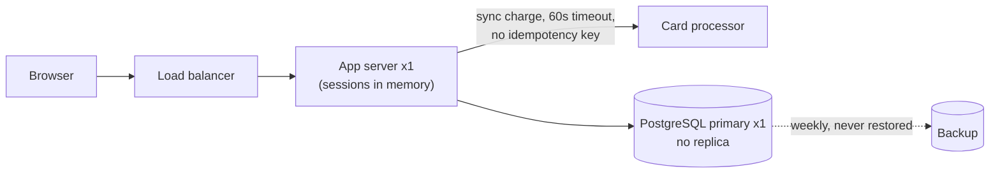
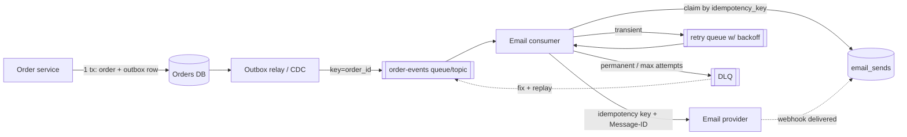
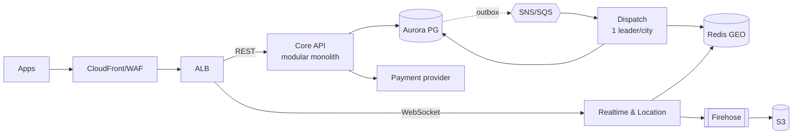
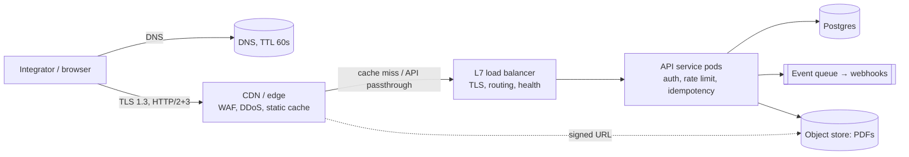

# Blind grading sheet

For each item, read the prompt and both answers. Do not try to guess which answer used a skill (some answers mention a skill or its files; ignore that), and do not reward length or formatting. Fill in `ratings-template.csv` (one row per item; copy it and name the copy for yourself).

- `better`: A, B or tie, for the answer a specialist would rather receive
- `a_correct_1to5`, `b_correct_1to5`: 1 = wrong or misleading, 3 = partly right, 5 = right and complete for the question asked
- `a_flags_doubt_y_n`, `b_flags_doubt_y_n`: does the answer say what it did not verify, assumed or is unsure about (y or n)
- `notes`: one line on anything a regular expression would miss

---

## P15

**Prompt:** Users upload videos up to 20 GB. Design the uploads, metadata, storage tiers and lifecycle rules, and compare replication with erasure coding on cost.

### Answer A

# Video upload and storage design (videos up to 20 GB)

## 0. Assumptions

You didn't give a workload, so I picked one. The numbers below are illustrative and costs scale linearly with them.

| Input | Assumed |
|---|---|
| Uploads | 100k/day, average 1 GB (median ~300 MB, long tail to 20 GB) |
| Originals ingested | ~100 TB/day |
| Transcoded versions (resolution ladder plus thumbnails) | ~0.5× the original → ~50 TB/day |
| Logical growth | ~150 TB/day ≈ **4.5 PB/month ≈ 55 PB/year** |
| Reads | Very uneven: a few % of videos get most views; most are rarely watched after 30 days |
| Retention | Originals kept until the user deletes them; deleted items recoverable for 30 days |

## 1. Data sets and where they go

| Data set | Shape | Store |
|---|---|---|
| Originals | 0–20 GB, written once, read once by the transcoder, then rarely | Object storage |
| Transcoded versions (HLS/DASH segments) | 2–10 s segments of 1–5 MB, read often | Object storage behind a CDN |
| Thumbnails, posters, manifests | KB to low MB, read very often | Object storage behind a CDN |
| In-flight upload parts | Temporary | Object storage multipart upload |
| Metadata, state, ownership, search | Small rows, queried | Relational database (e.g. Postgres) |

Bytes are stored under **opaque generated keys** such as `orig/{video_id}/{upload_id}` and `r/{video_id}/{rendition}/{seg}.m4s`. A user's file name is never used as a key. It is stored as `display_name`.

## 2. Upload path (resumable, direct to storage)

```
Client ──POST /uploads {size, type, part_size}──▶ API ──▶ DB: upload_session(INIT)
                                                    └──▶ Store: CreateMultipartUpload
Client ◀── upload_id + first batch of signed part URLs (15–60 min TTL)
loop parts (4–8 in parallel, each retried on its own):
  Client ──PUT part N + CRC32C/SHA-256──▶ Store ──▶ ETag
  Client ──GET /uploads/{id}/urls?from=N──▶ API     (refresh URLs as they expire)
Client ──POST /uploads/{id}/complete {parts, ETags}──▶ API ──▶ Store: CompleteMultipart
                                                       └──▶ DB: UPLOADED ──▶ queue event
Worker: ffprobe check → malware/content scan → transcode → versions written → DB: READY
```

**Part size**
- The ceiling is 20 GB. S3's documented limits (from memory, so check them) are a 5 MiB minimum part, 10,000 parts maximum and 5 TB per object. That means 20 GB fits with parts of 2 MiB or more, so the part-count limit is not a concern.
- Default to **32 MiB parts**: a 20 GB file is ~600 parts. At 10 Mbit/s one part takes ~27 s, which bounds the work lost on a retry.
- Let the client adjust between 16 and 128 MiB based on measured throughput. Fast links use bigger parts and fewer requests.

**How long an upload takes**
- 20 GB at 50 Mbit/s is ~53 minutes. At 10 Mbit/s it is ~4.4 hours.
- So signed URLs must be **issued in batches and refreshed**. One URL valid for 5 hours would be a security liability.
- An upload session stays resumable for **7 days**.

**Resuming**
- The client keeps `upload_id`. After a crash it calls `GET /uploads/{id}`, which uses ListParts, and re-sends only the missing parts.
- Re-sending part N just overwrites part N, so retries are safe.
- `complete` is idempotent: if the session is already UPLOADED, return success.

**Integrity**
- The client sends a checksum with each part and the store verifies it.
- Store the composite checksum in the database.
- Hashing the whole 20 GB file with SHA-256 on the client is optional. It is costly on mobile. Do it in the worker if you need it, for example for deduplication.

**Guardrails**
- Check the declared size (≤ 20 GB) against the user's quota at INIT.
- Each signed URL is scoped to one key, one part number and one content-length range.
- Re-check the real size at complete and reject anything that doesn't match.
- Never serve an object that is not READY.

**Write order**
- The object is written first and the database is flipped to READY last.
- A crash in between can only leave an orphaned object. The lifecycle rules and a reaper job clean these up, and nothing is ever left pointing at missing bytes.

## 3. Metadata schema

```sql
CREATE TABLE video (
  id            uuid PRIMARY KEY,
  owner_id      uuid NOT NULL,
  title         text, display_name text NOT NULL,
  state         text NOT NULL,   -- INIT|UPLOADING|UPLOADED|PROCESSING|READY|FAILED|DELETED
  visibility    text NOT NULL DEFAULT 'private',
  orig_key      text UNIQUE,     -- opaque
  orig_size     bigint, orig_checksum bytea, container text, duration_ms int,
  width int, height int, codec text,
  storage_class text,            -- mirrors lifecycle state, for cost reports
  last_viewed_at timestamptz,    -- rolled up from CDN logs, drives tiering
  deleted_at    timestamptz,
  created_at    timestamptz NOT NULL DEFAULT now(),
  updated_at    timestamptz NOT NULL DEFAULT now()
);
CREATE INDEX ON video(owner_id, created_at DESC);
CREATE INDEX ON video(state) WHERE state NOT IN ('READY','DELETED');

CREATE TABLE upload_session (
  id uuid PRIMARY KEY, video_id uuid REFERENCES video,
  store_upload_id text NOT NULL, part_size int NOT NULL, declared_size bigint NOT NULL,
  state text NOT NULL,           -- INIT|UPLOADING|COMPLETED|ABORTED
  expires_at timestamptz NOT NULL, created_at timestamptz DEFAULT now()
);

CREATE TABLE rendition (
  video_id uuid REFERENCES video, name text,      -- '1080p','720p','thumb'...
  key_prefix text NOT NULL, bytes bigint, codec text, bitrate int,
  state text NOT NULL, PRIMARY KEY (video_id, name)
);
```

Two supporting jobs:
- A **reaper** aborts sessions past `expires_at`.
- A **reconciler** runs weekly. It compares an inventory of the store against the database and fixes orphans in either direction.

## 4. Read path

- The player gets a manifest URL. Private videos use signed CDN cookies or tokens.
- The CDN fetches from the store through an origin shield and supports range requests.
- Segment keys never change once written, so they are cached with `Cache-Control: immutable, max-age=1y`.
- Originals are never served through the CDN. Owners download them via a short-lived signed URL.

## 5. Storage tiers and lifecycle rules

| Rule | Applies to | Condition | Action |
|---|---|---|---|
| Abort stale uploads | incomplete multipart uploads | > 7 days | Abort and delete parts (unfinished parts are billed) |
| Originals → warm | `orig/` | age > 30 days (transcode and re-edit window over) | Infrequent-access tier |
| Originals → archive | `orig/` | age > 180 days | Archive tier. Re-transcoding for a new codec is batch work that can wait hours for retrieval |
| Versions, by views | `r/` | `last_viewed_at` > 60 days | Infrequent-access tier, or let the store's automatic access-based tiering handle it |
| Prune cold versions | `r/` | no views for 365 days | Delete all versions except one low-resolution one; regenerate from the original on demand |
| Soft delete | all | user deletes | DB state = DELETED, hidden immediately; objects hard-deleted after 30 days |
| Old versions | all (versioning on) | old version > 30 days | Expire |
| Temp files | `tmp/` (transcode scratch) | > 1 day | Delete |

Points to watch:
- Thumbnails and manifests **stay hot**. They are tiny and the CDN constantly re-fetches them.
- Watch the **minimum storage durations** and **per-object transition fees** of the infrequent and archive tiers. Never move objects under ~128 KB down a tier. Segments of ~2–5 MB are fine.
- Set the 30/60/180-day thresholds from real CDN and access logs after a pilot. They are starting guesses.
- **Protection:**
  - Turn on versioning.
  - Back originals up to a separate account with separate credentials. A replica that also applies deletes is not a backup.
  - Run a quarterly restore drill and verify checksums.
  - Versions don't need a backup because they can be rebuilt from originals.

## 6. Replication vs erasure coding, on cost

**Overhead** (raw storage ÷ logical storage):

| Scheme | Overhead | Survives | Repair traffic after losing a 20 TB disk |
|---|---|---|---|
| 3× replication | 3.0× | any 2 copies | ~20 TB copied |
| EC 6+3 | (6+3)/6 = 1.5× | any 3 of 9 shards | ~120 TB read (k × lost) |
| EC 10+4 | 1.4× | any 4 of 14 shards | ~200 TB read |
| EC 10+4 ×2 regions | 2.8× | a full region loss + 4 shards | as above, plus cross-region rebuilds |

**Cost for one year of growth (55 PB logical).** I used $4 per raw TB-month as an all-in self-managed HDD figure (hardware amortized, power, space, ops). That number is illustrative: replace it with your own.

| Scheme | Raw PB | $/month | vs 3× |
|---|---|---|---|
| 3× replication | 165 | ~$660k | — |
| EC 10+4 | 77 | ~$308k | **−$352k/month (−53%)** |
| Hybrid (below) | ~80 | ~$320k | −51% |

The saving is always 1 − 1.4/3 ≈ 53% of raw capacity, whatever price per TB you use. The prices only set the dollar figure.

**Where erasure coding costs you:**
- **Repair traffic is ~10× higher** (k × the lost data). Size the network for it and throttle rebuilds so a failed node doesn't cause a repair storm that competes with CDN origin traffic.
- **Reads slow down when a shard is missing**: the system has to rebuild it from k other shards. This barely matters behind a CDN with a ~95%+ hit rate.
- **Small objects waste space.** A 50 KB thumbnail split into 14 shards is mostly per-shard overhead plus index entries.
- **CPU for encoding and decoding.** This is small next to transcoding.

**Recommended hybrid:**
- 3× replication for objects under ~1 MB (thumbnails, manifests) and for the first ~7 days of originals, while transcoding reads them hard. That is ~1–2% of bytes.
- EC 10+4 for everything else, with shards on 14 separate failure domains (racks, or zones if you have ≥ 3 zones).
- For protection against a region loss, add **one EC copy in a second region for originals only**. Versions can be regenerated, so they don't need it. That brings originals to 2.8×, still under 3× replication, which only covers a single region anyway.

**On a managed cloud (S3, GCS and similar)** you don't choose between replication and EC: the provider erasure-codes internally, and the price per GB already includes it. The equivalent decisions there are:
1. Which storage class: standard, infrequent or archive. This is the tiering table above.
2. Single-zone or multi-zone classes. Single-zone is cheaper and acceptable only for versions you can regenerate.
3. Whether to pay for cross-region replication. Do it for originals only.

At this scale the managed price per GB will probably be several times the self-managed EC figure. Running your own EC cluster starts to pay off at tens of PB, if you have the staff to run it. Use current list prices, which I haven't checked here, plus egress. Egress is usually dominated by CDN costs, not storage.

## 7. Failure cases

| Failure | Handling |
|---|---|
| Client crashes mid-upload | Resume via `upload_id` + ListParts; the session expires after 7 days and the lifecycle rule aborts it |
| Signed URL expires mid-part | Client refreshes the URL batch and re-sends that part |
| Duplicate or replayed `complete` | Idempotent: session already COMPLETED → return the existing video |
| Checksum mismatch | Store rejects the part; client retries the part |
| Object exists but database not updated | Reconciler finds the orphan and deletes it after 24 h |
| Transcode fails | State = FAILED with retry and backoff; the original is kept so the user doesn't re-upload |
| Bucket wiped by an attacker or bug | Versioning + object lock on the backup account; restore from the backup |
| Node or rack lost (EC) | Throttled rebuild; alert if shards at risk of loss pile up faster than repair |
| Viral video | CDN with origin shield; segment keys never change, so the cache hit rate is ~100% |

## 8. Before committing

1. **Pilot measurements:** actual distribution of upload sizes, rendition size ratio, and an access-age curve from CDN logs. These set the lifecycle thresholds.
2. **Upload test matrix:** 0-byte, 1-part, and 20 GB at 10 Mbit/s with the client killed at 50%; wrong checksum; expired URL; duplicate `complete`.
3. **Cost check:** compare a modeled month against a pilot bill, including request counts, transition fees and archive retrieval.
4. **Monitoring:** upload success rate, number of incomplete uploads, orphan count, tier-transition counts and EC repair backlog.

I can also turn this into a shareable design-doc page if your team needs to review it.

### Answer B

# Video upload and storage design (videos up to 20 GB)

## 1. Upload path

The main rule is that video bytes never pass through the API servers. Clients upload straight to object storage using presigned multipart URLs.

```
Client ──(1) POST /uploads {size, sha256?, mime}──▶ Upload API ──▶ Metadata DB (session row)
       ◀─(2) upload_id, part_size, presigned URLs for parts 1..N (batched, 1h TTL)
Client ──(3) PUT part i (parallel 4–8, CRC32C per part)──▶ Object store (staging bucket)
Client ──(4) POST /uploads/{id}/complete {part ETags+checksums}──▶ API ──▶ CompleteMultipartUpload
Object store ──(5) ObjectCreated event──▶ Queue ──▶ Validator → Transcoder → Packager
```

| Decision | Choice | Why |
|---|---|---|
| Part size | 64 MB (adaptive: 16 MB on mobile, 128 MB on fast links) | 20 GB / 64 MB = 320 parts, well under the 10,000-part limit. A failed part retries in seconds. |
| Parallelism | 4–8 parts in flight | Fills the uplink without causing head-of-line stalls. |
| Integrity | CRC32C per part, checked by the store; optional full-file SHA-256 | Catches corruption per part, so only the bad part is resent. The full hash enables deduplication. |
| Resume | `GET /uploads/{id}` returns the confirmed parts (from ListParts plus the DB) | Works after a crash, network switch or app restart. Sessions live for 7 days. |
| URL issuance | Batches of about 50 presigned URLs, refreshed on demand | Keeps responses small, and leaked URLs expire quickly. |
| Quotas and abuse | Size is declared up front and checked against quota. Content-length is enforced per part and total size at complete time. | Stops a client that declares 1 GB from uploading 20 GB. |
| Staging vs final | Uploads land in `staging/`. The validator (ffprobe, malware scan, policy checks) promotes them to `originals/`. | Unvalidated bytes never reach the serving path. |
| Idempotency | `complete` is keyed by `upload_id`, and the state machine ignores duplicates | Clients do retry. |

**Upload state machine:** `INITIATED → UPLOADING → COMPLETING → UPLOADED → VALIDATING → PROCESSING → READY`. The side states are `FAILED`, `ABORTED` and `EXPIRED`.

## 2. Metadata (Postgres, or a sharded store such as Spanner or Cockroach at scale)

```sql
videos(
  video_id        uuid pk,
  owner_id        uuid,             -- shard key
  title, description, visibility,
  status          enum,             -- see state machine
  duration_ms, width, height, codec, -- filled by validator
  original_object_id uuid,
  content_sha256  bytea,            -- dedup / integrity
  created_at, ready_at, deleted_at  -- soft delete
)

upload_sessions(
  upload_id       uuid pk,
  video_id        uuid fk,
  store_upload_id text,             -- multipart id from the object store
  declared_size   bigint,
  part_size       int,
  parts_confirmed int,
  bytes_confirmed bigint,
  expires_at      timestamptz,
  state           enum
)

objects(                            -- every physical blob we own
  object_id       uuid pk,
  video_id        uuid fk,
  kind            enum('original','rendition','thumbnail','manifest','caption'),
  rendition       text,             -- '2160p-av1', '720p-h264', ...
  bucket, key, size_bytes, checksum,
  storage_class   enum('hot','warm','cold','archive'),
  durability      enum('replicated','ec'),
  regenerable     bool,             -- true for renditions: can be rebuilt from original
  last_accessed_at timestamptz,     -- rolled up from CDN logs daily, not per request
  created_at
)

video_stats_daily(video_id, day, views, origin_bytes_served)  -- drives tiering
```

Design notes:
- Shard by `owner_id`, with a global secondary index on `video_id`.
- `last_accessed_at` is updated in batches from CDN and origin logs. Writing on every read would hammer the DB.
- `regenerable` matters most. Renditions are derived data, so they can be stored less durably, or deleted, than originals.

## 3. Storage tiers

| Tier | What lives there | Media / class (AWS-equivalent) | ~List $/GB-mo | Retrieval |
|---|---|---|---|---|
| **Hot** | Staging uploads; renditions under 30 days old or trending | Replicated SSD/HDD (S3 Standard) | 0.023 | ms, free |
| **Warm** | Renditions with low but non-zero views | EC HDD (S3 Standard-IA) | 0.0125 | ms, $0.01/GB |
| **Cold** | Originals after transcoding; long-tail renditions | EC dense HDD (Glacier Instant) | 0.004 | ms, $0.03/GB |
| **Archive** | Originals over 1 year old; deleted-but-retained content (legal hold) | EC/tape (Glacier Deep Archive) | ~0.001 | hours |

Prices are approximate list prices; check them against current pricing.

Video access follows a power law: most views hit a small fraction of the catalog, and the CDN absorbs nearly all of those reads. Origin storage is therefore mostly cold bytes. The goal is to get those bytes onto cheap tiers quickly.

## 4. Lifecycle rules

| # | Scope | Rule |
|---|---|---|
| 1 | `staging/*` | Abort incomplete multipart uploads after 7 days. Delete promoted or failed objects after 2 days. |
| 2 | `originals/*` | Move to Cold 7 days after `READY` (transcoding is done, so originals are rarely read). Move to Archive after 365 days. |
| 3 | `renditions/*` | Move to Warm after 30 days with no origin reads, and to Cold after 90 days with no reads. Base this on access, not age, using intelligent tiering or a nightly job over `video_stats_daily`. |
| 4 | Long-tail renditions | After 180 days with no views, delete the top rungs (4K, 1440p). Keep 720p and 360p. If a 4K request arrives, serve 720p immediately and re-transcode from the original in the background. This saves about 50–60% of rendition bytes on dead videos. |
| 5 | User delete | Soft delete, then hard delete all objects after 30 days unless a legal hold applies. Write a tombstone in `objects`. |
| 6 | Revival | When a cold video starts trending (by view rate), promote its renditions back to Hot. The CDN covers the gap. |
| 7 | Old versions | If versioning is on, expire noncurrent versions after 30 days. |

Watch out for minimum-duration charges: IA bills at least 30 days, Glacier Instant at least 90 and Deep Archive at least 180. Never tier down an object you are likely to delete sooner than that.

## 5. Replication vs erasure coding: cost

### How they compare
| Scheme | Raw bytes per logical byte | Failures tolerated | Bytes read to repair 1 lost fragment | Notes |
|---|---|---|---|---|
| 3× replication | **3.0×** | 2 | 1× | Simplest. Fastest reads and repair. |
| RS(6,3) | **1.5×** | 3 | 6× | Common default (HDFS, Ceph). |
| RS(10,4) | **1.4×** | 4 | 10× | Facebook f4-style. |
| LRC(12,2,2) | **1.33×** | 3 (+ some 4) | 6× (local) | Azure-style. Cuts repair traffic. |
| Geo: 2 regions × 3× | **6.0×** | 1 region + 2 | — | Naive disaster-recovery setup. |
| Geo EC across 3 regions (e.g. (9,3) + XOR) | **~1.8–2.0×** | 1 region | cross-region | Cheaper, but a degraded read crosses the WAN. |

### Worked example: 10 PB logical, self-hosted, ~$8/TB-month raw all-in (disk, server, power, space, ops)

| Scheme | Raw PB | $/month | $/year | vs 3× |
|---|---|---|---|---|
| 3× replication | 30 | $240k | $2.88M | — |
| RS(6,3) | 15 | $120k | $1.44M | −50% |
| RS(10,4) | 14 | $112k | $1.34M | **−53%** |
| LRC(12,2,2) | 13.3 | $107k | $1.28M | −56% |
| 2-region × 3× | 60 | $480k | $5.76M | +100% |
| 3-region geo-EC (~1.9×) | 19 | $152k | $1.82M | −37% (and survives losing a region) |

Rough ingest sizing: 100k uploads a day at 1.5 GB average, plus about 50% for renditions, is roughly 225 TB a day, or about 80 PB of new logical data a year. At that scale, choosing RS(10,4) over 3× saves about **$10M+ a year in raw capacity** for every year of retained data.

### Hidden costs of erasure coding
- **Repair amplification.** Rebuilding a dead 20 TB disk reads about 20 TB under 3×, but about 200 TB of cluster network traffic under RS(10,4). You need spare fabric bandwidth and throttled repair, or LRC to keep repairs local.
- **Degraded reads.** If a data fragment is missing, serving a read means reconstructing it from k other fragments, which raises p99 latency. This is tolerable here because the CDN sits in front.
- **CPU.** Encoding costs a few percent of a core per Gbps with ISA-L, which is negligible next to transcoding.
- **Small-object waste.** Not an issue for video, where objects run from MBs to GBs. Thumbnails and manifests should stay replicated or be packed into larger objects.
- **Write path.** Writes need k+m fragment acknowledgements, and partial updates are expensive. Video objects are write-once, so this is not a problem.

### Recommendation (hybrid, as Facebook Haystack/f4 and HDFS do)
1. Keep **staging and fresh hot renditions under 3× replication** for the first ~7–30 days, while reads and churn are highest.
2. Re-encode in the background to **RS(10,4) or LRC** when an object moves to Warm or Cold. Over 95% of bytes end up in EC at about 1.4× instead of 3×.
3. For **originals**, which are the only non-regenerable data, use geo-EC or a single cross-region archive copy. Do not use 2 × 3× replication.
4. Renditions can be regenerated from the original, so they can use **single-region EC with no geo copy**. Losing a region's renditions then costs transcode time, not data.
5. On a public cloud (S3, GCS, Azure), the provider already erasure-codes inside each storage class. Your levers there are **storage class choice and whether to replicate across regions**: Cross-Region Replication roughly doubles cost. Apply it only to originals, and send the replica straight to an archive class.

If it would help, I can turn this into a cost model with adjustable inputs (ingest rate, rendition ladder, $/TB, tier mix) as an artifact.

---

## P17

**Prompt:** Review this design and give me findings with evidence, severity, impact and a fix for each one. The system: one PostgreSQL primary with no replica and one app server behind a load balancer; user sessions are stored in the app server's memory; checkout charges the card synchronously inside the HTTP request with a 60 second timeout and no idempotency key; backups run weekly and nobody has ever restored one.

### Answer A

# Design review: single-node web app with synchronous checkout

**Verdict:** Not production-ready for taking payments. Two findings are **Critical**: customers can be charged twice, and a database loss could be permanent. Three more are **High** because any single failure takes the whole site down. The fixes are routine and none needs a rewrite.

**Scope:** This review is based only on your five-sentence description. I had no code, config, SLOs, traffic figures, incident history or payment provider details, so the evidence below quotes your description. I assumed checkout is a core journey and that roughly 99.9% availability is expected. Please confirm those under Questions.



---

### F-01: Checkout can charge a customer twice. **Critical**, high confidence
- **Evidence:** "charges the card synchronously inside the HTTP request with a 60 second timeout and no idempotency key."
- **Impact:** If the charge succeeds at the processor but the response is lost, you can't tell what happened. That can happen through a timeout, an app crash, a deploy, or a load balancer idle timeout. Many load balancers default to 60s, the same as your app timeout, so the LB may cut the connection first. The user sees an error or a spinner and clicks "Pay" again, or the client or app retries. That creates a second charge, and the processor can't tell it apart from a new purchase. The results are money lost to refunds, chargebacks and support tickets, and a loss of customer trust.
- **Fix:**
  1. Create a payment record (`pending`, with a unique idempotency key per checkout attempt) in Postgres before calling the processor.
  2. Send that key to the processor. Most major processors accept one, Stripe included.
  3. Model the payment as a state machine: `pending → succeeded | failed | unknown`. On timeout, mark it `unknown`, never `failed`. Resolve it by querying the processor or through its webhook.
  4. Disable double-submit in the UI, and make the checkout endpoint return the existing result when it sees a repeated key.
  5. Run a daily reconciliation job that compares processor records with your records.
  - Effort: S–M.
- **Verify:** Inject a fault where the processor succeeds but the response is dropped, then retry the checkout 3 times. Expect exactly one charge and an order in the correct state.

### F-02: Backups are weekly and have never been restored. **Critical**, high confidence
- **Evidence:** "backups run weekly and nobody has ever restored one." With no replica (F-03), the backup is the only copy of the data outside the primary.
- **Impact:** On average, a disk failure, bad migration or accidental `DELETE` loses about 3.5 days of orders and payments, and up to 7 days in the worst case. Because no backup has ever been restored, the real recovery point may be "none": backups can be corrupt, incomplete, missing WAL, or encrypted with a lost key. Recovery time is also unknown. Losing payment records means you can't prove what customers paid for.
- **Fix:**
  1. Enable continuous WAL archiving with point-in-time recovery (pgBackRest or WAL-G, or a managed Postgres service). This brings the recovery point down to minutes.
  2. Take daily base backups.
  3. Keep copies in a separate account or region.
  4. Monitor backup age and alert when it goes stale.
  5. Do a scheduled restore drill (monthly, then quarterly) into a scratch instance, and record the actual recovery time.
  - Effort: S–M.
- **Verify:** Restore to a timestamp from yesterday, check row counts and recent orders, and record how long it took. Repeat on schedule.

### F-03: The single PostgreSQL primary has no failover. **High** (Critical while F-02 is open), high confidence
- **Evidence:** "one PostgreSQL primary with no replica."
- **Impact:** A host, disk or zone failure, or a botched upgrade, takes down every journey, checkout included. Recovery time equals provisioning a new server plus restoring a backup, which currently means hours to days with an unknown result.
- **Fix:** Add a synchronous or streaming standby in another zone with automated failover (Patroni, or managed Multi-AZ). Point the app at a stable endpoint and use short connection timeouts. Effort: M.
- **Verify:** Kill the primary during a load test. Expect failover within the target recovery time, no committed orders lost, and the app reconnecting without a restart.

### F-04: A single app server makes the load balancer pointless for availability. **High**, high confidence
- **Evidence:** "one app server behind a load balancer."
- **Impact:** A crash, out-of-memory kill, host failure or ordinary deploy causes a full outage, because the LB has nowhere else to send traffic. Every release causes downtime.
- **Fix:** Run at least 2 instances across zones, with LB health checks and rolling deploys. This depends on F-05 being fixed first. Effort: S once F-05 is done.
- **Verify:** Terminate one instance under load. Expect no errors beyond in-flight requests, and a successful zero-downtime deploy.

### F-05: Sessions in app memory are lost on every restart and block scaling. **High**, high confidence
- **Evidence:** "user sessions are stored in the app server's memory."
- **Impact:** Every deploy, crash or restart logs out all users and drops carts, including people in the middle of checkout. That loss of state also adds to the retry risk in F-01. This setup also prevents F-04: with 2 or more servers, requests hit a node without the session. Sticky sessions only hide that problem and still lose sessions when a node dies.
- **Fix:** Move sessions to a shared store, either a Postgres table (no new component needed) or Redis. Alternatively, use signed, short-lived session cookies with server-side revocation. Effort: S.
- **Verify:** Log in, add an item to the cart, restart the app or switch nodes. Expect the session and cart to survive.

### F-06: A 60s synchronous payment call can exhaust the app server. **High**, medium confidence
- **Evidence:** "synchronously inside the HTTP request with a 60 second timeout," on a single app server (F-04).
- **Impact:** This is the capacity side of the problem; F-01 is the correctness side. During a processor brownout, each checkout holds a worker or connection, and possibly a DB connection, for up to 60s. The worker pool fills, and browsing, login and everything else fail too. A partial outage at the processor becomes a full outage of your site.
- **Fix:**
  1. Set explicit connect and read timeouts of about 5s and 10–15s, and keep the total deadline below the LB timeout.
  2. Cap concurrent payment calls (a bulkhead) and add a circuit breaker.
  3. Don't hold a DB transaction open during the processor call.
  4. If the processor is slow, return "payment processing" and finish the payment through the F-01 state machine and webhook.
  - Effort: S–M.
- **Verify:** Make the processor stub hang for 120s under load. Expect non-checkout pages to stay healthy and checkout to fail fast or go to `pending`.

---

### Questions that would change severity
1. What are the availability and recovery targets, and what are peak checkouts per minute?
2. Which payment processor do you use, and does it support idempotency keys and webhooks?
3. What is the LB idle or request timeout?
4. Where are backups stored: the same host, disk or account as the DB? If so, F-02 is worse.
5. Is the DB on the same host or zone as the app?

### What's good
- The design is simple: a single Postgres instance is the right store, and nothing here needs microservices, sharding or Kafka. Don't add any of them.
- A load balancer is already in place, so scaling out the app tier is cheap once sessions are moved.

### Prioritized plan
| Order | Action | Fixes | Effort |
|---|---|---|---|
| **Now** | Idempotency key, payment record before charge, `unknown` state, double-submit guard | F-01 | S–M |
| **Now** | Do a restore test of the current backup, then enable WAL/PITR with daily base backups and an offsite copy | F-02 | S–M |
| **Now** | Lower payment timeouts below the LB timeout and add a bulkhead | F-06 | S |
| **Next** | Move sessions to Postgres or Redis | F-05 | S |
| **Next** | Run 2+ app instances across zones with health checks and rolling deploys | F-04 | S |
| **Plan** | Add a standby with automated failover, and run a failover drill | F-03 | M |
| **Plan** | Add webhook handling and daily reconciliation with the processor | F-01 | M |

**Coverage:** Reliability, payments and API/timeouts were reviewed in depth. Scaling and storage/backups were reviewed in medium depth. Security, observability and deployment weren't covered because the description doesn't touch them, so they aren't assessed rather than passed.

### Answer B

# Design review: single-node checkout system

All evidence below comes from your description. I haven't seen code, configs or metrics, so some impacts depend on details I've noted, such as the load balancer's timeout and the payment provider.

---

## 1. Card charges can be duplicated: no idempotency key and a long synchronous timeout. **Critical**

**Evidence:** "Checkout charges the card synchronously inside the HTTP request with a 60 second timeout and no idempotency key."

**Impact:**
- If the provider responds slowly, the user, the browser or the load balancer gives up. The user clicks "Pay" again and the system creates a second charge. Nothing ties the two attempts together, so the provider treats them as separate payments.
- If your side times out after the provider has already captured the charge, you can't tell whether it succeeded. Retrying risks a double charge, and not retrying risks a paid order you never recorded.
- The result is customers charged twice, chargebacks, refund work and lost trust. Card networks penalise merchants with high chargeback rates.

**Fix:**
- Create an order row with status `pending_payment` and a unique `idempotency_key` (UUID) **before** calling the provider. Send that key on every charge attempt. Stripe, Adyen and Braintree all support this.
- Put a unique constraint on the order and key so a repeat submit returns the existing attempt instead of starting a new one.
- Disable the Pay button after the first click. This helps but doesn't replace the server-side key.
- Treat a timeout as "unknown", not "failed". Settle the outcome from the provider's webhook or a status query, then update the order.

---

## 2. Backups have never been restored, so you don't know if they work. **Critical**

**Evidence:** "Backups run weekly and nobody has ever restored one."

**Impact:**
- **Recovery point is up to 7 days.** Losing the database means losing up to a week of orders, accounts and payment records. Card charges for those orders still exist at the provider, so you'd have to rebuild that data by hand.
- **Recovery time is unknown.** Nobody knows how long a restore takes, which steps it needs, or who has the credentials.
- Backups that have never been restored often turn out to be incomplete, corrupt, missing roles or extensions, encrypted with a lost key, or stored on the same host as the database. Until a restore succeeds, assume you have no backup.

**Fix:**
- Turn on continuous WAL archiving for point-in-time recovery, using pgBackRest, WAL-G or a managed Postgres service. Pair it with nightly or more frequent base backups. That brings the recovery point down to minutes.
- Store backups off-host, in a different account or region, with immutability or object lock so ransomware or a bad `rm` can't delete them.
- **Run a restore drill now**, then schedule one at least monthly and automate it: restore into a scratch instance, run sanity queries such as row counts and the latest order timestamp, and record how long it took.
- Write a runbook and set recovery time and recovery point targets that the business agrees to.

---

## 3. The database is a single point of failure with no replica. **High**

**Evidence:** "One PostgreSQL primary with no replica."

**Impact:**
- Any disk, host or availability-zone failure, or any maintenance reboot, takes the whole site down.
- Recovery depends on finding #2, so an outage measured in hours could become days with data loss.
- Database maintenance such as upgrades and failovers needs downtime.

**Fix:**
- Add a streaming replica in a different availability zone, with automated failover through Patroni or a managed high-availability option such as RDS Multi-AZ or Cloud SQL HA.
- Use synchronous replication, or at least monitor replica lag, so a failover doesn't lose committed payment records.
- A replica doesn't replace backups. It copies `DROP TABLE` too. Do both.

---

## 4. The app server is a single point of failure, and in-memory sessions block scaling. **High**

**Evidence:** "One app server behind a load balancer; user sessions are stored in the app server's memory."

**Impact:**
- With only one server behind it, the load balancer adds no redundancy. A crash, an out-of-memory kill or a host failure is a full outage.
- **Every deploy or restart logs out every user** and drops their in-progress checkouts.
- You can't add a second server without sticky sessions. Sticky sessions still lose users when a node dies and cause uneven load.
- Memory grows with the number of active sessions, which raises the risk of out-of-memory crashes during traffic spikes.

**Fix:**
- Move sessions to a shared store such as Redis or Valkey with TTLs, or Postgres if traffic is low. Another option is signed, stateless session tokens, which are short-lived and revocable through a denylist.
- Run at least 2 app instances across availability zones, with load balancer health checks and rolling or blue-green deploys.

---

## 5. A 60-second synchronous call in the request path exhausts capacity and creates ambiguous failures. **High**

**Evidence:** The 60-second synchronous charge inside the HTTP request, on a single server.

**Impact:**
- Each checkout holds a worker or thread, and probably a database connection, for up to 60 seconds. A slowdown at the payment provider can use up the server's whole worker pool and take down the **entire site**, not just checkout.
- Many load balancers default to around 60 seconds of idle timeout (AWS ALB, for example). The client may get a 504 while the charge is still running, which leads straight into finding #1.
- Holding a database transaction open across an external call causes lock contention and connection-pool starvation.

**Fix:**
- Shorten the provider timeout to about 10–15 seconds, with a circuit breaker and a separate, bounded worker or connection pool for payment calls (the bulkhead pattern).
- Never hold a database transaction open while calling the provider. Commit the `pending_payment` order, call the provider, then update the order in a new transaction.
- Better still, make the charge asynchronous. Return "processing" right away, let a worker or the provider's hosted or 3DS flow finish the payment, and confirm through a webhook. The client polls or receives a push update.
- Make sure the load balancer timeout is longer than the app timeout, so the app always decides how a request ends.

---

## 6. Payments and orders aren't reconciled. **Medium** (follows from #1, #2 and #5)

**Evidence:** Charges happen in-request with no idempotency key. The database could be lost or restored to a week-old state.

**Impact:** You can end up with charges that have no order, after a timeout or a database restore, or orders marked unpaid that were actually charged. Nothing would detect it.

**Fix:**
- Handle provider webhooks idempotently, keyed by event ID.
- Run a daily reconciliation job that compares provider charges with orders and alerts on any mismatch.

---

## Priority order

1. **This week:** restore drill (#2) and idempotency keys plus a pending-order record (#1). These protect against money loss and data loss.
2. **Next:** WAL archiving with off-site backups (#2), and shared sessions with a second app instance (#4).
3. **Then:** a database replica with automated failover (#3), timeout, circuit breaker and async payments (#5), and reconciliation (#6).

Two facts would sharpen this review: the load balancer's idle timeout and which payment provider you use. Together they determine how often finding #1 is happening today.

---

## P05

**Prompt:** We need to rename a database column on a live service with zero downtime and a safe rollback. Plan the release, including a canary and the rollback triggers.

### Answer A

# Zero-downtime column rename: release plan

You didn't name the engine, table or service, so this plan assumes PostgreSQL or MySQL 8, a horizontally scaled stateless service, and a rename of `users.fullname` → `users.display_name`. Swap in your real names. The thresholds below are starting values to adjust to your traffic.

## 1. Why you can't just run `RENAME COLUMN`

During any rollout, old and new pods run at the same time against the same database. If you run `ALTER TABLE ... RENAME COLUMN`, every pod still on the old code fails at once with "column does not exist". Rolling back the code then fails too, because the old column name is gone. So the rename has to be split into steps where each step is safe to deploy and safe to reverse on its own (expand → migrate → contract). Schema changes ship separately from code deploys.

**Inventory every reader and writer of the column before you start.** Include the service code and ORM mappings, raw SQL, views, stored procedures and triggers, ETL/analytics jobs, change-data-capture/replication pipelines, search indexers, cached objects that serialise the field name, API responses that expose it, and backups/restore scripts. If you miss one, it breaks at the contract step.

## 2. Release steps

| # | Change | Type | State afterwards | How to roll back |
|---|---|---|---|---|
| 0 | Reconciliation query and dashboards in place; snapshot plan agreed | prep | — | — |
| 1 | **Expand:** `ADD COLUMN display_name` as nullable with no default | schema | New column exists; nothing uses it | `DROP COLUMN display_name` (harmless) |
| 2 | **Dual-write:** app writes both columns and still **reads `fullname`** | code, canary | New rows land in both columns | Redeploy previous build; the new column just goes stale |
| 3 | **Backfill:** `UPDATE ... SET display_name = fullname WHERE display_name IS NULL` in throttled batches | data job | Every row populated | Stop the job; it's idempotent, so rerun later |
| 4 | **Verify:** reconciliation query (`WHERE display_name IS DISTINCT FROM fullname`) returns 0 and stays at 0 | gate | — | — |
| 5 | **Switch reads:** app reads `display_name` and keeps writing both | code, canary (+ optional flag) | New column is the source of truth | Redeploy step 2's build (or flip the flag). Safe, because `fullname` is still being written |
| 6 | Migrate the other consumers (ETL, views, CDC, APIs) to `display_name` | code/config | Nothing reads `fullname` | Revert each consumer on its own |
| 7 | **Stop writing old:** app writes only `display_name` | code, canary | `fullname` goes stale | See the warning below |
| 8 | **Bake** for a full business cycle, including batch and month-end jobs | wait | — | — |
| 9 | **Contract:** snapshot, then `DROP COLUMN fullname` | schema | Done | **Point of no return.** The only way back is restoring from the snapshot |

**Warning about step 7:** after it ships, rolling back to step 2 or 5 code means reading a stale `fullname`. You have two options:
- **(a) Recommended:** keep dual-writing until step 9. It's the simplest and keeps rollback free.
- **(b)** Add a temporary DB trigger that copies `display_name` → `fullname`, so older builds stay correct.

Don't drop the column until no build you might roll back to still references it.

**Migration safety:**
- **Lock timeout:** set `lock_timeout`/`lock_wait_timeout` (e.g. 2–5s) and retry, so DDL never queues behind a long transaction and blocks the table.
- **Adding the column is cheap:** a nullable column with no default is metadata-only in Postgres and `ALGORITHM=INSTANT` in MySQL 8.
- **Indexes:** build them with `CREATE INDEX CONCURRENTLY` (Postgres) or online DDL (MySQL).
- **NOT NULL:** in Postgres, add it as `CHECK (...) NOT VALID` first, then `VALIDATE` it separately.
- **Backfill:** run it in small batches (around 1–10k rows) keyed by primary key, with sleeps between batches. Pause it automatically if replication lag or lock waits go over their limits.
- **Rehearse:** run the whole sequence on a production-size copy first and record lock times and backfill duration.

## 3. Canary (steps 2, 5 and 7)

Each code step ships on its own, never bundled with unrelated changes, and only when the previous step has finished across the whole fleet:

1. **1%** of pods/traffic, in one zone or cell. Bake ≥ 15–30 min, or until the canary has handled enough requests to see a 0.1% error difference against the baseline.
2. **10%**. Bake ≥ 30 min.
3. **50%**. Bake ≥ 30 min, crossing at least one cron or batch run if any touch this table.
4. **100%**, one zone or region at a time.

Compare the canary against the old-version pods running at the same time, not against absolute numbers. That cancels out time-of-day effects. Make sure the canary gets representative traffic: real users, including the endpoints that write this column, not just internal traffic. Avoid peak hours and other teams' release windows.

## 4. Rollback triggers

**Automatic rollback** (breach held for about 5 minutes; anyone on the release can also halt by hand):

| Signal | Trigger |
|---|---|
| 5xx / error rate, canary vs baseline | > baseline + 0.5 pp, or > 2× baseline |
| Errors mentioning `column`, `undefined`, `unknown field` | Any sustained occurrence |
| p99 latency on endpoints touching the table | > 20% over baseline |
| Business success rate (e.g. profile saves, signups) | > 1% drop vs baseline |
| Reconciliation mismatches (`display_name` ≠ `fullname`, or NULLs in rows written after deploy) | > 0 and growing |

**Database guardrails** (pause the migration or backfill, and page someone):
- Lock wait time or blocked sessions above normal.
- Replication lag over the SLO (e.g. > 5–10s).
- DB CPU or IOPS above 80%.
- Deadlocks on the table.

**Halt and investigate (don't advance the stage):**
- Downstream consumer errors (ETL, CDC, search).
- Cache deserialisation errors.
- Odd NULL rates in API responses.

**Speed target:** detect a problem and route traffic away within about 10 minutes. Rolling the code back is a redeploy of the previous artifact, which you keep ready, or a flag flip for step 5.

## 5. Rollback runbook

1. Stop the rollout: freeze the pipeline and pause the backfill.
2. Route the canary away, or redeploy the previous build. Code rollbacks only; never reverse a schema step during an incident.
3. Check the reconciliation query and fix any drift with a targeted re-sync, `fullname` → `display_name` or the other way depending on which side was being written correctly.
4. Leave the added column in place. Dropping it isn't urgent and adds risk.
5. Write up the cause before trying again.

## 6. Prove it before production

- **Rollback rehearsal:** in staging, with production-like data and a mixed-version fleet, roll back from each of steps 2, 5 and 7 and confirm reads are correct.
- **Bad-canary drill:** inject errors into a canary and confirm the automatic rollback fires within the target time.
- **Snapshot restore:** confirm the step 9 snapshot actually restores, and note how long that takes (your recovery time for the one irreversible step).

If you tell me the engine, table size and write rate, and whether an ORM or other consumers are involved, I can turn this into exact DDL, backfill batch sizes and threshold values. I can also make it a shareable page if this needs to go to your team.

### Answer B

# Zero-downtime column rename: release plan

The working directory has no code, so this plan is generic. I've assumed Postgres or MySQL, multiple app instances, and a deploy system that can canary a share of traffic. The core rule is **never rename in place**. Instead, add the new column, migrate to it, then remove the old one ("expand / contract"). Each phase can be rolled back on its own until the final drop.

Below, `old_col` is the current column name and `new_col` is the new one.

---

## Phase 0: Prep (no production change)
- List every reader and writer of `old_col`: the app, background jobs, analytics/ETL, reports, read replicas, CDC/Debezium consumers, ORM models, raw SQL, views, triggers and stored procedures.
- Record baselines for the dashboards used later: error rate, p50/p99 latency, DB CPU, lock waits, replication lag, write throughput.
- Make sure the deploy system can pin a version to a percentage of traffic and roll back in one command.
- Rehearse all phases end to end, including each rollback, on a staging copy with production-like data volume.

## Phase 1: Expand the schema (DB-only migration)
```sql
ALTER TABLE t ADD COLUMN new_col <same type> NULL;   -- nullable, no default → metadata-only, no table rewrite
```
- Run with `lock_timeout` (e.g. `SET lock_timeout = '3s'`) and retry, so a long-running query can't make the ALTER queue up and block all traffic.
- Don't add NOT NULL, foreign keys or indexes yet. Add indexes later with `CREATE INDEX CONCURRENTLY` (Postgres) or an online DDL tool such as gh-ost or pt-osc (MySQL).
- **Rollback:** `DROP COLUMN new_col`. Nothing reads it yet.

## Phase 2: Dual-write (app release #1, canaried)
- The app writes to **both** columns and still **reads `old_col`**.
- Optionally, add a DB trigger that syncs `old_col → new_col` so writers outside the app (scripts, other services) are also covered.
- Put the behaviour behind a flag (`dual_write_new_col`) so it can be turned off without a redeploy.

**Canary:** 1% → 10% → 50% → 100%. Hold each step for at least 15–30 min, or at least one full traffic cycle for batch-heavy services.

**Rollback:** turn off the flag, or redeploy the previous version. This is safe because `old_col` is still the source of truth.

## Phase 3: Backfill
- Copy existing rows in small batches, keyed by primary-key range, and throttle on replication lag:
  ```sql
  UPDATE t SET new_col = old_col
  WHERE id BETWEEN :lo AND :hi AND new_col IS DISTINCT FROM old_col;
  ```
- Batches of about 1k–10k rows, a short sleep between them, and a pause whenever replica lag exceeds the threshold.
- **Verify** with a full consistency check: `SELECT count(*) WHERE new_col IS DISTINCT FROM old_col` should be 0, plus sampled checksums. Re-run it after a soak period to catch any drift from writers you missed.
- When it's clean, add constraints: in Postgres, use `CHECK (new_col IS NOT NULL) NOT VALID` and then `VALIDATE CONSTRAINT`, so a full lock isn't held while it scans.
- **Rollback:** stop the job. The data in `old_col` is untouched.

## Phase 4: Switch reads (app release #2, canaried)
- The app **reads `new_col`** and keeps dual-writing. Use a flag (`read_new_col`).
- Optionally, run a **shadow-read** step first: read both columns, serve the old value, and log any mismatch. Move to serving the new value once mismatches stay at 0 for at least 24h.

**Canary:** 1% → 10% → 50% → 100%, with the mismatch counter and the metrics below on screen. Soak for several days, covering at least one weekly batch or report cycle.

**Rollback:** turn off the flag so reads go back to `old_col`. Because dual-write is still on, both columns are current and nothing is lost.

## Phase 5: Stop writing the old column (app release #3)
- Write only `new_col`. Remove the sync trigger. Make `old_col` nullable or give it a default so inserts that skip it don't fail.
- Before this step, confirm that **no consumer** still reads `old_col`, using `pg_stat_statements`, query logs or audit logs.
- **Rollback:** redeploy release #2, then re-run the backfill in the other direction (`new_col → old_col`) for rows written since the cutover. Keep that script ready before you deploy.

## Phase 6: Contract (point of no return)
- Wait out a bake period, e.g. 1–2 weeks, or one release cycle longer than your longest rollback window.
- Take a backup or snapshot of the table (or at least of `old_col`), then `DROP COLUMN old_col` with `lock_timeout`.
- **Rollback:** only by restoring from that backup. This is why every reader must be confirmed gone first.

---

## Rollback triggers (apply at every canary step)

Roll back **automatically** (flag off, or redeploy the previous version) if any of these hold for 5 minutes or more, comparing canary to baseline:

| Signal | Threshold |
|---|---|
| 5xx / error rate | > baseline + 0.5 pp, **or** ≥ 2× baseline |
| p99 latency | > 1.25× baseline |
| DB errors (undefined column, constraint violation, deadlock) | any sustained increase over baseline |
| Shadow-read mismatches (Phase 4) | > 0 that aren't explained |
| Backfill drift check | `new_col ≠ old_col` count > 0 after a batch completes |
| Replication lag | > your SLO (e.g. 10s) for more than 2 min |
| Lock waits / blocked queries | any query blocked > `lock_timeout` during DDL |
| DB CPU / IOPS | > 80% sustained |
| Business KPI (checkouts, signups, etc.) | drop > X% vs. same hour last week |

Roll back **manually**, after the on-call decides, for:
- Errors in a downstream consumer (ETL, analytics, CDC) that mention either column.
- Customer-reported data mismatches.
- Any unexplained anomaly during a soak.

## Operational notes
- Each phase is a separate deploy, at least a day apart. Never combine a schema change and the code that depends on it in one deploy.
- Write down a go/no-go owner, a comms channel and the exact rollback command for each phase before starting it.
- The phases are deliberately asymmetric: Phases 1–4 roll back with a flag flip, Phase 5 needs a reverse backfill, and Phase 6 needs a backup restore. Put your caution where the cost is.
- If your ORM supports it, map the model attribute to the column name during the transition (e.g. `db_column`, `@Column(name=…)`). Then app code changes once, and only the mapping moves between phases.

If you tell me the database engine, ORM and deploy tooling, I can turn this into concrete migration files, flag definitions and alert rules. I can also publish it as a page for the team.

---

## P14

**Prompt:** Our PostgreSQL primary is at 75% write IO and growing 50% every six months. Do we need to shard? If so, which shard key, and what is the failover plan?

### Answer A

## Short answer

**Probably yes, eventually. Not as your next step.** Your growth rate makes sharding (or at least partitioning your data across databases) very likely within 1–2 years. But you're already close to the limit, and sharding safely takes 6–12 months. You need cheaper fixes now to buy that time, and you should start the sharding design in parallel.

## The math

Write IO grows 1.5× every 6 months, which is about 2.25× per year and about 11× over 3 years.

| Threshold | Time from now (75%, growing 1.5× per 6 months) |
|---|---|
| 85% (where latency usually starts to degrade) | **~1.8 months** |
| 90% | ~2.7 months |
| 100% (saturated) | **~4.3 months** |

How much time vertical scaling buys, measured as months until you're back at 75%:

| Write IO headroom added | Time bought |
|---|---|
| 2× (e.g. double provisioned IOPS) | ~10 months |
| 4× | ~20 months |
| 8× | ~31 months |

**Conclusion:** vertical scaling and tuning only buy time. At 2.25× per year, a single primary runs out unless growth slows. That makes this a "plan it now" problem, not a "maybe someday" one.

## Do these first (the next 0–3 months)

These are listed roughly by write-IO payoff:

1. **Find what is generating the IO.** Use `pg_stat_statements` (sort by `shared_blks_written`/`wal_bytes`), `pg_stat_wal`, and `pg_stat_bgwriter`/`pg_stat_checkpointer`. Split it into WAL, checkpoint and vacuum IO.
2. **Reduce write amplification:**
   - Drop unused indexes (`pg_stat_user_indexes.idx_scan = 0`). Every index multiplies the cost of each write.
   - Get more HOT updates: lower `fillfactor` on tables with heavy updates, and avoid indexing columns that change often.
   - Raise `max_wal_size` and `checkpoint_timeout` so you get fewer full-page writes. Consider `wal_compression = lz4`.
   - Tune autovacuum, and fix bloat on the hottest tables.
3. **Remove write traffic that doesn't need to be there:**
   - Move cold data out with archival or TTL. Partition time-series tables so you can drop partitions instead of running `DELETE`.
   - Batch small writes.
   - Move counters and event logs to a queue or a separate store.
4. **Raise the IO ceiling**, e.g. more provisioned IOPS or NVMe storage. This is usually the cheapest single lever.
5. **Split by function:** if independent domains share the primary (audit logs, events, sessions, analytics), move the biggest writers into their own database. This often removes 30–60% of write IO without the complexity of sharding.

Read replicas won't help here, because they add no write capacity.

**Re-check after this phase.** Recompute the date you hit 85% from the new baseline. If it's more than about 18 months out, you can postpone sharding. If not, go ahead with the plan below.

## Shard key

I can't pick one without your schema and top queries. This is how to decide:

- **B2B / multi-tenant:** use `tenant_id`. Almost every query stays on one shard, and you can isolate a big tenant on its own shard. Check the largest tenant's share of writes. If it's more than about 10–20%, give it a dedicated shard or use a composite `(tenant_id, hash(sub_key))`.
- **B2C:** use `user_id`, hashed. Check that the queries behind your main screens filter by user. Cross-user features (feeds, search, admin reports) need a derived index or a separate read store.
- **Never use:** timestamps, auto-increment IDs as range keys (all new writes land on the last shard), status, or country alone.

Requirements for the key:
- Many distinct values compared with the number of shards.
- The busiest key carries only a small share of write traffic.
- The key never changes.
- At least 90–95% of queries hit a single shard.

**Mechanism:** hash the key into a fixed number of logical slots (e.g. 1024–4096) and assign slots to physical shards through a versioned shard map. Adding a shard then means moving slots, not re-hashing every key. Use globally unique IDs (UUIDv7 or Snowflake-style) instead of per-database sequences. **Citus** gives you most of this on Postgres. Hand-rolled routing gives you more control but means more work.

**Validate before committing:** replay a week of production queries against the candidate key. Measure the share of queries that hit one shard and the ratio of the busiest shard's load to the average shard's. If that ratio is above about 1.5, the hot shard eats most of the gain.

## Failover plan (per shard, starting today on the current primary)

- **Topology:** each shard has one primary plus two replicas spread across availability zones, managed by Patroni (or your managed service's HA).
- **Data-loss setting:** `synchronous_commit = on` with `synchronous_standby_names = 'ANY 1 (r1, r2)'`. A commit then waits for one replica, so no acknowledged writes are lost on failover and losing one replica doesn't stall writes. Measure the added commit latency before you commit to this.
- **Runbook:**
  1. **Detect:** Patroni checks the leader lock (etcd/Consul) plus health checks. The timeout is about 30s, longer than normal blips.
  2. **Choose the new primary:** the synchronous replica with the highest replay position.
  3. **Fence the old primary** before promoting: the leader lock expires, the old primary demotes itself (Patroni watchdog), and its network or security-group access is cut. This prevents two primaries accepting writes at once.
  4. **Promote and repoint clients** through the proxy (HAProxy/PgBouncer driven by the Patroni REST API). Don't rely on long-TTL DNS. Clients retry idempotent writes.
  5. **Rebuild** the old primary as a replica with `pg_rewind`, or re-clone it. Alert until all replicas are healthy again.
- **Backups are separate from replicas:** keep point-in-time recovery backups (pgBackRest/WAL-G) for each shard and test restores. Replicas copy a bad `DELETE` within milliseconds.
- **Rehearse:** run a quarterly drill that kills the primary under write load. Measure detection time, promotion time, writes lost (target 0), client error rate, and time back to full redundancy.

## Monitoring

- Write IO as a percentage of the provisioned ceiling, alerting at 70% and 85%.
- WAL generation rate.
- Checkpoint frequency.
- Replication lag (bytes and seconds).
- Busiest-to-average shard load ratio.
- Failover events.
- A monthly forecast of when you'll hit 85%.

## What I need to make this specific

- What dominates write IO: WAL, checkpoints, vacuum or bloat?
- The top 10 write statements.
- Whether you're B2B or B2C, and how write traffic is distributed across tenants or users.
- The current instance type and storage IOPS ceiling.
- Your data-loss and recovery-time targets (RPO/RTO).

With those I can say which tuning steps to take first, recommend a specific shard key, and work out a date by which you have to shard. I can also turn this into a shareable decision record (ADR) page if you want one.

### Answer B

**Short answer:** You may not need to shard yet, but you can't afford to wait and find out. At 75% and growing 1.5× every six months, you hit **~90% write IO in about 2.7 months** and **saturation in about 4.3 months**. A sharding migration usually takes 6–12 months, so you're already behind if sharding is the only fix. Start the cheap fixes now and plan sharding alongside them.

I can't pick a shard key without your schema and access patterns. Below is how to decide, plus a failover plan you can adapt.

## 1. Buy time first (weeks, not months)

Write IO often has a lot of slack in it. Check these in order:

- **What is the IO actually doing?** Use `pg_stat_statements`, `pg_stat_io` (PG16+) and `pg_stat_bgwriter`/`checkpointer`. Separate WAL, checkpoint flushes, autovacuum and index maintenance.
- **Checkpoint tuning:** raise `max_wal_size` and set `checkpoint_completion_target=0.9`. This often cuts write IO by 20–40% by reducing full-page writes.
- **`wal_compression = lz4` or `zstd`.**
- **Drop unused or duplicate indexes** (look for `idx_scan = 0` in `pg_stat_user_indexes`). Every index multiplies write cost.
- **HOT updates:** lower `fillfactor` on tables that get updated a lot, and avoid indexing columns that change often.
- **Partition and drop instead of DELETE** for time-series or retention data. Dropping a partition costs almost no IO; DELETE plus vacuum is expensive.
- **Move write-heavy non-relational data out:** sessions, queues, event logs, counters. These belong in Redis, Kafka, or an append-only store or OLAP sink.
- **Batch writes** and use `COPY` instead of row-by-row inserts.
- **Scale up storage:** faster NVMe, or more provisioned IOPS (io2, Hyperdisk). This is a one-time multiplier, but it might give you 2–3 doublings.

If these get you to around 40%, you've bought roughly 18 months, and you can shard on your own schedule instead of during an emergency. Even so, a single node can't keep up with 1.5× growth every six months forever. You'll need to scale out writes eventually, so the design work should start now.

## 2. Choosing a shard key

A good key has three properties:

1. **Most transactions touch one shard.** The key should be the entity that your writes and joins naturally group around.
2. **High cardinality and an even spread.** No single value should carry a large share of the load.
3. **It never changes for a row.**

Typical answers:

| Workload | Usual key | Watch out for |
|---|---|---|
| B2B SaaS | `tenant_id` / `org_id` | Whale tenants. Plan to give them a dedicated shard. |
| Consumer app | `user_id` | Social or cross-user features become cross-shard queries. |
| Marketplace/orders | `customer_id` or `merchant_id` | Pick one side. The other side's views become async or denormalized. |
| Time-series/events | `(entity_id, time)` with hash on entity | Never key on time alone, because all new writes land on one hot shard. |

Practical points:

- **Hash the key onto many logical shards** (for example 256–4096) and map those to a few physical nodes. Rebalancing then means moving logical shards, not re-hashing data.
- **Small global tables** (plans, countries, config) should be replicated to every shard, or stay in a separate unsharded database.
- **Cross-shard needs** (global search, analytics, admin views) go to a CDC-fed warehouse or search index, not live cross-shard queries.
- **Tooling:** Citus (distributed tables plus reference tables) is the least invasive option for Postgres. The alternatives are application-level routing with a shard-map service, or a managed distributed Postgres-compatible database.

To give you a concrete key, I'd need:

- your top 10 write-heavy tables
- the top queries by total time
- the foreign keys between those tables
- whether the product is multi-tenant

## 3. Failover plan

**For each shard (same pattern as today, repeated N times):**

- **Topology:** one primary plus at least two replicas. One synchronous replica in another availability zone (`synchronous_standby_names = 'ANY 1 (...)'`) gives zero data loss (RPO=0). Async replicas serve reads and disaster recovery.
- **Automated failover with Patroni** (backed by etcd or Consul) or the managed equivalent. Target recovery time (RTO) under 30–60 seconds. Use fencing so a demoted primary can't accept writes (watchdog, or a STONITH-style forced shutdown via a Patroni callback).
- **Connection routing:** PgBouncer or HAProxy that follows Patroni's leader key, so the app never hardcodes a host.
- **Backups:** pgBackRest or WAL-G with continuous WAL archiving for point-in-time recovery, per shard. Run a restore test every month.

**Concerns that only exist once you shard:**

- **The shard map is now critical infrastructure.** Store it somewhere strongly consistent (etcd, a small HA Postgres, or the Citus coordinator with its own Patroni cluster). Cache it in the app so you can keep routing through a short outage of the map service.
- **Losing one shard is a partial outage, not a total one.** Design for that: degrade per tenant, use circuit breakers per shard, and alert per shard.
- **Cross-shard writes:** avoid 2PC (two-phase commit). Use the outbox pattern or sagas instead, so a failover in the middle of a transaction doesn't leave transactions in limbo.
- **Region-level disaster recovery:** an async standby cluster per shard in a second region, with a scripted promotion runbook that includes the shard-map update.
- **Drills:** run quarterly failover game days for each shard, and measure the actual RPO and RTO you achieve.

**Migration path with low risk:** set up CDC or logical replication into the sharded cluster, dual-read to verify, cut over one tenant cohort at a time, and keep a reverse-replication rollback window.

## Recommendation

1. Start an IO breakdown and the quick fixes this week. They're cheap and might buy you a year or more.
2. Begin designing the shard key and running a Citus or app-routing proof of concept in parallel.
3. Decide in about 6 weeks, based on how much headroom the fixes actually bought you.

If you share the schema, top queries and the IO breakdown, I can recommend a specific shard key and estimate how much the quick fixes are likely to save.

---

## P06

**Prompt:** Design nearby-restaurant search for 50 million places and 20,000 queries per second. Geohash or quadtree? Does the index fit on one machine?

### Answer A

**Short answer:** use a geohash. Yes, the index fits on one machine with room to spare. You still want several replicas, for availability and to serve users in different regions, not because of memory or CPU. Don't shard.

## 1. Workload

- **Data:** 50M restaurants. They are static points of interest that change rarely, maybe tens to hundreds of edits per second worldwide. A few seconds of delay before an edit shows up in search is fine.
- **Query:** "Restaurants within radius r of (lat, lon)", plus filters such as cuisine or open now, sorted by distance or score, paginated. r ranges from about 0.5 to 20 km.
- **Load:** 20k QPS average. I assume a peak of about 2× that, so 40k QPS.

## 2. Does it fit on one machine?

| Item | Per entry | × 50M |
|---|---|---|
| Index only: 64-bit geohash or cell ID, 64-bit place ID, lat/lon as two float32 | ~24–40 B | **1.2–2 GB** |
| Plus the fields needed to filter and rank (category, rating, hours bitmap, price) | ~100–150 B | **5–7.5 GB** |
| Full records (names, addresses, photo URLs) | ~1 KB | ~50 GB. Keep these in the database or a cache, not in the index |

The index plus the filter fields comes to under 10 GB, which fits easily in a 64 GB server.

**CPU check.** These per-query costs are my estimates, so benchmark them:

- A query does about 9 cell range scans over a sorted array, then exact haversine distance checks on a few hundred candidates.
- That should take roughly 50–200 µs of CPU, so about 5–20k QPS per core.
- A 16-core box should therefore handle 80k+ QPS in theory, which covers the 40k peak by itself.

**Deployment.** Every node holds the full index, so no query ever has to fan out to several shards.

- Run 3–4 replicas per region, in 2–3 regions, for failover and lower latency. Each node then runs at a small fraction of its capacity.
- Shard by geography only if a measurement shows one of these:
  - the index exceeds RAM with headroom,
  - replicas plus caching can't keep up with QPS, or
  - write volume exceeds what one writer can handle.

  None of these is close at this scale.

## 3. Geohash or quadtree?

| | Geohash (or an S2 cell ID) | Quadtree |
|---|---|---|
| Storage | A sorted `uint64` array in memory, or an indexed column in any database | A custom in-memory tree |
| Updates | Insert or delete one key | Nodes need splitting and merging; usually rebuilt periodically |
| Startup | Load a sorted snapshot in seconds | Build the tree from 50M points, which takes minutes per replica |
| Uneven density | Fixed cell size, so a downtown cell can hold thousands of places | Adapts naturally: dense areas split into smaller cells |
| Sharding later | By prefix, which is trivial | Harder |
| "k nearest" queries | Widen the search ring until k results are found | Natural fit |

**Recommendation: geohash, or S2 if you want more uniform cells.**

- The data is static, so the quadtree's main strength, adapting to density, matters less than geohash's simplicity.
- The same key works in Postgres, in an in-memory array and as a shard key.

The density problem is real, but you can fix it in the query instead of the data structure:

- choose the geohash length from the radius,
- cap the candidate count, and
- in dense areas, use a longer prefix (smaller cells).

I would pick a quadtree only if the main query were "the k nearest at any density" rather than "within a radius".

## 4. Query algorithm

1. **Choose the precision.** Use the geohash length whose cell is slightly larger than r:

   | Radius | Geohash length | Cell size at the equator |
   |---|---|---|
   | ≤ 0.6 km | 6 | 1.2 × 0.6 km |
   | ≤ 5 km | 5 | 4.9 × 4.9 km |
   | ≤ 20 km | 4 | 39 × 20 km |

   Cells get narrower east-west at higher latitudes, by roughly cos(latitude).
2. **Generate candidates.** Scan the center cell plus its 8 neighbors. If you skip the neighbors, you miss places just across a cell edge.
3. **Filter exactly.** Compute haversine distance and apply the filters. Never treat "in the cell" as "within the radius".
4. **Handle sparse and dense areas.**
   - Too few results: go one character shorter (larger cells) and repeat.
   - Too many candidates, as in Manhattan: stop at a cap or move to a longer prefix.
5. **Return results.** Rank, take the top N, fetch display fields from a record cache, and paginate with a cursor.

## 5. Architecture

```
Client → CDN/LB → Search API (stateless)
                     │
                     ├─► Geo index service (full in-memory index, N replicas per region)
                     └─► Record cache (Redis) → Postgres (source of truth)

Writes: Admin/owner edits → Postgres primary → CDC (Kafka) → each index replica applies the change
Boot:   replica loads the latest snapshot from object storage, then replays CDC from the snapshot's offset
```

- **Caching:** cache results by (geohash-6, filters, page) with a 1–5 minute lifetime. This absorbs traffic spikes in popular areas.
- **Consistency checks:** rebuild the index from Postgres every night and compare it with the live index to catch drift.

## 6. Edge cases to test

- **Cell edges:** compare the index against brute force on random points.
- **Antimeridian and poles:** around Fiji at ±180° longitude and above about 85° latitude.
- **Densest cell:** measure p99 latency there at peak QPS.
- **Coordinate order:** check every interface for lat/lon vs lon/lat mix-ups.

**When to revisit this design:**

- **Billions of points:** move to geographic sharding.
- **Moving objects such as drivers:** keep current positions in memory with expiry times and take high write rates. That is a different design from this one.

### Answer B

# Nearby-restaurant search: 50M places at 20k QPS

**Short answers:** Use geohash, or a similar cell scheme such as S2 or H3. The search index fits on one machine with plenty of room to spare, so you copy it to several servers for load and availability rather than splitting it up.

## 1. Sizing

| Item | Math | Size |
|---|---|---|
| Index entry | place_id 8B + lat/lng 2×4B (float32 is about 1 m precision) + geohash 8B | ~24 B |
| Raw index | 50M × 24 B | ~1.2 GB |
| Index with data-structure overhead (sorted array, B-tree or Redis sorted set) | 2–5× | **3–6 GB** |
| Full place details (name, hours, rating, photos list, about 1 KB each) | 50M × 1 KB | ~50 GB, kept out of the search path |

**Conclusion:** the spatial index fits in RAM on any ordinary server. Store place details in a separate key-value store or cache, such as DynamoDB, Cassandra, or Postgres with Redis in front. You look up details only for the top-K results.

**Throughput:** one query reads about 9 cells, filters a few hundred candidates by distance, and sorts the top-K. That takes well under 1 ms of CPU, so one 16-core node can probably handle 20k QPS on its own. Even so, run **3–4 replicas per region**, for these reasons:
- Peak traffic is often 2–3× the average, so plan for 60k QPS.
- You need to survive a node or zone failure.
- Users get lower latency from a nearby region.

The data is small and mostly read, so copying it is cheap. Splitting it into shards would only add a scatter/gather step at the edges of each shard.

## 2. Geohash vs quadtree

| | Geohash | Quadtree |
|---|---|---|
| Storage | A string or integer column. Works with any sorted index (Postgres B-tree, Redis `GEOSEARCH`, DynamoDB sort key) | A custom in-memory tree |
| Uneven density (Manhattan vs. Nevada) | Fixed grid. Dense cells hold many places and empty cells hold none | Adapts: a leaf splits at about 100 places |
| Startup | None, the data is already indexed | Must rebuild the tree on boot: an N log N build over 50M points takes about minutes |
| Updates | Update one row | Change the tree in place with locking, or rebuild periodically |
| Edge cases | Nearby points can fall in different cells, so you query the 8 neighbouring cells as well | Moving to neighbouring nodes takes tree logic |
| Operations | Simple, stateless servers | Each server holds state you must warm up |

**Recommendation: geohash.** Restaurants change slowly (thousands of edits a day, not thousands a second), and the scale doesn't need anything special. Geohash works with standard databases and caches and needs no custom code or warm-up. The quadtree's one real advantage, adapting to density, can be handled within geohash:
- Choose the cell precision from the search radius. Precision 5 is about 4.9×4.9 km, precision 6 about 1.2×0.6 km, precision 7 about 150 m.
- If too few results come back, step down one precision level, or search outward in rings, until you have K results.

Choose a quadtree only if the main query is "the K nearest places, whatever the distance" in very uneven data and you don't mind running stateful index servers. Choose **S2/H3** if you want cells of roughly equal area worldwide; geohash cells get narrower near the poles.

## 3. Design

```
Client → LB → Search service (stateless, N replicas/region)
                 │ 1. geohash(lat,lng, precision from radius) → center + 8 neighbours
                 │ 2. Read cells from geo index (Redis GEO / in-proc sorted array)
                 │ 3. Haversine filter → rank (distance, rating, open-now) → top K
                 │ 4. Batch-fetch details for K ids from Place cache → Place DB
                 ▼
          Response (p99 target < 100 ms)

Writes: Business/Place service → Place DB (source of truth)
        → CDC/queue → update geo index replicas (seconds of lag is fine)
```

- **Caching:** cache results per (cell, filters) for popular downtown cells with a short TTL of about 60 s. Also cache place details, since the most popular places get most of the requests.
- **Filters:** for cuisine or open-now filters, either filter after the geo step (cheap, because there are only hundreds of candidates) or keep a separate index per category.
- **Consistency:** eventual consistency is acceptable. A new restaurant appearing a minute late doesn't matter.

## 4. When to shard

Shard only if the index grows past roughly 100 GB, for example with billions of points or large vectors per place, or if writes become heavy, such as with live delivery-driver locations. In that case, shard by geohash prefix or region, and handle searches that cross a shard boundary by querying both shards.

I can also turn this into a shareable design doc with a diagram if that would help.

---

## P02

**Prompt:** Our monolith slows down at 1,200 requests per second. Should we split it into microservices, scale up, or do something else? Find the bottleneck before recommending anything.

### Answer A

I couldn't find the bottleneck, because there's nothing here to look at yet. The working directory is empty: no code, configs, metrics, traces or load-test results. I don't want to guess at a cause and then recommend splitting the app or buying bigger servers on that guess.

## What I need from you

Any of these would let me start, roughly in order of usefulness:

1. **The code**, or a path or repo for it. Especially the hot request paths, the database access layer, and the server and connection-pool config (thread or worker counts, database pool size, timeouts).
2. **What "slows down" means.** Do average response times (p50) climb, or only the slowest requests (p99)? Do errors or timeouts appear? Does throughput level off at 1,200 requests per second, or does it drop?
3. **How busy each resource is at 1,200 requests per second**, for both the app hosts and the database:
   - CPU, memory, and garbage-collection pauses
   - Database CPU, number of active connections against the pool limit, slow-query log, lock waits
   - Network and disk I/O
4. **Stack details:** language and runtime, web server, database, caches, and any external APIs called during a request.
5. **A profile or trace taken under load**, such as a flame graph or APM traces, if you have one.

## What the evidence usually shows

At this kind of request rate, the limit is almost never "it's a monolith." It's usually one of these:

| Symptom at 1,200 req/s | Likely bottleneck | Typical fix |
|---|---|---|
| App CPU low, response times climbing, requests queuing | Connection-pool or thread-pool limit (DB pool, HTTP client pool) | Resize pools, make I/O non-blocking |
| Database CPU high, a few queries dominate | Missing indexes, N+1 queries | Fix the queries, add indexes, add a read cache |
| Lock waits or deadlocks in the database | Contention on hot rows or tables | Change the transactions, queue the writes |
| App CPU near 100%, spread across many hosts | Real compute limit | Profile and optimize, then add more instances behind the load balancer |
| App CPU near 100% on one core | Single-threaded runtime not using all cores | Run more worker processes or use clustering |
| Long garbage-collection pauses, memory growing | Allocation pressure or a memory leak | Tune or fix allocations |
| Slow calls to an outside service | A downstream dependency | Timeouts, caching, async calls, circuit breakers |

How each of these relates to your three options:

- **More instances behind the load balancer** works if the app tier is the limit and the database isn't. It's cheap and quick.
- **Bigger servers** only helps if you've confirmed the limit is CPU or memory on one box.
- **Microservices** almost never fix a throughput ceiling. If the database is the bottleneck, splitting the app around one shared database just adds network hops. Make that move for organizational or deployment reasons, not to get past 1,200 requests per second.

Send me the code or the numbers above and I'll find the actual bottleneck before recommending anything. If you have a staging environment, I can also help you write a load test that ramps up to and past 1,200 requests per second while recording those resource numbers.

### Answer B

I can't find the bottleneck yet because there's nothing to measure. The working directory has no code, metrics, profiles or load-test results, so any recommendation now would be a guess. Here's what I need from you and how each answer leads to a decision.

## My recommendation until we have data

**Don't split into microservices and don't scale up yet.** Splitting the code doesn't make a slow resource faster. If the database is what's saturated at 1,200 req/s, microservices that share that database (or call each other over the network) will be slower. The only good reason to split is that your teams are blocking each other's releases, and that has nothing to do with request rate. Scaling up only helps if the thing you make bigger is the thing that's saturated.

## Step 1: Describe "slows down" as a number

For example: "p99 goes from 150 ms at 800 req/s to 2.5 s at 1,200 req/s; target is 300 ms." Also tell me whether errors or timeouts rise, and whether every endpoint slows or only a few.

## Step 2: Capture these readings at 1,200 req/s

Either at your production peak or in a load test at about 1.5× that load.

| Resource | What to capture | It's the bottleneck if… |
|---|---|---|
| App CPU (per instance) | CPU %, run queue, a flame graph | >75% CPU and latency rises with it |
| App memory / GC | GC pause times, heap size, swapping | GC pauses grow with load |
| App threads / connection pools | busy worker threads, time spent waiting for a DB connection | CPU is low but requests queue, waiting for a pool |
| Database | CPU, IO wait, slow query log, lock waits, active connections vs `max_connections` | DB CPU or IO >75%, or one query dominates |
| Locks | thread dumps, DB lock-wait views | low CPU everywhere but latency is high |
| Downstream APIs | latency histograms, 429s or timeouts | a dependency's latency jumps at this load |
| Network / LB | connection counts, retransmits, LB queueing | connection limits or bandwidth near the cap |

A useful clue: **if nothing is busy but latency is high, the problem is waiting, not lack of capacity.** That means pool sizes, locks or a slow dependency. Adding machines won't fix it.

## Step 3: Apply the cheapest fix that clears the bottleneck

| If you find… | Do this | Not this |
|---|---|---|
| A few slow queries or N+1 patterns (most common) | Add indexes, rewrite the queries, batch them | Adding app instances (that puts more load on the DB) |
| DB connection pool exhaustion | Right-size pools, add a pooler (e.g. PgBouncer); keep instances × pool size ≤ 80% of the DB's connection limit | Raising pool sizes blindly |
| App CPU saturated, DB has headroom | Profile and fix the hot path, then run more stateless instances behind the load balancer | Microservices |
| DB saturated by reads | Cache the hot reads, then add read replicas | Sharding |
| DB saturated by writes after tuning | Move to a bigger DB instance (scaling up) | Splitting services that would still share the DB |
| Slow or spiky work inside requests (emails, reports, third-party calls) | Move it to a queue and background workers | Making users wait for it synchronously |
| Lock contention | Shorten transactions; use optimistic concurrency or sharded counters | More hardware |

After each change, run the load test again and confirm the saturated resource has improved. Fixing one bottleneck often uncovers the next, usually the database.

## Step 4: Only then consider microservices

Splitting makes sense only if all of these are true: teams are blocked by shared releases (and you've measured it), the domains have clean data ownership, and you already have CI/CD, tracing and on-call ownership per service. Even then, start with a few coarse services split along team lines, not along traffic lines.

## What to send me

Any of these lets me name the bottleneck and give you a concrete plan:
- APM traces or dashboard exports (Datadog, New Relic, Grafana) covering a 1,200 req/s period
- DB slow query log or `pg_stat_statements` / Performance Schema top queries
- Pool and thread metrics, and app and DB CPU during the slowdown
- The stack (language, framework, DB), instance sizes and instance count
- Or the codebase itself, so I can look for N+1 queries, synchronous external calls and pool configuration

Most monoliths that hit a wall around 1,000–1,500 req/s turn out to have a database problem: missing indexes, N+1 queries, or exhausted connection pools. That's usually fixed in days, without changing the architecture. It's a probability, not a diagnosis, so send the data and I'll confirm it or rule it out.

---

## P03

**Prompt:** Our product page makes 10,000 reads per second against a database that handles 3,000. Design the cache, handle stampedes and invalidation, and show what happens if Redis goes down.

### Answer A

# Product page cache design: 10k reads/s against a 3k reads/s database

## 1. The numbers

| | Value |
|---|---|
| Incoming reads | 10,000/s |
| Database capacity | 3,000/s (plan for about 70% of that, roughly 2,100/s) |
| Minimum hit rate to survive | 70%, which leaves no margin |
| **Target hit rate** | **≥ 97%** (about 300/s reaches the DB, about 10% of its capacity) |

The cache isn't an optimization here. Without it the database falls over. So the design must answer one question: **what keeps DB load under 3k/s when a cache layer fails or goes cold?**

## 2. Architecture: three tiers

```
Client ─▶ CDN / edge (optional, tier 0) ─▶ App pods
                                             │
                                  ┌──────────┴──────────┐
                                  │ L1: in-process LRU   │  ~5–10k hottest products, TTL 30s
                                  └──────────┬──────────┘
                                             │ miss
                                  ┌──────────┴──────────┐
                                  │ L2: Redis (HA)       │  all products, TTL 10 min ± jitter
                                  └──────────┬──────────┘
                                             │ miss (coalesced, rate-limited)
                                  ┌──────────┴──────────┐
                                  │ DB (≤ 2,100 r/s cap) │
                                  └─────────────────────┘
```

- **Tier 0, CDN (if the page can be public):** use `Cache-Control: s-maxage=30, stale-while-revalidate=60`. This alone can absorb most of the 10k/s. Personalized parts like price or stock can be loaded separately.
- **L1, in-process** (Caffeine, `lru-cache` and similar): hit latency is under 1µs. **This tier is what keeps you alive when Redis dies.** Product traffic is heavily skewed (Zipf-like), so a small L1 often covers 80–90% of requests.
- **L2, Redis:** the shared source of cached truth. Run it with a replica and Sentinel, or as Redis Cluster, so that "Redis down" is rare. Design as if it will still happen.
- **Cache-aside pattern:** the app owns the logic and Redis stores values only.

**Key format:** `product:v3:{id}`. The schema version in the key lets you deploy a new value format without a flush.

## 3. Stampede protection

A stampede happens when a hot key expires and thousands of concurrent requests miss together and all hit the DB. Four defenses, in layers:

| Technique | What it prevents |
|---|---|
| **TTL jitter** (`600s ± 10%`) | Many keys expiring in the same second, e.g. after a bulk warmup |
| **Soft TTL, stale-while-revalidate** | Users waiting on refresh. Store `{value, soft_exp}` with a longer hard TTL. After `soft_exp`, serve the stale value and let **one** request refresh it. |
| **Per-process singleflight** | N concurrent misses in one pod becoming N DB queries. They become 1. |
| **Distributed refresh lock** (`SET lock:{id} 1 NX PX 3000`) | Every pod refreshing the same key at once. Only the lock holder hits the DB. The others serve stale data, or wait briefly and re-read Redis. |

You can also use probabilistic early refresh (XFetch). Each request refreshes with probability rising as expiry approaches, which spreads refreshes out without any lock.

**Negative caching:** cache "not found" for 30–60s. Otherwise a bot scanning random IDs goes straight through to the DB.

### Read path (sketch)

```python
def get_product(pid):
    # L1
    e = l1.get(pid)
    if e and not e.hard_expired():
        if e.soft_expired(): refresh_async(pid)        # SWR
        return e.value

    # L2 (behind circuit breaker, ~20ms timeout)
    if redis_breaker.allow():
        try:
            e = redis.get(key(pid))
            redis_breaker.success()
            if e:
                l1.put(pid, e)
                if e.soft_expired(): refresh_async(pid)
                return e.value
        except RedisError:
            redis_breaker.failure()

    # DB: coalesced within this pod, bounded globally
    return singleflight.do(pid, lambda: load_from_db(pid))

def load_from_db(pid):
    if not db_limiter.try_acquire():                   # bulkhead / token bucket
        stale = l1.get_even_if_expired(pid)
        if stale: return stale.value                   # degrade, don't die
        raise ServiceBusy()                            # 503 + Retry-After
    row = db.fetch(pid)                                # may be None → negative cache
    e = Entry(row, soft_ttl=300, hard_ttl=jitter(600))
    l1.put(pid, e)
    if redis_breaker.allow():
        redis.set(key(pid), e, px=e.hard_ttl_ms, ...)  # fire-and-forget OK
    return row
```

`refresh_async` takes the distributed lock and then calls `load_from_db`.

## 4. Invalidation

**Rule:** on a write, update the DB and then **delete** the cache key. Don't SET it. If two writers SET in parallel, the cache can end up holding the older value.

There is one remaining race:
```
Reader: miss → reads OLD row from DB ........................ → SETs OLD into cache ✗
Writer:                     UPDATE row → DEL cache key
```
Fixes, cheapest first:
1. **Short hard TTL** bounds how long stale data can live (10 min). This is often good enough.
2. **Delayed double delete:** DEL again about 1s after the write.
3. **Versioned values:** store `updated_at` or a row version, and only write to the cache if the version is newer. A Lua script can do compare-and-set atomically.

**Making the invalidation reliable:** don't DEL from the request handler and hope it works. Use **CDC** (Debezium on the binlog/WAL) or a **transactional outbox** to emit `product.updated{id}`. A consumer then:
- DELs the key in Redis
- Publishes on Redis pub/sub or Kafka, and every pod evicts that key from L1

L1 stays short-lived (30s TTL) as a backstop, in case a pod misses the pub/sub message (for example during a Redis outage).

**Bulk changes** (a price migration, a catalog import): don't delete 1M keys. Bump the key version (`v3` → `v4`) and let the new keys fill gradually. This only works if the DB limiter (section 5) is in place, because otherwise you've created a cold cache on purpose.

## 5. What happens when Redis goes down

### Without the safeguards (the failure mode to avoid)
1. Redis stops responding. Every request waits for the client timeout (often 1–5s by default).
2. App threads and connections pile up waiting. Latency climbs and pods start failing health checks.
3. Timeouts fall through to the DB: 10,000/s against 3,000/s capacity. The DB saturates, queries slow down, and connection pools fill up.
4. **The whole site is down**, including pages that never needed the cache. After Redis recovers it is cold, so the DB gets hammered again.

### With this design

| t | Event | DB load |
|---|---|---|
| 0s | Redis primary dies. Sentinel/Cluster starts failover. | ~300/s |
| 0–0.1s | A few requests hit the 20ms timeout. **The circuit breaker opens** and Redis calls fail fast, with no waiting. | |
| 0s → | **L1 serves ~85% of traffic** (hot products, assuming 20 pods each holding the top 5–10k). Stale L1 entries are served past their soft TTL. | |
| | The remaining ~15% (the long tail, ~1,500/s) goes through singleflight to the DB, **capped by the limiter at ~2,100/s globally** (e.g. 105/s per pod across 20 pods). | **~1,500/s ✅** |
| | If load ever exceeds the cap: serve stale L1, otherwise return 503 with Retry-After for tail items only. **The DB is never pushed past capacity.** | ≤ 2,100/s |
| ~10–30s | The replica is promoted. The breaker goes **half-open** and lets about 5% of calls through to probe. | |
| 30s+ | The breaker closes. The new primary may be cold, and refills through the coalesced, rate-limited path. Hit rate climbs back to 97% over a few minutes. | Spikes, but stays capped |

**What users see:** hot products load normally, some data is up to a minute stale, and a few long-tail products may briefly return an error. That is much better than a full outage.

### Things that make or break this scenario
- **The breaker plus a short Redis timeout** (10–50ms) is the most important setting. Most real "Redis outage killed prod" incidents are timeout pileups, not cache misses.
- **The DB limiter is not optional.** It turns "the DB dies" into "some requests get a 503."
- **Check the L1 hit rate before relying on it.** The 85% above is an assumption about your traffic skew. Measure how much of your traffic the top N products cover. If it's lower, make L1 bigger or put a CDN in front.
- **Recovery is a second stampede.** Ramp up with the half-open breaker, and pre-warm the top products from a "hot keys" list before closing the breaker.
- **Practice it in staging:** kill Redis under realistic load and confirm DB load stays under the limiter cap.

## 6. What to monitor

- Hit rate per tier: L1, L2, and overall. Alert if overall drops below 95%.
- DB queries/s from the cache-miss path, compared to the limiter cap.
- Circuit breaker state changes.
- Stale-served rate and 503 rate (`ServiceBusy`).
- Invalidation lag: write time to DEL time from the CDC consumer.
- Hot-key concentration, since a single viral product can saturate one Redis shard. Fix that with L1 or by replicating the key.

**Bottom line:** Redis gets you to 97% hit rate in normal operation. When Redis fails, three things keep you alive: the in-process L1, the circuit breaker, and the DB concurrency cap.

I can turn this into a shareable design page with diagrams if your team will review it.

### Answer B

# Product page cache design

## 1. The numbers that drive the design

How much load reaches the database depends on the cache hit ratio *h*: DB load = (1 − h) × 10,000 rps.

| Hit ratio | DB load | Verdict (DB limit 3,000) |
|---|---|---|
| 0 (Redis gone, no fallback) | 10,000 | **The DB falls over (3.3× its capacity)** |
| 0.50 | 5,000 | Overloaded |
| 0.70 | 3,000 | At the limit, with no headroom |
| 0.82 | 1,800 | Roughly the safe operating point (about 60% of capacity) |
| 0.95 | 500 | Target |
| 0.99 | 100 | Typical for a catalog with a hot subset of products |

Two conclusions follow:
1. **The cache is load-bearing, not an optimization.** Below about 70% hit ratio the DB fails, so the cache needs the same reliability attention as the DB.
2. **"Fall back to the DB when Redis is down" does not work here.** Any design that does that will cascade, so the fallback must be bounded (section 6).

Measure two things before building:
- **Is the 3,000 rps ceiling caused by a fixable query?** Check for N+1 queries (one query per item), missing indexes, or over-fetching. Fixing those is cheaper than a cache.
- **Do anonymous users all see the same page?** If so, a CDN with a short TTL (`s-maxage=30, stale-while-revalidate`) can absorb most of the 10k before it reaches your servers. That is the cheapest first layer.

**Assumptions (please confirm):** product data can be about 30–60 s stale, but price and stock need fresher data. Writes are rare (well under 100/s). Product popularity is skewed, with a hot top few percent. Values are about 2–10 KB.

## 2. Architecture

```
Client → CDN (anonymous pages, 30s) → App instances
                                        │
                     L1: in-process LRU (hot products, 10–30s TTL)
                                        │ miss
                     L2: Redis (all products, 10 min ± jitter)
                                        │ miss
                     DB concurrency limiter (global budget ≈ 2,500 rps)
                                        │
                                     Database
```

- **Strategy:** cache-aside (the app reads the cache and fills it from the DB on a miss), with a TTL, delete-on-write and stale-while-revalidate.
- **Why add L1:** it absorbs hot keys, so no single Redis shard gets hammered. It is also the survival layer when Redis is down.
- **Keys:** `product:v3:{id}:{locale}`. The `v3` changes when the serialized format changes. Anything that changes the rendered value must be in the key (locale, currency, tenant). Never cache per-user data under a shared key.
- **Split volatile fields:** cache price and stock separately (`price:{id}`) with a short 5–10 s TTL, or fetch them live, so a stock change doesn't evict the large product blob.

## 3. Read path (stampede protection built in)

Each Redis entry stores the value, a version number and two expiry times:
- **soft expiry:** about 10 min, the point where the entry is due for a refresh but can still be served
- **hard expiry:** the Redis TTL itself, soft + 30 min, with ±15% random jitter

```python
def get_product(id):
    if (v := l1.get(id)): return v                     # ~µs

    entry = redis.get(key(id), timeout_ms=5)           # breaker-wrapped
    if entry:
        if now() > entry.soft_exp and redis.set(lock(id), 1, nx=True, px=3000):
            background_refresh(id)                     # ONE caller refreshes
        l1.put(id, entry.value)
        return entry.value                             # stale-while-revalidate

    # true miss: single-flight per key in this process, plus a fleet-wide lease
    return singleflight(id, lambda: load_and_fill(id))

def load_and_fill(id):
    if not redis.set(lock(id), 1, nx=True, px=3000):
        sleep(20ms); retry redis.get up to ~5x       # someone else is loading
    row = db_limiter.run(lambda: db.get_product(id))  # bounded DB access
    if row is None:
        redis.set(key(id), NOT_FOUND, ex=60)          # negative cache
    else:
        cas_set(key(id), row, row.version)            # never overwrite newer
    return row
```

How each stampede is handled:
- **Hot key expiry:** stale-while-revalidate means readers never block. The lease (`SET NX PX`, which only succeeds if no one else holds it) means exactly one request refreshes the key.
- **Cold miss on a hot key:** single-flight lets one load per process proceed while the others wait. The Redis lease makes it about one load across the whole fleet.
- **Avalanche (mass expiry):** TTL jitter, and a warm-up job that preloads the top N products after a deploy or flush.
- **Penetration (requests for IDs that don't exist):** validate the ID format, cache "not found" for 60 s, and optionally put a Bloom filter of valid IDs in front.
- **Hot keys:** L1 serves them from process memory, so Redis sees at most about one read per instance per L1 TTL for each hot key.

## 4. Invalidation

Writes follow: **write to the DB, then delete the cache key**, triggered from a transactional outbox or CDC (change data capture) rather than inline. That way a crash between the DB commit and the delete can't skip the invalidation.

```
UPDATE products SET ..., version = version + 1 WHERE id = ?
  → CDC/outbox event {id, version}
     → DEL product:v3:{id}:*            (Redis)
     → PUBLISH invalidate {id}          (L1 eviction on all instances, best-effort)
     → CDN purge for /product/{id}      (if CDN used)
     → delayed second DEL after ~1s     (closes the race below)
```

**The race:**
1. A reader misses and reads version 7 from the DB.
2. A writer commits version 8 and deletes the key.
3. The reader writes version 7 into the cache, so stale data now persists until the TTL expires.

Mitigations, layered:
1. **`cas_set` with a version check:** a Lua script that only writes if the incoming version is greater than or equal to the stored version, or if no entry exists.
2. **Delayed second delete** about 1 s after the write.
3. **TTL backstop:** in the worst case staleness is bounded by the hard TTL. Shorten it if that bound is too loose.

**L1 staleness:** pub/sub delivery is best-effort, so the 10–30 s L1 TTL is the real bound. If that is unacceptable for some field, that field must not be held in L1. This applies to price and stock.

## 5. Sizing (example: 1M products × 5 KB)

- **Memory:** 1M × (5 KB + about 100 B of key and overhead) ≈ 5.1 GB. At a 70% fill target, use about 7.5 GB `maxmemory` per primary. Run a primary plus replica, and leave headroom for replication buffers, which don't count toward `maxmemory`.
- **Eviction:** `allkeys-lru`, or `allkeys-lfu` if popularity is very skewed.
- **Persistence:** none needed for a pure cache. A replica gives faster failover; warm-up gives a faster recovery.
- **L1:** about 10k entries × 5 KB ≈ 50 MB per instance. That covers the hot set.
- **Throughput:** 10k rps is trivial for Redis. A single primary handles it, and Cluster is for memory, not QPS.

## 6. What happens when Redis goes down

**The naive design:** every request misses and goes to the DB.
- 10,000 rps hit a 3,000 rps DB.
- Latency climbs, connection pools fill, timeouts trigger retries, and load goes even higher.
- **The DB falls over, and the site stays down even after Redis recovers**, because the cache is empty and the DB is still overwhelmed.

**This design:**

| t | Event | Behavior |
|---|---|---|
| 0 s | Redis primary dies | Calls time out at **5 ms**, not 1 s. Redis failover begins (about 10–30 s with Sentinel or a managed service). |
| ~0.1 s | Circuit breaker opens | The app stops calling Redis, so threads aren't spent on timeouts. |
| 0 s onward | **L1 serves hot products** | With skewed traffic, the L1 hit ratio is typically 80–95%. That leaves about 500–2,000 rps of misses. |
| | **Single-flight per instance** | Duplicate misses collapse. With 20 instances, a hot key costs at most 20 DB reads, not thousands. |
| | **DB limiter** | Each instance gets a semaphore or token bucket of 2,500 ÷ N rps. The DB never sees more than about 2,500. |
| | Over budget | **Serve stale from L1 if any copy exists** (keep expired L1 entries as a fallback). Otherwise render a degraded page (cached shell, no recommendations), or return 503 with `Retry-After` for the long tail. |
| ~30 s | Replica promoted | The breaker goes half-open, probes succeed and it closes. |
| | Recovery | If the promoted replica holds the data, the hit ratio returns immediately. If the cache came back empty, the leases, single-flight and limiter stop a refill stampede, and the warm-up job preloads the top N products from the DB within the limiter's budget. |

**Worst case:** Redis is down *and* L1 is cold, for example a deploy during the outage. The DB stays at about 2,500 rps and stays healthy. Roughly 75% of requests get a degraded page or a 503 until the caches warm, which for hot products takes seconds.

That is the trade-off: **partial degradation instead of total outage**. Avoid deploys during a Redis incident, and consider persisting the L1 hot set or warming it from a peer at startup.

## 7. Monitoring and validation

**Metrics and alerts:**
- L1 and L2 hit ratio. Alert if L2 falls below 0.90, which is well before the 0.70 point where the DB fails.
- DB rps against the limiter budget, and how often the limiter rejects.
- Redis memory, evictions, latency, and circuit-breaker state.
- Stale-served rate, and how often fills are skipped because the cache already held a newer version.

**Chaos tests (run at 10k rps with a realistic skewed key distribution, not uniform):**
- `FLUSHALL` the cache
- kill the Redis primary
- add 100 ms of latency to Redis
- restart all app instances while Redis is down

**Pass criteria:** the DB stays below 3,000 rps in every test, and p99 latency for the requests that are served stays within the SLO.

**Staleness test:** update a product and measure how long readers keep seeing the old value. It should be under 2 s through Redis and within the L1 TTL through L1.

**When to rethink the design:** if the measured hit ratio is below about 0.85, or the DB can't hold 2,500 rps in a load test, lower the limiter budget. Add read replicas if the degraded share during an outage is unacceptable.

---

## P11

**Prompt:** I benchmarked old and new builds, 5 runs each: mean latency 41 ms for the old and 38 ms for the new. My manager wants to ship it as "7% faster". Is that supportable? Tell me what to check, what to run, and what I can honestly say today.

### Answer A

# Is "7% faster" supportable?

Not yet. The arithmetic is right: 3 ms out of 41 ms is a 7.3% drop. But two means from 5 runs each can't tell a real 3 ms improvement apart from run-to-run noise. Whether they can depends on the spread of the runs, and you haven't looked at that.

## Check first with the data you already have

**1. The standard deviation of each set of 5 runs.** Run a Welch t-test on the means. With 5 runs per build and similar spread, roughly:

| SD per build | t | p (approx) | Verdict |
|---|---|---|---|
| 1 ms | 4.7 | ~0.002 | Real difference |
| 2 ms | 2.4 | ~0.045 | Borderline |
| 3 ms | 1.6 | ~0.15 | Can't tell it from noise |
| 4+ ms | <1.2 | >0.25 | Noise |

Latency benchmarks often vary by more than 2 ms between runs. If yours do, you currently have nothing to claim.

**2. Overlapping runs.** Look at the raw 10 numbers. If the slowest new run is slower than the fastest old run, be careful with any claim.

**3. Outliers.** One slow old run, such as a cold cache or a GC pause, can produce the whole 3 ms gap on its own. Compare medians as well as means.

**4. Whether the comparison was fair.**
- Same machine, same load, same input data.
- Same build flags (release vs debug, LTO, PGO).
- Warmup runs excluded.
- CPU frequency scaling or turbo and thermal throttling under control.
- Runs interleaved, not all old runs followed by all new runs. Running in blocks mixes up any drift (heat, background jobs) with the build change.

**5. Which latency matters.** A lower mean can hide a worse p95/p99. If users or SLAs care about tail latency, measure that.

## What to run

1. **More runs, interleaved:** 20–30 per build in A/B/A/B order, with warmup runs thrown away. For a CLI or process-level benchmark, `hyperfine --warmup 3 --runs 30 'old' 'new'` does most of this and reports mean ± SD. For a service, use your load tool and collect p50/p95/p99 for each run.
2. **A confidence interval on the difference,** not just a p-value. Bootstrap the difference in means (or medians), or use a Welch t-test. Mann-Whitney U is a reasonable check if the distributions are skewed.
3. **A realistic workload,** if the benchmark is a microbenchmark. A 7% gain on the hot path can turn into 0.5% end to end.
4. **The whole comparison again on a second machine, or on another day,** if this number is going into release notes or marketing.

## What you can honestly say today

> "In a preliminary benchmark (5 runs each), mean latency went from 41 ms to 38 ms, about 7% lower. We're confirming with a larger run before quoting a figure."

After the larger run, say it with an interval, for example: **"~7% lower mean latency (95% CI: 4–10%) on [benchmark], [hardware]."** If the interval includes 0, the honest wording is "no measurable regression, possibly slightly faster." If it's something like 1–13%, say "faster, by roughly 1–13%."

## For your manager

The bare "7% faster" claim is risky. If someone reproduces the test and gets 2%, or 0%, the claim, and the team's credibility, take the hit. Running 30 interleaved runs per build takes about an hour and either backs the number up or saves you from shipping a wrong one.

If you paste the 10 raw numbers, I'll run the stats now.

### Answer B

**Short answer: not yet.** The 7% figure is just arithmetic: (41 − 38) / 41 = 7.3%. Whether it's a real speedup depends on how much the 5 runs varied, and you haven't said. Two means alone can't support any claim.

## The deciding check: run-to-run spread

Take the 5 per-run means for each build and run a Welch t-test. With 5 runs each, a 3 ms gap only clears 95% confidence if the standard deviation between runs is **below about 2 ms** (roughly 5% of the mean):

| Run-to-run SD | 95% CI on the 3 ms gap (approx.) | Verdict |
|---|---|---|
| 1 ms | about 1.5 to 4.5 ms | Real, somewhere between 4% and 11% faster |
| 2 ms | about 0.1 to 5.9 ms | Borderline, the low end is close to zero |
| 3 ms | about −1.4 to 7.4 ms | Can't tell apart from noise |

Even in the best case, the honest claim is a range ("4–11%"), not exactly "7%".

## What to check

1. **Were the runs independent?** Each run should be a fresh process or instance. Five samples from one process don't count as five runs.
2. **Were the builds interleaved?** If you ran all old runs and then all new ones, drift (thermal, background jobs, cloud neighbours, cache state) can look like a speedup. Rerun in alternating or random order.
3. **A/A noise floor.** Benchmark the old build against itself the same way. If two copies of the same build differ by 2–3 ms, your 3 ms means nothing.
4. **Did both builds get the same treatment?** Same hardware, config, data size and warm-up. A warm cache for one build and a cold one for the other is a classic accident.
5. **Is the mean the right metric?** "Faster" to users usually means the median and p99. A lower mean can hide a worse tail. Compare percentiles, and make sure each percentile you quote has enough samples behind it (at least ~10 above it, so p99 needs about 1,000+ requests).
6. **Resource use.** Check CPU and memory too, so you'd notice a speedup that just uses more cores.
7. **Load model.** If the load generator waits for each reply before sending the next request, it under-reports latency spikes (coordinated omission). Make sure both builds were measured the same way, ideally at the load level you actually care about.

## What to run

Put one value per line in files (per-run means, or raw per-request latencies):

```bash
S=.claude/skills/performance-evaluation-methodology/scripts/perfstats.py
python3 $S compare old_runs.txt new_runs.txt --stat mean    # difference + CI + effect size + rank test
python3 $S compare old_raw.txt  new_raw.txt  --stat p99     # check the tail too
python3 $S runs --cv <your observed CV> --rel 0.07          # how many runs you need to resolve 7%
python3 $S tail --q 0.99 --k 10                             # samples needed for a trustworthy p99
```

Plus the A/A run (old against old) through the same `compare` command.

If the spread turns out to be around 5%, plan on **at least 8–10 interleaved runs per build**. With a spread of 3% or less, 5 runs is enough.

## What you can honestly say today

> "In an initial benchmark (5 runs each), mean latency was 38 ms for the new build vs 41 ms for the old. We're confirming this with repeated, interleaved runs and a noise check before quoting a speedup figure."

Once the checks pass, quote the interval rather than a single number, and name the metric and setup: "Mean latency is 4–11% lower (95% CI) on [workload] at [load]; p99 is [unchanged or improved]."

If the interval includes zero, or the A/A test shows gaps as big as 3 ms, then today's data shows no difference. In that case, "7% faster" shouldn't ship.

If you paste the 10 per-run numbers, I can work out the actual interval now.

---

## P10

**Prompt:** Design card payments with a payment provider, a ledger and daily reconciliation. How do we avoid double charges when requests time out?

### Answer A

# Card payments design: PSP, ledger, daily reconciliation

**Assumptions** (change these if yours differ): one third-party PSP (Stripe-like) using hosted card fields, so no card numbers ever reach us. Separate authorize and capture steps, confirmation by webhook, a single currency stored as integer minor units, and the PSP's daily settlement report plus a bank statement.

## 1. Four stages, each with an owner

| Stage | Owner | Source of truth |
|---|---|---|
| Intent (order, amount, currency, idempotency key) | Payment service | `payment_intents` table |
| External processing (auth/capture) | PSP, mirrored by us | PSP API and webhooks |
| Accounting record | Ledger module | `ledger_entries` (append-only, double-entry) |
| Settlement (money actually reaches us) | PSP and bank | Settlement report and bank statement |

Components:
- **Payment API**: owns intents and the state machine.
- **PSP adapter**: keeps PSP-specific details in one place.
- **Webhook receiver**: checks the signature, stores the event and queues it.
- **Ledger poster**: consumes outbox events.
- **Recovery job**: resolves payments stuck in PROCESSING or UNKNOWN.
- **Daily reconciliation job**: compares our records with the PSP and the bank.

## 2. State machine

```
CREATED → PROCESSING → AUTHORIZED → CAPTURED → SETTLED
                │                      │          └→ CHARGEBACK
                ├→ FAILED (definitive decline)    └→ REFUNDED / PARTIALLY_REFUNDED
                └→ UNKNOWN (timeout / 5xx / crash)
                      ├→ AUTHORIZED (query or webhook confirms)
                      └→ FAILED (query confirms no charge)
```

- Transitions only move forward and are checked. A compare-and-set does this: `UPDATE … SET state=$new WHERE id=$id AND state=$expected`.
- Every transition records the time, the actor and the PSP reference.
- **UNKNOWN is a real state. The only exits from it are a status query or a webhook, never a new charge.**

## 3. Avoiding double charges on timeout

Retries only handle temporary errors. A single charge is guaranteed by these layers working together:

**Layer 1: client → our API**
- The UI disables the button after the first click.
- The client generates an `Idempotency-Key` once per checkout attempt and reuses it on every retry.
- We store `(key, request_hash, status, response)` with a unique constraint on the key:
  - Same key and same payload: return the stored response.
  - Same key and different payload: 422.
  - Same key while the first request is still running: 409, or wait.

**Layer 2: our API → PSP**
- The key sent to the PSP is derived from our own ID, e.g. `pay_123:auth` or `pay_123:capture`. It is not random per attempt.
- This way a retry after a crash or a new deploy still sends the same key, and the PSP returns the original result instead of charging again.

**Layer 3: durable state before the network call**
1. Commit `PROCESSING` first.
2. Then call the PSP with a bounded timeout, for example 10–15 s.
3. On success or a definitive decline, commit `AUTHORIZED` or `FAILED`.
4. On a timeout, a 5xx or a connection reset, commit `UNKNOWN` and show the customer **"Payment pending"**. Do not show an error, because that invites them to pay again.

**Layer 4: recovery job**
- Every minute it scans for PROCESSING or UNKNOWN payments older than N seconds.
- For each one it queries the PSP by our payment ID or metadata, then moves it to AUTHORIZED or FAILED.
- If the PSP has no record and the idempotency key is still retained, it can safely retry **with the same key**.
- This covers the case where our process died after the PSP charged but before we wrote anything.
- **Watch the key retention window.** PSPs eventually drop idempotency keys; Stripe documents at least 24 hours. Make sure recovery always finishes well within that window. After it, never retry. Escalate to a person.

**Layer 5: webhooks**
- Store `provider_event_id` with a unique constraint.
- Apply the event and the state change in one transaction.
- Ignore events that would move the state backwards. Events can arrive out of order or before our own commit.
- If the payment isn't found yet, return non-2xx so the PSP retries later.

**Layer 6: ledger**
- A unique constraint on `(payment_id, entry_type)` means a payment can only post once, however many times its event is delivered.

**Layer 7: refunds and captures**
- Each has its own business ID and key, e.g. `refund_789`.
- Enforce `refunded_total + amount ≤ captured` inside the same transaction that creates the refund.

**Never fall back to a second PSP while the first PSP's outcome is UNKNOWN.**

### Timeout walk-through

| What happened | Result |
|---|---|
| PSP charged, response lost | Retry with the same key returns the original charge. If we crashed instead, recovery queries the PSP and finds it. |
| User double-clicks | Same client key, so the stored response is returned. |
| Webhook arrives twice | The event ID unique constraint drops the second one. |
| Ledger event delivered twice | The `(payment_id, entry_type)` constraint stops a second posting. |
| Charge exists at the PSP but we never recorded it | Daily reconciliation flags it as "missing internally". |

## 4. Writes and the ledger

**One write path:** in a single DB transaction, update the payment state and insert an outbox row. A relay then publishes the event, and the ledger poster consumes it idempotently.

**Schema:**
```sql
accounts(id, type, currency)    -- customer_receivable, psp_clearing, revenue, fees, bank_cash, refunds_payable
ledger_transactions(id, payment_id, kind, created_at, UNIQUE(payment_id, kind))
ledger_entries(id, txn_id, account_id, amount_minor BIGINT, direction DEBIT|CREDIT, currency)
```

**Postings:**

| Event | Debit | Credit |
|---|---|---|
| Capture | `psp_clearing` | `revenue` |
| Settlement (net 10,000 less 320 fee) | `bank_cash` 9,680 and `fees` 320 | `psp_clearing` 10,000 |
| Refund | Reverses the capture | |
| Chargeback | Reverses the capture, plus a fee | |

**Rules:**
- Entries are immutable. Corrections are always new, reversing entries.
- An invariant check runs continuously: debits equal credits for every transaction and overall.
- Balances are calculated from the entries. Any cached balance must be verifiable against them.
- `psp_clearing` should fall back to zero once each payment is settled. Any amount left over is money in transit or a discrepancy.

## 5. Daily reconciliation

**Inputs:**
- Our captured, refunded and charged-back items for the day, using the PSP's cutoff time and timezone.
- The PSP transaction and settlement report.
- The bank statement.

**Two matches:**
1. **Ledger ↔ PSP report**, per transaction, keyed on the PSP reference. Check amount, currency, status and fee.
2. **PSP payout ↔ bank deposit**, per payout batch. Check the net amount and the date.

**Mismatch types and what happens:**

| Mismatch | Action |
|---|---|
| Missing internally (PSP has it, we don't) | Run the recovery path, then post. Alert if the payment was never fulfilled. |
| Missing at the PSP (we have it, the PSP doesn't) | Query the PSP. Usually a timing difference; carry it over to the next day. Escalate after 2–3 days. |
| Amount or fee differs | Send to the manual review queue. Never auto-correct amounts. |
| Status differs (e.g. we say captured, PSP says reversed or disputed) | Post a correcting entry and notify the order system. |
| Duplicate charge at the PSP | Refund automatically using a deterministic refund key and page the on-call. This should never happen, so treat it as an incident. |
| Payout ≠ bank deposit | Hand to finance with the relevant entries attached. |

- Only well-understood categories resolve automatically. Everything else goes to a queue with an owner and a deadline.
- Alerts fire on any unreconciled amount above a threshold and on any item that stays open too long.

## 6. Security and compliance
- Use PSP-hosted fields and tokens to keep PCI DSS scope small (SAQ-A-style). Never store card numbers or CVVs.
- Verify webhook signatures and reject replays by timestamp.
- Refunds and payouts need role-based permissions, plus two-person approval above a threshold.
- Keep an audit log of every state change.

## 7. Tests that prove it
Inject each of these failures:
- Timeout after the PSP succeeds.
- Crash between the PSP call and the DB write.
- Concurrent requests with the same key.
- Duplicate and out-of-order webhooks.
- Webhook arriving before our commit.
- PSP 500 errors.
- A recovery run.

Each must end with exactly one charge, a balanced ledger and the correct final state. Also run reconciliation against seeded mismatches. The design has failed if any test produces two charges, a lost charge, or a discrepancy without an alert.

**Things to check with your actual PSP:** how long it keeps idempotency keys, whether you can look up a payment by your own ID, the webhook retry policy, the settlement report format and cutoff time, and how partial captures and refunds behave. Confirm the ledger accounts and mismatch handling with your finance team.

### Answer B

# Card payments: provider, ledger and daily reconciliation

To prevent double charges, treat a timeout as **"outcome unknown"**, not as a failure. Never start a new charge to recover from one. Reuse the same idempotency key, or look up the original attempt, until you know what happened. The rest of the design supports that rule.

## 1. Components

```
Client ──► Payments API ──► Payments DB (intents, attempts, outbox)
                │                  │
                │            Outbox worker ──► Provider adapter ──► Card provider (Stripe/Adyen/…)
                │                  │                                      │
                ▼                  ▼                                      │ webhooks
             Ledger (double-entry, append-only) ◄── Webhook ingester ◄────┘
                ▲
                └── Daily reconciliation ◄── provider settlement report + bank statement
```

- **Payments service:** owns the payment state machine. It is the only component that calls the provider.
- **Provider adapter:** turns provider responses into a small set of results: `success`, `declined`, `retryable_error`, `unknown`.
- **Ledger:** double-entry, append-only. Every movement of money is a balanced journal entry. Corrections are new entries; nothing is ever updated or deleted.
- **Webhook ingester:** checks signatures, removes duplicates by provider event ID, and passes events into the same state machine.
- **Reconciliation:** a daily batch job plus an exception queue that people work through.

## 2. Data model (core)

```sql
payment_intents(
  id                  uuid pk,
  merchant_id, customer_id,
  amount_minor bigint, currency char(3),
  status              -- CREATED, AUTHORIZING, AUTHORIZED, CAPTURING, CAPTURED,
                      -- FAILED, VOIDED, REFUNDED, UNKNOWN
  idempotency_key     text,
  request_hash        text,          -- reject the same key reused with a different body
  provider_ref        text null,     -- provider's charge/PI id once known
  version             int,           -- optimistic locking
  unique (merchant_id, idempotency_key)
)

payment_attempts(
  id, intent_id, operation,          -- authorize | capture | void | refund
  provider_idem_key   text unique,   -- deterministic: f"{intent_id}:{operation}:{n}"
  status, provider_response jsonb, created_at
)

outbox(id, aggregate_id, type, payload, sent_at null)

ledger_entries(id, journal_id, account_id, direction, amount_minor, currency, created_at)
journals(id, payment_intent_id, kind, external_ref, created_at)  -- sum(debits) = sum(credits)
```

## 3. Avoiding double charges: three layers of idempotency

### Layer 1: client → your API

- The client sends an `Idempotency-Key` header and generates it once per checkout, not once per HTTP retry.
- Run `INSERT ... ON CONFLICT (merchant_id, idempotency_key) DO NOTHING`, then:
  - **New row:** process the request.
  - **Existing row with the same request hash:** return the stored result. If the request is still in progress, return `409`/`202` with the current status.
  - **Existing row with a different hash:** return `422`, because the key was reused with a different body.
- A client that retries after a timeout gets back the same payment intent, not a new one.

### Layer 2: your service → the provider

- Send the provider a **deterministic** idempotency key (`intent_id:authorize:1`). Also put `intent_id` in the provider's metadata or merchant reference.
- Save `status = AUTHORIZING` and the attempt row **before** you make the network call, in the same transaction as the outbox entry. A crash then leaves a trace that you can recover from.
- On timeout or a 5xx from the provider:
  1. Set `status = UNKNOWN`. Don't set `FAILED`, and never tell the customer it failed.
  2. Retry with the **same** provider idempotency key, using exponential backoff. The provider returns the original result and does not charge again.
  3. If the provider's key retention window has passed (Stripe keeps keys for about 24h), stop retrying. Look up the charge by your merchant reference or metadata instead.
  4. Whichever of the webhook, the retry result or the lookup arrives first settles the state. The state machine ignores transitions that don't apply, such as `AUTHORIZED → AUTHORIZED`.
- Only start a new attempt (`:authorize:2`) when the provider has **definitively** said that attempt 1 failed (a decline or a validation error).

### Layer 3: webhooks and workers

- Store `provider_event_id` with a unique constraint and ignore duplicate deliveries.
- Apply state changes with compare-and-set (`UPDATE ... WHERE id=? AND version=?`), so a webhook and a retry result arriving at the same moment can't both post to the ledger.
- Ledger journals have a unique `(payment_intent_id, kind, external_ref)`, so a capture can only be posted once.

### Safety nets

- **Authorize first, capture later.** If something goes wrong between the two steps (for example an orphan authorization), you can **void** it at no cost. With a single combined charge you would have to refund and pay fees.
- **Sweeper job:** every few minutes, find intents that have been `UNKNOWN`, `AUTHORIZING` or `CAPTURING` for longer than N minutes. Query the provider for each one and resolve it. If an intent is still unresolved after a set time, send it to a person.
- **Front end:** disable the pay button after the first click, and reuse the same key for the whole checkout session.

## 4. Sequence on timeout

```
Client      API/DB                       Provider
  │ POST /pay (key K)                         │
  │──────────►│ intent CREATED → AUTHORIZING  │
  │           │ authorize(idem=I:auth:1) ────►│ (charges card)
  │           │        ✕ timeout ◄─ ─ ─ ─ ─ ─ │
  │           │ status=UNKNOWN                │
  │◄── 202 {status: processing} ──│           │
  │           │ retry(idem=I:auth:1) ────────►│ returns original result, no new charge
  │           │◄───────── authorized ─────────│
  │           │ AUTHORIZED, post ledger       │
  │ POST /pay (key K) retry                   │
  │──────────►│ returns stored intent (AUTHORIZED)
```

## 5. Ledger postings (example)

| Event | Debit | Credit |
|---|---|---|
| Capture $100 | Provider receivable 100 | Merchant payable / Revenue 100 |
| Provider fee $3 | Processing fees 3 | Provider receivable 3 |
| Settlement payout $97 | Cash (bank) 97 | Provider receivable 97 |
| Refund $100 | Revenue 100 | Provider receivable 100 |

Authorizations are not posted, or are posted only to memo accounts, because no money has moved yet. "Provider receivable" should return to zero once a settlement arrives; if it doesn't, reconciliation flags it.

## 6. Daily reconciliation

**Inputs:** your payments and ledger for day D, the provider's settlement or transaction report, and the bank statement.

**Three-way match:**

1. **Internal vs provider:** match on `provider_ref`, falling back to the merchant reference `intent_id`. Compare amount, currency, status and fees.
2. **Provider vs bank:** each payout total in the provider report should equal a bank deposit.
3. **Ledger integrity:** every journal balances, and each account's balance equals the sum of the matched items.

**How mismatches are classified and handled:**

| Mismatch | Likely cause | Action |
|---|---|---|
| Charge at provider, missing internally | Timeout that was never resolved | Auto-link if the metadata matches. Otherwise void or refund, and alert. |
| Internally `CAPTURED`, missing at provider | Lost capture, or a bug | Query the provider, then fix the state with a correcting journal |
| Two provider charges for one intent | Idempotency failure | Refund the duplicate and open a P1 incident |
| Amount or fee differs | FX, interchange, partial capture | Post an adjustment journal if within tolerance; otherwise send to a person |
| Payout ≠ bank deposit | Timing, reserves, chargebacks | Carry forward as in transit for T+N days, then escalate |

**Rules:**

- Matches that pass the rules are posted automatically. Everything else goes to an exception queue with an owner and an SLA.
- Fixes are always **new ledger entries**, never edits to old ones.
- Track the match rate and the age of unmatched items as metrics. The count of duplicate charges should stay at zero, and it should page someone if it ever isn't.

## Summary

Here is how a double charge is prevented:
1. The client's idempotency key prevents duplicate payment intents.
2. A deterministic provider key prevents duplicate charges at the provider.
3. Saving state before the call and recording timeouts as `UNKNOWN` prevents blind retries.
4. Webhooks, the sweeper and lookups settle unknown outcomes.
5. Unique constraints on the ledger prevent posting the same money twice.
6. Authorize-then-capture keeps mistakes cheap to undo.
7. Daily reconciliation catches anything that gets past the other measures.

If you'd like to share this with your team, I can turn it into a document page with diagrams.

---

## P08

**Prompt:** Order confirmation emails go out twice after consumers restart. Design the queue, retries, dead letters and idempotent consumers so each email is sent once.

### Answer A

The working directory is empty, so this design isn't tied to any particular stack. The examples use Postgres and generic queue terms, and I've noted where SQS, Kafka and RabbitMQ differ.

## Why emails go out twice

Nearly every queue delivers a message *at least once*. The duplicate happens in this gap:

```
receive msg → send email ✅ → [consumer restarts] → ack ❌ → msg redelivered → send email again
```

When a consumer restarts, the message is redelivered in a few ways: the SQS visibility timeout expires, a RabbitMQ channel closes with an unacked message, or Kafka's last offset commit is behind the record that was processed. The queue can't fix this, because the email is a side effect outside the queue's transaction. The fix is to make the consumer idempotent: redelivery stays possible, but a redelivered message never sends a second email.

## 1. Producer: transactional outbox

Write the event in the same database transaction as the order:

```sql
BEGIN;
INSERT INTO orders (...) VALUES (...);
INSERT INTO outbox (event_id, type, payload)
VALUES ('order-confirmation:' || :order_id, 'OrderConfirmed', :payload);
COMMIT;
```

A relay process publishes outbox rows and marks them published. The relay can also publish a row twice, which is fine because the consumer handles duplicates.

**Key rule:** the idempotency key is derived from the business event: `order-confirmation:{order_id}`. Don't use the broker's message ID, because a republished message gets a new one.

## 2. Consumer: a dedupe table with a claim and states

```sql
CREATE TABLE email_sends (
  idempotency_key   text PRIMARY KEY,          -- order-confirmation:{order_id}
  status            text NOT NULL,             -- SENDING | SENT | FAILED
  lease_until       timestamptz,
  attempts          int  NOT NULL DEFAULT 0,
  provider_msg_id   text,
  last_error        text,
  updated_at        timestamptz NOT NULL DEFAULT now()
);
```

How the consumer handles each message:

```python
def handle(msg):
    key = msg.idempotency_key

    # 1. Claim atomically. Only one worker can hold the lease.
    row = db.one("""
      INSERT INTO email_sends (idempotency_key, status, lease_until, attempts)
      VALUES (%s, 'SENDING', now() + interval '2 min', 1)
      ON CONFLICT (idempotency_key) DO UPDATE
        SET status='SENDING', lease_until=now() + interval '2 min',
            attempts = email_sends.attempts + 1, updated_at=now()
        WHERE email_sends.status = 'FAILED_RETRYABLE'
           OR (email_sends.status = 'SENDING' AND email_sends.lease_until < now())
      RETURNING status, attempts, provider_msg_id, (xmax <> 0) AS reclaimed
    """, key)

    if row is None:                       # already SENT, or another worker holds the lease
        return ack(msg)

    # 2. A stale lease means an earlier worker died mid-send. Check before resending.
    if row.reclaimed and provider.was_sent(key):    # look up by tag/metadata/idempotency key
        mark_sent(key); return ack(msg)

    # 3. Send, passing the same key to the provider.
    try:
        res = provider.send(email_for(msg), idempotency_key=key, tags={"idem": key})
    except Permanent as e:                # 400 bad address, template error
        mark(key, 'FAILED', e); return dead_letter(msg, e)
    except Ambiguous as e:                # timeout or connection reset: the email MAY have been sent
        return retry_later(msg)           # leave the lease in place; the reclaim path checks the provider
    except Transient as e:                # 429, 5xx
        mark(key, 'FAILED_RETRYABLE', e); return retry_later(msg)

    # 4. Record the send durably, THEN ack.
    mark_sent(key, res.message_id)
    ack(msg)
```

The two rules that matter:
- **Commit `SENT` before you ack.** If the consumer crashes after the commit but before the ack, the redelivered message finds `SENT` and is acked without sending.
- **A crash between the provider accepting the email and the `SENT` commit is the one remaining gap.** Close it on the provider side:
  - Best: use a provider that accepts an idempotency key (for example, Resend's `Idempotency-Key` header). The provider then refuses the duplicate.
  - Otherwise: tag each message with the key and query the provider before resending a reclaimed lease (step 2).
  - If neither works, the gap is a few milliseconds per crash. That's much smaller than today's problem, but it isn't zero. You can't get a mathematically exact once-only send to a third-party system without the third party's cooperation.

## 3. Retries

| Error class | Examples | Action |
|---|---|---|
| Transient | 429, 5xx, provider outage | Exponential backoff with jitter: 30s, 2m, 10m, 30m, 1h, 3h. Give up after about 6 attempts. |
| Ambiguous | Timeout after the request was sent | Retry the same way, but always through the reclaim and provider check |
| Permanent | Invalid address, 4xx validation error, missing template | Don't retry. Send to the DLQ immediately. |
| Poison | Can't deserialize the payload | Send to the DLQ immediately |

- Every retry uses the **same idempotency key**, so retries can't cause duplicates.
- Build the delay with the broker's tools: an SQS `ChangeMessageVisibility` call, RabbitMQ delay queues with TTL and a dead-letter exchange, or Kafka retry topics (`email.retry.30s`, `email.retry.10m`, …).
- Use the `attempts` count in the database, not the broker's receive count. The broker's count resets when a message is republished.

## 4. Dead letters

- A message goes to the DLQ (`email.confirmation.dlq`) when it has a permanent error or has used up its retries. Include the original payload, the idempotency key, the attempt count, the last error and timestamps.
- Set the row to `FAILED` so the state is queryable without reading the DLQ.
- Alert when the DLQ has more than 0 messages, or when a message is older than a threshold. A confirmation email that is hours late is an incident.
- **Redrive through the normal consumer.** The dedupe table makes replay safe: anything that was actually sent gets skipped. Never write a "send directly" script that bypasses this path.
- To retry a `FAILED` row after a fix (for example, a corrected template), reset it to `FAILED_RETRYABLE` and then redrive.

## 5. Make restarts clean

This is likely the trigger for your bug, so fix it alongside the idempotency work:

- **Graceful shutdown:** on SIGTERM, stop pulling messages, finish the ones in flight, commit and ack, then exit. Set the orchestrator's grace period (for example, `terminationGracePeriodSeconds`) longer than the slowest send.
- **SQS:** set the visibility timeout well above the p99 handling time, and extend it during slow sends.
- **Kafka:** commit offsets only after `SENT` is committed. Commit synchronously in `onPartitionsRevoked`, and use cooperative rebalancing so a restart doesn't trigger a rebalance across the whole group.
- **RabbitMQ:** use manual acks with a bounded `prefetch` so a restart doesn't strand a large batch of unacked messages.

## 6. Retention and housekeeping

- Keep `email_sends` rows at least as long as a message could be redelivered or redriven. With one small row per order, keeping them indefinitely is usually the simplest choice.
- Add a sweeper that finds rows stuck in `SENDING` with an expired lease and no matching queue message. Those are lost messages; run them through the reclaim path.

## 7. Prove it with tests

Kill the consumer with `kill -9` at each of these points and check that each order gets exactly one email:
1. After receiving, before claiming
2. After claiming, before sending
3. After the provider accepts, before the `SENT` commit (this checks the provider idempotency key or lookup)
4. After the `SENT` commit, before the ack

Also test: two consumers getting the same message at once (only one claim succeeds), a DLQ redrive of a message that was already sent (it's skipped), and a rolling restart under load. Assert one provider send per order ID.

**Summary:** the queue stays at-least-once. Deduplication happens in the consumer: a database row keyed on the order is claimed atomically, `SENT` is committed before the ack, and the provider's idempotency key or a provider lookup covers a crash in the middle of a send. Retries and DLQ redrives reuse the same key, so they can't send a second email.

### Answer B

# Sending each order confirmation email once

## Why restarts cause duplicates

Your queue almost certainly delivers **at least once**: a message can arrive more than once, but it is never silently dropped. Your consumer probably does this:

```
receive msg → send email → ack msg
```

If the process stops after "send email" but before "ack", the broker never hears that the message was handled. When the consumer comes back, the broker delivers it again and the email goes out a second time. Restarts make this much more likely for three reasons:

- **Deploys kill workers mid-batch.** On SIGTERM, every message the worker has sent but not yet acked comes back.
- **Consumer rebalances** (Kafka) re-deliver from the last committed offset. If offsets are committed in batches every N seconds, a whole batch of already-sent emails goes out again.
- **Visibility timeouts** (SQS-style) expire while the consumer is restarting, so the message becomes visible to another worker.

The broker cannot fix this alone. Kafka's exactly-once guarantee only covers data written back into Kafka. An email provider sits outside that boundary, so **you have to make "send once" part of the email-sending step itself.** The design below has four layers.

---

## 1. Producer: transactional outbox

This prevents two failures: an order is saved but its message is never published, or a message is published for an order that was rolled back.

```sql
BEGIN;
  INSERT INTO orders (...) VALUES (...);
  INSERT INTO outbox (event_id, type, aggregate_id, payload)
  VALUES (gen_random_uuid(), 'OrderPlaced', :order_id, :json);
COMMIT;
```

A relay process (or change-data-capture such as Debezium) publishes outbox rows and marks them sent. The relay may publish the same row twice, and that is fine because the consumer deduplicates.

**Message contract**

| Field | Value |
|---|---|
| Key / partition key | `order_id` |
| `event_id` | UUID, stable across republishes |
| `idempotency_key` | `order-confirmation:{order_id}` (a business key, not the event_id) |
| `schema_version` | integer; changes are additive only |
| `attempt`, `first_seen_at` | retry metadata |

Deduplicate on the **business key**, not on `event_id`. If an upstream bug or a manual replay emits a second `OrderPlaced` event with a new event_id, the customer should still get one email.

## 2. Consumer: claim, send, record

Track each email in a durable state table. The unique key is the deduplication mechanism.

```sql
CREATE TABLE email_sends (
  idempotency_key   text PRIMARY KEY,          -- 'order-confirmation:123'
  order_id          bigint NOT NULL,
  status            text NOT NULL,             -- CLAIMED | SENT | FAILED_PERMANENT
  claimed_by        text,
  lease_until       timestamptz,
  attempts          int NOT NULL DEFAULT 0,
  provider_msg_id   text,
  sent_at           timestamptz,
  last_error        text
);
```

```python
def handle(msg):
    key = f"order-confirmation:{msg.order_id}"

    # 1. Atomically claim, or find it already done
    row = db.execute("""
      INSERT INTO email_sends (idempotency_key, order_id, status, claimed_by, lease_until, attempts)
      VALUES (:key, :oid, 'CLAIMED', :me, now() + interval '2 minutes', 1)
      ON CONFLICT (idempotency_key) DO UPDATE
        SET claimed_by = :me, lease_until = now() + interval '2 minutes',
            attempts = email_sends.attempts + 1
        WHERE email_sends.status = 'CLAIMED' AND email_sends.lease_until < now()
      RETURNING status, attempts, provider_msg_id
    """)
    if row is None:                    # SENT, permanently failed, or another worker holds the lease
        metrics.incr("email.duplicate_skipped")
        return ACK

    # 2. A row reclaimed after a crash may have been sent already.
    #    Ask the provider before sending again.
    if row.attempts > 1 and provider.lookup(idempotency_key=key):
        mark_sent(key, ...); return ACK

    # 3. Send, passing the key to the provider and as a stable Message-ID
    resp = provider.send(
        to=..., template="order_confirmation", data=...,
        headers={"Message-ID": f"<{key}@mail.yourshop.com>"},
        idempotency_key=key,               # if the provider supports it
        tags={"idempotency_key": key},     # otherwise: searchable metadata
    )

    # 4. Record the result before acking
    db.execute("UPDATE email_sends SET status='SENT', provider_msg_id=:id, sent_at=now() "
               "WHERE idempotency_key=:key", ...)
    return ACK
```

**The one gap this cannot close.** If the provider accepts the email and the process dies before step 4, the lease expires and the row gets reclaimed. Step 2 covers this case:

- **Provider supports idempotency keys:** the resend is harmless and the provider drops it.
- **No idempotency keys:** search the provider's message log or events API by the tag before resending. A delivery webhook (`delivered`/`processed`) that writes `SENT` back into `email_sends` also closes this gap.
- **Neither is available:** you cannot do better than "at most one duplicate, only when a crash hits a window of a few milliseconds." Shrink the window and measure it (see section 6). Do not let the consumer commit before sending, because that turns duplicates into lost emails.

## 3. Retries and dead letters

| Failure | Classification | Action |
|---|---|---|
| Provider timeout, 5xx, 429 | transient | Leave the row `CLAIMED` and let the lease expire. Retry with exponential backoff and full jitter (e.g. 30s, 2m, 10m, 1h, 6h). After about 8 attempts or 24h, send to the DLQ. |
| **Timeout specifically** | outcome unknown | Never resend blindly. Go through the provider lookup in step 2 first. |
| Invalid address, suppressed or bounced recipient | permanent | Set `FAILED_PERMANENT` and send to the DLQ with the reason. Do not retry. |
| Order not found (replica lag) | transient, bounded | Retry a few times. After that, send to the DLQ. |
| Schema or deserialization error, handler crash | poison | Count attempts from the message header or `email_sends.attempts`. Park in the DLQ so it does not block the partition. |

**Ordering.** Confirmation emails don't need to be ordered relative to other orders, so a delayed retry queue or retry topic is acceptable. On SQS, use the visibility timeout plus `maxReceiveCount` and a redrive policy. On Kafka, use retry topics with increasing delays.

**DLQ entries** should hold the original payload, the error class and message, the attempt count, `first_seen_at` and the consumer version. Alert when DLQ depth is above 0 for more than 15 minutes.

**Replaying from the DLQ is safe** because replayed messages go through the same `email_sends` claim. Anything already `SENT` is skipped automatically.

## 4. Fixing restarts

Idempotency makes duplicates harmless. These changes also make them rarer:

1. **Graceful shutdown.** On SIGTERM, stop fetching, finish the messages already in progress, commit offsets or ack, then exit. Set the deploy's grace period (`terminationGracePeriodSeconds`) longer than the slowest send, including the provider timeout.
2. **Commit per message, or right after the `SENT` write.** Don't rely on periodic auto-commit (`enable.auto.commit=false` on Kafka).
3. **Static group membership** (Kafka `group.instance.id`) and cooperative-sticky rebalancing, so a rolling restart doesn't reshuffle every partition.
4. **Visibility timeout or lease longer than the worst-case send.** If it is shorter, a slow send gets picked up by a second worker while the first is still sending. Keep the `email_sends` lease in line with the broker timeout.
5. **Low prefetch/batch size** for this consumer. Emails are cheap to process and expensive to duplicate.

## 5. Flow



## 6. Proving it works

- **Chaos test:** run 10k orders while `kill -9`-ing consumers at random every few seconds and doing rolling restarts. Pass condition: `COUNT(provider sends per idempotency_key) = 1` for every order, checked against the provider's own log rather than your table.
- **Replay test:** publish the whole message set twice and in shuffled order. Expect zero additional sends.
- **Fault injection:** make the provider time out after accepting a message. Confirm the lookup path prevents a resend.
- **Metrics:**
  - `email.duplicate_skipped` (should spike during deploys; that is the system working)
  - `email.reclaimed_after_lease` (each one is a crash-window event)
  - Consumer lag and age of the oldest message
  - Retry rate and DLQ depth
  - A daily reconciliation job comparing orders against `SENT` rows against the provider log, alerting on any key with zero or more than one send

## Summary

1. **Outbox** on the producer side.
2. **At-least-once delivery.**
3. **A business idempotency key (`order-confirmation:{order_id}`)** claimed in a unique-keyed table before sending, and passed to the provider.
4. **Write `SENT` before acking.**
5. **Look up with the provider before resending a reclaimed row.**
6. **Classified retries with backoff, and a DLQ that is safe to replay.**
7. **Graceful shutdown** so restarts stop forcing redeliveries.

The only remaining risk depends on whether your provider supports idempotency keys or message lookup. Check that first. If you tell me which broker (SQS, RabbitMQ or Kafka) and which email provider you use, I can make the config and code specific to them.

---

## P04

**Prompt:** Pick a database for an order system with 185 writes per second, multi-row transactions, ad hoc reports and three years of growth. Compare PostgreSQL, MongoDB and DynamoDB.

### Answer A

# Recommendation: PostgreSQL

**Use PostgreSQL on a managed service** (RDS, Aurora, Cloud SQL or Azure Flexible Server). It is the only one of the three that fully meets both hard requirements, multi-row transactions and ad hoc reports. 185 writes/s is a light load for a single PostgreSQL primary.

## Sizing (assumptions are marked; check them)

| Quantity | Calculation | Result |
|---|---|---|
| Writes per day | 185 × 86,400 | ~16 M |
| New rows over 3 years | assume 70% are inserts: 130/s × 94.6 M s | ~12 B rows |
| Storage over 3 years | assume ~1 KB per row including indexes | **~12 TB** if 185/s is the steady average; **~4 TB** if 185/s is the peak and the average is a third of that |
| Write load | a modest PostgreSQL node handles thousands of simple OLTP writes/s | **under 10% of one node's capacity** |

Writes are not your bottleneck. **Data volume and reporting over a growing history are.** That decides the design.

## Gate questions

| Gate | Requirement | PostgreSQL | MongoDB | DynamoDB |
|---|---|---|---|---|
| Multi-row atomic transactions | Order, order lines, inventory and payment written together | ✅ Native ACID, any number of rows and tables | ⚠️ Multi-document transactions work (replica sets since 4.0, sharded since 4.2), but cost more and have time limits (60 s by default). Embedding lines in the order document avoids most of them, but not for inventory | ⚠️ `TransactWriteItems`: up to 100 items and 4 MB, at 2× write cost. No interactive transactions (you can't read, decide, then write inside one) |
| Ad hoc reports | Questions you don't know yet | ✅ SQL, joins, window functions, CTEs | ⚠️ Aggregation pipeline and `$lookup` work, but joins are clumsy and slow at scale | ❌ **Fails.** Only key and index queries. Anything ad hoc needs Scan, or an export to S3 plus Athena or a warehouse |
| Constraints | No orphan lines, unique order numbers, no negative stock | ✅ FK, UNIQUE and CHECK enforced by the database | ⚠️ Unique indexes and schema validation, no FKs | ❌ Done in app code or with condition expressions |
| 185 writes/s | | ✅ Trivial | ✅ Trivial | ✅ Trivial |
| 3-year growth | 4–12 TB | ✅ With partitioning and archiving (see growth path) | ✅ Shards horizontally | ✅ No storage ceiling |
| Ops burden (managed) | | Low–medium | Low–medium (Atlas) | Lowest |
| Exit cost | | Low: standard SQL | Medium: its query language is proprietary | High: the data model is shaped for one vendor's API |

**Result:**
- **DynamoDB is eliminated** by the ad hoc reporting requirement. Its strengths (unlimited scale, no servers to run) solve a write volume you don't have.
- **MongoDB is viable but second-best.** It wins only if orders really are self-contained documents with highly variable shape. Order systems are relational: customers, products, inventory, payments, shipments. PostgreSQL's `jsonb` covers the variable fields anyway.

## Data model sketch (PostgreSQL)

```sql
orders        (order_id bigint PK /* time-ordered id */, customer_id FK, status, currency,
               total_minor bigint, created_at timestamptz, attrs jsonb)
order_lines   (order_id FK, line_no, product_id FK, qty CHECK (qty > 0), unit_price_minor bigint,
               PRIMARY KEY (order_id, line_no))
payments      (payment_id PK, order_id FK, status, amount_minor bigint, idempotency_key UNIQUE)
inventory     (product_id PK, on_hand int CHECK (on_hand >= 0))
order_events  (order_id, seq, event, at)   -- append-only status history
```

- Store money as integer minor units (cents) and times as UTC `timestamptz`.
- Use time-ordered 64-bit ids so inserts don't fragment the B-tree.
- Partition `orders`, `order_lines` and `order_events` **by month** on `created_at`. Old partitions can then be detached and archived cheaply, and reports that filter by date skip most of the data.
- Index each hot query: `(customer_id, created_at DESC)` and `(status, created_at)` where `status` is not terminal.

## Growth path and triggers

1. **Day 1:** one primary plus a standby (Multi-AZ), point-in-time recovery, and monthly partitions.
2. **Reports slow the OLTP path, or a report runs over ~30 s:** send reports to a **read replica**.
3. **Ad hoc scans over years of data become slow (likely in year 2):** stream changes with CDC (Debezium or the cloud equivalent) into a columnar warehouse such as BigQuery, Redshift, ClickHouse or Snowflake. PostgreSQL stays the source of truth, and the warehouse can be rebuilt from it.
4. **Hot data passes ~5 TB or the storage limit comes into view:** archive partitions older than N months to object storage. RDS PostgreSQL caps storage at 64 TiB and Aurora at 128 TiB, well above your 3-year projection.
5. **Sustained writes reach thousands per second, with the primary's CPU or WAL saturated:** only then consider sharding, for example with Citus. Nothing in your numbers points there within 3 years.

## Validate before committing
- Load test at **1.5× peak (~280 writes/s)** with production-like indexes, measuring p99 commit latency.
- Run your 5 heaviest expected reports against a synthetic dataset 1–2 years in size, and keep the query plans.
- Do a restore drill from point-in-time recovery and record how long recovery takes.

**When to revisit:** if write rates grow by 10× or more, or if orders turn out to be self-contained documents with no cross-entity transactions, look again at MongoDB. DynamoDB would only come back if the reporting requirement moved entirely to a warehouse and the access patterns became fixed and key-based.

I can also write this up as an ADR document for your team if that would help.

### Answer B

# Recommendation: PostgreSQL

**PostgreSQL** fits this workload best. It's the only one of the three that handles all of your requirements well without extra systems. 185 writes/sec is light for a single well-sized Postgres instance. Your real constraints are multi-row transactions and ad hoc reporting, and both are where Postgres is strongest.

## Sizing check

If 185/s is the sustained average, that's about 16M writes/day and about 17.5B writes over 3 years. At roughly 0.5 KB per row plus indexes, that comes to **about 10–15 TB** by year 3. If 185/s is the peak and the average is closer to 50/s, it's more like 3–4 TB. Either way you need a plan for growth, but a different engine isn't required.

## Comparison

| Requirement | PostgreSQL | MongoDB | DynamoDB |
|---|---|---|---|
| **185 writes/s** | Easy on one node | Easy | Easy, and auto-scales |
| **Multi-row transactions** | Native full ACID with strong isolation, including SERIALIZABLE | Supported since 4.0, but slower and best kept small; the schema is designed to avoid needing them | `TransactWriteItems`: max 100 items, costs 2× capacity, no interactive transactions |
| **Ad hoc reports** | Full SQL: joins, window functions, CTEs | Aggregation pipeline is workable but clumsy for joins (`$lookup`) | **Poor.** Queries must follow keys and indexes you design up front. Ad hoc needs an export to Athena, Redshift or similar |
| **3-year growth (TB scale)** | Needs planning: partition by month, archive old partitions, maybe Citus later | Native sharding | Unlimited and hands-off |
| **Relational order data** (orders, line items, customers, inventory) | Natural fit, with foreign keys and constraints | Embedding works for order plus line items; cross-entity integrity is up to your app | Single-table design; integrity is entirely up to your app |
| **Ops burden** | Moderate (low on RDS or Aurora) | Moderate (low on Atlas) | Lowest |

## Why not the others

- **DynamoDB** is excellent for scale and hands-off ops, but "ad hoc reports" rules it out as the only store. You'd be running a second analytics system from day one, and its transaction limits make complex order workflows awkward.
- **MongoDB** can work, but you'd give up relational integrity and SQL reporting to gain sharding you don't need at 185 writes/s.

## How to set up Postgres for this

1. **Managed service:** RDS or Aurora PostgreSQL, Cloud SQL, or similar, with a standby in another availability zone.
2. **Partition** the orders and order-items tables by month (declarative partitioning). Old months can then be detached and archived cheaply, and queries skip irrelevant partitions.
3. **Run reports on a read replica**, so heavy queries don't compete with order writes.
4. **Add an analytics path** (for example, change data capture to BigQuery, Redshift or Snowflake) once reports get heavy or span years of data. This is often worth it around year 2.
5. **Watch these:** autovacuum on hot tables, index bloat, and connection count. Use PgBouncer if you have many app instances.
6. **If you outgrow one node** (unlikely at this rate), Citus or Aurora Limitless can scale out and keep SQL.

**When I'd pick DynamoDB instead:** if writes were heading toward tens of thousands per second, access patterns were fixed and known up front, and reporting already lived in a separate warehouse.

---

## P09

**Prompt:** Define SLOs and alerts for checkout so we stop getting paged on CPU. Include burn-rate alerts and a check for metric cardinality.

### Answer A

I've written the checkout SLOs, the alert rules, and a cardinality check in `observability/checkout/`. The YAML parses and the checker works on test data, but Prometheus hasn't validated the rules yet. Also, there was no monitoring config in this directory, so I couldn't find or remove your existing CPU page. That step is still yours.

**The SLOs (`SLO.md`)**
- **Availability:** 99.9% over 30 days. Server errors (5xx) and throttled requests (429) count as bad; other client errors (4xx) aren't counted. That leaves a budget of about 43 minutes.
- **Latency:** 99% of successful checkouts finish within 800 ms.
- Both targets are starting points. Check them against 4 weeks of history before enforcing the policy that freezes risky releases when the budget runs out.

**The alerts (`prometheus-rules.yaml`)**
- **Burn-rate alerts:** each SLO has three, and both of an alert's time windows must breach before it fires:
  - Fast: 14.4× over 1 hour and 5 minutes, which uses 2% of the budget. Pages.
  - Medium: 6× over 6 hours and 30 minutes, which uses 5%. Pages.
  - Slow: 1× over 3 days and 6 hours, which uses 10%. Opens a ticket.
- I checked those budget percentages with the skill's calculator script.
- **Low-traffic guard:** paging alerts also need at least 1 request per second, so a few failures at 3 a.m. won't page anyone.
- **Other alerts:** a failing synthetic checkout probe pages. Missing request data also pages, so having no data never looks healthy.
- **CPU:** the CPU alert is now a ticket, not a page.

**Cardinality (number of distinct metric series)**
- **Runtime alerts:** a ticket fires when a server exposes more than 80% of a 20,000-series budget, when series grow more than 50% in a day, or when a scrape goes over the hard limit.
- **Hard limit (`scrape-config-snippet.yaml`):** settings to merge into your Prometheus scrape config. Scrapes fail above 25,000 series. Over-long label values are rejected, and labels like `user_id`, `order_id` and `request_id` are dropped.
- **`check_cardinality.py`:** for CI or a nightly run. It reads live Prometheus or a saved metrics dump. It fails when a metric has too many series, a label has too many distinct values (for example, `route` over 100), or a banned identifier label appears. On test data it passed a clean dump and failed one with raw `/orders/{id}` routes and `user_id`.

**Before you rely on it**
1. **Metric names are assumed:** `http_requests_total` and `http_request_duration_seconds_bucket` with `job="checkout"`. The latency SLI also needs an exact `le="0.8"` histogram bucket. The CPU rule assumes host metrics carry a `service="checkout"` label.
2. **Validate the rules:** run `promtool check rules` and `promtool test rules`. Then inject a 5% error rate in staging and confirm the fast burn alert fires within about 5 minutes and clears after the fault stops.
3. **Fill in the links:** the runbook and dashboard URLs are placeholders. The synthetic probe job `checkout-synthetic` must exist. Your alert routing needs to send `severity=page` to the pager and `severity=ticket` to the team queue.
4. **Remove the old CPU page:** do this only after checking whether past CPU pages would have triggered a burn alert. Any that wouldn't have were noise.

Files are in `observability/checkout/`:
- `SLO.md`
- `prometheus-rules.yaml`
- `check_cardinality.py`
- `scrape-config-snippet.yaml`

### Answer B

I've written SLOs, burn-rate alerts, cardinality checks and Alertmanager routing for checkout, and moved CPU alerts off the pager. The project directory was empty, so I assumed a Prometheus and Alertmanager setup with standard metric names. You'll need to rename those to match your service before deploying.

**SLOs, over a rolling 30 days:**
- **Availability:** 99.9% of requests don't return a 5xx error. Health checks don't count.
- **Latency:** 99% of requests finish in under 1 second.

**What pages and what doesn't:**
- **Fast burn pages:** the error budget is being used up at least 14.4 times too fast, over both the last hour and the last 5 minutes. At that rate it would run out in about 2 days.
- **Medium burn pages:** at least 6 times too fast, over both the last 6 hours and the last 30 minutes.
- **Slow burns open a ticket:** 3 times too fast over a day, or at the budget rate over 3 days.
- **Low-traffic guard:** pages only fire above 1 request/second, so one error at 3am on almost no traffic won't wake anyone.
- **Missing metrics page:** if checkout stops reporting metrics, the SLO alerts can't fire, so a separate alert pages instead.
- **CPU never pages.** CPU throttling is now a ticket-only alert. In Alertmanager, any checkout alert with "CPU" in its name goes to Slack, and only alerts marked `severity=page` reach PagerDuty. If high CPU actually hurts customers, the latency alerts will page.

**Cardinality (number of metric series) has three layers:**
1. **CI check** (`scripts/check_cardinality.py`): reads checkout's `/metrics` output and fails the build if:
   - there are more than 8,000 series in total, or more than 1,000 for one metric;
   - any label has more than 100 different values;
   - a label like `user_id` or `order_id` appears;
   - a label holds ID-like values such as UUIDs or `/orders/123456`.

   I tested it on a bad sample: it caught both problems and exited with code 1.
2. **Live alerts:** tickets for too many series on one target, more than 50% growth since yesterday, or a high rate of new series being created. These use cheap built-in Prometheus metrics, not expensive count queries.
3. **Hard limit:** `sample_limit: 10000` in the scrape config, plus automatic dropping of ID labels. If a target goes over the limit, Prometheus drops that whole scrape, so that case pages.

All the YAML files parse. I couldn't run `promtool` or `amtool` because they aren't installed, so the rules and Alertmanager config haven't been checked by Prometheus's own tools yet.

**Before you deploy:**
- **Metric names:** rename `http_requests_total`, `code`, `handler` and `job="checkout"` to whatever your service uses.
- **Latency bucket:** make sure your latency histogram has a 1-second bucket (`le="1"`).
- **Traffic guard:** set the 1 request/second minimum below your quietest real hour.
- **Alertmanager match:** shared rule packs like kube-prometheus' `CPUThrottlingHigh` probably don't carry a `service="checkout"` label. If so, match those alerts on `namespace` instead.
- **Placeholders:** fill in the runbook, dashboard and PagerDuty URLs.

Files are in the project directory:
- `README.md`
- `prometheus/rules/checkout-slo-recording.yaml`
- `prometheus/rules/checkout-slo-alerts.yaml`
- `prometheus/rules/checkout-cardinality-alerts.yaml`
- `prometheus/scrape-checkout.yaml`
- `alertmanager/checkout-routes.yaml`
- `scripts/check_cardinality.py`

---

## P19

**Prompt:** I built a distributed scheduler that cuts tail latency by 30% in our cluster. Help me turn it into a paper: write the claim, at most three contributions, a claims-evidence matrix with the limit of each claim, and an outline for a systems conference.

### Answer A

This is a draft with placeholders, because I don't yet know your mechanism, workload, or baseline. Anything in `[brackets]` needs your real numbers. Each spot where reviewers are likely to push back is marked ⚠.

---

## 1. The central claim

"Cuts tail latency by 30% in our cluster" can't be published as written. Reviewers will ask which percentile, compared with what, under what load, and at what cost. Here's a version that can be tested:

> **[System name] reduces p99 job/request latency by 30% relative to [strongest baseline, e.g., the Kubernetes default scheduler / Sparrow-style sampling], on [workload] at [X–Y]% cluster utilization, without reducing throughput or utilization by more than [Z]%. It does this by [one-sentence mechanism, e.g., "placing tasks using predicted queueing delay instead of instantaneous load"].**

The claim needs to say all of the following:
- **Which percentile.** p99 vs. p99.9 matters a lot.
- **Which baseline.** If it's a strawman, reviewers will reject the paper.
- **The operating range.** Tail gains usually disappear at low load and can reverse near saturation.
- **What you didn't give up.** Throughput, utilization, and scheduler overhead.
- **Why it works.** Without the mechanism, 30% is just a number.

## 2. Contributions (three)

1. **Insight / characterization.** A measurement study of [your production cluster or trace] showing that tail latency is driven by [specific cause, e.g., head-of-line blocking from stale load signals]. Existing schedulers miss it because [reason].
2. **Design.** [System name], a distributed scheduler that addresses this cause through [mechanism], and [the property that makes it practical, e.g., decentralized decisions with O(1) messages per task].
3. **Evaluation.** An implementation in [N] LoC deployed on [cluster size]. It reduces p99 latency by 30% vs. [baseline] across [workloads], with [overhead] scheduling cost. The paper also characterizes the regimes where the benefit shrinks.

⚠ If contribution 1 isn't real (meaning you didn't find a non-obvious cause), replace it with a clearly new mechanism. Don't pad the list to reach three.

## 3. Claims-evidence matrix

| # | Claim | Evidence needed | Status | Limit of the claim |
|---|---|---|---|---|
| C1 | Tail latency is dominated by [cause] | Breakdown of where p99 time goes (queueing vs. execution vs. scheduling) on a production trace | [have / need] | Holds for [cluster/workload type]. May not hold for clusters with different job-size distributions. |
| C2 | [System] cuts p99 by 30% vs. [baseline] | p50/p99/p99.9 CDFs, ≥5 runs, confidence intervals, same hardware and workload | [have] (one cluster only?) | ⚠ One cluster and one workload is the biggest weakness. Report it as "up to" or as a range, and add a public trace (Google Borg 2019, Alibaba) replayed in a simulator. |
| C3 | The gain comes from [mechanism], not tuning | Ablation: switch off each component; compare with baseline given equal tuning effort | [need] | The ablation only tests the components you isolate. Interactions between them can still confound the result. |
| C4 | Gains hold across load levels | Sweep utilization from 30% to 95%; plot p99 vs. load | [need] | ⚠ State plainly where the gain goes to zero or turns negative. Reviewers trust a paper more when it shows this. |
| C5 | No meaningful cost | Throughput, utilization, scheduler CPU/messages, decision latency, all at scale | [need] | Overhead measured up to [N] nodes. Scaling beyond that is extrapolated or simulated. |
| C6 | Robust to [mispredictions / failures / bursts] | Fault and burst injection; sensitivity to wrong predictions | [optional] | Only the failure modes you injected are covered. |

C2, C3, and C4 together make the paper. If you only have C2, you have a result but not a paper yet.

## 4. Outline (OSDI / NSDI / EuroSys / SoCC, ~12 pages)

1. **Introduction (1.5 pp).** Why tail latency matters → the claim → why existing schedulers fall short → the key insight → the three contributions → the headline result with its scope.
2. **Background and motivation (1.5 pp).** Scheduler design space (centralized, distributed, hybrid; Borg, Sparrow, Firmament, etc.). Measurement study backing C1, with one strong motivating figure.
3. **Design (2.5 pp).** Goals and non-goals. Architecture diagram, the core mechanism, and how it handles staleness, failures, and scale.
4. **Implementation (0.5 pp).** LoC, integration points, practical details.
5. **Evaluation (3.5 pp).** Setup, workloads, and baselines (and why they're fair). Then headline results (C2), the breakdown and ablation (C3), the load sweep (C4), overhead and scale (C5), robustness (C6), and a short "when it doesn't help" subsection.
6. **Discussion and limitations (0.5 pp).** Generality beyond your cluster, assumptions, deployment lessons.
7. **Related work (1 pp).** Organize by idea, not by paper, and say specifically how yours differs.
8. **Conclusion (0.25 pp).**

## What would most improve acceptance odds

1. **A second environment.** Replaying a public trace in a simulator or on a testbed answers "it only works on your cluster."
2. **A strong, well-tuned baseline.** Reviewers will ask whether you tuned the baseline as carefully as your own system.
3. **Variance.** Tail metrics are noisy, so show confidence intervals or the spread across runs.

---

If you send me the mechanism, the baseline, the workload, and the measurements you have now, I'll fill in the placeholders, tighten the claim, and mark which matrix cells are actually still missing.

### Answer B

I don't yet know how your scheduler works or how you measured the 30%, so below is a structured draft. Anything in `[brackets]` is a gap you need to fill. I wrote it so you can see exactly what a reviewer will ask for.

## The claim (one sentence)

> **[Scheduler name] cuts p[99] job/request latency by 30% relative to [baseline, e.g. the cluster's tuned production scheduler] on [workload] in a [N]-node production cluster, by [the one insight, e.g. "placing tasks using predicted queueing delay instead of current load"], at a cost of [overhead: CPU, decision latency, throughput].**

There are four places a reviewer will push on this:
- **"Tail latency" must name a percentile** (p99, p99.9) and the unit: per request, per task or per job.
- **"30%" needs a baseline.** Compared with what, and was that baseline tuned? An untuned default is the most common reason reviewers reject this kind of paper.
- **"Our cluster" is a single environment.** The headline holds for that environment. Generalising needs trace replay or a second workload (see contribution 3).
- **The insight is the paper.** "We built a scheduler" is a component, not a contribution. You need the reason existing schedulers lose at the tail and the idea that fixes it.

## Contributions (at most three, each falsifiable)

1. **Problem analysis.** A measurement study of [cluster] showing that [X% of tail latency comes from cause Y, e.g. head-of-line blocking or stale load information], which [existing schedulers A, B] do not address because [assumption].
2. **Design.** [Scheduler], which uses [mechanism] to [effect], with decision latency of [Z µs] at [N] nodes.
3. **Evaluation.** On [production workload] and [K replayed or public traces], [Scheduler] reduces p99 latency by [30% ± CI] compared with [tuned baselines], keeps throughput within [x%] of the baseline, and the ablation attributes [most] of the gain to [mechanism].

## Claims-evidence matrix

| # | Contribution | Evidence | Fig/Table | Limit of the claim |
|---|---|---|---|---|
| 1 | Tail latency in [cluster] is dominated by [cause Y], which current schedulers ignore | Latency breakdown from production traces; counterfactual analysis or a targeted microbenchmark that isolates Y | Fig 1 (motivation), Fig 2 (breakdown) | Measured in one cluster over [time window]. Other clusters with a different workload mix may have a different dominant cause. |
| 2 | [Mechanism] removes [cause Y] at low overhead | Design argument; microbenchmark of decision latency and scheduler CPU while varying cluster size; **ablation** with each component removed | Fig 5 (ablation), Table 3 (overhead) | Tested up to [N] nodes and [R] decisions/s. Behaviour beyond that is extrapolated. Assumes [e.g. predictable task durations, accurate telemetry]. |
| 3 | 30% lower p99 than tuned baselines with no throughput loss | End-to-end runs: production A/B or shadow test, plus trace replay against [baseline 1, baseline 2 (a published research scheduler)]. ≥[5] runs, confidence intervals, open-loop load generation, A/A noise floor. Load sweep and sensitivity to [key parameter]. | Fig 3 (CDF), Fig 4 (p99 vs load), Fig 6 (sensitivity) | The gain applies at [load range]. It may shrink at low utilisation (no queueing) or under overload. Reported only for [workload types]. Production numbers can't be reproduced by outsiders, so the artifact uses traces. |

**Before you trust the 30% yourself, check:**
- Was the comparison concurrent (an A/B test) or before/after? Before/after mixes in workload drift.
- Is the improvement larger than the A/A noise floor?
- Did the load generator suffer from coordinated omission? Closed-loop generators underreport the tail.
- Did throughput, utilisation, or median latency get worse as the price of the tail gain? If so, report it.
- What happens when the scheduler fails or its inputs are stale?

The `performance-evaluation-methodology` skill can plan these experiments in detail if you want that.

## Outline (12-page systems venue, e.g. OSDI/SOSP/NSDI/EuroSys)

1. **Abstract** (~200 words): problem, insight, mechanism, headline number with its baseline and setting.
2. **Introduction** (1.5 pp): why tail latency matters here; why current schedulers fail (preview Fig 1); the insight; the three contributions; headline results; artifact availability.
3. **Background and motivation** (1.5 pp): cluster and workload characteristics; measurement study (contribution 1); requirements the design must meet.
4. **Design** (2.5 pp): overview figure; core mechanism; how it handles [heterogeneity, failures, stale information]; design alternatives and why you rejected them.
5. **Implementation** (0.5–1 pp): lines of code, integration points (e.g. Kubernetes or a custom scheduler), deployment experience in production.
6. **Evaluation** (3.5 pp), written as questions:
   - Q1: Does it cut tail latency at production load, and by how much? (A/B test, CDFs)
   - Q2: How does it compare with tuned and research baselines across load levels? (trace replay)
   - Q3: Which component causes the gain? (ablation)
   - Q4: What does it cost? (decision latency, CPU, throughput, median latency)
   - Q5: How sensitive is it to parameters, scale and workload shift?
   - Q6: How does it behave under failures or misprediction?
7. **Related work** (1 pp): a comparison table across centralized, distributed and hybrid schedulers, and load-aware and prediction-based placement. Axes: information used, decision latency, tail-latency goal, assumptions. Name the closest competitor and state exactly how you differ.
8. **Limitations and discussion** (0.5 pp):
   - **Internal validity:** workload drift during the A/B test, interference from other tenants.
   - **External validity:** one cluster and one workload class.
   - **Construct validity:** does the p99 you measured match the user-perceived tail, e.g. per job or per request?
9. **Conclusion.**
10. **Artifact appendix:** code, configs, anonymized traces, one-command reproduction of Figs 3–6.

## What I need from you to fill this in

1. The mechanism: what the scheduler does differently, in 2–3 sentences.
2. How you measured the 30%: percentile, baseline, workload, duration, number of runs, A/B or before/after.
3. Cluster size and workload type (latency-critical services, batch, mixed).
4. Target venue and deadline. Page limits and double-blind rules change the outline.
5. Whether you can release traces or code. Many venues weigh artifacts.

With those answers I can draft the abstract and introduction and replace the placeholders.

---

## P12

**Prompt:** A slow payment provider keeps taking checkout down through retry storms. Add timeouts, backoff, circuit breakers and a degradation plan for a 99.95% availability target.

### Answer A

There's no code in this workspace (it only contains `.claude/`), so I couldn't change an existing client. Below is the design with concrete settings. The numbers are starting values to tune against your provider's real latency data.

---

## 1. Targets and what they rule out

- **99.95% availability = about 21.6 minutes of downtime per 30 days.**
- Most payment providers promise 99.9% or 99.95%. When checkout calls the provider directly and has to wait for it, checkout's availability is at most the provider's, multiplied by your own components: 0.9995 × 0.999 ≈ 99.85%. **If checkout always depends on one provider in real time, you can't reach the target.** The provider has to become either:
  - **redundant**, with a second provider, or
  - **buffered**, by accepting the order and charging later.

  Section 5 covers both.
- **Your outages happen because the provider is slow, not because it is down.** Slow calls hold threads and connections. Every layer then retries, which adds more load to a provider that is already struggling. Every control below either limits how long you wait or limits how much you send.

## 2. Timeouts and deadlines

| Setting | Value | Why |
|---|---|---|
| Overall checkout deadline (set at the edge) | 10 s | Users give up after this; anything slower is wasted work |
| Pass the remaining deadline downstream | Yes, as a header such as `X-Deadline` | The payment adapter skips a call that can't finish in time |
| Provider connect timeout | 500 ms–1 s | Connecting is fast when the provider is healthy |
| Provider authorize timeout | About the provider's p99.9 plus margin (e.g. 4–6 s), **capped by the remaining deadline** | Measure p99.9; don't use library defaults (often 30–60 s or unlimited) |
| Connection pool wait (time to get a connection) | 100 ms | A full pool should fail immediately, not queue |

## 3. Retries: one layer, budgeted, and safe for money

**This is a payment, so a timeout doesn't mean the charge failed. The outcome is unknown.** A blind retry can charge the customer twice.

- **Idempotency key on every authorization.** Use one key per checkout attempt, generated once and saved before the first call. A retry must reuse the same key.
- **Retry only when you know the request did nothing.** That means a connection failure, a 429, or a 503 that the provider documents as "not processed". **Never retry a read timeout.** Mark the payment `PENDING_UNKNOWN` and resolve it by:
  - querying the provider's status endpoint with the idempotency key, or
  - waiting for the provider's webhook,

  using a background reconciler.
- **At most 1 retry**, with full jitter: `sleep(random(0, min(2s, 200ms * 2^attempt)))`.
- **Retry budget:** retries may be at most 10% of first attempts, measured over a rolling 10 s window per instance, using a token bucket. When the budget is empty, fail without retrying.
- **Retry at one layer only: the payment adapter.** Remove retries from:
  - the browser and mobile client (show "processing" instead),
  - the API gateway and load balancer,
  - service-mesh retry policies,
  - checkout-to-payment-service calls (or keep them, but only with the same idempotency key, and remove the adapter's retry).

  Today, three layers each retrying 3 times means up to 27 calls per checkout. That is your retry storm.

## 4. Circuit breaker and bulkhead

**Bulkhead.** Give provider calls their own limit on concurrent calls, separate from the threads that serve checkout.

- Limit ≈ peak authorizations per second × p99 latency × 1.5. For example, 50/s × 2 s × 1.5 = **150 concurrent calls**.
- When the limit is full, reject immediately and go to the degraded path. Don't queue.
- This change on its own stops a slow provider from using up checkout's resources.

**Circuit breaker**, one per provider (and per region, if the provider has regional endpoints):

| Parameter | Value |
|---|---|
| Opens when | errors **plus timeouts plus slow calls (> 3 s)** are ≥ 50% of calls in a 20 s window, with at least 20 calls |
| Stays open for | 30 s, then half-open |
| Half-open | Let 5 test calls through; close if 4 or more succeed, otherwise reopen and double the open time (max 5 min) |
| While open | Don't call the provider; go straight to the degraded path |
| Counts as failure | 5xx, timeouts, connection errors, slow calls. **Not** card declines (4xx business errors). |

Counting slow calls is the key setting. A breaker that only counts errors never opens when the provider is just slow.

**Load shedding at the edge.** If the payment path is degraded, keep browsing and cart working. Return a fast 503 with `Retry-After` only for actions that truly need an immediate charge. The edge shouldn't wait on the payment service to make that decision.

## 5. Degradation plan

Work down the levels in order. Each level is triggered by breaker state or the bulkhead being full:

| Level | Trigger | Behavior | Risk / cost |
|---|---|---|---|
| **0 Normal** | – | Charge synchronously with the primary provider | – |
| **1 Fail over** | Primary breaker open | Send new authorizations to the **secondary provider**, using a different idempotency namespace | Needs a second contract and tokenization that works with both providers (network tokens or a vault). Never fail over a `PENDING_UNKNOWN` attempt, or you risk a double charge. |
| **2 Accept now, charge later** | Both providers unavailable, order below a risk threshold (e.g. ≤ $200, returning customer, low fraud score) | Save the order as `PAYMENT_PENDING`, show "Order received, we'll confirm payment shortly", queue the authorization through an outbox, and drain it with rate limits when a breaker closes | Some charges will be declined later, so hold fulfilment until authorized. Get product and finance to sign off on the threshold. |
| **3 Partial** | Above the threshold, or the queue is past its bound | Turn off one-click and express checkout and keep saved carts. Show a clear "payments temporarily unavailable, your cart is saved" message. | Lost conversions, but nothing else breaks |
| **4 Shed** | Checkout service itself is overloaded | Return fast 503s on payment endpoints; the rest of the site stays up | – |

**Recovery from levels 2 and 3:**
- Drain the queue at a fixed rate, e.g. 20% of normal capacity, ramping up over 10 minutes.
- Add jitter so the recovering provider isn't hit all at once.

Levels 1 and 2 are what make 99.95% reachable. With two independent providers (assume 99.9% each), the payment step is up to about 99.9999%. Shared failures cap that figure, for example your own adapter, a shared card network, or your token vault. Level 2 removes the payment step from checkout availability for most orders.

## 6. Payment state machine (needed for safe retries)

```
CREATED → AUTH_REQUESTED → AUTHORIZED → CAPTURED
                         ↘ DECLINED
                         ↘ PENDING_UNKNOWN → (reconciler: status query / webhook) → AUTHORIZED | DECLINED
CREATED → QUEUED (degraded L2) → AUTH_REQUESTED …
```

- **Reconciler:** query status by idempotency key with backoff (1 min, 5 min, 15 min…).
- After 24 h unresolved, flag the payment for manual review.
- Run a daily reconciliation against the provider's settlement report.

## 7. Observability and alerts

- **Metrics:**
  - provider latency (p50/p99/p99.9)
  - timeouts
  - retries per request and retry budget used
  - breaker state changes
  - bulkhead rejections
  - count and age of `PENDING_UNKNOWN` payments
  - L2 queue depth and age
  - degradation level
- **SLI:** successful checkout submissions (including accepted-pending) divided by valid attempts.
- **Alerts:** burn-rate alerts on the 99.95% target, at 14.4× over 1 h and 6× over 6 h. Also page on:
  - a breaker open for more than 2 minutes
  - `PENDING_UNKNOWN` older than 30 minutes

## 8. Verification before you rely on this

1. **Fault injection** with a proxy such as Toxiproxy in front of a provider sandbox:
   - add 5 s latency
   - add 30 s latency
   - return 50% 503s
   - black-hole the connection

   **Expected:** checkout p99 stays under 10 s, the breaker opens within about 20 s, the degraded path takes over, and the checkout service has spare threads and memory.
2. **Count requests reaching the provider.** Upstream calls per checkout must be ≤ 1.1 under failure. This confirms the retry storm is gone.
3. **Duplicate-charge test.** Kill the adapter after the request is sent but before the response arrives, then check for exactly one charge.
4. **Load test at 2× peak while the provider is slow,** then watch recovery after the slowness clears.
5. **Game day every quarter** that exercises levels 1 and 2 in production. Degraded paths that are never run tend to fail when needed.

## Decisions that need your input

- Whether to add a second payment provider.
- The risk threshold for "accept now, charge later" (needs finance and fraud sign-off).
- Your provider's measured p99.9 latency and contracted SLA, which set the timeout value and whether failover is required.

With your stack (language and HTTP client, e.g. resilience4j, Polly, or Envoy), I can implement the adapter: timeouts, budgeted retry, breaker, bulkhead, idempotency and reconciler. I can also publish this as a shareable design-doc page.

### Answer B

I added timeouts, backoff, a retry budget, a circuit breaker, a concurrency cap and a degradation plan for the payment provider. **I haven't run the tests**: the command needs your approval. To run them: `node --test test/payment.test.ts` (Node 26 runs the TypeScript directly, with no dependencies).

The directory was empty, so this is a standalone, dependency-free TypeScript module. You'll need to wire it into your checkout service and write the adapter for your provider.

## What I added
- **`src/resilience.ts`**: the general building blocks: an overall deadline, a per-attempt timeout that actually cancels the request, backoff with jitter, a retry budget, a circuit breaker and a concurrency cap.
- **`src/paymentClient.ts`**: `ResilientPaymentClient`, which wraps the provider with those pieces, plus `decideCheckout()`, which turns each result into what checkout should do.
- **`test/payment.test.ts`**: tests for each piece.
- **`RESILIENCE.md`**: the plan: what 99.95% allows, which control fixes which failure, degradation levels, alerts, and load and game-day tests to run before relying on it.

## What stops the retry storms
- **Timeouts:** each attempt gets 3s, and the whole checkout gets 8s. No attempt starts with less than 500ms left.
- **Retry budget:** across all checkouts, retries are capped at 10% of first attempts. This is the main fix: during an outage the provider gets about 1.1× normal traffic instead of 3×.
- **Backoff:** exponential with full jitter, and it honours the provider's `Retry-After` header.
- **Which errors retry:** only timeouts, dropped connections, 429, 502, 503 and 504. Declines and other 4xx errors are never retried.
- **Circuit breaker:** it opens when 50% of recent calls fail **or 60% take longer than 2s**. Slow calls matter most here, because a slow provider is what holds connections and takes checkout down.
  - Card declines don't count as failures.
  - Once it's open, remaining retries stop immediately.
- **Concurrency cap:** at most 200 provider calls at once, with a short queue. It sits outside the retry loop, so one checkout holds one slot however many times it retries. This keeps cart and pricing up while the provider is slow.
- **No double charges:** every attempt reuses the order's idempotency key.

## Degradation
Every failed charge ends in one of two outcomes, and checkout handles them differently:
- **`unavailable`:** the charge definitely wasn't processed (circuit open, cap full, or an error response from the provider). Returning customers with orders up to $200 get "order received, payment processing", and the charge is retried from a queue later. Everyone else keeps their cart and sees "try again in 30s".
- **`unknown`:** an attempt timed out or the connection dropped, so the card may have been charged. The order is held, and a reconciliation job looks up the result using the idempotency key. Checkout never charges again with a new key.

## Before you deploy
- **Turn off retries in other layers** (the provider's SDK, any service mesh, the frontend). Otherwise they multiply with these.
- **Tune the limits from your own traffic.** The 3s timeout, the cap of 200 and the breaker thresholds are reasonable starting values, not measured ones.
- **Get the pay-later rules signed off.** Finance and Risk should agree the $200 limit and how failed later charges are handled.
- **Build the supporting pieces.** The queue for later charges and the reconciliation job are specified in `RESILIENCE.md` but not built.

---

## P16

**Prompt:** Design the backend for a food-delivery app: 500,000 orders a day across 3 cities, a team of 8, and AWS. Give me a design doc with a diagram, a capacity table and ADRs for the hard decisions.

### Answer A

I wrote the design doc, but it isn't published: the request to upload it to claude.ai wasn't approved. It's saved locally at:

`<temporary path>`

If you approve the upload, it becomes a private page you can share.

**The main recommendation:** at this scale, the hard part is getting the dinner peak right with only eight people to run the system. Raw throughput isn't the problem. So it's one modular monolith on ECS Fargate with one Aurora PostgreSQL database, plus two small services where the load is different: courier GPS, and live tracking for customers.

**Capacity, at 3× normal peak to cover rain and promotions:**

| Load | Normal peak | Design target |
|---|---|---|
| Orders placed | 21/s | **65/s** |
| Order database writes | 630/s | **2,000/s** |
| Courier GPS pings | 7,500/s | **15,000/s** |
| Browse and menu API | 4,200 rps | **12,000 rps** |
| Live tracking connections | 75k | **150k** |
| Order storage | 5 GB/day | **1.8 TB/yr** |

The 3× target assumes the busiest hour carries 15% of daily orders. GPS is the only high-volume path, and it's about three orders of magnitude more writes than orders.

**The seven ADRs:**
1. **Modular monolith instead of microservices.** Order and payment changes happen in one database transaction.
2. **One Aurora PostgreSQL database, no sharding.** Every row carries a city ID, so splitting by city later is easy.
3. **GPS goes to Redis and S3, never Postgres.** Redis holds the latest positions; history goes to S3 through Kinesis.
4. **Dispatch runs in batches** every 10 seconds per zone, instead of grabbing the nearest courier immediately.
5. **Events go out through an outbox table to SNS/SQS** instead of Kafka. Delivery is at least once, so consumers must handle duplicates.
6. **One region across three availability zones, on Fargate.** Disaster recovery is restoring backups into a second region; a full regional outage would stop ordering for about 4 hours.
7. **Live tracking uses one-way streaming (SSE)** instead of WebSockets through API Gateway, which charges per message.

The doc also has the architecture diagram, an order state machine, SLOs, failure modes, a split of the 8 engineers into three groups, and open questions.

**Things to check:**
- **Assumptions:** the cities are in one country, the busiest hour is 15% of the day, and a courier does 2.5 orders per hour. If any is wrong, the capacity table changes.
- **Cost:** the doc's "low tens of thousands of USD per month" is a guess I didn't calculate. Run it through the AWS Pricing Calculator before using it.
- **Diagram:** it's written in Mermaid, which renders on the published page; opened as a local file it shows as code.

### Answer B

I wrote the design doc to `food-delivery-design.md`. It has requirements, a capacity table, a Mermaid diagram, a component table, a data model, a failure analysis, an operations plan, a validation plan and six ADRs. The numbers rest on stated assumptions (mostly about how traffic peaks), and nothing has been load-tested yet.

**Main finding:** orders are the easy part. 500k a day works out to about 6 orders/s on average and about 40/s at the busiest moments. The real load is couriers' GPS pings: about 9,000 updates/s at peak, plus about 13,000 live-tracking messages/s going out over roughly 130,000 open connections. So the design keeps location data out of the main database and runs the live connections as their own service.

**Capacity at peak**
| | Peak |
|---|---|
| Orders | ~40/s |
| Order status updates | ~400/s |
| Browse reads | ~2,500/s (mostly cached) |
| Courier GPS updates | **~9,000/s** |
| Open live connections | ~130,000 |
| Order data | ~0.9 TB/year (fits one Postgres cluster) |
| Location history | ~3.8 TB/year (stored in S3) |

**Architecture:** the main app is a single service with internal modules (catalog, orders, payments, users, admin). Live connections and location updates run as a separate service. Courier dispatch and background jobs run from the same codebase as separate processes. Data lives in Aurora PostgreSQL (the source of truth), Redis and S3. Events go through SNS/SQS, written first to the database so none are lost (the "outbox" pattern).



**ADRs (the hard decisions)**
1. **One main service plus a separate live-connections service, not microservices.** Eight people can't run 10 or more services, and nothing at this load needs them.
2. **One Aurora PostgreSQL database, no sharding.** Every row carries `city_id` so the database can be split by city later if needed. Peak writes are only ~400/s.
3. **Courier locations go to Redis and S3, never Postgres.** At 9,000 updates/s they would compete with checkout on the main database.
4. **Outbox plus SNS/SQS instead of Kafka.** About 400 events/s doesn't justify running Kafka with this team.
5. **Payments: authorize at checkout, capture at delivery.** Every payment call carries a fixed retry key, and a timeout marks the payment as "unknown" until the provider confirms, which prevents double charges. Card entry stays with the payment provider.
6. **One AWS region across three availability zones, no multi-region.** That's enough for 99.9% uptime. A warm standby in a second region is deferred until it's needed.

**Top 3 risks**
- **Peak-traffic assumption may be wrong.** I assumed 60% of orders land in the lunch and dinner peaks; promotions could push spikes past that. The doc calls for load-testing at twice the expected peak and scaling up ahead of meal times.
- **Dispatch quality.** Assigning couriers to orders well is harder than handling the volume. Every assignment decision is logged to S3 so the matching can be tuned offline.
- **The single main service could blur together over time.** The doc keeps modules apart with separate database schemas per module and automated architecture checks.

I can turn this into a shareable web page for the team if that's useful.

---

## P07

**Prompt:** We are building a multi-tenant B2B SaaS where each customer brings its own single sign-on. Design authentication, authorization and tenant isolation, and give me a threat model.

### Answer A

# Multi-tenant SaaS with per-customer SSO: design and threat model

Every security decision here follows one rule. **The tenant is decided by the server, from something it has verified.** That is either a verified IdP connection or the tenant ID inside a session token you issued. It is never a header, a URL parameter, an email domain or a value from the request body that hasn't been checked.

---

## 1. Authentication

### 1.1 Tenant routing (home-realm discovery)
- **Recommended:** give each tenant a subdomain (`acme.app.com`) or a slug in the login URL. That maps directly to the tenant's IdP connection.
- **Email-first fallback:** the user types an email, you look up its domain and send them to that IdP. Only use domains the tenant has **proven it owns** with a DNS TXT record, and a domain can belong to only one tenant. If the domain isn't verified, don't reveal whether it exists. Show a generic "continue with your organization" screen.
- Discovery only decides where to redirect. It never decides which tenant the user ends up in.

### 1.2 Per-tenant IdP connections
Store one record per connection: `{tenant_id, connection_id, protocol (OIDC|SAML), issuer/entityID, metadata/JWKS, signing certs, allowed_domains, status}`.

**OIDC (preferred for new customers):**
- Use Authorization Code + PKCE. Send `state` and `nonce` and validate both.
- Validate `iss` exactly against the connection's issuer and `aud` against your client ID. Also check `exp`, `iat` and `nonce`.
- Pin the issuer per connection. To prevent mix-up attacks, use a separate callback URL per connection or check the `iss` value in the authorization response (RFC 9207).
- Fetch the JWKS only from the issuer's discovery document, which is set when the connection is configured. Never follow a `jku` or `x5u` header from a token. Allow-list algorithms (RS256/ES256) and never accept `none`.

**SAML (needed for enterprise customers):**
- Use a well-maintained library. Do not write your own XML signature handling.
- Require a signed **Assertion**, not just a signed Response. Process only the element the signature actually covers. This is the main defense against signature wrapping (XSW).
- Disable DTDs and external entities (XXE). Reject comments inside NameID, which was the source of a known auth-bypass class of bugs.
- Check `Issuer`, `Audience`, `Destination` and `Recipient`, plus `NotBefore`/`NotOnOrAfter` with no more than about 2 minutes of clock skew.
- Store assertion IDs until they expire so a replayed assertion is rejected.
- Make SP-initiated login the default and check `InResponseTo`. Turn IdP-initiated login off unless a tenant needs it. If one does, treat it as higher risk: short validity, no deep links from RelayState, and RelayState checked against an allow-list (otherwise it becomes an open redirect).
- Support certificate rollover by allowing two active certs. Alert when a cert is about to expire.

### 1.3 Identity binding (the most important rule)
- A user's key is `(tenant_id, connection_id, subject)`, where subject is the OIDC `sub` or a persistent SAML NameID.
- **Never use email to look up or link accounts across connections or tenants.** Doing so lets tenant A's IdP assert `ceo@tenantB.com` and sign in as that person. Treat email as a display attribute only, and only trust it if its domain is on that connection's verified list.
- The tenant for the session comes **only** from the connection that verified the assertion.
- If one person belongs to several tenants, give them a separate membership in each, authenticated through each tenant's own IdP, and require an explicit tenant switch that re-authenticates.

### 1.4 Provisioning
- **Just-in-time (JIT) provisioning:** create the user on first login with a default role taken from the tenant's settings. Never grant admin through JIT unless the tenant has explicitly mapped an IdP group to admin.
- **SCIM 2.0:** give each tenant its own bearer token, stored hashed, rotatable and scoped to that tenant. Deprovisioning must revoke the user's sessions and refresh tokens within minutes, not when they next happen to log in.
- Map IdP groups to roles per tenant in configuration you control. Never use raw IdP role strings directly as permissions.

### 1.5 Your own sessions and tokens
- After the IdP login succeeds, issue your **own** session. Use an opaque, server-side session cookie (`HttpOnly; Secure; SameSite=Lax`, host-only cookie on the tenant subdomain) or a short-lived JWT access token (5–15 minutes) with a rotating refresh token.
- Include these claims: `tid`, `sub` (your internal user ID), `sid`, `roles` (or a policy version), `amr`, `auth_time`.
- Issue a new session ID at login to prevent session fixation. Set an idle timeout and an absolute timeout, both configurable per tenant within your limits.
- Logout: kill your session locally and support OIDC back-channel logout. Treat SAML Single Logout as best effort.
- **Break-glass access:** each tenant can have one or two local accounts with mandatory passkey/MFA, rate limits and alerts. Recovery must go through a verified support process, never self-service email alone. This is your biggest social-engineering risk.

### 1.6 Connection management
- Changing a tenant's SSO configuration is the highest-privilege action in the product. Require a tenant admin with a fresh MFA step-up, send email notifications to all admins, and record it in the audit log.
- Test-before-enforce: an admin must complete a successful test login before the connection becomes active, so they can't lock themselves out.
- Changes to verified domains require DNS verification again.

---

## 2. Authorization

**Model:** RBAC scoped to each tenant, with ABAC added where needed (resource owner, project membership, data classification).

```
Tenant ─┬─ Membership(user, tenant, roles[])
        ├─ Role(tenant_id | system, permissions[])
        └─ Resource(tenant_id, ..., owner_id, project_id)
```

- **Tenant check first, always:** `resource.tenant_id == principal.tid`. Enforce it in a shared data-access layer, not in individual handlers (see §3).
- **Permission check second:** `can(principal, action, resource)` goes through one policy decision point. Use a library or engine such as Cedar, OPA or OpenFGA, or a well-tested in-house module. Do not scatter `if role == 'admin'` checks through the code.
- Ship system roles (Owner, Admin, Member, Read-only, Billing) and allow tenant-defined custom roles that can only combine existing permissions. Custom roles can never include platform-level permissions.
- **Privilege-escalation rule:** a user can't grant a role or permission they don't hold. Role changes take effect immediately: include a policy version in the token, or check it server-side.
- **Platform staff are not tenant users.** Keep internal admin and support access on a separate auth plane with your own corporate IdP, separate hosts and separate audit. Support impersonation should be time-boxed, require a reason and a ticket, ideally need customer approval, be visible to the tenant in their audit log, and be read-only by default.
- **API keys and service accounts:** belong to a tenant, have scoped permissions, are stored hashed, have a prefix so leaked keys can be detected by secret scanning, can expire, and carry `tid` like any other principal.

---

## 3. Tenant isolation

Choose the isolation tier per customer. Use the same code everywhere and change only the deployment.

| Tier | Data model | Use for |
|---|---|---|
| Pooled (default) | Shared database, `tenant_id` on every row, Postgres RLS | Most tenants |
| Bridge | Schema or database per tenant, shared compute | Mid-market, data residency |
| Silo | Dedicated stack or account | Regulated or very large customers |

### Pooled controls (defense in depth)
1. **Request context:** middleware takes `tid` from the verified session only and stores it in a request-scoped context. Handlers can't set it.
2. **Data-access layer:** a repository or ORM scope adds `tenant_id = :tid` to every query automatically. Raw SQL without a tenant scope fails CI lint.
3. **Database RLS as the backstop:** `SET app.tenant_id` per transaction, with policies like `USING (tenant_id = current_setting('app.tenant_id')::uuid)`. The app connects as a role **without** BYPASSRLS. Migrations and admin tooling use a separate role. With connection pooling, use `SET LOCAL` inside the transaction so the tenant setting can't leak to the next request on the same connection.
4. **Composite keys and foreign keys:** `(tenant_id, id)`, with foreign keys that include `tenant_id`. This makes it impossible to link a tenant A row to a tenant B parent. Use random UUIDs for IDs, never sequential ones.
5. **Everything else carries the tenant too:**
   - Caches: key prefix `t:{tid}:` with no exceptions.
   - Object storage: prefix `tenants/{tid}/`, using short-lived pre-signed URLs or credentials scoped to that prefix.
   - Search indexes: filter on tenant, or one index per tenant for large tenants.
   - Queues and jobs: the message includes `tid`, and the worker **re-establishes** tenant context from it and re-checks authorization. Never trust a job to "know" its tenant.
   - Analytics, logs, exports and webhooks: tenant-tagged, and webhook signing secrets are per tenant.
6. **Encryption:** per-tenant data keys wrapped by KMS (envelope encryption). This allows crypto-shredding when a tenant is deleted, and bring-your-own-key for top tiers.
7. **Noisy neighbors:** per-tenant rate limits, quotas and query timeouts, plus fair-share scheduling for background jobs.
8. **Testing:** a cross-tenant test suite that logs in as tenant A and tries every endpoint with tenant B's IDs, which must return 404 (not 403, to avoid revealing that the resource exists). Run it in CI. Add RLS property tests and fuzzing on ID parameters.

---

## 4. Threat model (STRIDE)

**Assets:** tenant data, IdP configuration, sessions and tokens, SCIM and API credentials, signing keys, per-tenant keys, audit logs.
**Actors:** external attacker, malicious or compromised **tenant admin**, malicious **tenant IdP**, compromised end user, malicious insider (your staff), compromised dependency.
**Trust boundaries:** browser ↔ app, app ↔ customer IdP (this is an *untrusted* party with respect to other tenants), app ↔ database/cache/queue, tenant plane ↔ staff plane.

| # | Threat | STRIDE | Mitigation |
|---|---|---|---|
| 1 | Tenant A's IdP asserts a user from tenant B (identity injection across tenants) | S, E | Bind identity to `(tenant, connection, subject)`; tenant comes from the verified connection; no linking by email |
| 2 | Tenant claims another company's email domain to capture its users | S | DNS TXT verification, one owner per domain, re-verification, alert on disputes |
| 3 | SAML signature wrapping, XXE, comment injection | S, T | Hardened library, signed-assertion requirement, DTDs disabled, consume only the signed node, keep patched |
| 4 | Assertion or token replay | S | Assertion ID cache, `InResponseTo`, nonce, short validity, audience/recipient checks |
| 5 | OIDC mix-up or issuer confusion between tenants' IdPs | S | Callback per connection, exact `iss` match, RFC 9207 |
| 6 | IdP-initiated login CSRF or open redirect through RelayState | S, T | SP-initiated by default; RelayState allow-list |
| 7 | Algorithm confusion or forged JWT (`alg:none`, HS/RS swap, `jku`) | S | Algorithm allow-list, keys pinned per issuer |
| 8 | Cross-tenant IDOR (guessing or reusing another tenant's IDs) | I | Tenant-scoped data layer + RLS + composite foreign keys + UUIDs + cross-tenant test suite |
| 9 | Tenant context lost in background jobs, caches or pooled connections | I | `tid` in every message and cache key; `SET LOCAL`; workers re-check authorization |
| 10 | Malicious tenant admin swaps the IdP to take over users | S, E | Step-up MFA, notify all admins, audit, optional cooling-off period, test-before-enforce |
| 11 | Deprovisioned user keeps access | E | SCIM-triggered session and refresh-token revocation; short access-token lifetime; back-channel logout |
| 12 | Leaked SCIM or API token | S, E | Hashed storage, scoped to tenant, prefixed for secret scanning, rotation, IP allow-list option |
| 13 | Break-glass or support account takeover through social engineering | S, E | Passkeys, out-of-band verified recovery, alerts, no reset by email alone |
| 14 | Insider abuse of support or impersonation tools | E, R, I | Separate staff plane, just-in-time access with approval, read-only by default, visible in the tenant's audit log |
| 15 | Privilege escalation through custom roles or role-assignment endpoints | E | Users can only grant what they hold; policy decisions in one place; tests |
| 16 | Session fixation or theft | S | Regenerate session on login, secure cookies, host-only cookies per subdomain, optional device binding |
| 17 | Cross-tenant exposure through search, exports, analytics or logs | I | Tenant filters enforced in the shared layer; PII scrubbing; per-tenant export keys |
| 18 | Repudiation of admin or configuration changes | R | Append-only, tenant-visible audit log (who, what, IP, `amr`); export to the customer's SIEM |
| 19 | Noisy neighbor or targeted DoS on one tenant's login | D | Per-tenant and per-IP rate limits, quotas, isolated queues for large tenants |
| 20 | Customer IdP outage or expired certificate locks the tenant out | D | Cert-expiry alerts, dual certs, break-glass accounts |
| 21 | Key compromise (your signing keys or tenant data keys) | S, I | KMS/HSM, rotation, a `kid` in every token, per-tenant envelope keys |

**Top 5 risks to test before launch:** #1, #8, #9, #10, #13.

---

## 5. Build order
1. Tenant context middleware, then a tenant-scoped data layer, RLS and the cross-tenant test suite.
2. OIDC and SAML connections using a vetted library (or a broker such as WorkOS, Auth0/Okta CIC or Keycloak, used *only* for federation; keep tenant binding and authorization in your own code). Then domain verification and JIT provisioning.
3. Your own session/token service, then RBAC with a central policy point.
4. SCIM, audit log, staff plane with just-in-time access, step-up MFA on configuration changes.
5. Per-tenant keys and silo tier when customers need them.

I can also turn this into a shareable design-doc page with architecture and login-flow diagrams if you want to circulate it to your team.

### Answer B

# Multi-tenant B2B SaaS: identity, authorization, tenant isolation and threat model

**Assumptions** (tell me if any are wrong): web app plus public API, business PII, thousands of tenants of mixed size, Postgres-style relational store, managed cloud, SOC 2-type compliance. Some enterprise tenants will want stronger isolation.

## 1. Authentication

### Architecture
```
Browser ──► Edge (TLS 1.3, WAF, rate limit)
              │
              ▼
        Auth Service (we own it, or a broker like Auth0/WorkOS/Keycloak)
          ├─ tenant discovery
          ├─ per-tenant IdP connections (OIDC preferred, SAML 2.0 supported)
          ├─ session issuance
          └─ SCIM endpoint per tenant
              │ issues session / short-lived access token bound to ONE tenant
              ▼
        API Gateway ──► Services ──► Data layer (RLS)
```
**Recommendation:** use a federation broker (WorkOS, Auth0 Organizations, Keycloak, or similar) rather than writing SAML handling yourself. SAML parsing is where most SSO vulnerabilities live. Your own code keeps control of tenant binding, sessions and authorization.

### Login flow
1. **Tenant discovery.** Use a tenant subdomain or login URL (`acme.app.com`), or ask for the email and look the domain up in a *verified-domain* table.
   - Domains are verified by a DNS TXT record before they can route users.
   - One domain maps to at most one tenant.
2. **Redirect to the tenant's IdP.** Store the expected `tenant_id` and `connection_id` in the signed login state (OIDC `state`, SAML `RelayState`/`InResponseTo`).
3. **Validate the response.**
   - **OIDC:** authorization code + PKCE, exact redirect URI, `state`, `nonce`. Check `iss` against *this connection's* configured issuer, plus `aud`, `exp` and an allow-list of algorithms. Use the RFC 9207 `iss` response parameter to stop IdP mix-up.
   - **SAML:** require a signed assertion, not just a signed response. Validate against this connection's certificate only, and check `Audience`, `Recipient`, `InResponseTo`, `NotBefore`/`NotOnOrAfter` with small clock skew. Keep a replay cache of assertion IDs, disable DTDs/XXE, and use a maintained library hardened against signature wrapping.
4. **Bind the identity to the tenant.** The user key is `(tenant_id, connection_id, issuer, subject)`, **never the email address**. The response must come from the connection whose login was started; otherwise reject it.
5. **Provision.** Use JIT provisioning on first login only inside that tenant. Prefer SCIM for lifecycle: deprovisioning through SCIM revokes sessions immediately.
6. **Issue our own session.**
   - Browser: `HttpOnly; Secure; SameSite=Lax` cookie, session ID rotated at login, server-side session record holding `tenant_id`. Idle timeout of about 8–12 hours and an absolute cap of about 24 hours, tenant-configurable.
   - API calls: short-lived (5–15 min) access token with a `tenant_id` claim and an audience per service.

### Rules specific to "bring your own SSO"
- **A tenant's IdP is untrusted outside that tenant.** A tenant admin controls their IdP and can assert any email, including `ceo@othercustomer.com` or `admin@yourcompany.com`. Never link accounts across tenants by email, never grant platform roles from tenant IdP claims, and never trust `email_verified` from tenant IdPs for anything cross-tenant.
- **Multi-tenant users** (consultants, partners) have a separate identity per tenant. Switching tenant means a new session; one session never spans tenants.
- **Changing the IdP configuration is a privileged action.** It requires tenant-admin role plus recent re-authentication. It is audited, other tenant admins are notified, and a test login must succeed before activation.
- **Break-glass access:** one or two tenant-admin local accounts using passkeys or WebAuthn MFA, so a broken IdP doesn't lock the customer out. A tenant setting can enforce SSO for everyone else.
- **Per-tenant OIDC client secrets / SAML SP keys** are stored in a secret manager or encrypted with KMS, never in plain database columns. Prefer `private_key_jwt` over client secrets where the IdP supports it.

### Machine access
- **Customer integrations:** per-tenant OAuth client credentials or API keys. Keys have a prefix, are shown once, stored as a hash, carry scopes, have an expiry and can be revoked individually. Every key is owned by a tenant and gets that tenant's context.
- **Service-to-service:** mTLS or workload-identity tokens. The tenant context is propagated as a signed token, not as a bare header.
- **Webhooks we send:** HMAC-SHA-256 over timestamp + raw body, with a per-tenant secret and support for rotation using two keys.

### Your own staff (support/ops)
- Staff log in through a **separate corporate IdP and a separate admin app/domain**, never through tenant login.
- Access to tenant data is granted just in time: a ticket reference, time-boxed, approved, fully audited, and optionally shown to the customer (an "access transparency" log). Impersonation is read-only by default.

## 2. Authorization

**Model:** RBAC inside each tenant for the coarse layer, plus relationship/attribute checks for objects.
- Built-in roles: `owner`, `admin`, `member`, `viewer`, `billing`. Custom roles are a set of fine-grained permissions such as `project.read` or `user.invite`.
- Tenant admins map **IdP groups to roles** in our config. IdP claims never name our roles directly; we translate them. Group claims are re-evaluated at each login and pushed through SCIM.
- Object level: ReBAC for sharing and ownership (owner/editor/viewer of a project or folder). Use a policy engine (OpenFGA, Cedar or OPA) once sharing rules go beyond simple roles.

**Enforcement points (all default-deny):**

| Layer | Check |
|---|---|
| Gateway | Valid session or token, audience, tenant is active, rate limit per tenant and per user |
| Service | `can(principal, action, resource)`, where the resource is loaded *with its tenant_id* and compared to the principal's tenant |
| Data | Row-level security on `tenant_id` (section 3) as the backstop |

**Rules:**
- `tenant_id` always comes from the authenticated session, never from the URL, body or header. Path IDs are resource IDs only.
- Cross-tenant misses return 404, not 403, to prevent enumeration.
- Every endpoint gets an automated test that calls it as a user from another tenant and as a lower role in the same tenant.

## 3. Tenant isolation

**Default: pooled.** Shared tables with `tenant_id` on every row, enforced by Postgres RLS.
- The app connects as a non-owner role. Use `FORCE ROW LEVEL SECURITY` with policy `tenant_id = current_setting('app.tenant_id')::uuid`, set per transaction with `SET LOCAL` (this is safe with connection poolers in transaction mode).
- Use composite keys and foreign keys that include `tenant_id`, so a row cannot reference another tenant's row.
- Migrations and admin jobs run under a separate role that is audited.

**Premium tier: silo.** A dedicated database or schema, optional dedicated compute, and a per-tenant KMS key (customer-managed keys or BYOK) for regulated customers. Keep one codebase and route by a tenant → cell/shard directory.

**Everything else must carry the tenant too:**

| Component | Isolation |
|---|---|
| Cache | Key prefix `t:{tenant_id}:`, never a bare resource ID |
| Object storage | `tenants/{tenant_id}/…` prefix, short-lived pre-signed URLs, per-tenant KMS key for silo tier |
| Search index | Mandatory tenant filter added by a wrapper (index per tenant for large tenants) |
| Queues/jobs | Signed tenant context in every message; workers re-establish RLS context |
| Analytics/exports | Tenant-scoped pipelines; cross-tenant aggregates only from de-identified data |
| Logs | Tenant ID tagged; no PII or secrets; customer-facing audit log per tenant |
| Noisy neighbor | Per-tenant rate limits, quotas, job concurrency caps, statement timeouts |
| Data residency | Region-pinned cells if customers require it |

**Encryption:** TLS 1.3 at the edge and mTLS internally. Encryption at rest everywhere, with envelope encryption for sensitive columns (per-tenant data keys make crypto-shredding possible on offboarding).

## 4. Threat model (STRIDE)

**Trust boundaries:**
- B1: internet → edge
- B2: tenant IdP → auth service
- B3: gateway → services
- B4: services → data stores
- B5: staff → admin plane
- B6: our webhooks/integrations → customer systems
- B7: CI/CD and cloud control plane

| # | STRIDE | Threat | Mitigation | Sev |
|---|---|---|---|---|
| 1 | S | **Malicious tenant IdP asserts a victim's email** to take over an account in another tenant or a staff account | Identity = (tenant, connection, iss, sub); no cross-tenant email linking; staff use a separate IdP and domain | Critical |
| 2 | S | **IdP mix-up / assertion substitution:** tenant A's assertion is accepted while tenant B's login is in progress | Bind login state to connection; validate issuer and certificate per connection; RFC 9207 `iss` check; SAML `InResponseTo` | Critical |
| 3 | S/T | **SAML signature wrapping, XXE**, unsigned assertions | Maintained library, require signed assertions, disable DTDs, fuzz tests | Critical |
| 4 | S | **Domain claim hijack:** attacker registers a tenant claiming `bigcorp.com` to capture its users | DNS TXT verification; one tenant per domain; re-verify periodically | High |
| 5 | S | Replay of an assertion or code | Assertion ID replay cache, single-use codes, PKCE, short validity | High |
| 6 | S | Session/token theft | HttpOnly cookies, short tokens, rotation, server-side revocation, step-up for sensitive actions | High |
| 7 | E | **Rogue or compromised tenant admin re-points the IdP** to take over accounts in their own tenant | Re-auth plus notification to all admins, delay or approval for IdP changes, audit log | Medium |
| 8 | E | **Deprovisioned employee keeps access** (IdP disabled, our session alive) | SCIM deprovisioning revokes sessions; absolute session cap; periodic re-auth | High |
| 9 | I | **Cross-tenant read through a missed filter (IDOR)** | Tenant from session only; service checks; RLS backstop; cross-tenant test suite | Critical |
| 10 | I | Cross-tenant leak through cache, search, job or export paths | Tenant-prefixed keys, mandatory filter wrappers, signed job context | High |
| 11 | I | Leaked API keys or IdP client secrets | Hashed keys, secret manager, secret scanning, rotation, scoped keys | High |
| 12 | I | Enumeration of tenants or users through discovery and login errors | Uniform responses and timing, rate limits | Low |
| 13 | E | Privilege escalation through IdP group claims (e.g. group "admin") | Explicit tenant-configured mapping; claims never name our roles | High |
| 14 | E | Staff over-access / insider risk | JIT approval-gated access, read-only impersonation, customer-visible access log | High |
| 15 | E | Confused deputy in workers or service calls | Propagated signed tenant/principal context; workers re-check authorization | High |
| 16 | T | Tampering with tenant data or other tenants' records via foreign keys | Composite tenant foreign keys, RLS on writes (`WITH CHECK`) | High |
| 17 | R | Customer disputes who changed SSO config or exported data | Append-only audit log (actor, tenant, action, object, IP, outcome), customer-exportable | Medium |
| 18 | D | Noisy-neighbor or abusive tenant exhausts shared resources | Per-tenant quotas, rate limits, statement timeouts, cell-based isolation | Medium |
| 19 | D | A tenant's slow IdP or metadata endpoint ties up auth workers | Timeouts, cached JWKS/metadata, circuit breaker per connection | Medium |
| 20 | E | Supply chain or CI compromise | Pinned and scanned dependencies, signed builds, least-privilege deploy roles, separate prod accounts | High |
| 21 | S | Forged webhooks or webhook replay | HMAC over timestamp + body, 5-minute window, event ID dedupe | Medium |

**Abuse cases to test first:** sign up as a tenant and claim a competitor's domain; set up your own IdP that asserts a victim's email; call every endpoint with another tenant's resource IDs; export data after SCIM deactivation; impersonate support.

## 5. Validation before launch
- A cross-tenant regression suite runs in CI on every endpoint, job and export. Any cross-tenant read is a release blocker.
- Negative tests for token and assertion validation: expired token, wrong audience or issuer, wrong connection, unsigned assertion, replayed assertion, `alg=none`.
- RLS check: run the app with a missing `app.tenant_id` and confirm queries return nothing.
- External pen test focused on SSO, SAML handling and tenant isolation.
- Rehearse key and secret rotation, and offboarding by crypto-shredding.

## Decisions to record as ADRs
1. Build vs. buy for SSO federation (I recommend a broker).
2. Pooled with RLS by default, silo tier for enterprise.
3. Identity key is `(tenant, connection, iss, sub)`, never email.
4. Policy engine choice for object-level authorization.
5. Staff access model.

I can turn this into a shareable design-doc page, or go deeper on any part, such as the RLS schema and policies, the SAML validation checklist, or the authorization data model.

---

## P13

**Prompt:** We expect 2 million daily users making 40 requests each, with a 4x evening peak and 5% writes. How many requests per second and how much storage per year do we need, and which availability target is realistic?

### Answer A

## Traffic

| Metric | Calculation | Result |
|---|---|---|
| Requests per day | 2M users × 40 | **80M/day** |
| Average RPS | 80M ÷ 86,400 s | **~930 RPS** |
| Peak RPS (4×) | 930 × 4 | **~3,700 RPS** |
| Writes (5%) | avg / peak | **~46 / ~185 writes/s** |
| Reads (95%) | avg / peak | **~880 / ~3,500 reads/s** |

Size the system for about **7,500 RPS**. That is twice the peak, which leaves room for growth, retry storms and losing a node. Reads far outnumber writes, so caching and read replicas will do most of the work. A single primary database can easily handle about 200 writes/s.

## Storage per year

You didn't give a record size, so I assumed **1 KB per write**:

- 80M × 5% = **4M writes/day** × 1 KB = **4 GB/day**
- 4 GB × 365 = **~1.5 TB/year** of raw data
- With 3× replication and about 30% for indexes and overhead: **~5–6 TB/year provisioned**

Storage scales directly with record size:

| Avg record | Raw/year | With replication and overhead |
|---|---|---|
| 1 KB | 1.5 TB | ~6 TB |
| 5 KB | 7.3 TB | ~28 TB |
| 10 KB | 14.6 TB | ~57 TB |

Media uploads such as images would change this a lot. They belong in object storage and should be estimated separately.

## Availability target

| Target | Downtime/year | What it takes |
|---|---|---|
| 99.9% | ~8.8 h | Redundant instances, load balancer, managed DB with failover |
| **99.95%** | **~4.4 h** | **Multi-AZ everything, automated failover, solid monitoring and on-call** |
| 99.99% | ~53 min | Multi-region active-active, data replicated across regions, mature incident response, careful deploys |

**My recommendation is 99.95%.** You can reach it with a multi-AZ deployment in one region at reasonable cost and complexity. 99.99% means going multi-region. Only commit to it if the business really needs it, because it roughly doubles infrastructure and operational effort. You also can't promise more availability than your dependencies give you: cloud database and load balancer SLAs are usually 99.95–99.99%.

### Answer B

## Requests per second

| Figure | Formula | Result |
|---|---|---|
| Requests per day | 2M users × 40 | 80M/day |
| Average QPS | 80M ÷ 86,400 s | **~930 req/s** |
| Peak QPS | 930 × 4 | **~3,700 req/s** |
| Peak reads (95%) | 3,700 × 0.95 | ~3,500 req/s |
| Peak writes (5%) | 3,700 × 0.05 | **~185 req/s** (about 46/s on average) |

**Plan for about 10k req/s.** The 4× factor is an hourly average. Traffic within the peak hour comes in short bursts, and during an incident retries multiply load further: three layers each retrying three times can turn one request into 27. Sizing for about 2.5× the computed peak covers both.

**What this means for the design:** 3,500 reads/s is easy for a cache plus a few app servers. 185 writes/s is light for a single well-tuned relational primary. This load does not justify sharding. Load-test at 1.5× peak (about 5.5k req/s) before committing to node counts.

## Storage per year

You didn't give a record size, so this part is an assumption.

- Writes per year: 4M per day × 365 = **~1.46 billion records/year**

| Average record size (ASSUMPTION) | Raw data/year | With indexes (×1.5) and 3 replicas |
|---|---|---|
| 200 B | 0.3 TB | ~1.3 TB |
| **1 KB (expected)** | **1.5 TB** | **~6.6 TB** |
| 10 KB | 14.6 TB | ~66 TB |

- **Record size is the input that matters most for storage.** Pin it down before buying anything.
- If writes include images or other media, keep those in object storage and size them separately. They would dwarf these numbers.
- Storage adds up year after year: with flat traffic, year 3 holds 3× this amount. Apply your growth rate to user count, not to storage alone.
- Backups (for example, 30 days of snapshots) add roughly another 1× the data.

## Availability target

| Target | Downtime allowed per year | Downtime allowed per month | What it takes |
|---|---|---|---|
| **99.9%** | 8.8 h | 43 min | Single region, multiple availability zones (separate data centres in one region), automatic database failover, safe rollbacks |
| 99.95% | 4.4 h | 22 min | Same as 99.9%, plus a mature on-call rotation, canary deploys and tested failover |
| 99.99% | 53 min | 4.3 min | Multiple regions (usually all serving traffic at once), automated recovery, and a lot more cost and complexity |

**Recommendation: commit to 99.9% and aim internally for 99.95%.**

- Availability multiplies across serial dependencies. Four components at 99.95% each give about 99.8% end to end, so every hard dependency eats into the budget.
- A single bad deploy or a slow database failover can use up a whole month's 99.99% allowance (4.3 minutes).
- At this scale, 99.99% only makes sense if the business can show that an hour of downtime costs more than running a second region.

## Assumptions to confirm

- **Average record size:** this moves storage by 10× or more.
- **Peak factor:** the 4× is an hourly average; bursts within the hour may be higher.
- **Retention:** whether data is kept forever or deleted after N days.
- **Latency target:** you didn't state one; p99 under 200 ms is a typical starting point.

If you give me the record size and retention, I can tighten the storage numbers and turn them into a cost estimate.

---

## P20

**Prompt:** Two customers can buy the last item at the same moment and we oversell. Which isolation level or locking should we use, and how do we test that it works?

### Answer A

You don't need a stricter isolation level for this. Make the stock check and the decrement **one atomic conditional UPDATE**, and back it with a CHECK constraint. That works correctly at the default Read Committed level in both PostgreSQL and MySQL. You didn't say which database you use, so I've assumed PostgreSQL and noted where MySQL InnoDB differs.

## Why it oversells

The usual code reads the stock and then writes it, with a gap in between:

```
T1: SELECT qty FROM stock WHERE sku='X'   → 1
T2: SELECT qty FROM stock WHERE sku='X'   → 1
T1: UPDATE stock SET qty = 0 ...; INSERT order ...   ✓
T2: UPDATE stock SET qty = 0 ...; INSERT order ...   ✓   ← oversold
```

Both transactions decide based on a value that is already out of date. This is called a *lost update*. Read Committed allows it, and so does MySQL's default Repeatable Read for plain reads.

## The fix, best option first

**1. Atomic conditional decrement (recommended)**

```sql
-- invariant enforced by the DB no matter what code runs
ALTER TABLE stock ADD CONSTRAINT stock_nonneg CHECK (qty >= 0);

BEGIN;
UPDATE stock SET qty = qty - :n
 WHERE sku = :sku AND qty >= :n;
-- rows affected = 0  → ROLLBACK, return "sold out"
INSERT INTO orders (...) VALUES (...);
COMMIT;
```

There's no gap between reading and writing. The second UPDATE waits on the row lock taken by the first. Once the first commits, the second re-checks `qty >= :n` against the new value and matches 0 rows. Always check the affected-row count. The CHECK constraint catches any code path that skips this pattern.

**2. `SELECT ... FOR UPDATE`**, if you need to run logic between reading and writing (for example per-customer limits or bundles):

```sql
BEGIN;
SELECT qty FROM stock WHERE sku = :sku FOR UPDATE;  -- second buyer blocks here
-- if qty < n → ROLLBACK
UPDATE stock SET qty = qty - :n WHERE sku = :sku;
INSERT INTO orders ...;
COMMIT;
```

Keep this transaction short. Never call a payment provider or any other network service while holding the lock. If one order can contain several SKUs, lock them in a fixed order (sorted by SKU) to avoid deadlocks, and retry when a deadlock happens.

**3. Serializable isolation**: this also works. In PostgreSQL, one of the two transactions fails with SQLSTATE `40001`, and you must retry the whole transaction, with a cap on retries and some random delay between them. It's more expensive and only safe if every transaction can be retried. In MySQL, Serializable mostly adds blocking. Use it when the rule spans several rows, such as "total reserved across warehouses ≤ capacity". For a single stock counter, option 1 is simpler.

**Not enough on its own:** "it's ACID", PostgreSQL's Repeatable Read without retry handling (it aborts the second updater and you have to catch that), or checking stock against a read replica or cache. A replica can be behind, so it must never decide whether a write goes ahead.

**About payments:** reserve stock first, using option 1, with a status and an expiry time. Then charge the card outside the transaction. Then confirm the order, or release the stock if payment fails or the reservation expires. Put an idempotency key, protected by a unique constraint, on the order request so a client retry can't create two orders.

## How to test it

A test with one thread proves nothing. You need real concurrency against the same database engine and isolation level you run in production, not SQLite and not mocks.

```python
# pytest sketch; works with psycopg / any driver
import threading

def test_no_oversell(db_factory):
    for _ in range(50):                          # repeat: races are probabilistic
        reset_stock(sku="X", qty=1)
        N = 20
        barrier = threading.Barrier(N)
        results = []

        def buyer():
            conn = db_factory()                  # one connection per thread
            barrier.wait()                       # release all at once
            results.append(purchase(conn, "X", 1))  # returns True/False

        ts = [threading.Thread(target=buyer) for _ in range(N)]
        [t.start() for t in ts]; [t.join() for t in ts]

        assert results.count(True) == 1
        assert stock_qty("X") == 0
        assert order_count("X") == 1             # orders, not just stock
```

What makes the test worth trusting:

1. **Make sure it can fail.** Temporarily swap in the naive read-then-write version and confirm the test goes red. To make the race happen reliably, put a `pg_sleep(0.05)` between the SELECT and the UPDATE. A test that never fails doesn't protect you.
2. **Vary it.** Try stock=5 with 50 buyers and mixed quantities (assert sold quantity ≤ 5 and stock ≥ 0). Add a case where a buyer's transaction rolls back after reserving, and check the stock is restored.
3. **If you use Serializable or FOR UPDATE**, assert that retries happen and still give exactly one success. Also test deadlocks with two buyers ordering the same two SKUs in opposite order.
4. **Run it through the real HTTP endpoint** with a load tool (k6 or similar) firing at one SKU. This catches ORMs that quietly load the object, change it in memory and save it back, which is the same read-then-write bug.
5. **Check in production as well**: run an audit query such as `SELECT sku FROM stock WHERE qty < 0` and compare orders against stock received. Alert on any mismatch, and track how often deadlocks and serialization retries happen.

If you tell me your database and paste the current purchase code or ORM call, I can point to exactly where the gap is and write the fix and the test for your stack.

### Answer B

The cause is almost certainly a check-then-act race. Two requests both read `stock = 1`, both pass the "in stock?" check, and both write. Raising the isolation level is usually not the best fix. Make the decrement itself conditional and atomic instead.

## Fix: conditional atomic update (recommended)

```sql
UPDATE inventory
SET    qty = qty - 1
WHERE  product_id = $1 AND qty >= 1;
-- rows affected = 1 → you got it; 0 → sold out
```

Do this in the same transaction as the order insert. If no row was updated, roll back and show "sold out." This works at the default READ COMMITTED level in both Postgres and MySQL. The `UPDATE` takes a row lock, so the second transaction waits for the first. It then re-checks `qty >= 1` against the committed value and matches 0 rows. There's nothing to retry, no deadlock between the two buyers, and the lock is held only briefly.

Also add a database-level backstop so a code path you missed can't oversell:

```sql
ALTER TABLE inventory ADD CONSTRAINT qty_nonneg CHECK (qty >= 0);
```

## Alternatives, and when to use them

| Approach | When to use it | Catch |
|---|---|---|
| **`SELECT ... FOR UPDATE`** then check, then update | The check logic is too complex for one `WHERE` clause (per-customer limits, bundles, etc.) | Lock rows in a consistent order, such as sorted by product_id, or multi-item carts can deadlock |
| **Optimistic: `version` column**, `UPDATE ... WHERE version = $v` | Contention is low and you'd rather not hold locks | You need a retry loop when 0 rows are updated |
| **SERIALIZABLE** | Your invariant spans many rows, for example "count of orders ≤ capacity" with no stock column to lock | You must retry on serialization failures (`40001`), and throughput drops under contention |

Isolation-level details that often catch people out:
- **MySQL REPEATABLE READ does not prevent this.** A plain `SELECT` reads a snapshot. If you then write a value you calculated in the app (`SET qty = 0`), you get a lost update. If you write `qty = qty - 1` without the `WHERE` guard, stock goes to -1.
- **Postgres REPEATABLE READ** raises a serialization error on the concurrent update. That's correct, but every caller then needs retry logic.
- **Write skew:** if you model stock as "capacity minus the number of order rows" with no counter row, there's no single row to lock. Then you need SERIALIZABLE, or a `FOR UPDATE` lock on a parent row such as the product or event.

## How to test it

**1. Concurrency stress test against the real database engine.** Don't use mocks or SQLite in place of Postgres or MySQL, because locking behavior differs between engines.

```python
import threading

def test_no_oversell(db_factory):
    reset_stock(product_id=1, qty=1)
    N = 50
    barrier = threading.Barrier(N)
    results = []

    def buyer():
        conn = db_factory()           # separate connection per thread
        barrier.wait()                # release all buyers at the same instant
        results.append(purchase(conn, product_id=1))

    threads = [threading.Thread(target=buyer) for _ in range(N)]
    [t.start() for t in threads]; [t.join() for t in threads]

    assert results.count(True) == 1
    assert get_stock(1) == 0
    assert count_orders(product_id=1) == 1
```

Run it in a loop (100+ iterations), and also with stock = 5 and 50 buyers to check that exactly 5 succeed. Each thread needs its own connection, or the test proves nothing.

**2. Deterministic interleaving test.** Random timing can let a race pass, so also force the exact bad schedule with two explicit connections:
1. Transaction A begins and runs the check or decrement.
2. Transaction B begins and runs the same step. With the fix, B should block here; give it a timeout.
3. A commits.
4. Assert that B now sees 0 rows affected, or gets a serialization error that your retry handles correctly.

**3. Prove the test can fail.** Run both tests against the old code first. If they don't reproduce the oversell, they aren't testing the race. Usually that's because of a shared connection, a single worker, or missing the barrier.

**4. Monitor in production.** Run a periodic check query that alerts on any violation:

```sql
SELECT product_id FROM inventory WHERE qty < 0;
-- or, if using order counts:
SELECT p.id FROM products p JOIN orders o ON o.product_id = p.id
GROUP BY p.id, p.capacity HAVING count(*) > p.capacity;
```

If you tell me your database and paste the current purchase code, I can show the exact change and write the test for your stack.

---

## P18

**Prompt:** Read the Raft paper (Ongaro and Ousterhout, USENIX ATC 2014) for me. We run a five-node cluster across three availability zones. Give me the claim record, what the paper assumes about failures and the network, and whether those assumptions hold for us. Say what you read and what you are recalling.

### Answer A

I didn't read the paper. My request to fetch the PDF from usenix.org was denied, and I haven't tried any other way to get it. Everything below is from memory, so check it against the text before relying on it. If you allow the fetch or put the PDF in this directory, I'll check each item against it and give section numbers.

## Claim record (recalled)

| Claim | How it's supported | Confidence in my recall |
|---|---|---|
| Raft gives the same fault tolerance and performance as (multi-)Paxos | Argued from how the protocol is built; no performance comparison against Paxos | High |
| Raft is easier to understand than Paxos | User study of about 43 Stanford and Berkeley students. Most scored higher on the Raft quiz (I think 33 of 43, about 4.9 points higher on average), and most said Raft was easier to implement and explain | Medium on the exact numbers |
| Safety: committed entries are never lost or applied differently on different servers | TLA+ spec and a proof of log completeness. I believe the proof relies on invariants that were not machine-checked. There is also an informal argument for State Machine Safety. I don't think membership changes are covered by the proof | Medium |
| Leader election is fast and avoids split votes | Measured on a 5-server cluster with a broadcast time of about 15 ms. A small randomized timeout range was enough. With 12–24 ms timeouts, election took about 35 ms on average and about 150 ms at worst. The paper recommends 150–300 ms timeouts | Medium on the numbers |
| It's practical to build | About 2,000 lines of C++ in LogCabin, plus many third-party implementations | Medium |

## What the paper assumes (recalled)

- **Failures:** servers crash but never act maliciously (no Byzantine faults). A crashed server can restart and recover from stable storage. `currentTerm`, `votedFor` and the log must be written durably before the server replies to an RPC.
- **Network:** messages can be delayed, lost, duplicated or reordered, and the network can partition. Safety doesn't depend on timing.
- **Availability:** the cluster works whenever a majority of servers are up and can reach each other and the clients. Five servers survive two failures.
- **Timing:** availability needs broadcastTime ≪ electionTimeout ≪ MTBF. The paper's examples are roughly 0.5–20 ms, 10–500 ms, and months.
- **Clients and reads:** linearizability depends on clients tagging requests with unique serial numbers so duplicates are dropped. A read-only request needs the leader to commit a no-op in its term and confirm with a majority via heartbeats. Using a lease instead makes correctness depend on clocks.
- **Membership changes:** joint consensus. New servers join as non-voters until they catch up. A leader that isn't in the new configuration steps down. Servers ignore RequestVote if they heard from a leader within the minimum election timeout, so removed servers can't disrupt the cluster.

## Do these hold for five nodes across three AZs?

1. **Placement:** five nodes over three AZs has to be 2-2-1. Losing either 2-node AZ leaves 3 nodes, which is still a majority. Losing one AZ plus any other node stops the cluster. That is within the model, but it's your real fault tolerance: one AZ, not "any two nodes" if an AZ outage lines up with another failure.
2. **Durability (the most important check):** the paper assumes stable storage really is stable. If any node uses ephemeral or instance-store disks, or skips/batches fsync, a restarted node can forget its vote or log. That breaks the assumption and can break safety, not just availability.
3. **Disk corruption:** the paper only models clean crashes. Silent corruption of a disk or log isn't covered. That's from later work, not this paper; I recall Alagappan et al., FAST 2018.
4. **Timing:** a few milliseconds between AZs in one region should easily satisfy broadcastTime ≪ electionTimeout. Gray failures that the timing rule doesn't capture are a bigger risk: slow fsync on cloud disks, GC pauses, noisy neighbours.
5. **Partial or one-way partitions between AZs:** the model allows them for safety, but the base paper's election rules can leave the cluster electing leaders over and over. Pre-Vote and CheckQuorum fix this, but they come from Ongaro's dissertation, not the ATC paper. I recall a public 2020 Cloudflare outage involving etcd that was caused by exactly this.
6. **Clocks:** safety doesn't depend on clocks unless your implementation uses lease-based reads. If it does, bounded clock drift becomes an assumption you need to check.
7. **Membership changes:** if your implementation adds or removes one server at a time (the dissertation's method) instead of using joint consensus, it's outside this paper. I recall a bug was later found in that method, which Ongaro posted about in 2015.

Which Raft implementation are you running (etcd, Consul, something else)? Are Pre-Vote and CheckQuorum on, how are reads served, and what disks do the nodes use? Points 2, 5 and 6 depend on those answers.

### Answer B

I couldn't read the paper. The PDF fetch from usenix.org needed your permission and didn't get it, there's no local copy in the workspace, and I didn't try to get around that with curl. So everything below about what the paper says is **recalled**, from memory and not checked against the text. I've left out the paper's numbers because I can't point to a page for any of them. If you approve the fetch or drop the PDF in this folder, I'll check each item against the text and add section and figure references.

## What I used

| Source | Mark | Notes |
|---|---|---|
| Ongaro, D., Ousterhout, J. "In Search of an Understandable Consensus Algorithm." USENIX ATC 2014, pp. 305–319 | **seen** for the citation, **recalled** for the content | The citation comes from the reading list bundled with the skill I used, which records it as checked against the USENIX record. I wasn't allowed to run the citation checker. |
| Ongaro's PhD thesis (Stanford, 2014): pre-vote, check-quorum, single-server membership change | **recalled** | |
| The 2015 bug in single-server membership change, reported on raft-dev | **recalled** | This would be the independent cross-check, but it's unverified. It affects the thesis method, not joint consensus in the ATC paper. |

## Claim record (recalled)

- **Main claim:** Raft gives the same safety and roughly the same efficiency as (Multi-)Paxos, and is easier to understand.
- **Mechanisms:**
  - The problem is split into leader election, log replication and safety.
  - The protocol has fewer possible states: one strong leader, and log entries flow only from leader to followers.
  - Election timeouts are randomized.
  - Membership changes use joint consensus.
  - Logs are compacted with snapshots.
- **Evidence:**
  - A user study comparing Raft and Paxos, with quizzes given to students at two universities.
  - A formal specification in TLA+ and a safety proof. The full proof is in the thesis.
  - Leader-election timing experiments on a small cluster with varying amounts of timeout randomization.
- **What the paper does not claim:**
  - Throughput or latency under your workload.
  - Tolerance of Byzantine (arbitrary or malicious) faults.
  - Protection against disk corruption.
  - Behaviour of any particular implementation.

## The paper's assumptions (recalled)

1. **Servers fail by crashing and may recover.** They are not Byzantine. Each server writes its current term, its vote and its log to stable storage before replying.
2. **The network is asynchronous.** Messages can be delayed, lost, duplicated or reordered, and the network can partition. Safety doesn't depend on timing.
3. **Availability does depend on timing:** broadcast time ≪ election timeout ≪ mean time between failures.
4. **Majority quorums.** A cluster of 2f+1 servers tolerates f failures, so five nodes tolerate two.
5. **Clocks aren't needed for safety.** Lease-based read-only requests, the optional optimisation, do assume bounded clock drift. The default read path confirms leadership with a heartbeat round to a majority.
6. **Clients get linearizable results** when they tag each request with a unique serial number so duplicates can be discarded.

## Do the assumptions hold for five nodes in three availability zones?

**Verdict: applies with changes.** The model fits a five-node, three-zone cluster, but several assumptions depend on how your implementation and infrastructure are set up.

| Assumption | Your situation | What to check |
|---|---|---|
| Five nodes tolerate two failures | With nodes placed 2/2/1, you survive the loss of any one zone. You don't survive a two-node zone going down together with one more node elsewhere. | Confirm the placement and write down that limit. |
| Broadcast time ≪ election timeout | A majority is three nodes, so a commit needs at least one acknowledgment from another zone. Cross-zone round trips are typically a few milliseconds (provider-dependent, recalled), well below normal election timeouts. | Measure the p99 cross-zone round trip. Check that election timeouts are well above garbage-collection pauses, VM pauses and noisy-neighbour stalls. |
| Partitions are handled | Partitions between zones are often partial or one-way, and basic Raft can churn through elections or be disrupted by a node that's cut off. | Make sure your implementation has **PreVote** and **CheckQuorum**, which come from the thesis, not the ATC paper. etcd/raft and HashiCorp Raft offer both; whether they're turned on depends on your config. |
| Stable storage really persists | The assumption fails if fsync is turned off or ignored. It also fails if a node loses its disk, for example when a zone-local volume is gone, and comes back empty under the same ID. That node can then vote twice in one term, which breaks safety. | Require fsync before acknowledging. Bring a node with a lost disk back in through a membership change, never as the same member. |
| No corruption | Raft doesn't detect corrupted bits on disk. | Use checksums on log and snapshot data. |
| Bounded clock drift (lease reads only) | Cloud VMs can pause or be live-migrated, which breaks lease timing. | Use ReadIndex-style reads, the heartbeat-confirmed default, unless you have measured drift and pause bounds. |
| Crash-only faults | Probably fine inside your trust boundary. | No action. |

## Still unknown

- Which Raft implementation and version you run, and its PreVote, CheckQuorum, read-path and fsync settings.
- How nodes are spread across the zones.
- Your measured cross-zone round trip and pause times.
- Whether nodes use zone-local disks.

If you allow the fetch, I'll replace the "recalled" marks with section and figure references and add the paper's actual numbers.

---

## P01

**Prompt:** Design the public API for an invoicing product. Compare REST and GraphQL, then cover pagination, idempotency, error format, versioning, and what belongs on the CDN and the load balancer.

### Answer A

# Invoicing product: public API design

**What I assumed:** the API is public JSON over HTTPS. The callers are third-party integrators (ERPs, accounting tools, e-commerce platforms), our own web and mobile apps, and webhook receivers. Most traffic is reads. The writes that matter are creating, finalizing and voiding invoices and recording payments, and each of those has real money consequences if it runs twice. The authentication design (API keys, OAuth scopes) is out of scope here.

## 1. REST or GraphQL

| What matters for invoicing | REST | GraphQL |
|---|---|---|
| Third-party integrators (the main audience) | Works with curl, any HTTP client and OpenAPI-generated SDKs | Integrators have to learn the schema and query language; client support is weaker in older ERP stacks |
| Safe retries of money operations | One `Idempotency-Key` per POST, which is simple | One request can carry several mutations, so idempotency has to be handled per mutation, which is awkward |
| Rate limiting and cost control | Count requests per endpoint | Needs query cost and depth analysis; one query can fan out to thousands of line items |
| Authorization | Checked per resource or route | Checked per field, which is easier to get wrong (for example a customer's tax ID reached through a nested field) |
| HTTP caching (for example a public "view invoice" page) | GET responses carry ETags and can be cached | Mostly POST, so it is not cacheable by default |
| Composite dashboard views | Takes several round trips, or needs `expand=` | One round trip that returns exactly the fields asked for |
| Webhooks and events | Event payloads can reuse the same resource shapes | No natural fit (subscriptions do not replace webhooks) |

**Decision: REST for the public API.** If our own dashboard later suffers from too many round trips, add a private GraphQL or backend-for-frontend layer for our apps only, built on the same domain services. For now, `?expand[]=customer&expand[]=lines` covers most over- and under-fetching.

## 2. Resource model (contract outline)

```
POST   /v1/customers                     GET /v1/customers/{id}   PATCH  DELETE
POST   /v1/invoices                      (creates a draft)
GET    /v1/invoices?status=open&customer=cus_123&created[gte]=...
GET    /v1/invoices/{id}
PATCH  /v1/invoices/{id}                 (drafts only; requires If-Match)
POST   /v1/invoices/{id}/lines           DELETE /v1/invoices/{id}/lines/{line_id}
POST   /v1/invoices/{id}/finalize        draft → open (gets a number, becomes immutable)
POST   /v1/invoices/{id}/send
POST   /v1/invoices/{id}/void            open → void
POST   /v1/invoices/{id}/payments        records a payment (full or partial)
POST   /v1/credit_notes                  (corrections to finalized invoices)
GET    /v1/invoices/{id}/pdf             → 302 to a short-lived signed URL
GET    /v1/events                        (backs webhooks and allows replay)
```

These rules are specific to invoicing:
- **Money** is an integer amount in minor units plus an ISO 4217 currency: `{"amount": 125000, "currency": "EUR"}`. Never use floats. Zero-decimal currencies (such as JPY) are documented separately.
- **State changes are explicit action endpoints** (`/finalize`, `/void`), not a writable `status` field in a PATCH. This keeps the state machine on the server and gives each transition its own error codes and webhook events.
- **Finalized invoices are immutable** because of legal and tax rules. Corrections go through credit notes. A PATCH on an open invoice returns `409 invoice_not_editable`.
- **Lost updates are prevented** by returning an `ETag` on GET and requiring `If-Match` on PATCH. A mismatch returns 412.
- **IDs are opaque and prefixed** (`inv_…`, `cus_…`). The human invoice number (`INV-2026-0042`) is a separate field, allocated sequentially per account at finalization, because many jurisdictions require gap-free numbering.

## 3. Pagination

Use **cursor (keyset) pagination** everywhere. Invoices are added constantly, and offset pagination skips or duplicates rows when that happens, besides getting slow on deep pages.

```
GET /v1/invoices?limit=50&starting_after=inv_8f2...
→ { "data": [...], "has_more": true, "next_cursor": "inv_93a..." }
```

- Results are sorted by `(created_at DESC, id DESC)`. Including `id` breaks ties, so the order is stable.
- `limit` defaults to 20, with a maximum of 100.
- Filters (`status`, `customer`, `created[gte|lt]`, `due_date`) must be backed by composite indexes that end in the sort key. Reject filter combinations that have no index rather than running a full scan.
- Totals are not returned by default (`COUNT(*)` is expensive at scale). Offer `include=total_count` on narrow filters only, or point people to a reporting or export endpoint.
- For bulk sync (an ERP pulling everything), use `GET /v1/events?starting_after=evt_…` or an async export job. Paging through list endpoints is the wrong tool for that.

## 4. Idempotency

This matters most here, because a retried `POST /payments` or `/finalize` that runs twice is a real financial error.

- Every POST accepts `Idempotency-Key: <client UUID>`, and our SDKs generate one automatically. Endpoints that move money **require** it (`/payments`, refunds).
- On the server, keys are scoped by `(account_id, key)`. Each record stores a fingerprint of the request (method, path, body hash), a status (`in_progress` or `complete`), the stored response (status and body), and an expiry of at least 24 hours.
  - **Same key, same fingerprint, complete:** replay the stored response and add `Idempotent-Replayed: true`.
  - **Same key, request still in progress:** return `409 idempotency_request_in_progress` with `Retry-After`.
  - **Same key, different payload:** return `422 idempotency_key_reused`.
- The key record and the business write are committed **in the same database transaction**. Otherwise a crash between the two leaves them out of step.
- Do not store responses for 5xx errors that happened before any side effect, so the client can retry safely. Do store 4xx validation errors.
- Retry rules for clients (documented and built into the SDKs): retry on network errors, timeouts, 429, 502, 503 and 504, using exponential backoff with jitter, and always reuse the same key.
- Webhook delivery is at-least-once. Every event has a stable `evt_` ID so receivers can deduplicate.

## 5. Error format

Use Problem Details (RFC 9457) with `Content-Type: application/problem+json`, extended with fields that code can rely on:

```json
{
  "type": "https://docs.example.com/errors/invoice_not_editable",
  "title": "Invoice cannot be modified",
  "status": 409,
  "code": "invoice_not_editable",
  "detail": "Invoice inv_8f2 is open; issue a credit note instead.",
  "param": null,
  "request_id": "req_01HZX...",
  "errors": [ { "param": "lines[2].unit_amount", "code": "must_be_positive" } ]
}
```

- **`code` is part of the contract.** Clients branch on it, not on `title` or `detail`, which may be reworded.
- Status codes:
  - 400: malformed request.
  - 401 / 403: authentication or permission.
  - 404: not found, and also for resources in another tenant, so the API does not reveal that they exist.
  - 409: state conflict.
  - 412: ETag mismatch.
  - 422: validation, with per-field `errors[]`.
  - 429: rate limited, with `Retry-After`.
  - 5xx: our fault. These never include stack traces or internal details, and always include `request_id`.
- `request_id` is also sent as a response header, logged, and shown in the dashboard, so support can trace any failure.

## 6. Versioning

Use two layers:
1. **Major version in the URL (`/v1`).** This changes only for a redesign, which should be rare. v1 and v2 run side by side for at least 12 to 24 months.
2. **Dated versions inside v1** via an `Api-Version: 2026-10-01` header. Each account is pinned to the version current when it signed up and can override it per request. Breaking changes, such as renaming a field or changing a default, ship as a new dated version, and a translation layer converts responses down for older pins. This lets the API keep evolving without breaking any integration.

- **Allowed without a new version:** new endpoints, new optional request fields, new response fields, new enum values. The docs must tell clients to ignore unknown fields and handle unknown enum values.
- **Breaking:** removing or renaming fields, changing types, adding a required field, changing defaults or state-machine behavior.
- **Deprecation:** send `Deprecation` and `Sunset` response headers, email accounts still on the old version (we know which ones from usage data), and keep a public changelog.
- **CI enforces it:** each release's OpenAPI schema is diffed against the previous one, and any breaking change that is not behind a new dated version fails the build.

## 7. Edge: what belongs on the CDN and on the load balancer



**On the CDN:**
- **Cached:** API docs, SDK downloads, the dashboard's static JS and CSS, email images, and the OpenAPI spec. Use long `max-age` and content-hashed filenames.
- **Invoice PDFs:** served from the object store through **short-lived signed URLs** (`Cache-Control: private` or a short TTL; the signature is part of the cache key). The API returns a 302 to them, so large binary files never pass through the API servers.
- **Hosted invoice pages:** the payer-facing link, `/i/{unguessable_token}`. The static shell can be cached; the amount and status are fetched without caching.
- **Edge protection:** TLS termination close to the user, DDoS absorption, WAF rules, request body size limits (for example 1 MB), and slow-client (slowloris) timeouts.
- **Never cached:** authenticated `/v1/*` JSON. Send `Cache-Control: no-store` for it. Caching a tenant's invoice list at a shared cache would leak one customer's data to another. The CDN passes this traffic straight through and only adds TLS and connection reuse to the origin.

**On the load balancer (L7):**
- Terminate or re-encrypt TLS from the CDN, and allow traffic only from CDN IP ranges.
- Route by path and version: `/v1/*` to the API service, `/webhooks-admin`, the export service and so on to their own services. Also handle canary weighting during deploys.
- Use the **least outstanding requests** algorithm, because request duration varies a lot (a list with `expand` versus a single GET). Balance per request, not per connection, since HTTP/2 connections are long-lived.
- Health checks hit a readiness endpoint that checks the database pool. Connections are drained on deploy.
- Timeouts are ordered so each layer gives up after the one behind it: client SDK 30s > CDN origin timeout 25s > LB 20s > service request deadline 15s > database statement 5–10s. Anything longer than about 15s (large exports, bulk PDF generation) becomes an async job: `202` plus a job resource to poll or a webhook.

**In the API service, not on the LB:** authentication, **per-account rate limits** (these need the tenant identity and a shared store), idempotency, and the `request_id` (generated at the edge, propagated through every layer).

**Per-hop time budget for a 300 ms p99 target on `GET /v1/invoices/{id}`:**

| Hop | Budget |
|---|---|
| DNS (cached) | ~0–20 ms |
| TLS to edge (reused connection) | ~0–30 ms |
| CDN to origin | ~20–60 ms |
| LB | <5 ms |
| Service | ~50 ms |
| Database | ~30 ms |
| Headroom | the rest |

These numbers are starting estimates. Replace them with measured p99s from a load test that goes through the real edge.

## 8. How to validate the design

- Contract tests generated from the OpenAPI spec, plus a breaking-change diff in CI.
- Send every POST twice, then concurrently with the same key: it must produce exactly one side effect. Repeat with a timeout injected after the commit but before the response.
- Insert invoices while paging through results, and check for no duplicates or gaps.
- Confirm an authenticated request never gets a CDN cache HIT (check the `Age` and `X-Cache` headers in a test).
- Load test through CDN → LB → service, and check that no 502s or 504s come from timeout misordering.

**Summary decision:** a public REST API with cursor pagination, required idempotency keys on money operations, RFC 9457 errors with stable codes, a `/v1` URL version plus dated versions pinned per account, a CDN that caches only static and signed-URL content, and an L7 load balancer for routing and health checks. GraphQL is deferred, and would be added only as a private layer for our own apps.

I can expand this into a full OpenAPI skeleton or write up the REST-versus-GraphQL decision as an ADR.

### Answer B

# Invoicing API: Public Design

## 1. REST vs GraphQL

| Concern | REST | GraphQL |
|---|---|---|
| Fit for the domain | Strong. Invoices, customers and payments are clear resources, and their state changes map well to explicit action endpoints. | Fine for reads. Mutations end up as RPC either way. |
| Idempotency and retries | Simple: one key per POST. | Harder: one request can carry several mutations, so what does a single key cover? |
| HTTP caching, CDN, WAF | Works by default: each URL is one operation. | Usually one `POST /graphql`, so edge tooling can't tell operations apart. |
| Rate limiting and cost | One request is one unit of work. | Needs query-cost analysis and depth limits. |
| Integrators (ERPs, Zapier, scripts, curl) | Everyone knows it. OpenAPI generates SDKs. | Higher barrier for accounting and back-office developers. |
| Webhooks | Payloads match REST resources. | Still need a separate event model. |
| Over- and under-fetching | Handled with `expand[]` and sparse fields. | GraphQL's real strength. |

**Recommendation:** make REST plus OpenAPI 3.1 the public contract. Add `expand[]=customer&expand[]=lines` to cover most of what GraphQL would give you. If your own dashboard needs flexible reads, run GraphQL as a separate read-only layer (internal or beta) over the same services. Don't make it the main public surface.

## 2. Resource model

```
/v1/customers
/v1/invoices                    GET, POST (creates a draft)
/v1/invoices/{id}               GET, PATCH (drafts only), DELETE (drafts only)
/v1/invoices/{id}/lines         GET, POST
/v1/invoices/{id}/finalize      POST  draft → open (assigns the legal number)
/v1/invoices/{id}/send          POST
/v1/invoices/{id}/void          POST  open → void
/v1/invoices/{id}/mark_uncollectible POST
/v1/invoices/{id}/pdf           GET   302 to a signed CDN URL
/v1/payments, /v1/credit_notes, /v1/tax_rates, /v1/products
/v1/events, /v1/webhook_endpoints
```

These rules prevent most of the data-integrity bugs:

- **Money is integer minor units plus an ISO 4217 currency**, e.g. `{"amount_due": 12950, "currency": "eur"}`. Never use floats. Send quantities and unit prices that need fractions as decimal strings (`"unit_amount_decimal": "0.0125"`).
- **State changes are explicit actions, not PATCHes of `status`.** Lifecycle: `draft → open → paid | void | uncollectible`. Once an invoice is finalized it can't be changed; corrections go through credit notes. Many jurisdictions require this legally.
- **The invoice number is assigned at finalize, not at create.** It is gapless per numbering series, which is also a legal requirement in many countries. Drafts only get an `id`.
- **IDs are prefixed and opaque**, such as `inv_…`, `cus_…` and `pay_…`. The prefixes make support tickets and logs readable.
- **Keys carry their mode**: `sk_test_…` and `sk_live_…` go to fully separate data. Restricted keys have scopes, such as `invoices:read`.
- **Timestamps are RFC 3339 UTC**: `created_at`, `finalized_at`, `due_date` (a date only).

## 3. Pagination

Use cursor-based pagination. Don't use offset: it gets slow on deep pages and skips or repeats rows while invoices are being created.

```
GET /v1/invoices?limit=50&status=open&customer=cus_123&created[gte]=2026-01-01&starting_after=<cursor>
```

```json
{
  "object": "list",
  "data": [ ... ],
  "has_more": true,
  "next_cursor": "eyJjIjoiMjAyNi0xMC0xM1QxMjowMDowMFoiLCJpIjoiaW52XzlhIn0"
}
```

- Order is stable by `(created_at DESC, id DESC)`, and the cursor encodes both values.
- Cursors are opaque, base64 and signed. Clients must not parse them, so the encoding can change later.
- `limit` defaults to 25, with a maximum of 100.
- There is no `total_count` by default because it is expensive. Offer `include[]=total_count` only on filtered queries that are cheap to count.
- For accounting syncs, add `updated[gte]` filtering and an `/v1/events` feed, so clients don't re-list everything.
- Large exports go through an async job: `POST /v1/exports` returns a job, and the finished file arrives as a signed URL. Don't make clients page through 1M rows.

## 4. Idempotency

Every POST accepts `Idempotency-Key: <uuid>`. SDKs generate one automatically and reuse it across retries.

- **Storage:** `(account_id, mode, key)` maps to `{request_fingerprint, status, response_code, response_body, created_at}`. Keep records for at least 24 hours.
- **Fingerprint:** a hash of the method, path and canonicalized body.
- **Behaviour:**
  - First request: insert the record as `in_progress` and run the request in the same transaction as the business write where you can.
  - Replay of a finished request: return the stored status and body, plus the header `Idempotent-Replayed: true`.
  - Replay while the first is still running: return `409 idempotency_request_in_progress` with `Retry-After`.
  - Same key with a different body: return `422 idempotency_key_reused`.
  - 5xx responses that fail before any side effect: don't store them, so the client can retry safely.
- GET, PUT and DELETE are idempotent by definition. PATCH on drafts is too in practice, but still accept the key.
- Retries are critical for `finalize` (it consumes an invoice number) and for anything that moves money (`/payments`, `/pay`). Without the key, a retried request would burn a number or charge twice.
- Webhooks go the other direction. Delivery is at-least-once, and each event has a unique `evt_…` id so consumers can dedupe.

## 5. Error format

Use RFC 9457 Problem Details (`Content-Type: application/problem+json`), plus a few stable extension fields:

```json
{
  "type": "https://api.example.com/errors/invoice_not_editable",
  "title": "Invoice is not editable",
  "status": 409,
  "detail": "Invoice inv_8Kq2 is finalized; issue a credit note instead.",
  "code": "invoice_not_editable",
  "request_id": "req_01JA3…",
  "doc_url": "https://docs.example.com/errors#invoice_not_editable",
  "errors": [
    { "param": "lines[2].unit_amount", "code": "must_be_non_negative", "detail": "…" }
  ]
}
```

- **`code` is the contract.** Never change existing codes; add new ones. `title` and `detail` are for humans and can change.

| Status | Use |
|---|---|
| 400 | Malformed request |
| 401 | Bad or missing key |
| 403 | Key lacks the scope |
| 404 | Not found (also used for another tenant's objects, so their existence doesn't leak) |
| 409 | State conflict |
| 422 | Validation failure |
| 429 | Rate limited, with `Retry-After` |
| 5xx | Ours. Always safe to retry when the client sent an idempotency key. |

- Every response carries `Request-Id`, so support can trace it.
- Rate-limit headers are `RateLimit-Limit`, `RateLimit-Remaining` and `RateLimit-Reset`, limited per key and per mode.

## 6. Versioning

Use a major version in the URL plus dated versions pinned per account (the Stripe model):

- `/v1` changes only for a total redesign, which ideally never happens.
- Breaking changes inside v1 ship as a dated version, e.g. `Invoicing-Version: 2026-10-01`.
  - Each account is pinned to the version current on its first API call.
  - A request header can override the pin, so clients can test an upgrade before committing to it.
  - The server keeps only the newest internal model. A chain of version transforms rewrites requests and responses backward for older pins.
- **Write down what counts as breaking.** These are breaking: removing or renaming fields, changing types, changing defaults, adding required params, new validation on existing input, and changing error codes. These are not breaking: new endpoints, new optional params, new response fields, new enum values (document that clients must tolerate unknown enum values), and new event types.
- Webhook payloads render at the endpoint's own pinned version.
- Deprecation uses the `Deprecation` and `Sunset` headers (RFC 8594), a changelog, and per-account usage dashboards that show who still calls deprecated paths. Support each version for at least 12 months.

## 7. CDN vs load balancer

The rule: the CDN handles things that are public, static or edge-generic. The load balancer handles transport and routing. Anything that needs to know the tenant (auth, idempotency, per-key limits, business rules) belongs in the API gateway or service layer, not in either one.

**CDN / edge:**
- Docs, OpenAPI spec, SDK downloads, changelog, and static assets for the hosted invoice and payment page. Cache these for a long time with immutable hashed filenames.
- **Invoice PDFs** via short-lived signed URLs (5–15 min) from `GET /invoices/{id}/pdf → 302`. The origin is object storage, and the URL key includes the invoice revision.
- TLS termination at the edge, HTTP/2 and HTTP/3, DDoS absorption, WAF rules, bot filtering, and coarse per-IP rate limits.
- **No API responses.** Every `/v1/*` response is authenticated and tenant-specific, so it gets `Cache-Control: no-store`. Configure the CDN to bypass the cache for anything with an `Authorization` header. One bad cache rule here leaks invoices between customers.
- The hosted invoice page (`/i/{unguessable_token}`) has PII. Serve its HTML with `no-store` and cache only its assets.

**Load balancer:**
- TLS (re-encrypt or mTLS to backends) and HTTP/2 to clients.
- Path routing: `/v1/files` and PDF rendering go to dedicated pools; `/v1/*` goes to the API gateway; webhook delivery egress is a separate pool.
- Health checks, connection draining for zero-downtime deploys, and outlier ejection.
- Inject the `Request-Id` if it's missing, and set `X-Forwarded-For` and `X-Forwarded-Proto`.
- Limits on request body size and header size, plus timeouts (e.g. 30s, with exports going async).
- No sticky sessions, because the API is stateless.
- **Never auto-retry non-idempotent requests** after the request has been sent upstream. Retry only connection failures that happen before the request goes out, and leave everything else to the client and its idempotency key.

**API gateway, behind the LB:** auth and key-to-tenant resolution, scope checks, per-key and per-mode rate limits, version pinning and the transform layer, idempotency lookup, and request logging. All of these need tenant context, which the CDN and LB don't have.

---

**Biggest risks to get right first:**
1. Integer money.
2. Gapless numbering at finalize.
3. Idempotency keys stored in the same transaction as the write.
4. `no-store` on every API response at the CDN.
5. A written definition of what counts as a breaking change.

I can also turn this into a shareable design-doc page or an OpenAPI skeleton if that would help.

