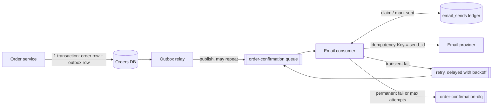

# `messaging-streaming`: a sample answer

A real answer from a Claude Code session, with the numbers behind it. The prompt is the skill's starter prompt (the first one in its prompts file). The answers are excerpts of single runs picked to be typical in length; the token and cost figures are means over 3 runs with the skill and 3 without.

## Prompt

> Order confirmation emails go out twice after consumers restart. Design the queue, retries, dead letters and idempotent consumers so each email is sent once.

## Tokens

| | Without the skill | With the skill |
|---|---|---|
| Output tokens (what the model wrote, including its reasoning) | 4,299 | 3,470 |
| Input tokens read across all turns (including cached context) | 51,116 | 73,058 |
| Extra input tokens when the skill is installed | | +21,943 |
| Cost, US dollars at list price | 0.154 | 0.200 |
| Skills invoked in the sample run | none | `messaging-streaming` |

Size of the skill by Claude Code's own estimate (`claude plugin details`): about 210 tokens for its name and description, which are in every session where the skill is installed, and about 3,500 tokens when the skill is used and its instructions are loaded. The estimate is not a measurement.

## Answer with the skill (excerpt)

````text
# Sending each order confirmation email once

## Why it happens now

Your consumer sends the email and only then acknowledges the message (or commits the offset). A restart, deploy or rebalance that lands between those two steps makes the broker redeliver the message, and the email goes out again. That is normal at-least-once delivery.

No queue setting fixes this. Kafka's exactly-once only covers writes back into Kafka. SQS FIFO deduplicates only within a 5-minute window, and only on the producer side. The broker's guarantee ends where your consumer starts, so the consumer itself must be idempotent.

**Goal:** at-least-once delivery, plus a consumer that records which emails it has sent, keyed by order, plus an idempotency key passed to the email provider.

## Architecture



### 1. Producer: transactional outbox
- In the same transaction that creates the order, insert `outbox(event_id, order_id, type='OrderConfirmed', payload)`.
- A relay publishes rows that haven't been sent yet and marks them sent. It may publish the same row twice, which is fine because the consumer deduplicates.
- This removes the dual-write gap (order saved but no event, or an event for an order that rolled back).

### 2. Message contract
| Field | Value |
|---|---|
| `event_id` | UUID from the outbox row |
| `send_id` | **`order-confirmation:{order_id}`**. This is the dedupe key. It's a business key, so a re-published event or a replayed order still maps to the same key. |
| `order_id` | partition / message-group key |
| `attempt`, `first_seen_at`, `schema_version` | used for retries and the DLQ |

Use `send_id` as the dedupe key, not `event_id`. If an order is re-emitted with a new event id, it must still produce one email. If you ever want a deliberate resend, make it a different key, such as `order-confirmation:{order_id}:resend:{n}`.

### 3. Queue choice
Use a work queue (SQS, or RabbitMQ with quorum queues). This is task distribution: each message needs its own retry and delay, and nothing needs replay. If your events are already on Kafka, a consumer group keyed by `order_id` works the same way. In both cases, ack or commit only after the ledger has been updated.

### 4. Idempotent consumer: the `email_sends` ledger

```sql
CREATE TABLE email_sends (
  send_id       text PRIMARY KEY,           -- order-confirmation:{order_id}
  status        text NOT NULL,              -- SENDING | SENT | FAILED
  attempts      int  NOT NULL DEFAULT 0,
  lease_until   timestamptz,
  provider_msg_id text,
  updated_at    timestamptz NOT NULL DEFAULT now()
);
```

[... excerpt ends; the full answer is longer]
````

## Answer without the skill (excerpt)

````text
The working directory is empty, so this design isn't tied to any particular stack. The examples use Postgres and generic queue terms, and I've noted where SQS, Kafka and RabbitMQ differ.

## Why emails go out twice

Nearly every queue delivers a message *at least once*. The duplicate happens in this gap:

```
receive msg → send email ✅ → [consumer restarts] → ack ❌ → msg redelivered → send email again
```

When a consumer restarts, the message is redelivered in a few ways: the SQS visibility timeout expires, a RabbitMQ channel closes with an unacked message, or Kafka's last offset commit is behind the record that was processed. The queue can't fix this, because the email is a side effect outside the queue's transaction. The fix is to make the consumer idempotent: redelivery stays possible, but a redelivered message never sends a second email.

## 1. Producer: transactional outbox

Write the event in the same database transaction as the order:

```sql
BEGIN;
INSERT INTO orders (...) VALUES (...);
INSERT INTO outbox (event_id, type, payload)
VALUES ('order-confirmation:' || :order_id, 'OrderConfirmed', :payload);
COMMIT;
```

A relay process publishes outbox rows and marks them published. The relay can also publish a row twice, which is fine because the consumer handles duplicates.

**Key rule:** the idempotency key is derived from the business event: `order-confirmation:{order_id}`. Don't use the broker's message ID, because a republished message gets a new one.

## 2. Consumer: a dedupe table with a claim and states

[... excerpt ends; the full answer is longer]
````

Agent model claude-opus-5-5, Claude Code 2.1.296. Excerpts are cut at the length shown; the model-judged and regular-expression checks for this skill are in [`evals/results/outcome.md`](../evals/results/outcome.md).
