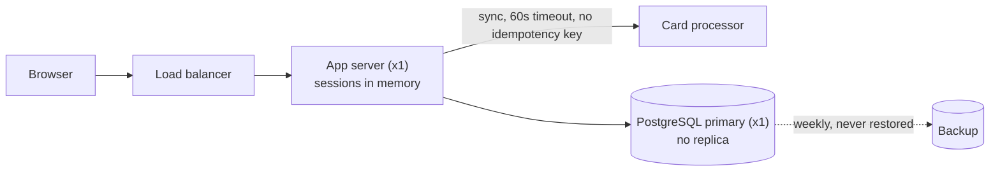

# `system-design-review`: a sample answer

A real answer from a Claude Code session, with the numbers behind it. The prompt is the skill's starter prompt (the first one in its prompts file). The answers are excerpts of single runs picked to be typical in length; the token and cost figures are means over 3 runs with the skill and 3 without.

## Prompt

> Review this design and give me findings with evidence, severity, impact and a fix for each one. The system: one PostgreSQL primary with no replica and one app server behind a load balancer; user sessions are stored in the app server's memory; checkout charges the card synchronously inside the HTTP request with a 60 second timeout and no idempotency key; backups run weekly and nobody has ever restored one.

## Tokens

| | Without the skill | With the skill |
|---|---|---|
| Output tokens (what the model wrote, including its reasoning) | 2,968 | 4,467 |
| Input tokens read across all turns (including cached context) | 30,438 | 73,727 |
| Extra input tokens when the skill is installed | | +43,289 |
| Cost, US dollars at list price | 0.120 | 0.225 |
| Skills invoked in the sample run | none | `system-design-review` |

Size of the skill by Claude Code's own estimate (`claude plugin details`): about 210 tokens for its name and description, which are in every session where the skill is installed, and about 3,900 tokens when the skill is used and its instructions are loaded. The estimate is not a measurement.

## Answer with the skill (excerpt)

````text
# Design review: single-node checkout system

**Verdict: not ready for production traffic that handles money.** There are two Critical findings: the checkout can charge a card twice or charge it without recording an order, and the database cannot be shown to be recoverable. Both can be fixed without changing the overall architecture. The simple monolith on PostgreSQL is a sound choice. The gaps are in redundancy and correctness, not in the architecture style.

**Scope:** I reviewed only your five-sentence description. I had no code, config, traffic numbers or SLOs, so every "Evidence" line below quotes your description. I assumed the following requirements: checkout is the core journey, no double charges, data loss limited to minutes not days, and no planned downtime for deploys.



---

### F-01 — Checkout can double-charge a card, or charge it without recording an order
**Severity:** Critical · **Confidence:** High
**Evidence:** "charges the card synchronously inside the HTTP request with a 60 second timeout and no idempotency key."
**Impact:**
- **Double charge:** a slow processor call times out at the browser or load balancer, or the user clicks "Pay" again. The second request is a fresh charge, and the processor cannot tell it is a duplicate.
- **Orphaned charge:** the processor succeeds, then the app crashes or the DB write fails before the order is saved. The customer has paid and there is no order.

Both cases lose money directly and lead to chargebacks.

**Fix:**
1. Create a `payment_attempt` row (status `pending`) with a unique idempotency key before calling the processor. Send that key to the processor; most processors, Stripe and Adyen included, honour one.
2. Treat a timeout as status `unknown`, not `failed`. Settle it by asking the processor for the outcome or by handling its webhook.
3. Run a daily reconciliation that matches processor charges against orders.
4. Disable the Pay button after the first submit. This is a convenience, not the fix.

Effort: medium.

**Verify:** inject a crash right after the processor responds, then retry the same checkout. You should see exactly one charge and an order that is recovered. Separately, send two concurrent submits and check that only one charge appears.

### F-02 — Backups have never been restored and run only weekly
**Severity:** Critical · **Confidence:** High
**Evidence:** "backups run weekly and nobody has ever restored one." There is also only one database copy (see F-03).
**Impact:**
- **Best case:** a lost disk or a bad `DELETE` costs up to 7 days of orders, payments and accounts (RPO ≈ 7 days).
- **Worst case:** the backup turns out to be unusable (incomplete, corrupt, missing WAL, no credentials) and the data is gone for good. Recovery time (RTO) is unknown because nobody has timed a restore.

[... excerpt ends; the full answer is longer]
````

## Answer without the skill (excerpt)

````text
# Design review: single-node checkout system

All evidence below comes from your description. I haven't seen code, configs or metrics, so some impacts depend on details I've noted, such as the load balancer's timeout and the payment provider.

---

## 1. Card charges can be duplicated: no idempotency key and a long synchronous timeout. **Critical**

**Evidence:** "Checkout charges the card synchronously inside the HTTP request with a 60 second timeout and no idempotency key."

**Impact:**
- If the provider responds slowly, the user, the browser or the load balancer gives up. The user clicks "Pay" again and the system creates a second charge. Nothing ties the two attempts together, so the provider treats them as separate payments.
- If your side times out after the provider has already captured the charge, you can't tell whether it succeeded. Retrying risks a double charge, and not retrying risks a paid order you never recorded.
- The result is customers charged twice, chargebacks, refund work and lost trust. Card networks penalise merchants with high chargeback rates.

[... excerpt ends; the full answer is longer]
````

Agent model claude-opus-5-5, Claude Code 2.1.296. Excerpts are cut at the length shown; the model-judged and regular-expression checks for this skill are in [`evals/results/outcome.md`](../evals/results/outcome.md).
