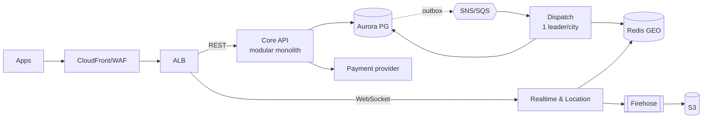

# `system-design`: a sample answer

A real answer from a Claude Code session, with the numbers behind it. The prompt is the skill's starter prompt (the first one in its prompts file). The answers are excerpts of single runs picked to be typical in length; the token and cost figures are means over 3 runs with the skill and 3 without.

## Prompt

> Design the backend for a food-delivery app: 500,000 orders a day across 3 cities, a team of 8, and AWS. Give me a design doc with a diagram, a capacity table and ADRs for the hard decisions.

## Tokens

| | Without the skill | With the skill |
|---|---|---|
| Output tokens (what the model wrote, including its reasoning) | 15,569 | 13,251 |
| Input tokens read across all turns (including cached context) | 160,032 | 140,036 |
| Extra input tokens when the skill is installed | | -19,996 |
| Cost, US dollars at list price | 0.602 | 0.521 |
| Skills invoked in the sample run | none | `system-design` |

Size of the skill by Claude Code's own estimate (`claude plugin details`): about 220 tokens for its name and description, which are in every session where the skill is installed, and about 2,900 tokens when the skill is used and its instructions are loaded. The estimate is not a measurement.

## Answer with the skill (excerpt)

````text
I wrote the design doc to `food-delivery-design.md`. It has requirements, a capacity table, a Mermaid diagram, a component table, a data model, a failure analysis, an operations plan, a validation plan and six ADRs. The numbers rest on stated assumptions (mostly about how traffic peaks), and nothing has been load-tested yet.

**Main finding:** orders are the easy part. 500k a day works out to about 6 orders/s on average and about 40/s at the busiest moments. The real load is couriers' GPS pings: about 9,000 updates/s at peak, plus about 13,000 live-tracking messages/s going out over roughly 130,000 open connections. So the design keeps location data out of the main database and runs the live connections as their own service.

**Capacity at peak**
| | Peak |
|---|---|
| Orders | ~40/s |
| Order status updates | ~400/s |
| Browse reads | ~2,500/s (mostly cached) |
| Courier GPS updates | **~9,000/s** |
| Open live connections | ~130,000 |
| Order data | ~0.9 TB/year (fits one Postgres cluster) |
| Location history | ~3.8 TB/year (stored in S3) |

**Architecture:** the main app is a single service with internal modules (catalog, orders, payments, users, admin). Live connections and location updates run as a separate service. Courier dispatch and background jobs run from the same codebase as separate processes. Data lives in Aurora PostgreSQL (the source of truth), Redis and S3. Events go through SNS/SQS, written first to the database so none are lost (the "outbox" pattern).



**ADRs (the hard decisions)**
1. **One main service plus a separate live-connections service, not microservices.** Eight people can't run 10 or more services, and nothing at this load needs them.
2. **One Aurora PostgreSQL database, no sharding.** Every row carries `city_id` so the database can be split by city later if needed. Peak writes are only ~400/s.
3. **Courier locations go to Redis and S3, never Postgres.** At 9,000 updates/s they would compete with checkout on the main database.
4. **Outbox plus SNS/SQS instead of Kafka.** About 400 events/s doesn't justify running Kafka with this team.
5. **Payments: authorize at checkout, capture at delivery.** Every payment call carries a fixed retry key, and a timeout marks the payment as "unknown" until the provider confirms, which prevents double charges. Card entry stays with the payment provider.
6. **One AWS region across three availability zones, no multi-region.** That's enough for 99.9% uptime. A warm standby in a second region is deferred until it's needed.

[... excerpt ends; the full answer is longer]
````

## Answer without the skill (excerpt)

````text
I wrote the design doc, but it isn't published: the request to upload it to claude.ai wasn't approved. It's saved locally at:

`<temporary path>`

If you approve the upload, it becomes a private page you can share.

**The main recommendation:** at this scale, the hard part is getting the dinner peak right with only eight people to run the system. Raw throughput isn't the problem. So it's one modular monolith on ECS Fargate with one Aurora PostgreSQL database, plus two small services where the load is different: courier GPS, and live tracking for customers.

**Capacity, at 3× normal peak to cover rain and promotions:**

| Load | Normal peak | Design target |
|---|---|---|
| Orders placed | 21/s | **65/s** |
| Order database writes | 630/s | **2,000/s** |
| Courier GPS pings | 7,500/s | **15,000/s** |
| Browse and menu API | 4,200 rps | **12,000 rps** |
| Live tracking connections | 75k | **150k** |
| Order storage | 5 GB/day | **1.8 TB/yr** |

The 3× target assumes the busiest hour carries 15% of daily orders. GPS is the only high-volume path, and it's about three orders of magnitude more writes than orders.

[... excerpt ends; the full answer is longer]
````

Agent model claude-opus-5-5, Claude Code 2.1.296. Excerpts are cut at the length shown; the model-judged and regular-expression checks for this skill are in [`evals/results/outcome.md`](../evals/results/outcome.md).
