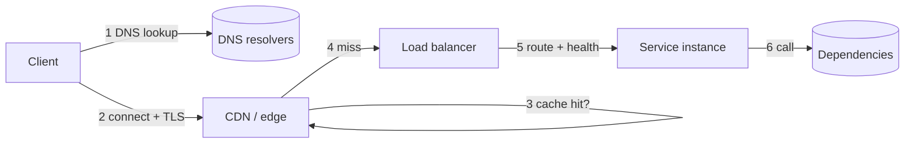

# API design and networking

## Purpose and activation

Define how clients and services talk: the contract (what is promised) and the path (DNS →
CDN → load balancer → service → dependencies). Activate when designing or reviewing an API
or its edge. Not for token/auth design (`identity-security`), cache invalidation policy
(`caching-performance`), or workflow/topology choices (`architecture-scaling`).

## Required inputs

Consumers (browser, mobile, third parties, internal services), request shapes and sizes,
latency targets, traffic profile, geographic spread, compatibility promises, and who
controls the client. Missing: assume a public JSON-over-HTTPS API with unknown clients.

## Workflow

1. **List consumers and top operations.** For each: caller, data returned, frequency,
   latency target, whether it changes state, whether it can be retried.
2. **Choose the API style** (matrix below) per boundary; different boundaries may differ.
3. **Write the contract first** (resources/operations, schemas, status/error model,
   pagination, idempotency, rate limits, timeouts, versioning). Use the checklist in
   [references/api-contract-checklist.md](references/api-contract-checklist.md).
4. **Trace the request lifecycle** end to end (below) and attach a time budget to each
   hop from the latency target.
5. **Choose the edge**: DNS strategy, CDN for cacheable content, load balancer layer and
   algorithm, TLS termination point, health checks.
6. **Set connection management**: keep-alive/pooling, multiplexing, HTTP version, limits.
7. **Define timeouts and retry rules** per call; retries only for idempotent operations.
8. **Decide compatibility policy** and how breaking changes are introduced.
9. **Validate** with contract tests, a load test through the real edge, and failure injection.

## Decision framework

### API style

| Style | Strengths | Weaknesses | Choose when |
|---|---|---|---|
| REST over HTTP/JSON | Uniform, cacheable GETs, tooling, easy third-party use | Over/under-fetching, many round trips for composite views | Public APIs, CRUD-like resources, cache-friendly reads |
| GraphQL | Client-shaped queries, one round trip for composite views, typed schema | Harder HTTP caching, query cost control and N+1 resolver problems, authorization per field | Many diverse clients (mobile/web) needing flexible views of a graph of data |
| RPC (for example gRPC) | Compact binary encoding, streaming, generated typed clients, low overhead | Less browser-native, harder to debug by hand, tighter coupling to schema evolution rules | Internal service-to-service calls, streaming, performance-sensitive paths |
| SOAP/XML | Formal contracts, WS-* standards | Verbose, heavyweight | Existing enterprise integrations that mandate it |

Default: REST for external, RPC or REST internally per team tooling. Mixing is fine if each
boundary has one clear style. Cost of GraphQL: you must add query depth/cost limits,
batching (dataloader pattern) and per-field authorization.

### HTTP version

| Version | Key property | Consequence |
|---|---|---|
| HTTP/1.1 | Persistent connections; one request at a time per connection | Browsers open several connections; head-of-line blocking at the application layer |
| HTTP/2 | Multiplexed streams over one TCP connection, header compression | Fewer connections; TCP packet loss stalls all streams (transport head-of-line blocking) |
| HTTP/3 | HTTP over QUIC (UDP-based), per-stream loss recovery, faster handshake, connection migration | Better on lossy/mobile networks; UDP must be allowed; support depends on CDN/LB |

Recommend: enable the newest version your edge supports with automatic fallback; do not
make correctness depend on the version. VERIFY RFC numbers cited elsewhere (9110 semantics,
9112, 9113, 9114, 9000) against the IETF site before quoting.

### Load balancer layer

| Layer | Sees | Use when |
|---|---|---|
| L4 (TCP/UDP) | Addresses and ports | Raw throughput, non-HTTP protocols, TLS passthrough |
| L7 (HTTP) | Paths, headers, cookies | Path routing, TLS termination, retries, canary weighting, WAF, per-request balancing for long-lived HTTP/2 connections |

Algorithms: round robin (uniform requests), least connections / least outstanding
requests (variable duration), consistent hashing (cache affinity, sticky data). Health
checks must test readiness; remove unhealthy targets and drain connections on deploy.

## Architecture and implementation guidance

### Request lifecycle (what can fail at each hop)

Hop notes: DNS answers are cached per TTL (low TTL speeds failover but raises query load;
resolver caches may ignore it). TLS and TCP/QUIC handshakes add round trips for new
connections: reuse connections. CDN serves cacheable responses near the user; set
`Cache-Control` deliberately and never cache personalized responses without a variation key
(HTTP caching semantics: RFC 9111, VERIFY). The load balancer needs a timeout longer than
the slowest legitimate request and shorter than the client's.

### Timeouts and deadlines

Every outbound call has a timeout. Propagate a *deadline* downward; callee timeout < caller
timeout, otherwise work continues after the caller gave up. Typical layering: client
timeout > LB idle timeout > service timeout > dependency timeouts (choose values from
measured p99, not folklore).

### Idempotency and retries

`GET`, `PUT`, `DELETE` are idempotent by HTTP semantics; `POST` is not. For unsafe
operations offer an `Idempotency-Key` header: store key + request fingerprint + result;
replay returns the stored result; same key with a different payload is rejected (409/422).
Clients retry only on network errors/timeouts/5xx marked retryable, with exponential
backoff and jitter (`reliability-resilience`).

### Errors

Use a consistent machine-readable error body (consider RFC 9457 problem details, VERIFY)
with a stable error code, human message, and correlation id. Distinguish 4xx (caller can fix)
from 5xx (server fault) and use 429 with `Retry-After` for rate limits. Never leak internals.

### Pagination, filtering, versioning

Prefer cursor (keyset) pagination for large or changing sets; offset pagination is simple
but slow and unstable under concurrent writes. Version by URL or header with a written
deprecation policy.

## Failure and edge cases

- Retried non-idempotent POST creating duplicates (missing idempotency key).
- LB idle timeout shorter than a long request → intermittent 502/504.
- Stale DNS or CDN cache after failover or release; cached error responses.
- Connection pool exhaustion or ephemeral port exhaustion under load.
- Slowloris-style slow clients holding connections; set header/body read timeouts.
- Thundering herd on cache expiry at the CDN; request coalescing at the edge.
- Large payloads: enforce size limits, use streaming or upload URLs (`storage-systems`).
- WebSockets/SSE need LB support for long-lived connections and a reconnect protocol.
- Clock skew affecting signed requests and token expiry.

## Validation

- Contract tests from the schema (consumer-driven where clients are known).
- Replay each operation twice (idempotency) and with injected timeouts.
- Load test through the same edge path; record p50/p95/p99 per hop.
- Compat check: diff the schema against the previous release; any removal, type change or
  new required field is breaking.
- Falsifier for the chosen HTTP/CDN setup: p99 for distant users does not improve vs. origin.

## Expected output

An API contract (operations, schemas, error model, idempotency, pagination, versioning,
limits), an edge design (DNS, CDN, LB, TLS, timeouts) with a Mermaid request-path diagram,
a time budget per hop, and an ADR for style choices (`../system-design/assets/templates/adr.md`).

## Sources and confidence

- Book (direct): TLS/HTTPS walkthrough (printed p. 16-17) — verified against supplied text; used only to be corrected
- Book (synthesized): HTTP versions (p. 53), API styles (p. 62), CDN (p. 84), DNS (p. 97), URL walk-through (p. 99) — TOC-anchored only
- Modern: IETF RFC 9110/9111/9112/9113/9114/9000/9457 — from author knowledge, VERIFY
- Needs workload validation: timeouts, TTLs, connection limits, algorithm choice
