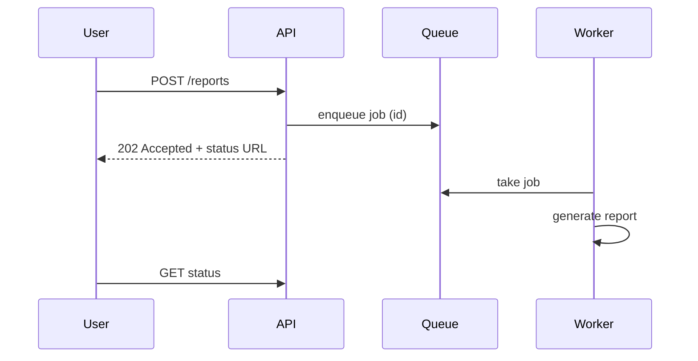

# Architecture style and scaling

## Purpose and activation

Decide the *shape* of the system (how many deployables, how they talk, how it scales) and
only then how much to scale. The rule: **no architectural complexity before a measured or
calculated bottleneck or a concrete organizational constraint justifies it.**

Activate on style questions (monolith vs microservices), scaling plans, and slow-under-load
complaints. Hand off data-tier specifics to `database-selection`, `caching-performance`,
`sharding-replication`; network edge to `api-networking`.

## Required inputs

Peak load and growth (from `requirements-capacity`), current architecture or baseline, team
size and deployment independence needs, measured per-node limits or profiles (or mark
`UNMEASURED`), and the failure/consistency constraints that cross component boundaries.

## Workflow

1. **State the baseline.** Default: one deployable (a modular monolith: clear internal
   module boundaries, one codebase, one database), stateless app instances behind a load
   balancer, one relational database.
2. **Find the bottleneck first.** Follow the procedure in
   [references/bottleneck-and-scaling-ladder.md](references/bottleneck-and-scaling-ladder.md):
   measure CPU, memory, IO, network, locks/contention, database, and downstream limits at
   current or load-tested peak. Name the saturated resource and the metric.
3. **Pick the cheapest fix for that bottleneck** by climbing the scaling ladder (profile and
   fix → cache → vertical → horizontal stateless tier → read replicas → async offload →
   data partitioning → service split). Stop at the first rung that clears the requirement
   with headroom.
4. **Choose the architecture style** with the matrix below, driven by team and deployment
   constraints, not by traffic alone.
5. **Choose communication per interaction** (sync vs async) with the rules below.
6. **For multi-step workflows across services**, choose orchestration or choreography.
7. **Define scaling triggers and limits** (metric, threshold, action, ceiling) and the
   next rung to climb.
8. **Record an ADR** (`../system-design/assets/templates/adr.md`) including the rung
   rejected as too costly and the number at which the decision is revisited.

## Decision framework

### Architecture style

| Style | Choose when | Costs you accept | Avoid when |
|---|---|---|---|
| Modular monolith | One team or a few; fast iteration; shared transactions; load fits scaled instances | Single deploy unit; discipline needed to keep modules independent | Teams blocked by shared releases for a measured reason |
| Service-oriented (a few coarse services) | Distinct domains with different scaling/availability or ownership; a few teams | Network calls, contract management, distributed failure modes | The services share one database and change together |
| Microservices (many fine services) | Many autonomous teams; independent release cadence is a measured bottleneck; mature CI/CD, observability and on-call exist | Operational overhead, distributed transactions, latency, versioning, testing cost | Small team, unclear domain boundaries, no platform engineering |

Warning sign: a **distributed monolith** - services that must deploy together, share a
database schema, or call each other in long synchronous chains. It has the costs of
distribution without the benefits.

### Scaling mode

| Mode | When | Limit |
|---|---|---|
| Don't scale | Headroom ≥ requirement × growth horizon, measured | None; revisit at trigger |
| Vertical (bigger machine) | Stateful or hard-to-partition component; quick relief; below the provider's largest size | Ceiling, single failure domain, cost non-linear at the top |
| Horizontal | Stateless tier; independent requests; need redundancy | Requires statelessness, shared state externalized, load balancing, connection limits downstream |

### Sync vs async

| Use synchronous when | Use asynchronous when |
|---|---|
| The caller needs the answer to proceed | Result can arrive later; user need not wait |
| Latency budget allows the callee | Callee is slow, unreliable or rate-limited |
| Simple failure handling suffices (timeout + error) | Work is spiky and should be smoothed by a queue |
| | Fan-out to many consumers (see `messaging-streaming`) |

Asynchrony trades latency for decoupling at the price of: eventual consistency,
duplicate/out-of-order handling, observability across hops, and operational parts. If
nothing needs smoothing, retry isolation or fan-out, a direct call is simpler.

### Orchestration vs choreography

| | Orchestration (central coordinator) | Choreography (services react to events) |
|---|---|---|
| Visibility of the workflow | One place defines and shows it | Spread across services; needs tracing |
| Adding a step | Change coordinator | Change/consume in several services |
| Coupling | Services coupled to coordinator | Services coupled via event contracts |
| Risks | Coordinator is a throughput and availability dependency; may become a god service | Cyclic event chains, hard debugging, implicit ordering |
| Use when | Ordered multi-step business process with compensation | Loosely related reactions to a fact (email, analytics, search index) |

Either way, a failure midway needs designed compensation (saga) or reconciliation; neither
style provides distributed atomicity by itself (see `transactions-consistency`).

## Architecture and implementation guidance

- **Stateless app tier**: sessions in a shared store or signed tokens; no local-disk
  state; graceful shutdown (drain connections); health checks that test readiness, not
  just liveness.
- **Module boundaries in a monolith**: separate packages, no cross-module table access,
  explicit interfaces; this makes later extraction cheap.
- **Service boundaries** follow business capabilities and data ownership: one service owns
  its data; others use its API or events. Shared databases are a red flag.
- **Backpressure**: bound queues, pools, concurrency; reject early instead of queueing
  forever.
- **Connection math**: instances × pool size must stay under database connection limits;
  add a pooler before adding instances.
- Diagram the chosen style with the sync/async arrows labeled; example of an async offload:

## Failure and edge cases

- Scaling out a stateless tier moves the bottleneck to the database or a downstream API;
  re-run the bottleneck check after each rung.
- Autoscaling lag: scaling reacts in minutes; spikes faster than that need headroom or
  queues. Scale-in can kill in-flight work: drain first.
- Retry storms between services amplify load; see `reliability-resilience`.
- Splitting a service splits transactions: operations that were atomic become sagas.
- Chatty services: N+1 calls across the network multiply latency and failure probability.
- Deployment coupling: one slow dependency in a sync chain sets availability for all
  upstream callers.

## Validation

- Profile or load test at 1.5× peak; the saturated resource named in step 2 must move or
  disappear after the change, and p99 must stay within budget.
- Confirm linear-ish scaling: doubling instances should roughly double throughput until the
  next bottleneck; if not, find the shared resource (lock, DB, single queue).
- For a style change, measure lead time or deployment conflicts before/after; if none were
  measured, the change is not yet justified.
- Falsifier for "microservices needed": teams can release independently from a modular
  monolith without conflicts.

## Expected output

A bottleneck statement (metric and evidence), the chosen rung of the ladder and why higher
rungs are deferred, an architecture-style recommendation with the matrix rationale, a
sync/async table per interaction, scaling triggers, and an ADR.

## Sources and confidence

- Book (direct): orchestration vs choreography and their trade-offs (printed p. 38-39) — verified against supplied text
- Book (synthesized): scaling ladder from "scale a website to millions of users" (p. 55-57) and virtualization vs containers (p. 40) — TOC-anchored only
- Modern: monolith-first and distributed-monolith guidance is widely discussed practice — from author knowledge, VERIFY with a cited source before quoting
- Needs workload validation: every threshold, per-node limit, autoscaling parameters
