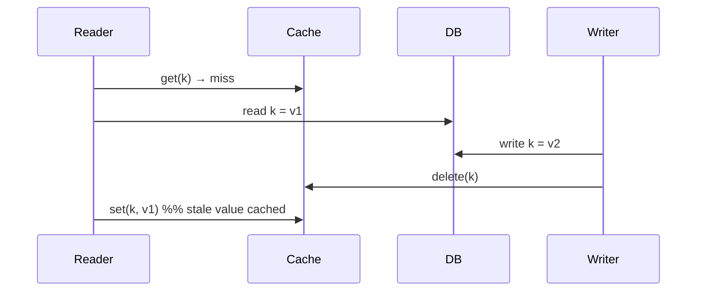

# Cache design reference: formulas, sensitivity, performance triage

Numbers are illustrative.

## 1. Benefit formulas

- Effective latency: L = h × t_cache + (1 − h) × t_miss, where t_miss includes the cache
  lookup plus DB read plus fill.
- Backing-store load: R_db = (1 − h) × R, with R total read rate.
- Hit ratio from key distribution: h ≈ share of requests covered by the keys that fit in
  the cache (for skewed access this can be high with a small cache).
- Memory: M = N_entries × (S_value + S_key + S_overhead) ÷ fill_ratio.

## 2. Worked sensitivity (R = 10,000 reads/s, t_cache = 1 ms, t_miss = 25 ms, DB ceiling 3,000 reads/s)

| Hit ratio h | Effective latency | DB reads/s | DB within ceiling? |
|---|---|---|---|
| 0.50 | 13.0 ms | 5,000 | no |
| 0.80 | 5.8 ms | 2,000 | yes |
| 0.95 | 2.2 ms | 500 | yes |
| 0.00 (cache down) | 25 ms | 10,000 | **no** |

Calculation check: 0.8 × 1 + 0.2 × 25 = 5.8 ms; 0.95 × 1 + 0.05 × 25 = 2.2 ms.
Interpretation: the cache is only safe as a *performance* layer if the system survives the
last row. Otherwise it is a *capacity* dependency: it needs replication, warm standby,
request shedding, or a fallback tier, and its failure must be in the failure analysis.
Break-even: with the DB ceiling at 3,000 reads/s and R = 10,000, the minimum hit ratio is
1 − 3,000/10,000 = 0.70.

## 3. Write-race timeline (cache-aside, delete after write)



Backstops: TTL; set with a version and refuse older versions; delayed second delete; fill
only under a lease taken before reading.

## 4. Stampede protection (single-flight pseudo-code)

```
def get(key):
    v = cache.get(key)
    if v is not None: return v
    if cache.set_if_absent("lock:"+key, token, ttl=5s):
        try:
            v = db.load(key); cache.set(key, v, ttl=jitter(300s)); return v
        finally:
            cache.delete_if_equals("lock:"+key, token)
    else:
        sleep(small random); return cache.get(key) or db_fallback_with_limit(key)
```

Lock TTL must exceed the loader's time bound; fallback path must be rate limited.

## 5. Negative caching and Bloom filter

- Cache "not found" for 30-60 s to absorb repeated lookups of non-existent ids (shorter than
  positive TTL so new records appear quickly).
- Bloom filter of valid ids: false positives allowed (extra DB lookups), false negatives
  not allowed - rebuild when ids are added, or add new ids to the filter on creation.

## 6. Performance triage (before or alongside caching)

1. Define the metric and target (p99 of endpoint X < Y ms at Z req/s).
2. Break down the time: client, network, server CPU, DB, downstream calls (tracing).
3. Look for: N+1 queries, missing/unused indexes, unbounded result sets, serialization of
   large payloads, synchronous calls that could be parallel or deferred, lock contention,
   connection-pool waits, GC pauses, cold starts.
4. Fix the largest contributor; re-measure; repeat.
5. Only then cache, batch, or move work off the request path (`messaging-streaming`).

Diagnosing a process with high CPU/memory/IO (the book's p. 70 topic, TOC-anchored only):
check CPU vs run queue, memory/swap, IO wait and per-process IO, network sockets, then
profile (flame graph) or trace system calls; tool names vary by OS.

## 7. Cache checklist

- [ ] Measured need and expected hit ratio
- [ ] Keys include all variation (tenant, locale, permissions)
- [ ] TTL with jitter; invalidation path defined; race analysis done
- [ ] Stampede, penetration, avalanche, hot-key protections chosen
- [ ] Cache timeout shorter than caller deadline; fallback behavior defined
- [ ] DB survives h = 0 or load shedding exists
- [ ] Memory sized; eviction policy chosen; headroom for buffers
- [ ] No unrecoverable data lives only in the cache (or write-back loss accepted in writing)
- [ ] Metrics and alerts: hit ratio, evictions, latency, errors
