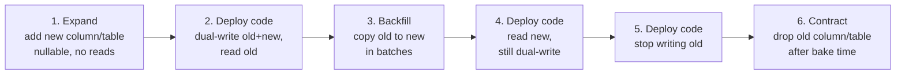

# Deployment and delivery

## Purpose and activation

Make every change reversible, observable and small enough that a bad one costs minutes,
not hours. Activate when designing a release process, a migration, a rollout of a risky
feature, or when a deploy caused an incident. Not for incident response design in general
(`reliability-resilience`) or monitoring design (`observability`).

## Required inputs

Architecture (stateless services, databases, queues), release frequency goal, traffic
profile and safe rollout windows, existing CI/CD, environments, tolerance for downtime and
for mixed versions running together, state/schema involved in the change, and the SLIs
that define "healthy".

## Workflow

1. **Classify the change**: code only, config, schema/data format, infrastructure, or
   dependency version. Each class has its own rollback story.
2. **Decide compatibility**: during any rollout old and new versions run at once and
   share data and messages. List every shared contract (database schema, queue message
   format, API, cache entry format, files).
3. **Make the change backward compatible** with the previous version and the next
   (n-1 / n+1), splitting it into independently safe steps if necessary (expand/contract,
   two-phase format change).
4. **Choose the rollout strategy** from the table, justified by blast radius, cost and
   rollback speed.
5. **Define the pipeline gates**: build, unit/integration/contract tests, security scans,
   deploy to a pre-production environment, smoke tests, progressive rollout.
6. **Define rollout verification**: SLI guardrails, bake time per stage, automatic
   rollback triggers, who can halt.
7. **Write the rollback plan** and prove it works (rehearse), including data.
8. **Complete the pre/post-deploy checklist** and
   `../system-design/assets/templates/production-readiness-checklist.md` for first launch.

## Decision framework

### Strategy

| Strategy | How | Blast radius | Rollback speed | Cost | Choose when | Watch for |
|---|---|---|---|---|---|---|
| Recreate | Stop old, start new | All users, downtime | Redeploy | Lowest | Non-critical, batch, dev | Downtime |
| Rolling | Replace instances gradually | Grows as rollout proceeds | Roll forward/back gradually | Low | Stateless services, backward-compatible changes | Mixed versions; needs health checks and max-unavailable limits |
| Blue-green | Two production-capable stacks; switch traffic from old (blue) to new (green) | All users at switch, but instant revert | Fast (switch back) | High (two stacks) | Strict downtime limits, fast revert needed | Shared database/state is the hard part; warm-up and connection draining |
| Canary | Send a small share of traffic to the new version, increase on healthy signals | Small initially | Fast (route away) | Moderate | Risky changes, large user base, good metrics | Needs sound metrics and enough traffic to detect problems |
| A/B test | Different versions to user cohorts to measure outcomes | Cohort | Disable variant | Moderate | Product experiments | Experiment control; do not use as a safety mechanism alone |
| Feature flag / dark launch | Code ships off; enable gradually or per segment | Controlled by flag | Instant flag off | Low | Decouple deploy from release | Flag debt; combinatorial states; test both sides |
| Shadow traffic | Duplicate requests to the new version without using the response | None to users | n/a | Moderate | Validate performance/behavior | Side effects must be disabled |
| Multi-service simultaneous | Release several services together | Large | Hard | n/a | Avoid | The book (p. 30) notes dependencies are hard to test and roll back |

Correction to the book's framing (p. 31): in practice blue-green is two production-quality
stacks where traffic moves between them; the "staging" environment is a separate,
earlier step. The book's cost and rollback observations hold: instant revert, double the
infrastructure. The book's canary description (gradual, tested in production, needs
monitoring) and A/B description are consistent with the table.

### Change class → approach

| Change | Safe approach |
|---|---|
| Stateless code | Rolling/canary with health checks |
| Config | Treat as a deploy: version, review, stage, roll back |
| Database schema | Expand/contract (below), separate from code deploys |
| Message/API/wire format | Two-phase: readers first, writers later |
| Infra / platform | Immutable infrastructure, staged by environment/region, blue-green for the platform |
| Dependency upgrade | Canary + load test |

## Architecture and implementation guidance

### Backward-compatible schema change (expand → migrate → contract)

Rules: each step is deployable and revertible on its own; migrations run separately from
the code release (not as a hidden startup side effect); never rename or drop in the same
release that stops using it; avoid long locks (online/concurrent index builds, batch
updates, throttle backfills); test the migration on production-size data.

### Rollback safety (AWS Builders' Library, read 2026-10-14)

Old and new versions coexist during rollout, and a change to a persisted or wire format
is the most common reason rollback fails. Use two phases: (1) deploy code that can *read*
the new format but still writes the old; verify all servers finished; (2) after a bake
period, deploy code that *writes* the new format. Do not combine the phases; do not remove
the ability to read the old format until a backfill has rewritten all old data. Roll
forward readers before writers; when rolling back, writers go first. Test upgrades and
downgrades with mixed versions. If a change cannot be rolled back, split it until each
part can.

### Rollout verification

- Guardrail SLIs per stage: error rate, p99 latency, saturation, business success rate,
  compared against the baseline (control group) rather than absolute numbers.
- Stage plan example: 1% → 10% → 50% → 100% with a minimum bake time per stage (set from
  your traffic volume and incident-detection time, not a fixed folklore number).
- Automatic rollback when a guardrail breaches for a set window; humans can halt anytime.
- Deploy to one failure domain (zone/region/cell) at a time; avoid deploying everywhere
  simultaneously.
- Annotate dashboards with deploy markers; keep the previous artifact ready.

### Pipeline

Commit → build once → test (unit, integration, contract) → security/dependency scan →
artifact registry → deploy to staging → smoke/acceptance → progressive production rollout →
verification → promote. The same artifact moves between environments; environment
differences are configuration only. Keep the pipeline fast (minutes) so changes stay
small; small, frequent changes carry less risk than rare large ones (continuous delivery,
a theme of the Builders' Library readings named on printed p. 33).

### Stateful systems

Use rolling upgrades with quorum awareness (one node at a time), verify replication health
between steps, and take a backup/snapshot before irreversible steps. Failover-based upgrades
need a tested failover (`sharding-replication`).

## Failure and edge cases

- Rollback after data was written in a new format.
- Migration locks a hot table and causes an outage.
- Mixed-version fleet: new code writes a message old consumers reject.
- Canary receives unrepresentative traffic (internal users only); metrics too sparse to
  detect a problem; time-of-day effects.
- Health checks pass but the feature is broken (shallow checks).
- Config deployed everywhere at once with no staging; flag service outage disables features.
- Rollout paused halfway leaving a long-lived mixed state.
- Caches populated by the new version break the old (serialization change).
- Deploy coincides with a traffic spike or another team's release.
- Secrets/credentials rotated with the deploy and out of sync.

## Validation

- Rehearse rollback in staging with production-like data and mixed versions.
- Run the migration against a production-size copy; record lock times and duration.
- Inject a bad canary (increase error rate) and confirm automatic rollback fires within
  the target time.
- Track delivery metrics: deployment frequency, lead time, change failure rate, time to
  restore; investigate when change failure rate rises.
- Falsifier: any release step that cannot be reverted within the stated time.

## Expected output

Change classification, compatibility analysis (contracts shared across versions), strategy
choice with rationale, step plan (including expand/contract or two-phase steps),
verification guardrails and rollback triggers, pipeline stages, rollback runbook, and the
completed production-readiness checklist.

## Sources and confidence

- Book (direct): deployment strategies - multi-service, blue-green, canary, A/B (printed p. 30-31); Builders' Library reading list incl. rollback safety, continuous delivery, high-availability deployment (p. 33-34) — verified against supplied text
- Book (synthesized): large-scale outage handling (p. 49-50) — TOC-anchored only
- Modern: AWS Builders' Library "Ensuring rollback safety during deployments" — fetched 2026-10-14; expand/contract migration and DORA-style delivery metrics — from author knowledge, VERIFY
- Needs workload validation: stage sizes, bake times, rollback thresholds
