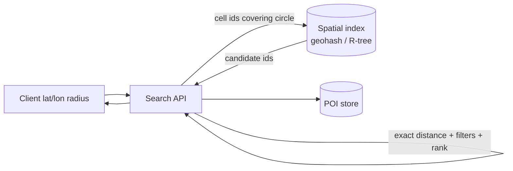

# Geospatial design

## Purpose and activation

Answer "what is near here" and "how do I get there" efficiently, choosing an index and
architecture proportional to the data size and update rate. Most nearby-search features
fit on one database or one in-memory index for a long time; distribution is a later step
justified by arithmetic, not a starting point.

Activate for proximity search, location services, map rendering and routing questions.
Not for general database selection (`database-selection`).

## Required inputs

Entity types (static places vs moving objects), count and growth, update frequency, query
types (radius, k-nearest, bounding box, polygon/geofence, route), query rate, accuracy
and freshness needs, geographic spread and density skew, latency targets, clients
(mobile, web), and map data source and licensing.

## Workflow

1. **Classify the data**: static points of interest (POIs; rarely updated) vs moving
   objects (drivers, couriers; updated every few seconds). They need different designs.
2. **Define the queries and accuracy**: radius vs k-nearest, whether results must be
   ranked by distance, filters (category, open now), maximum radius.
3. **Estimate size and rate** (`requirements-capacity`): entries × bytes, update QPS, query
   QPS. Use the memory arithmetic below to decide single node vs distributed.
4. **Choose the index** (decision table).
5. **Design the query algorithm**: candidate generation via the index → exact distance
   filter → rank → return. Never trust the cell alone.
6. **Design updates**: for moving objects, how location writes reach the index, and what
   is stored durably vs held in memory.
7. **Design the serving architecture**: single node + replicas first; cache hot cells;
   partition by geography only if justified.
8. **Maps/tiles/routing** if in scope (sections below).
9. **Validate** with a representative dataset including dense cities and the poles/
   antimeridian edge cases.

## Decision framework

### Index choice

| Index | Idea | Good for | Watch for |
|---|---|---|---|
| Geohash | Interleave longitude/latitude bits into a string; shared prefix = same cell | Simple prefix queries in any database; sharding by prefix | Cell edges: nearby points can have different prefixes - query the neighbor cells too; cell shape varies with latitude |
| Quadtree | Recursively split a region into 4 when a node exceeds a capacity | In-memory index adapting to uneven density (dense cities split deeper) | Rebuild/rebalance on updates; memory; not a database feature |
| R-tree / GiST (for example PostGIS) | Balanced tree of bounding rectangles | Rich queries (polygons, intersections, k-nearest) inside a spatial database | Write cost for frequently moving points |
| S2 / H3-style cells | Hierarchical cell ids on a sphere (square-ish or hexagonal cells) | Uniform neighbor logic, cell-id keys in key-value stores | Library dependency; picking the cell level |
| Grid by fixed cell | Simple lat/lon grid | Prototypes, uniform density | Poor with skew |
| Search engine geo fields | Geo filter plus text/relevance | Nearby + text search combined | Eventual consistency as a derived index |

Default: use the spatial support in the database you already run (a spatial index, or a
geohash/cell-id column with a normal index) and add a dedicated in-memory structure only
for high-rate moving objects.

### Geohash precision (computed from the bit layout, at the equator)

Each character adds 5 bits, alternating longitude and latitude, so cell size follows from
the bit counts. East-west width shrinks with latitude by roughly cos(latitude).

| Length | Approx. cell (E-W × N-S) at equator |
|---|---|
| 3 | 157 km × 156 km |
| 4 | 39 km × 20 km |
| 5 | 4.9 km × 4.9 km |
| 6 | 1.2 km × 0.6 km |
| 7 | 150 m × 150 m |
| 8 | 38 m × 19 m |

Pick the length whose cell is a bit larger than the search radius, then query the cell
and its 8 neighbors, then filter by exact distance. If too few results return, move to a
shorter prefix (larger cell).

### Single machine or distributed?

Memory for an in-memory index ≈ N × bytes per entry (coordinates, id, a few attributes,
index overhead). Illustrative arithmetic:

| Scenario | N | Bytes per entry (assumed) | Memory |
|---|---|---|---|
| Restaurants worldwide | 50 million | 100 | 5 GB |
| Larger POI set | 500 million | 64 | 32 GB |

Both fit in the RAM of a single commodity server. Replicas then serve **read** capacity.
Triggers to distribute (state your measured numbers):

1. Index memory plus working set exceeds a node's RAM with headroom.
2. Query QPS exceeds what replicas can serve after caching hot cells.
3. Update rate (moving objects) exceeds one writer's capacity.
4. Availability/latency needs require regional placement.

Steps before sharding: read replicas, cache popular queries/cells, shrink entries, tier
cold regions. If distributing, partition by geography (cells/regions) so a query touches
few shards, but expect hotspots (cities): split dense cells further or give them dedicated
shards (`sharding-replication`). Sharding by entity id forces scatter-gather on every
query.

## Architecture and implementation guidance

### Nearby search (static POIs)

Steps: compute cells covering the radius → fetch candidate ids → load attributes (cached) →
compute true distance (haversine or geodesic as needed) → filter and rank → paginate.
Write path: POI changes go to the primary database; the index is updated in the same
transaction or via CDC; reads tolerate seconds of lag. Cache results by (cell, filters).

### Moving objects (drivers, couriers)

Location pings arrive often; storing every ping in a transactional database is wasteful.
Keep the *current* location in memory (or a fast store) keyed by cell for matching; write
a sampled history to durable storage asynchronously. Use TTLs so stale drivers disappear.
Update rate = objects × pings per second; batch writes; smooth by sending updates only
when movement exceeds a threshold. Matching queries read the cell and neighbors.

### Map tiles and rendering

- The world is cut into a pyramid: zoom level z has 4^z tiles (z=0 is one tile); clients
  request only visible tiles (z/x/y).
- Raster tiles: pre-rendered images, easy and cacheable, larger and fixed style. Vector
  tiles: compact geometry rendered on the client, flexible styling, smaller.
- Pre-render low zoom levels (few tiles, heavy reuse); render high zoom levels on demand
  and cache; put a CDN in front; tiles are immutable per data version, so use versioned
  URLs with long cache lifetimes.
- Tile count grows ×4 per zoom level, so storage for pre-rendering every level of the
  whole world is impractical at high zooms: render lazily where users look.
- The book's map-rendering and Google Maps design sections are at printed p. 113-116
  (TOC-anchored only).

### Location service and routing

- Route computation is graph search on a road network (nodes = intersections, edges =
  road segments with weights). Large networks need partitioning or hierarchical
  techniques, precomputation, and caching of popular routes; the concept level is
  enough here, and algorithm choice should be benchmarked on real data.
- Separate pipelines: (1) static road graph (batch-built, versioned), (2) live traffic
  (stream processing updates edge weights), (3) routing service (reads graph + weights),
  (4) ETA (route time with traffic, possibly learned). Updates to weights must not
  require rebuilding the whole graph.
- Map data pipeline: ingest from data providers → validate → build graph/tiles → publish
  versioned artifacts → roll out like a release (`deployment-delivery`).

## Failure and edge cases

- Cell boundary misses: forgetting neighbor cells drops nearby results.
- Antimeridian (±180° longitude) and poles break naive bounding boxes and grids.
- Dense cities: one cell with millions of entries; adapt precision or split further.
- Coordinate order confusion (lat/lon vs lon/lat); datum/projection mismatches; using
  planar distance over long ranges.
- GPS noise and teleporting objects; stale locations for offline drivers.
- Thundering herd on a popular area after an event; cache by cell.
- Index and source of truth drifting apart; periodic rebuild/reconciliation.
- Privacy: precise location is sensitive; minimize retention, coarsen where possible,
  access control (`identity-security`).
- Tile cache poisoning/stale styles after data updates; version tile URLs.

## Validation

- Property test: for random query points, compare index results to a brute-force scan
  over a sample (must match after exact filtering).
- Boundary tests at cell edges, antimeridian, near poles, and in the densest area.
- Benchmark queries at target QPS with a realistic density distribution; record p99.
- Memory measurement per entry at production size; extrapolate with the formula.
- Falsifier for single-node: measured memory or QPS above the node's limit at projected
  growth; falsifier for the geohash length: results often empty or candidate sets very
  large.

## Expected output

Data classification, query definitions, size/rate arithmetic with the single-node verdict,
index choice with rationale, query and update algorithms, serving architecture diagram,
tile/routing design if applicable, edge-case test list, and an ADR.

## Sources and confidence

- Book (direct): none verified in the supplied text (map rendering p. 113-114, design Google Maps p. 115-116, quadtree p. 142-143, nearby restaurants p. 144-145) — TOC-anchored only
- Book (synthesized): single-node-first arithmetic combines these topics with the capacity method
- Modern: geohash cell sizes computed from the 5-bits-per-character layout (script run 2026-10-14); S2/H3/PostGIS/R-tree characterizations — from author knowledge, VERIFY against the library or database documentation
- Needs workload validation: bytes per entry, density skew, update and query rates, accuracy requirements
