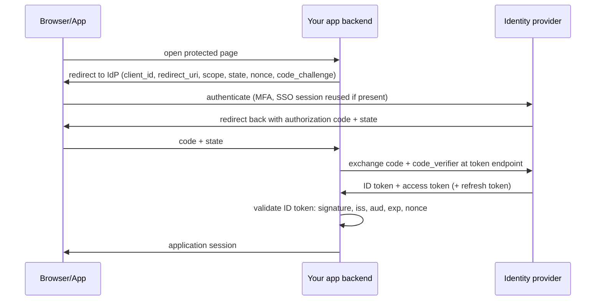

# Modern authentication reference

Parameters marked "fetched 2026-10-14" come from the OWASP Password Storage Cheat Sheet as
read on that date. Re-check the live page before fixing parameters in code.

## 1. Password hashing

| Algorithm | Minimum configuration (OWASP, fetched 2026-10-14) | When |
|---|---|---|
| Argon2id | 19 MiB memory, 2 iterations, parallelism 1 (m=19456, t=2, p=1); equivalent trade-offs listed: 46 MiB with t=1, 12 MiB with t=3 | First choice |
| scrypt | N=2^17 (128 MiB), r=8, p=1; alternatives with lower N and higher p | If Argon2id unavailable |
| bcrypt | work factor at least 10, as large as latency allows; input limited to 72 bytes in most implementations | Legacy systems only |
| PBKDF2 | HMAC-SHA-256 with 600,000 iterations (SHA-1: 1,400,000, legacy only) | When FIPS-140 compliance is required |

Rules that apply to all:

- Salt: unique per password, random, generated by the library, stored with the hash. The
  book's point that a salt is not secret is correct; the missing piece is that the hash
  function must be slow and, ideally, memory-hard.
- Pepper: an additional secret shared across passwords, kept outside the database (secret
  manager or HSM); defense in depth only; plan for rotation.
- Migration from legacy hashes: wrap (hash the old hash with the new algorithm) or rehash on
  next login; mark each record with its algorithm id.
- Compare using the library's verify function (constant time).
- Operational controls matter as much as the hash: rate limiting, lockout/slowdown,
  breached-password screening, MFA, safe recovery.
- Tune cost to your hardware: pick the strongest parameters that keep login latency and
  server capacity acceptable under peak login rate (login rate × hash time = CPU/memory
  needed; hashing is deliberately expensive and can be a DoS vector).

## 2. OIDC / OAuth 2.0 authorization code flow with PKCE (conceptual)



Validation checklist for tokens (JWT or opaque):

1. Signature with a key from the issuer's published key set; algorithm from an allow-list
   (reject `none` and unexpected algorithms).
2. `iss` equals the expected issuer; `aud` contains this service; `exp`/`nbf` in range with
   small leeway.
3. For ID tokens, `nonce` matches the one sent.
4. Scopes/claims checked per operation, never trusted from the client.

Compared with the book's SSO walk-through (central session, token validated via a callback
to the auth server): the same idea, standardized, with signed tokens validated locally and
protection against code interception (PKCE) and CSRF (state).

## 3. HMAC request signing (for partner or machine APIs)

Canonical request to sign (all parts bound to the signature):

```
METHOD \n
PATH \n
CANONICAL_QUERY \n
SIGNED_HEADERS (host, content-type, x-timestamp, x-nonce) \n
SHA256(BODY)
```

- Signature = HMAC-SHA-256(secret key, canonical request); send key id, timestamp, nonce,
  signature in headers.
- Server: look up secret by key id, recompute, compare in constant time, check

  |now − timestamp| ≤ window, reject a seen nonce within the window.

- Why include the timestamp: without it a captured request can be replayed indefinitely;
  with it, replay is limited to the window and nonce cache closes the remainder.
- Why HMAC gives integrity: changing any signed part changes the MAC, and only holders of the
  secret can compute a valid one. It does not give confidentiality (use TLS) or per-user
  identity (the secret identifies the client application).
- Key management: one secret per client, rotate with overlapping validity, store hashed or
  encrypted server-side as appropriate, revoke individually.
- Prefer a standard (HTTP Message Signatures, RFC 9421 - VERIFY) over a bespoke scheme when
  clients can adopt it.

## 4. TLS policy (from RFC 8446 section 1.2, fetched 2026-10-14)

- Static RSA and Diffie-Hellman cipher suites are removed; key exchange always provides
  forward secrecy.
- Handshake messages after ServerHello are encrypted.
- 0-RTT mode saves a round trip but carries no non-replay guarantee between connections
  (section 2.3): disable or restrict to idempotent requests.
- Policy: TLS 1.3 preferred; TLS 1.2 only where clients need it, with AEAD suites and
  forward-secret key exchange; no SSL/TLS 1.0/1.1; automated certificate renewal;
  monitor expiry. Handshake round-trip count for 1.3 (one before application data in the
  full handshake) is from author knowledge, VERIFY.

## 5. STRIDE quick prompts

| Threat | Ask | Typical mitigations |
|---|---|---|
| Spoofing | Can someone pretend to be a user/service? | Strong authN, mTLS, signed tokens |
| Tampering | Can data be altered in transit/at rest? | TLS, signatures, integrity checks, least-privilege writes |
| Repudiation | Can an actor deny an action? | Audit log with identity and correlation ids |
| Information disclosure | Where could data leak (logs, errors, caches, backups)? | Encryption, minimization, access control, scrubbing |
| Denial of service | Which resource can be exhausted cheaply? | Rate limits, quotas, timeouts, autoscaling limits, expensive-endpoint protection |
| Elevation of privilege | Can a low-privilege caller reach a high-privilege function? | Object-level authZ, default deny, separate admin plane |

## 6. Secure defaults list

Default deny; least privilege; secure cookie flags; no default credentials; secrets
outside code; input validated at the boundary; output encoded for its context;
parameterized queries; dependency pinning and scanning; fail closed on auth errors;
security headers; separate environments; logging without secrets.
