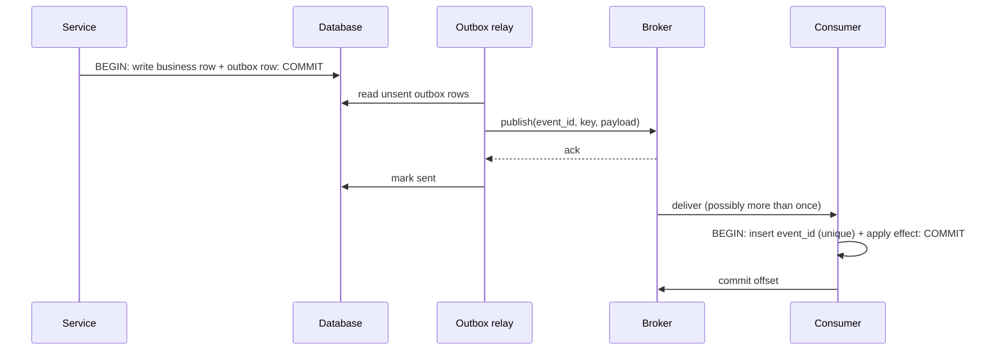

# Messaging patterns, sizing and a failure walk-through

## 1. Producer: outbox flow



Crash points and outcomes: after DB commit before publish → relay publishes later (no loss).
After publish before mark → publish repeats (consumer dedupes by event_id). After consumer
effect before offset commit → redelivery; dedupe table makes it a no-op.

## 2. Idempotent consumer, minimal schema

```sql
CREATE TABLE processed_event (
  event_id   text PRIMARY KEY,
  consumer   text NOT NULL,
  processed_at timestamptz NOT NULL DEFAULT now()
);
-- in the same transaction as the business change:
INSERT INTO processed_event(event_id, consumer) VALUES (:id, 'billing')
ON CONFLICT DO NOTHING;     -- 0 rows inserted → duplicate: skip
```

Retention of the dedupe table must exceed the maximum redelivery window; purge by age.
For external side effects (HTTP call), send `Idempotency-Key: <event_id>`; if the target
cannot honor keys, the effect is not safely retryable and needs reconciliation.

## 3. Sizing (illustrative)

Arrival 4,000 msg/s at peak, handler takes 20 ms, each consumer single-threaded:

- Consumer throughput = 1 / 0.020 = 50 msg/s per consumer thread.
- Consumers needed = 4,000 / 50 = 80 (plus headroom, say 100 at 80% utilization).
- Partitions ≥ number of parallel consumers = 100; choose 128 for growth.
- Backlog after a 10-minute consumer outage = 4,000 × 600 = 2.4 million messages.
  With 100 consumers (5,000 msg/s capacity) vs arrival 4,000/s, net drain = 1,000/s →
  2,400 s = 40 minutes. Raise consumers or batch to drain faster; retention must cover it.
Rule: drain time = backlog ÷ (consume capacity − arrival rate).

## 4. Ordering cheat sheet

| Need | Design |
|---|---|
| Order per entity | Partition key = entity id; one handler at a time per partition |
| Global order | Single partition (throughput limit) - usually rethink the requirement |
| Out-of-order tolerance | Version numbers/timestamps in events; consumers apply "newer wins" |
| Retry without reordering | In-place bounded retry, or pause partition |

## 5. Failure walk-through: "charge once" with at-least-once delivery

1. Consumer receives `order.paid(event_id=E1)`, calls the payment API with key `E1`.
2. Payment API succeeds, consumer crashes before committing the offset.
3. Redelivery: consumer calls the payment API again with key `E1`; the API returns the
   stored result. No double charge - correctness came from the key, not from the broker.
4. If the payment API ignored keys: the card is charged twice. Remedy: reconcile against the
   provider's records; do not rely on delivery semantics. (See `payment-systems`.)

## 6. Retry/DLQ policy template

| Parameter | Value |
|---|---|
| Max attempts | 5 |
| Backoff | 1 s base, ×2, cap 60 s, full jitter |
| Retry classification | by exception type map (transient vs permanent) |
| DLQ payload | original message + error + attempts + first-seen time + consumer version |
| Alert | DLQ depth > 0 for > 15 min, or DLQ rate > 1% of traffic |
| Replay | tool re-injects DLQ messages after fix, preserving event_id |

## 7. When not to use a broker

- One consumer, low volume, tolerant of latency → a database table with a worker polling
  (`SELECT ... FOR UPDATE SKIP LOCKED`) is simpler and transactional with your data.
- Request/response needed with a deadline → direct call with timeout.
- Periodic work → scheduler.

Add a broker when you can name the property you need that the simpler option lacks.

## 8. Checklist

- [ ] Reason for asynchrony recorded
- [ ] Queue vs log chosen with rationale
- [ ] Message key and schema versioned
- [ ] Producer atomicity (outbox/CDC) defined
- [ ] Consumers idempotent; dedupe retention defined
- [ ] Retry, DLQ and replay defined
- [ ] Partitions/consumers sized; drain time computed
- [ ] Backpressure and overload plan
- [ ] Lag, age, DLQ alerts
