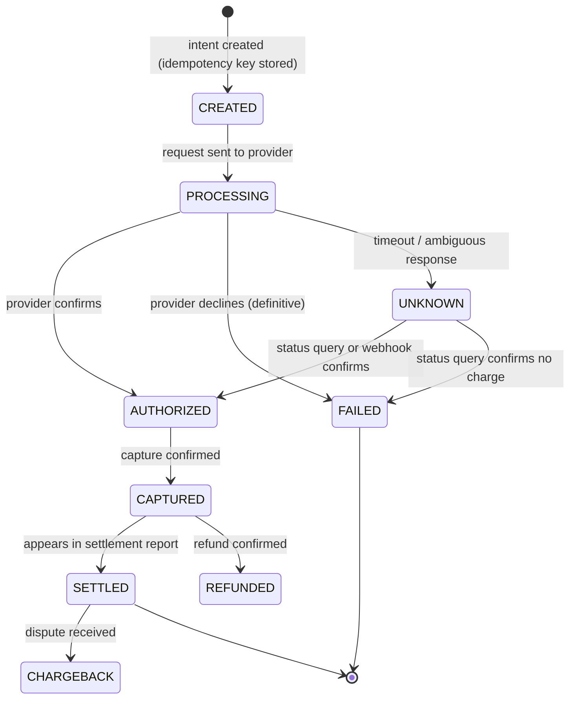

# Payment systems

## Purpose and activation

Move and record money correctly when networks time out, providers retry, messages
duplicate and banks settle days later. Correctness here means: the customer is charged
exactly the intended amount once, every cent is accounted for in an auditable ledger, and
internal records can be proven consistent with external ones (provider reports and bank
statements).

Activate for checkout, payouts, wallets, subscriptions/billing, marketplaces, refunds,
or any design that touches money. Compose with `transactions-consistency`,
`messaging-streaming`, `identity-security`, `reliability-resilience`.

## Required inputs

Money flows (who pays whom, in what currencies), payment methods, providers (PSP,
acquirer, bank rails) and their APIs (sync/async, webhooks, idempotency support),
settlement timing, volume and peak rates, regulatory regime, refund/chargeback needs,
reconciliation sources (provider reports, bank files). Missing: assume a third-party PSP,
card payments, asynchronous confirmation by webhook, USD-like minor units.

## Four things to keep separate

| Stage | What it is | Typical latency | Source of truth |
|---|---|---|---|
| 1. Initiation | The customer's *intent*: order id, amount, currency, method, idempotency key | Immediate | Your payment-intent record |
| 2. External processing | Authorization/capture or transfer at a PSP, acquirer, card network or bank; may time out with an **unknown** outcome; confirmed by response and/or webhook | Seconds (sometimes minutes) | The external party, mirrored in your state |
| 3. Ledger record | Your internal, append-only double-entry record of who owes whom | Immediate after confirmation | Your ledger |
| 4. Final settlement | Funds actually move between institutions; reconciled to bank statements | Hours to days | Provider settlement reports and bank statements |

A payment can be "successful" at stage 2 and still fail at stage 4 (chargeback, bank return),
or succeed externally while your system never recorded it (crash). Design each stage's
state and the transitions between them explicitly.

## Workflow

1. **Map the money flow** and list the parties, accounts and currencies. Identify which
   stage each system owns.
2. **Define the payment state machine** with explicit PENDING/UNKNOWN states (below).
3. **Design idempotency end to end**: client → your API → provider → webhook handler →
   ledger (below).
4. **Design the ledger** (double-entry, immutable) and how balances are derived
   (reference file).
5. **Design failure handling** for each external call: timeout, 5xx, duplicate, late
   webhook, out-of-order webhook, provider outage.
6. **Design reconciliation** with provider reports and bank settlement files; define
   mismatch classes and resolution.
7. **Design refunds, reversals, chargebacks, and corrections** as new ledger entries.
8. **Apply security and compliance**: minimize card-data scope, tokens, access control,
   audit (`identity-security`).
9. **Test failures deliberately** (validation section).
10. Document in the system design document; record ADRs for provider, ledger design and
    reconciliation approach.

## Decision framework

### Payment state machine (example; adapt to your provider)

Rules: UNKNOWN is a first-class state. From UNKNOWN you **query or reconcile**, you do not
blindly resend a new charge. Transitions are monotonic and validated (illegal transitions
rejected); each transition records time, actor, and the provider reference.

### Why retries alone are not enough (walk-through)

Scenario: the API calls the PSP to charge $50. The PSP charges the card, then the network
drops before the response arrives.

1. Naive retry without an idempotency key → the PSP creates a **second** $50 charge.
2. Retry with a key (provider honors it) → the PSP returns the first result. Correct *only
   if* the key is reused, the provider supports keys, and the stored result is still
   retained (providers expire keys; for example Stripe's docs say keys may be pruned
   after at least 24 hours).
3. Crash after the PSP charged but before you recorded it → on restart your record says
   CREATED/PROCESSING. A retry loop never runs because the process died. Needs a recovery
   job that finds stale PROCESSING/UNKNOWN payments and queries the PSP.
4. Webhook arrives twice, late, or before your own DB commit → handler must be idempotent
   and tolerate "unknown payment" by retrying later.
5. The PSP charged the card but later reverses it (failed capture, dispute) → your
   internal state is wrong until reconciliation finds it.
6. Retried *refund* or *payout* creates duplicate money movement unless each has its own
   idempotency key tied to the business operation.
Retries address transient errors. Correctness comes from idempotency keys, durable state
machines, recovery jobs, ledger invariants and reconciliation working together.

### Idempotency design

| Layer | Mechanism |
|---|---|
| Client → your API | `Idempotency-Key` header; store (key, request fingerprint, status, response); same key + same payload returns stored response; same key + different payload → error; concurrent duplicate → wait or 409 |
| Your API → PSP | Pass a key derived deterministically from your payment id and operation (`pay_123:charge`), so retries after crashes reuse it |
| Webhooks | Dedupe on provider event id; process in a transaction that also updates state |
| Ledger posting | Unique constraint on (payment id, entry type) so a payment posts once |

Provider facts (Stripe API docs, read 2026-10-14, as one example): the first request's
status and body are saved and returned on retries (including errors); reusing a key with
different parameters errors; keys may be removed after at least 24 hours; requests that
fail validation or conflict with a concurrent request aren't saved. Behavior differs per
provider: read yours.

## Architecture and implementation guidance

- **Payment service** owns intents and the state machine; **ledger service** (or module)
  owns accounts and entries; **provider adapter** isolates PSP specifics; **webhook
  receiver** verifies signatures and enqueues; **reconciliation job** compares sources;
  **recovery job** resolves stale non-terminal payments.
- **Money representation**: integer minor units plus ISO currency code; never binary
  floating point; define rounding rules once; store the FX rate and its source/time used for
  each conversion. Mixed-currency arithmetic is forbidden without conversion records.
- **Write path**: in one local transaction persist the payment state change and an outbox
  event (`messaging-streaming`); a relay publishes; ledger posting consumes idempotently.
- **Double-entry ledger**: each transaction has ≥ 2 entries whose debits equal credits;
  entries are immutable; corrections are reversing entries; balances are derived (sum of
  entries) or maintained as cached aggregates that reconciliation can verify. The book's
  discussion of stored vs derived wallet balance and a journal as source of truth
  (printed p. 9-10) is consistent with this.
- **Reconciliation**: daily (or more often) compare (a) internal ledger vs provider
  transaction/settlement reports, and (b) provider payouts vs bank statements. Classify
  mismatches: missing internally, missing at provider, amount differs, status differs,
  duplicate. Automatic resolution only for well-understood classes; others go to a
  queue with an owner. Details in
  [references/ledger-and-reconciliation.md](references/ledger-and-reconciliation.md).
- **Settlement**: track expected vs actual settlement dates and amounts net of fees;
  fees, FX and reserves are ledger entries too.
- **Refunds / chargebacks**: separate operations with their own state machines and
  idempotency keys; ledger entries reverse prior ones; enforce refund ≤ captured − refunded.
- **Timeouts**: use bounded timeouts, then UNKNOWN; show the customer a pending state,
  not an error that invites re-submission; disable duplicate submit in the UI and rely on
  the key in the API.
- **Security**: never store card numbers or security codes yourself unless certified;
  use provider-hosted fields/tokens to reduce scope; PCI DSS applies to entities that
  store, process or transmit cardholder data (PCI SSC page read 2026-10-14 refers to
  v4.x; check the current version and your scope with your assessor). Restrict who can
  create refunds/payouts, require dual control for large ones, audit everything.
- **Fraud and limits**: velocity limits, amount limits, 3-D Secure/strong customer
  authentication where regulation requires; treat as separate risk subsystem.

## Failure and edge cases

- Duplicate submission (double click, app retry, user refresh).
- Timeout after provider success; crash between provider call and DB write.
- Webhook before response; duplicate or missing webhooks; replayed or forged webhooks.
- Provider outage: queue and retry later vs fail fast; do not charge via a fallback
  provider without ensuring the first did not charge.
- Partial capture/refund; multi-item orders; currency conversion differences.
- Clock and cutoff differences in settlement files (timezones, business days).
- Ledger imbalance from a bug: detect with continuous invariant checks (sum of debits equals sum of credits per transaction and globally).
- Reconciliation drift accumulating unnoticed; late chargebacks months afterward.
- Inventory/entitlement granted before payment confirmation (or not granted after
  confirmation): tie fulfillment to a confirmed state via events with dedupe.
- Race: refund requested while capture is in flight.

## Validation

- Fault-injection suite on the payment path: timeout after provider success; crash after
  provider call; duplicate client request; duplicate and out-of-order webhooks; provider
  500; recovery job run - each must end in a single charge, a consistent ledger, and a
  correct final state.
- Invariants checked continuously: every ledger transaction balances; payment state
  agrees with ledger; no payment non-terminal beyond the SLA; refunds ≤ captured.
- Reconciliation dry run against sandbox/provider test files including seeded mismatches.
- Load test the idempotency store (concurrent same-key requests).
- Falsifier: any scenario producing two charges, a lost charge, or an unreconciled
  difference without an alert.

## Expected output

Money-flow diagram, four-stage ownership table, state machine, idempotency design per
layer, ledger schema, failure table with recovery action per failure, reconciliation
design (sources, cadence, mismatch classes), security/compliance notes, test plan, ADRs.

## Sources and confidence

- Book (direct): bitcoin-style derived wallet balance vs stored balance, journal as source of truth (printed p. 9-10) — verified against supplied text; Builders' Library "making retries safe with idempotent APIs" (p. 33, title only) — verified
- Book (synthesized): money movement p. 119-120, reconciliation p. 122 and 131, avoid double charge p. 136-137, payment security p. 138, design a payment system p. 153-154, SWIFT p. 77-79, foreign exchange p. 89-90 — TOC-anchored only
- Modern: Stripe API idempotent requests documentation — fetched 2026-10-14 (as an example provider); PCI Security Standards Council PCI DSS page — fetched 2026-10-14 (v4.x referenced); double-entry accounting and reconciliation practice — from author knowledge, VERIFY with finance/compliance owners
- Needs workload validation: provider behaviors, settlement timing, reconciliation cadence, key retention
