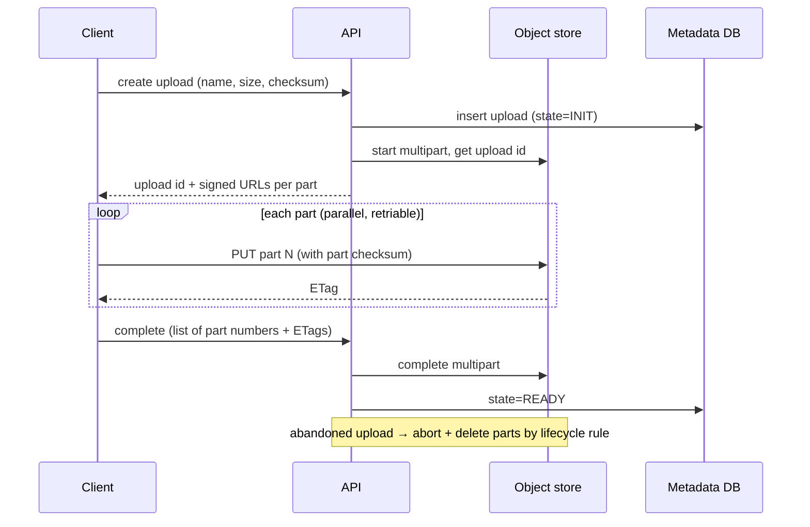

# Storage systems

## Purpose and activation

Match each kind of data to the storage type that fits its access pattern, size, durability
and cost, and design the upload/download/lifecycle paths so partial failures do not leave
corrupt or orphaned data. Activate for user uploads, media, documents, backups, logs
and archives, shared file systems, and VM or database volumes.

## Required inputs

Object sizes (median, max), count and growth, read/write ratio and access pattern
(sequential, random, whole-object, partial/range), required latency, sharing needs
(one machine or many), durability and retention requirements, compliance (region,
encryption, immutability), budget. Missing: assume objects up to a few GB, written once,
read often, retained for years.

## Workflow

1. **Classify each data set** by access pattern and mutation (immutable blob, mutable
   file, random-access volume). Fill the table in the decision framework.
2. **Pick the storage type** per data set (block / file / object) using the table.
3. **Separate metadata from bytes**: names, owners, permissions, status and search live in
   a database; bytes live in the store, addressed by an opaque key.
4. **Design the write path**: direct-to-storage upload with short-lived signed
   permissions for large files; multipart/resumable; verify integrity; commit metadata only
   after the object exists.
5. **Design the read path**: authorization, signed URLs or proxy, CDN for popular
   content, range requests for large files.
6. **Choose redundancy**: replication vs erasure coding, single zone vs multi-zone vs
   cross-region, and the failure each protects against.
7. **Choose tiers and lifecycle**: hot/warm/cold/archive transitions and expiry, based on
   measured access age.
8. **Protect against deletion and corruption**: versioning, soft delete, immutability
   locks, independent backups, checksums, restore tests.
9. **Estimate cost and capacity** (`requirements-capacity`): stored bytes × copies or
   overhead, request counts, egress.
10. **Write failure handling** for abandoned uploads, duplicate parts, orphan cleanup.

## Decision framework

### Block vs file vs object

| Type | Interface | Best for | Limits |
|---|---|---|---|
| Block | Raw volume attached to one host (or few); you add a file system | Databases, VM disks, low-latency random IO | One-host attachment typical, capacity/IOPS provisioned, you handle replication via the platform |
| File (network file system) | Hierarchical files, POSIX-like semantics, shared by many hosts | Shared content, home directories, lift-and-shift apps needing a file system | Metadata scalability and locking limits, higher cost than object |
| Object | Flat key → bytes + metadata over HTTP | Media, backups, logs, data lakes, static assets, user uploads | No in-place partial updates (replace the whole object), higher latency per request, per-key semantics only |

Default for user uploads, media and backups: **object storage with metadata in a database**.
Use block for database volumes, file for shared POSIX needs. The book covers all three at
printed p. 94-95 (TOC-anchored only).

### Redundancy: replication vs erasure coding

| | N-way replication | Erasure coding (k data + m parity shards) |
|---|---|---|
| Storage overhead | N× (3 copies = 3×) | (k + m) / k (for k=10, m=4 → 1.4×) |
| Failures tolerated | N − 1 copies lost | Any m shards lost |
| Read path | Read one copy | Read k shards (or reconstruct) |
| Repair cost | Copy one object | Read k shards to rebuild one: more network/IO |
| Small objects | Efficient | Poor (shard overhead); often replicate small, erasure-code large |
| Use | Hot data, low latency | Large, cold or warm data where cost dominates |

Formulae: overhead = (k + m) / k; tolerated shard losses = m; with placement on distinct
failure domains. Erasure coding is covered at printed p. 87-88 (TOC-anchored only).
Durability and availability differ: durability = probability data is not lost;
availability = probability you can access it now. Do not quote "nines" from memory -
use the provider's documented design figures and state the source and date. Replication
within one zone does not survive zone loss; cross-region replication does not protect
against a delete you replicate.

### Tiering

| Tier | Access | Typical rule |
|---|---|---|
| Hot | Frequent, low latency | Recently written or read |
| Warm / infrequent | Occasional | Not read for N days (set N from access logs) |
| Cold / archive | Rare, retrieval delay and fees | Retained for compliance or history |

Tier choice trades storage price for retrieval fees, minimum storage durations and
retrieval latency (check each provider). Use lifecycle rules to transition and expire.

## Architecture and implementation guidance

### Large-file upload (multipart / resumable)

Design points: choose part size to balance retries (small parts) against request count
(large parts); provider part-size and part-count limits exist - check current docs (for
example, AWS documents minimum part size and a maximum number of parts; VERIFY values).
Parts upload in parallel and retry independently; completion is atomic from the reader's
view. Compute and verify checksums end to end (client part checksums, store-side
verification, final object checksum). Use short-lived signed URLs scoped to one key and
operation; enforce size and content-type limits server-side; scan content if untrusted.
Track upload state in the metadata DB; clean abandoned multipart uploads with a lifecycle
rule or a reaper job (incomplete parts are billed).

### Object metadata

Keep authoritative metadata in a database keyed by object id; store the object key, size,
checksum, content type, owner, state (INIT/READY/DELETED), created time, version.
Object-store system metadata and tags are useful but limited and not queryable like a
database. Never use user-supplied file names as keys without sanitizing; prefer generated
ids plus a stored display name. Spread key prefixes only if the provider documents a need.

### Consistency (what object stores promise)

Fetched from AWS S3 documentation on 2026-10-14: S3 provides strong read-after-write
consistency for PUT (new and overwrite) and DELETE, and list operations reflect them;
updates to a single key are atomic (readers see old or new, never partial); there is **no
atomic update across keys** and **no locking for concurrent writers** (concurrent PUTs to
one key resolve as last-writer-wins by timestamp); bucket *configuration* changes are
eventually consistent (for example, after enabling versioning wait before writes). Other
providers and S3-compatible systems may differ: verify before depending on it. Design
consequence: to publish a multi-object set atomically, write the objects, then flip a
single manifest/pointer (key or database row) last.

### Durability and protection

- Versioning plus lifecycle expiry of old versions protects against overwrite/delete.
- Object lock (write-once-read-many) for compliance; protect the lock configuration.
- Independent backup: copy to another account/region with separate credentials; a replica
  that applies deletes is not a backup (`reliability-resilience`).
- Encrypt at rest with managed keys; restrict via bucket policies; block public access by
  default; log access.
- Verify checksums on read for critical data; run periodic integrity scrubbing for
  self-managed systems.

### Delivery

Put a CDN in front of public or widely read objects; use signed URLs/cookies for private
content; support range requests and resumable downloads; set cache headers to match mutation
(immutable content-addressed keys can be cached for long periods).

## Failure and edge cases

- Upload interrupted, client crash, or duplicate part: resume using stored state; parts
  are idempotent by part number; completion with wrong ETag list fails safely.
- Metadata row exists but object missing (or the reverse): reconcile with a periodic job;
  write order (object first, then metadata READY) leaves only orphan objects, which
  lifecycle/reaper clean.
- Concurrent overwrite of the same key: last writer wins; use unique keys + a pointer, or
  conditional writes where supported.
- Hot objects or prefixes overwhelming a single partition; use CDN and caching.
- Deletion by mistake or attacker: versioning, object lock, separate backup account.
- Erasure-coded repair storms after a node loss; throttle repairs.
- Cost surprises: egress, request counts, minimum storage duration, retrieval fees,
  lifecycle transition fees.
- Eventually consistent listing on systems that are not strongly consistent.
- Large directory listings in file systems; metadata server bottleneck.

## Validation

- Upload test matrix: sizes from empty to max, parallel/retry, killed client, duplicated
  completion, wrong checksum, expired URL.
- Chaos/restore: delete a version and restore; restore from the independent backup within
  the RTO; verify checksums of restored data.
- Cost model check: predicted monthly cost vs a pilot bill using real access logs.
- Metrics: upload success rate, incomplete uploads, orphan count, integrity-check
  failures, tier transition counts, egress per tier.
- Falsifier: any readable object whose checksum differs from the recorded one, or a restore
  that misses the RTO.

## Expected output

Storage-type table per data set; metadata schema; upload/download flow diagram; redundancy
and tier plan with overhead calculation; lifecycle rules; protection and restore plan;
cost estimate; failure table; ADR. Overhead math, part-size planning, lifecycle rules and a
metadata schema: [references/storage-worksheets.md](references/storage-worksheets.md).

## Sources and confidence

- Book (direct): none verified in the supplied text (large file upload p. 74-75; erasure coding p. 87-88; block/file/object storage p. 94-95; CDN p. 84) — TOC-anchored only
- Book (synthesized): metadata-in-database pattern combines the above with the database topics
- Modern: AWS S3 documentation, consistency model and storage-management features — fetched 2026-10-14; multipart limits and checksum algorithms — from author knowledge, VERIFY
- Needs workload validation: part size, tier thresholds, k and m parameters, restore times, cost
