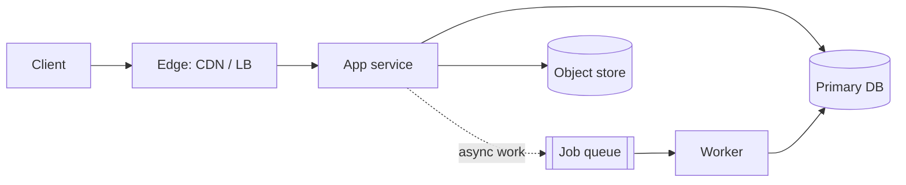

# System design coordinator

## Purpose and activation

Turn a vague "design / architect / scale this" request into a defensible architecture with
documented decisions. This skill owns the workflow and the final document. It delegates depth
to specialist skills **only when the problem needs them**; it never loads all of them.

Activate when the user wants a new architecture, a major redesign, or a design document.
Do not activate for: one narrow question (go straight to the specialist), reviewing an
existing design (`system-design-review`), or code-level bugs.

## Required inputs

- What the system does and for whom (one paragraph).
- Scale hints: users, traffic, data volume, growth. If missing, assume and label `ASSUMPTION:`.
- Hard constraints: consistency, compliance, budget, team size, existing platforms.

Ask at most 3 focused questions, and only those whose answer would change the architecture.
Otherwise state the assumption and continue.

## Workflow (do the steps in order; each names its output)

1. **Understand the problem** → boundary statement: in scope, out of scope, actors, external
   systems.
2. **Clarify requirements** → fill `assets/templates/requirements.md`. Mark every guess.
3. **Quantify the workload** → fill `assets/templates/capacity-worksheet.md` using
   `requirements-capacity`. Output: peak QPS, storage/year, bandwidth, latency budget,
   which resource runs out first.
4. **Identify architectural constraints** → consistency needs (what must never be wrong),
   availability target and its downtime budget, security/compliance, deployment model,
   operational maturity, budget.
5. **Propose the simplest viable baseline** → usually one deployable app, one relational
   database, object storage if files exist, a managed load balancer. State the number from
   step 3 at which this baseline fails. No distributed technology without a failing number
   or a hard requirement.
6. **Evaluate alternatives** → for each real choice (datastore, sync vs async, topology)
   use `assets/templates/technology-selection-matrix.md`; compare with advantages,
   disadvantages, operational cost, and "fails when".
7. **Design the architecture** → components, request paths, APIs, data model, storage; one
   Mermaid diagram minimum for anything beyond a single service plus database. Every box
   gets a one-line purpose tied to a requirement ID.
8. **Analyze failure modes** → for each dependency and arrow: slow, down, wrong, duplicated,
   out of order. Use `assets/templates/failure-analysis.md` with `reliability-resilience`.
9. **Design operations** → deployment strategy, SLIs/SLOs, alerts, backups and restore test,
   scaling triggers (metric + threshold), on-call story. Use
   `assets/templates/production-readiness-checklist.md`.
10. **Validate assumptions** → list the experiments that could falsify the design (load
    test, failover drill, query plan, spike), with the pass/fail number.
11. **Document decisions** → `assets/templates/system-design-document.md` plus one
    `assets/templates/adr.md` per significant choice. Include rejected alternatives,
    remaining risks, and revisit triggers.

## Decision framework: which specialist skills to load

Load a specialist only if its trigger is true for this problem.

| Trigger observed in steps 1–4 | Load |
|---|---|
| Needs numbers, SLO targets, or storage/QPS estimates | `requirements-capacity` (almost always) |
| Choosing monolith vs services, sync vs async, scaling plan | `architecture-scaling` |
| Public/internal API, DNS/CDN/load balancer, protocol choice | `api-networking` |
| Users, tenants, tokens, secrets, PII, payments | `identity-security` |
| More than one plausible datastore, or unclear data model | `database-selection` |
| Concurrent writers to the same data, replicas, multi-step workflows | `transactions-consistency` |
| Measured data/throughput beyond one primary, or HA failover design | `sharding-replication` |
| Read-heavy path, latency target, expensive queries | `caching-performance` |
| Background jobs, events, fan-out, integration with slow/external parties | `messaging-streaming` |
| User files, media, backups, logs archives | `storage-systems` |
| Release safety, schema migrations, zero downtime | `deployment-delivery` |
| Availability target ≥ 99.9% or critical dependencies | `reliability-resilience` |
| Anything running in production | `observability` (light touch) |
| Maps, nearby search, location tracking | `geospatial-design` |
| Money movement, ledgers, refunds | `payment-systems` (also load `identity-security`, `transactions-consistency`) |

Typical sets (illustrative): internal CRUD tool → requirements, database-selection only.
Public marketplace → add api-networking, identity-security, caching, messaging, payments.
Do not load a skill "just in case".

## Architecture and implementation guidance

- Prefer boring parts you can operate. A component is justified by a requirement ID or a
  measured number; record it in the component table of the design document.
- Separate concerns in the diagram: edge (DNS/CDN/LB), compute, data stores, async
  pipeline, third parties. Show trust boundaries and where data is authoritative.
- Name the source of truth for every datum and how copies (cache, search index, replica,
  warehouse) are refreshed and how stale they can be.
- Interfaces: for each boundary state protocol, idempotency behavior, timeout, retry rule,
  and compatibility policy.
- Mermaid starting point (replace content, keep one idea per diagram):

## Failure and edge cases (coordinator-level)

- Estimates wrong by ×10: say which component breaks first and how you would know.
- Requirement conflicts (strong consistency + multi-region active-active + low latency):
  surface the conflict and pick explicitly; do not hide it behind a buzzword.
- Skipping to step 7: designs drawn before numbers (step 3) tend to over- or under-build.
  If numbers are unavailable, produce a range and design for the upper bound's *shape*.
- Specialist outputs disagreeing: resolve in an ADR; the requirement priority decides.
- Retrofitting: if a system exists, switch to `system-design-review` first.

## Validation

Before finishing, check: every component maps to a requirement; every NFR has a number; the
baseline's breaking point is stated; every arrow has a failure behavior; there is a restore
and rollback story; each assumption has a test. List unchecked items as open risks.

## Expected output

1. System design document (`assets/templates/system-design-document.md`) containing
   requirements, capacity table, diagram, component table, data model, failure analysis,
   operations plan, risks.
2. ADRs for the 2–5 decisions that were hard to reverse or contested.
3. A "Validation plan" list. Keep the final answer shorter than the document: summary,
   diagram, top 3 risks, and where files were written.

Template guide: capacity numbers → `capacity-worksheet.md`; picking a technology →
`technology-selection-matrix.md`; schema work → `database-design-review.md`; failure
walkthrough → `failure-analysis.md`; auth/data protection → `security-architecture-checklist.md`;
monitoring/reliability → `observability-reliability-review.md`; go-live → `production-readiness-checklist.md`.
Provenance and corrections to the source book: `references/book-provenance.md`,
`references/modernization-notes.md`.

## Sources and confidence

- Book (direct): isolation levels (printed p. 4–5), SSO, passwords, HTTPS, API auth,
  orchestration vs choreography, deployment strategies (p. 11–17, 30–31, 35–39) — verified against supplied text
- Book (synthesized): the 11-step workflow combines scaling (p. 55–57) and estimation (p. 157–158) — TOC-anchored only
- Modern: none needed beyond specialist skills
- Needs workload validation: every number in the capacity worksheet
