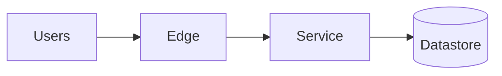

# System Design Document: <system name>

Status: draft | in review | approved   Owner: <name>   Date: <YYYY-MM-DD>
Instructions: delete guidance text in italics once a section is filled. Keep the document
under ~6 pages; link to the requirements, capacity worksheet and ADRs instead of pasting.

## 1. Summary

*Three sentences: what is built, the shape of the solution, the biggest risk.*

## 2. Goals, non-goals and requirements

- Goals / non-goals: ...
- Requirements: link to `requirements.md` (IDs F*, N*). Restate only the top five NFRs
  with numbers.

## 3. Workload and capacity

*Peak QPS, storage per year, bandwidth, latency budget, first resource to exhaust. Link to
the capacity worksheet. State the three assumptions that matter most.*

## 4. Baseline and why it is (not) enough

*Describe the simplest viable design and the number at which it fails.*

## 5. Proposed architecture

### 5.1 Component table

| Component | Purpose (requirement ID) | Technology (and alternative rejected) | Scaling mode | State / source of truth |
|---|---|---|---|---|
| Example: Order service | F1, N1 | Stateless app on managed containers (vs functions: cold-start p99) | horizontal, CPU-based | none |

### 5.2 Request and data flows

*One numbered flow per critical use case (write path, read path, background path).*

### 5.3 APIs and contracts

*Resources/operations, idempotency, error model, timeouts, versioning.*

### 5.4 Data model and storage

*Entities, keys, indexes, retention, consistency requirement per entity. Link to
`database-design-review.md`.*

## 6. Alternatives considered

| Decision | Chosen | Rejected | Why | ADR |
|---|---|---|---|---|

## 7. Failure modes and recovery

*Top failure scenarios from `failure-analysis.md`: trigger, blast radius, detection,
mitigation, residual risk. Include data-loss window (RPO) and recovery time (RTO).*

## 8. Security and privacy

*Trust boundaries, authN/authZ model, data classification, secrets, audit. Link to the
security checklist result.*

## 9. Operations

- Deployment strategy and rollback:
- SLIs/SLOs and alerts:
- Backups and restore test cadence:
- Scaling triggers (metric, threshold, action):
- Cost estimate at expected and 10× load:

## 10. Validation plan

| Assumption | Experiment | Pass/fail number | Owner | Date |
|---|---|---|---|---|

## 11. Risks and open questions

| Risk / question | Likelihood | Impact | Mitigation / owner |
|---|---|---|---|

## 12. Rollout plan

*Phases, feature flags, migration steps, success criteria for each phase.*
