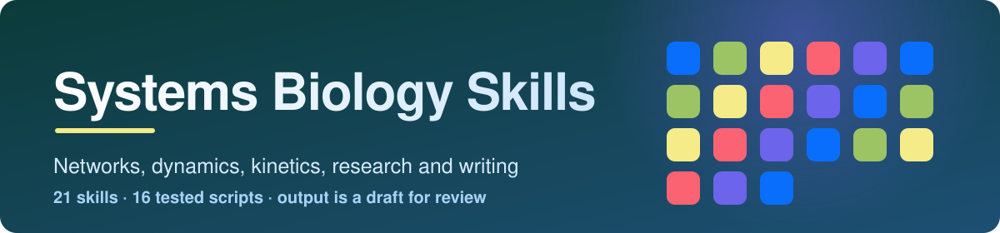

<p align="center">
  
</p>

<p align="center">
  
  
  
  
</p>

Twenty-one skills for modelling biological systems and for the research around the models: choosing a
formalism, writing assumptions, units and balances, network matrices and graphs, stoichiometric and
flux balance analysis, ODE dynamics and stability, control and feedback, enzyme kinetics,
pharmacokinetics, parameter estimation and model selection, stochastic and Boolean models, multivariate
omics, measurement and quantitative methods, model files and code, literature, research planning, paper
writing, model review, and learning the subject. Each skill states its question first and picks the
lightest model that can answer it. Every output is a draft for someone who knows the system: the skills
mark what is assumed, what is fitted and what is tested.

## Which one is for my tool?

| I use | Read | Install | Status |
|---|---|---|---|
| **Claude Code** | [`claude/`](claude/README.md) | `bash scripts/install.sh --claude --project DIR` | Works |
| **OpenAI Codex** | [`openai/`](openai/README.md#codex) | `bash scripts/install.sh --codex --project DIR` | Same folder format as the other collections; not run with Codex for this one |
| **ChatGPT desktop app** | [`openai/`](openai/README.md#chatgpt) | [21 zips](openai/chatgpt/) | Zips built; how the app takes them is not confirmed |
| **OpenAI Skills API** | [`openai/`](openai/README.md#openai-skills-api) | [21 zips](openai/chatgpt/) | Zips built to the documented format and limits |

Claude Code and Codex read the same files from [`skills/`](skills/). Nothing is copied per platform,
so there is one place to fix a skill. The zips are built from `skills/` and checked for being current.

## What is in this folder

```text
systems-biology-skills/
├── skills/     the 21 skills (SKILL.md plus references, scripts and templates)
├── claude/     Claude Code: install and use
├── openai/     OpenAI: Codex, ChatGPT and the Skills API, with chatgpt/ holding one zip per skill
├── prompts/    ready-to-paste prompts, one file per skill
├── scripts/    install.sh, build_chatgpt.py, validate_collection.py, check_routing.py, check_answers.py
├── evals/      test cases and measured results
├── examples/   a real answer per skill, with token counts
└── assets/     banner
```

## Skills

### Plan, design and learn

| Skill | Use it for | Prompts |
|---|---|---|
| [`systems-biology-workflow`](skills/systems-biology-workflow/) | The coordinator: the question as an observable, the lightest formalism that answers it, and which skill does each step | [5](prompts/systems-biology-workflow.md) |
| [`model-building-design`](skills/model-building-design/) | The modelling cycle, assumption register, variables versus parameters versus coefficients, model classes, well-posedness | [5](prompts/model-building-design.md) |
| [`systems-biology-learning-path`](skills/systems-biology-learning-path/) | A study plan from the workbook's prioritised checklist, 28 worked exercises with checkable answers, study strategies, flipped classroom | [5](prompts/systems-biology-learning-path.md) |

### Research and writing

| Skill | Use it for | Prompts |
|---|---|---|
| [`modeling-research-planning`](skills/modeling-research-planning/) | Aims that pair modelling with experiments, the model–experiment cycle, design for identifiability, measurement planned before data, a plan checker | [5](prompts/modeling-research-planning.md) |
| [`quantitative-research-methods`](skills/quantitative-research-methods/) | Construct maps, outcome spaces, CTT and Rasch, local independence, reliability and validity evidence, effect sizes, choosing among regression, multilevel, SEM and other methods | [5](prompts/quantitative-research-methods.md) |
| [`systems-biology-literature`](skills/systems-biology-literature/) | Searching papers, BioModels and parameter databases, reading a modelling paper critically, a citation checker for invented references | [5](prompts/systems-biology-literature.md) |
| [`modeling-paper-writing`](skills/modeling-paper-writing/) | Journal choice, authorship, a model description others can rebuild, section by section, abstract, cover letter, reviewer responses, rejection | [5](prompts/modeling-paper-writing.md) |
| [`model-review`](skills/model-review/) | A 12-dimension audit of a model or modelling paper with ranked findings and a rebuild attempt | [5](prompts/model-review.md) |

### Networks and matrices

| Skill | Use it for | Prompts |
|---|---|---|
| [`linear-algebra-networks`](skills/linear-algebra-networks/) | Matrix form, Gauss–Jordan, rank, Rouché–Capelli, determinants, inverses, LU, null spaces, eigenvalues, exactly | [5](prompts/linear-algebra-networks.md) |
| [`network-analysis`](skills/network-analysis/) | Adjacency and incidence matrices, hypergraphs, centrality, feed-forward loops, network medicine, provenance | [5](prompts/network-analysis.md) |
| [`stoichiometric-networks`](skills/stoichiometric-networks/) | Stoichiometric matrix, steady-state flux space, conservation relations, elementary flux modes, MFA determinacy | [5](prompts/stoichiometric-networks.md) |
| [`flux-balance-analysis`](skills/flux-balance-analysis/) | FBA with an exact simplex, flux variability, knockouts, pros and cons, genome-scale checks | [5](prompts/flux-balance-analysis.md) |

### Dynamics and kinetics

| Skill | Use it for | Prompts |
|---|---|---|
| [`quantities-units-balances`](skills/quantities-units-balances/) | Quantity calculus, unit conversion, dimensions, mass and amount balances, thermodynamic constraints, chemostat | [5](prompts/quantities-units-balances.md) |
| [`ode-dynamics`](skills/ode-dynamics/) | Simulation, steady states, Jacobian and stability classes, phase portraits, bistability, sensitivity | [5](prompts/ode-dynamics.md) |
| [`control-systems-feedback`](skills/control-systems-feedback/) | Block diagrams, state space, transfer functions, Routh–Hurwitz, controllability, observability, feedback and feed-forward | [5](prompts/control-systems-feedback.md) |
| [`enzyme-kinetics`](skills/enzyme-kinetics/) | Mass action, Michaelis–Menten and its assumptions, inhibition, Hill, nonlinear fitting instead of Lineweaver–Burk | [5](prompts/enzyme-kinetics.md) |
| [`pharmacokinetic-modeling`](skills/pharmacokinetic-modeling/) | One-compartment IV and oral PK, AUC, accumulation, Emax, links to QSP | [5](prompts/pharmacokinetic-modeling.md) |
| [`stochastic-discrete-models`](skills/stochastic-discrete-models/) | Gillespie simulation, noise, Boolean attractors, difference equations and the logistic map | [5](prompts/stochastic-discrete-models.md) |

### Data, statistics and code

| Skill | Use it for | Prompts |
|---|---|---|
| [`parameter-estimation-model-selection`](skills/parameter-estimation-model-selection/) | Error models, identifiability, AIC, AICc, BIC, Akaike weights, nested F-tests, defending an interpretation | [5](prompts/parameter-estimation-model-selection.md) |
| [`multivariate-omics`](skills/multivariate-omics/) | Centring and scaling, PCA, PLS regression, VIP, cross-validation and permutation, which multivariate method for which question | [5](prompts/multivariate-omics.md) |
| [`systems-biology-programming`](skills/systems-biology-programming/) | SBML, SED-ML, CellML, MIRIAM annotation, element and charge balance, MEMOTE, reproducible code | [5](prompts/systems-biology-programming.md) |

## How researchers would use them

- Turn "model this pathway" into a question about an observable, and pick a formalism that the data can constrain.
- Write the assumption register and unit table before the first simulation, and catch a factor of 1000 early.
- Get the flux space, conserved pools and elementary modes of a network exactly, and see which fluxes a set of measurements fixes.
- Simulate, find and classify steady states, and see which parameters the conclusions depend on.
- Fit rate laws and compare models with AICc, and find out which parameters the data cannot identify.
- Define what a score or readout measures, gather validity evidence, and choose a method that fits the design.
- Plan a grant around the model–experiment cycle; write, submit and defend the paper; review someone else's model.
- Learn the subject from the workbook's checklist with exercises you can check by running something.

## Install

Run from this folder. Install all 21 skills together: the coordinator hands work to the others.

```bash
bash scripts/install.sh --claude --project /path/to/your/repo   # Claude Code
bash scripts/install.sh --codex --project /path/to/your/repo    # OpenAI Codex
```

Add `--user` to install for every project on the machine, `--symlink` to link instead of copy,
`--force` to replace, or `--dry-run` to preview. Details: [`claude/`](claude/README.md) and
[`openai/`](openai/README.md).

## Scripts you can run

Each needs only Python 3.9 or later and has a `--selftest` with hand-computed values.

| Script | Skill | What it does |
|---|---|---|
| `linalg.py` | `linear-algebra-networks` | Exact RREF, rank, determinant, inverse, solve with Rouché–Capelli, null space, LU, eigenvalues |
| `graphs.py` | `network-analysis` | Adjacency and incidence matrices, centrality, shortest paths, feed-forward loops |
| `stoich.py` | `stoichiometric-networks` | Stoichiometric matrix, null spaces, conservation relations, elementary modes, MFA determinacy |
| `fba.py` | `flux-balance-analysis` | FBA, FVA and knockouts with an exact two-phase simplex |
| `ode.py` | `ode-dynamics` | RK4 and Euler simulation, steady states, Jacobian, stability, sensitivity |
| `control.py` | `control-systems-feedback` | Controllability, observability, Routh–Hurwitz, transfer functions, second-order response, feedback |
| `kinetics.py` | `enzyme-kinetics` | Rate laws and Levenberg–Marquardt fitting beside the Lineweaver–Burk estimate |
| `pk.py` | `pharmacokinetic-modeling` | IV and oral one-compartment PK, repeated dosing, AUC, Emax |
| `fitstats.py` | `parameter-estimation-model-selection` | AIC, AICc, BIC, Akaike weights, nested F-test |
| `discrete.py` | `stochastic-discrete-models` | Gillespie SSA, Boolean attractors, logistic map |
| `multivar.py` | `multivariate-omics` | PCA, PLS1 and VIP |
| `units.py` | `quantities-units-balances` | Unit conversion, dimensions, chemostat steady state |
| `measure.py` | `quantitative-research-methods` | Cronbach's alpha, Spearman–Brown, Cohen's d and Hedges' g, Rasch fit with Q3, missing patterns |
| `balance.py` | `systems-biology-programming` | Element and charge balance of reactions |
| `plancheck.py` | `modeling-research-planning` | Missing fields in a proposal plan, chained aims |
| `citecheck.py` | `systems-biology-literature` | DOI syntax, duplicates, Crossref lookup of title, year and author |

## Try it

Pick a skill's prompt file from [`prompts/`](prompts/README.md). Or run a script directly:

```bash
python3 skills/linear-algebra-networks/scripts/linalg.py solve "1,1;1,-1" --b "3,1"
python3 skills/control-systems-feedback/scripts/control.py routh "1,1,2,8"
python3 skills/enzyme-kinetics/scripts/kinetics.py rate competitive --S 2 --Vmax 10 --Km 1 --I 1 --Ki 0.5
python3 skills/pharmacokinetic-modeling/scripts/pk.py iv --dose 100 --V 20 --CL 5 --t 2
python3 skills/quantities-units-balances/scripts/units.py convert 1e6 "1/(M*s)" --to "1/(uM*s)"
python3 skills/quantitative-research-methods/scripts/measure.py sb --r 0.7 --factor 2
```

<!-- samples:start -->

## Sample outputs and token cost

Every skill has one real answer in [`examples/`](examples/), with the prompt that produced it. The table has the numbers behind those answers: means over 3 runs with the skills installed and 3 without (Claude Code 2.1.296, model claude-opus-5-5). **Output tokens** is what the model wrote, including its reasoning. **Extra input tokens** is how many more tokens the model read across all turns when the skills were installed (the skill text it loaded, reference files, script output and extra turns); the large base context is the same in both arms and is left out. **Skill size** is Claude Code's own projected cost from `claude plugin details`: the first figure is in every session for every installed skill (its name and description), the second only when the skill is used. When the skill was not invoked in a run, the extra is only the descriptions of the installed skills, so the smallest figure in the table is the cost of having the collection installed. More tokens is not a defect by itself; what the tokens buy is in [`evals/`](evals/).

| Skill | Output tokens, no skill to skill | Extra input tokens | Cost, no skill to skill (US dollars) | Skill size, always / when used | Sample |
|---|---|---|---|---|---|
| `control-systems-feedback` | 878 to 1,087 | +6,008 | 0.08 to 0.13 | ~310 / ~1,900 | [answer](examples/control-systems-feedback.md) |
| `enzyme-kinetics` | 2,710 to 3,193 | +134,011 | 0.15 to 0.25 | ~280 / ~1,600 | [answer](examples/enzyme-kinetics.md) |
| `flux-balance-analysis` | 2,332 to 2,302 | +97,253 | 0.13 to 0.21 | ~270 / ~1,700 | [answer](examples/flux-balance-analysis.md) |
| `linear-algebra-networks` | 560 to 801 | +6,013 | 0.07 to 0.12 | ~290 / ~1,700 | [answer](examples/linear-algebra-networks.md) |
| `model-building-design` | 2,608 to 3,964 | +83,820 | 0.11 to 0.22 | ~250 / ~2,000 | [answer](examples/model-building-design.md) |
| `model-review` | 2,500 to 3,392 | +44,195 | 0.11 to 0.20 | ~290 / ~1,600 | [answer](examples/model-review.md) |
| `modeling-paper-writing` | 6,739 to 6,765 | +61,956 | 0.26 to 0.33 | ~340 / ~2,000 | [answer](examples/modeling-paper-writing.md) |
| `modeling-research-planning` | 2,635 to 7,536 | +221,022 | 0.21 to 0.82 | ~300 / ~1,900 | [answer](examples/modeling-research-planning.md) |
| `multivariate-omics` | 2,112 to 2,670 | +106,218 | 0.11 to 0.22 | ~300 / ~1,900 | [answer](examples/multivariate-omics.md) |
| `network-analysis` | 2,280 to 2,890 | +151,333 | 0.13 to 0.24 | ~280 / ~1,800 | [answer](examples/network-analysis.md) |
| `ode-dynamics` | 1,163 to 1,252 | +6,010 | 0.08 to 0.13 | ~320 / ~1,800 | [answer](examples/ode-dynamics.md) |
| `parameter-estimation-model-selection` | 2,027 to 2,086 | +6,005 | 0.10 to 0.15 | ~290 / ~1,900 | [answer](examples/parameter-estimation-model-selection.md) |
| `pharmacokinetic-modeling` | 487 to 505 | +6,008 | 0.07 to 0.12 | ~280 / ~1,600 | [answer](examples/pharmacokinetic-modeling.md) |
| `quantitative-research-methods` | 2,485 to 3,028 | +6,004 | 0.11 to 0.17 | ~340 / ~3,300 | [answer](examples/quantitative-research-methods.md) |
| `quantities-units-balances` | 771 to 926 | +6,004 | 0.08 to 0.13 | ~260 / ~1,700 | [answer](examples/quantities-units-balances.md) |
| `stochastic-discrete-models` | 2,856 to 2,714 | +64,438 | 0.16 to 0.24 | ~290 / ~1,700 | [answer](examples/stochastic-discrete-models.md) |
| `stoichiometric-networks` | 1,517 to 1,605 | +6,009 | 0.09 to 0.14 | ~290 / ~1,900 | [answer](examples/stoichiometric-networks.md) |
| `systems-biology-learning-path` | 3,116 to 3,330 | +115,363 | 0.12 to 0.25 | ~330 / ~1,900 | [answer](examples/systems-biology-learning-path.md) |
| `systems-biology-literature` | 3,041 to 4,880 | +135,200 | 0.14 to 0.29 | ~300 / ~1,700 | [answer](examples/systems-biology-literature.md) |
| `systems-biology-programming` | 811 to 1,010 | +6,007 | 0.08 to 0.13 | ~290 / ~1,700 | [answer](examples/systems-biology-programming.md) |
| `systems-biology-workflow` | 2,192 to 2,134 | +44,856 | 0.10 to 0.18 | ~240 / ~2,100 | [answer](examples/systems-biology-workflow.md) |

### One answer in full: `model-review`

Prompt:

> Review this model as a referee: an ODE model of a metabolic pathway, 30 parameters, fitted to one time course, claims to explain why a mutant accumulates an intermediate. Parameters are in a table without units. No model file is provided.

Answer with the skill (excerpt of a single run; the same prompt without the skill is on the [sample page](examples/model-review.md)):

````text
# Referee report: ODE model of a metabolic pathway explaining intermediate accumulation in a mutant

**Scope.** I reviewed the paper as you described it: a 30-parameter ODE model, fitted to one time course, a parameter table without units, and no model file. I couldn't recompute anything or rebuild the model, because no equations, values or files were provided. That gap is itself a major finding (M4). The points below are what I'd raise with the authors, and what I'd check once they send the material.

## Summary of the claim

The authors say their pathway model explains why a mutant builds up an intermediate. This only becomes a mechanistic claim if the model (a) predicts the build-up from a stated change, such as lower activity of the downstream enzyme, that was not tuned to the mutant data, and (b) does better than other plausible explanations. As described, the manuscript shows neither.

## Major issues

**M1. 30 parameters from one time course are almost certainly unidentifiable.**
- **Problem:** A single time course, even with several species at 10–20 time points, cannot constrain 30 parameters. Many combinations, such as Vmax/Km ratios and production and consumption rates that trade off against each other, will fit equally well.
- **Why it matters:** If the parameters that control the intermediate are among the unidentifiable ones, the mechanism is not supported. The data would fit equally well with very different values.
- **What would resolve it:**
  - Report the number of data points against the number of parameters, and run a structural identifiability check (e.g. DAISY, StructuralIdentifiability.jl, or a GenSSI-type analysis).
  - Report profile likelihoods for every fitted parameter, or at least for those the claim depends on.
  - Fix parameters that have literature values (BRENDA, SABIO-RK, with sources) and fit only the rest.
  - Report confidence intervals, not point estimates.

[... excerpt ends; the full answer is longer]
````

<!-- samples:end -->

## Check it

```bash
python3 scripts/validate_collection.py          # structure, links, prompts, script self-tests, bundles current, evaluation cases
python3 scripts/check_answers.py                # exercises and good-answer lines against the scripts
python3 scripts/check_routing.py                # description routing for the starter prompts
python3 scripts/build_chatgpt.py --fresh        # zips are valid and match the skills
skills-ref validate skills/<name>               # official Agent Skills validator
claude plugin validate skills                   # Claude Code's own check of the skill files
python3 ../tools/run_evals.py plan .            # evaluation cases; live runs spend API credit, see TESTING.md
```

Last run, 2026-10-15: the collection validator reports 0 errors on Python 3.9 and 3.14 (21 skills, 16
scripts), including the navigation, prompt, bundle and evaluation-case checks; the script self-tests pass (372
hand-computed checks); `skills-ref` accepts all 21 skills and all 21 zips; `claude plugin validate` accepts the
skills; markdownlint reports 0 issues; 86 answer checks pass (28 worked exercises and 58 good-answer lines); and
all 21 starter prompts route to their own skill. Routing is a word-match check, not a model of how an agent picks a
skill.

The scripts were also checked against independent libraries on random inputs: 4,650 comparisons with NumPy, SciPy,
scikit-learn and networkx (PCA and PLS, the F tail and incomplete beta, AIC, RK4 against the matrix exponential
and `solve_ivp`, Jacobians and eigenvalues, betweenness, closeness and feed-forward loops, Michaelis–Menten
fitting, Routh–Hurwitz against polynomial roots, oral PK against an ODE solver, AUC, null-space dimensions and
elementary-mode properties, Cronbach's alpha and Cohen's d, Boolean attractors) and 600 controllability and
observability ranks. The only disagreement was one Michaelis–Menten fit where SciPy's default tolerance stopped
early; with a tight tolerance the two agree to 1e-7 in 300 fits and this script never has the larger residual.
A mutation test that changed the scripts' working code in 568 random places (comparisons, arithmetic operators,
constants) was caught 424 times (75 percent). Most of the 144 that survived change a numerical tolerance, an
iteration limit, a starting value, an unused default or a boundary no input reaches. The test also found real
gaps, which were closed with new hand-computed cases, and two bugs, both fixed: undirected graphs printed a
meaningless in-degree column, and the micro prefix was accepted on hours ("µh").

### Measured results

How an agent actually behaves with these skills, measured by [`tools/run_evals.py`](../tools/run_evals.py). Method,
limits and the commands are in [TESTING.md](../TESTING.md); the full tables are in [`evals/results/`](evals/results/).

<!-- results:start -->

#### Outcome runs: starter prompts with and without the skills

Share of runs passing each check, with Wilson 95% intervals; the last column is the difference in percentage points with a Newcombe interval. Rubric and limits are judged by a model.

| Collection | Skills | Runs per arm | Facts: skills / none | Rubric: skills / none | Rubric difference | Limits: skills / none | Expected skill invoked |
|---|---|---|---|---|---|---|---|
| systems-biology-skills | 21 | 63 / 63 | 94% (85-98) / 78% (66-86) | 90% (81-96) / 60% (48-71) | +30 (+15 to +44) | 27% (18-39) / 21% (12-32) | 56% (43-67) |

#### Tokens and cost per run (means)

| Collection | Output tokens: skills / none | Input tokens read: skills / none | Cost, US dollars: skills / none | Runs with a denied tool call: skills / none |
|---|---|---|---|---|
| systems-biology-skills | 2,765 / 2,182 | 116,882 / 54,324 | 0.223 / 0.119 | 0 / 0 |

#### Trigger runs: does the agent pick the right skill

| Collection | Should-trigger runs hit (recall) | Near-miss runs correctly left alone (specificity) | Precision | Unrelated prompts that triggered a skill |
|---|---|---|---|---|
| systems-biology-skills | 73% (61-82) | 100% (94-100) | 100% (92-100) | 0 of 6 |

Human grading: the blind kit is built (`run_evals.py sheet`) but no person has graded any answers yet, so none of the judged results above has been checked against human preference.

<!-- results:end -->

## Sources

The skills are built on the topics of the workbook cited below. Only its introduction and learning
checklist were available when the skills were written, so where a skill goes beyond the checklist's topic
list it says so and marks the claims to check. The research skills also draw on two further sources,
paraphrased and not quoted:

- Teo, T. (Ed.) 2013. *Handbook of Quantitative Methods for Educational Research*. Rotterdam: Sense
  Publishers. DOI 10.1007/978-94-6209-404-8. In particular Wilson, M. and Gochyyev, P., "Psychometrics",
  pp. 3–30, DOI 10.1007/978-94-6209-404-8_1 (`quantitative-research-methods`, `modeling-research-planning`,
  `model-review`, `parameter-estimation-model-selection`, `multivariate-omics`).
- Baker, P. N. 2012. "How to write your first paper". *Obstetrics, Gynaecology and Reproductive Medicine*
  22(3): 81–82. DOI 10.1016/j.ogrm.2011.12.003 (`modeling-paper-writing`).

## Contribute

See [CONTRIBUTING.md](../CONTRIBUTING.md). Add a script only with a self-test that uses hand-computed
values or an independent cross-check, and check that the test can fail.

## License

Apache-2.0

## Citation

Sauter, Thomas, and Marco Albrecht. 2023. *Introduction to Systems Biology: Workbook for Flipped-Classroom
Teaching*. Cambridge: Open Book Publishers. DOI 10.11647/OBP.0291. CC BY-NC 4.0.
